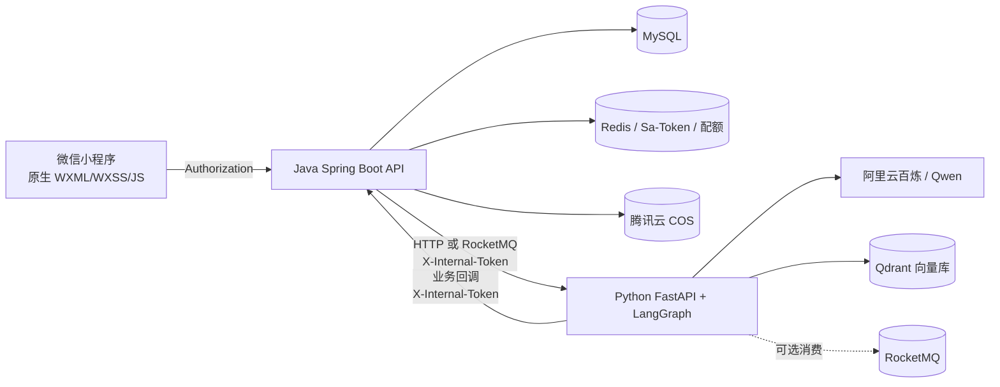

# FaFa 项目指南（Codex 开发上下文）

> 用途：作为后续 Codex 会话的项目上下文入口，帮助理解 FaFa 宠物生活小程序、Java 后端、Python AI 服务、产品文档、UI 原型与部署关系。
>
> 维护方式：本文描述当前仓库的架构和约定。代码、迁移脚本、`app.json`、配置模板若已发生变化，应先核验实际内容，再更新本文。最后核验日期：2026-10-09。

## 1. 给 Codex 的开始指引

处理本仓库任务时，按以下顺序获取上下文：

1. 先检查仓库根目录的 `AGENTS.md`、相关子目录的 `AGENTS.md` 和 `.agent/development-guidelines.md`；这些文件若存在，应遵循其中适用于当前任务的规则。
2. 阅读本文对应章节，再阅读目标功能的产品文档、Java/Python 实现、小程序页面与服务、相关数据库迁移及原型页面。
3. 修改前检查 `git status` 和目标文件现状。仓库可能已有用户未提交的修改，保留这些修改，只处理当前任务所需范围。
4. 以当前实现和迁移为准核对文档中的接口、字段、状态与路径。产品文档和架构分析可能落后于代码；发现差异时，先说明或按任务范围同步文档。
5. 不在小程序中放置服务器凭证、云厂商密钥、模型密钥或内部服务令牌。不得读取、复制或回显 `.env`、`.env.*.local`、密钥文件或含密钥的历史配置；需要配置时使用示例模板和环境变量名。
6. 未经用户明确要求，不要启动部署、覆盖服务器已有服务、修改生产数据或执行有破坏性的数据库操作。修改服务端部署时先阅读根目录 `DEPLOYMENT.md` 和 `docker-compose.apps.yml`。
7. 修改微信小程序时核对 `fafa-miniapp/app.json`、项目配置和 `fafa-miniapp/config.js`；路由以 `app.json` 为准，接口地址和接口参数配置集中在 `config.js`。发布环境的 request/upload 域名必须满足微信公众平台的 HTTPS 域名校验要求。

### 信息优先级

遇到冲突时，依次核验：用户当前要求与项目局部指引 → 当前源代码、数据库迁移、自动化配置 → 对应产品文档 → `docs/project-analysis.md` 与本指南 → README、原型注释及归档材料。原型主要说明视觉和交互，不代表接口、权限或数据已实现。

## 2. 产品与系统概览

FaFa 是面向宠物及宠物主的微信小程序，核心能力包括宠物档案、日常照护、喂养、食品知识、健康医疗、提醒与成长时间线、照片素材、AI 问答和报告、家庭协作、紧急卡片、消费记录与会员配额。

仓库包含三个协同模块：

| 模块 | 目录 | 主要职责 |
| --- | --- | --- |
| 微信小程序 | `fafa-miniapp/` | 用户界面、页面导航、微信登录、后端 API 请求、图片上传与隐私授权 |
| Java 服务 | `fafa-java/` | 用户/宠物业务、授权与数据持久化、配额、事务、AI 任务编排、统一 API |
| Python AI 服务 | `fafa-python/` | LangGraph AI Agent、Qwen 模型调用、宠物/照片向量处理、AI 内容生成 |

Java 是业务事实源：用户权限、宠物归属、业务状态、配额和最终数据以 Java/MySQL 校验及写入为准。Python 负责模型能力与 AI 处理，不应绕过 Java 改业务数据。微信小程序只访问 Java 公共 API，不直接访问 MySQL、Redis、Qdrant、COS 私有凭证或 Python 内部 API。



生产请求流通常是：小程序 → Java → Python AI 服务 → Qwen/向量服务；AI 处理结果通过受保护回调通知 Java，由 Java 校验状态、权限并更新业务数据。当前 Docker 应用部署采用 Java HTTP 调用 Python 的模式；如有改动，应以实际部署配置为准。

## 3. 仓库目录与模块边界

```text
FaFa/
├─ docs/
│  ├─ project-analysis.md              # 架构和代码现状分析
│  ├─ 小程序开发规划.md                 # 小程序实施规划
│  ├─ product/                         # 产品需求与业务规则（00–12）
│  └─ dev/                             # 开发与功能说明
├─ fafa-app-design/                    # 当前 UI 设计原型（HTML/CSS/SVG）
├─ fafa-app-design-archive/            # 历史设计归档，不作为当前视觉基线
├─ fafa-miniapp/                       # 原生微信小程序
├─ fafa-java/                          # Spring Boot 后端
├─ fafa-python/                        # FastAPI / LangGraph AI 服务
├─ docker-compose.apps.yml             # 应用服务 Compose 配置
├─ DEPLOYMENT.md                       # 应用部署和运维流程
└─ .agent/development-guidelines.md    # 仓库开发规范（如存在）
```

### Java 分层

主代码位于 `fafa-java/src/main/java/com/fafa/`：

| 包 | 职责 | 依赖方向 |
| --- | --- | --- |
| `interfaces/` | REST Controller、请求/响应 DTO、Assembler、Web 适配 | 调用 `application/` |
| `application/` | 用例服务、Command/DTO、端口、消息订阅和应用编排 | 调用 `domain/`，依赖抽象端口 |
| `domain/` | 聚合、实体、值对象、领域服务、仓储接口、领域事件 | 不依赖 Spring、数据库或外部 SDK |
| `infrastructure/` | MyBatis 持久化、仓储实现、外部 AI/OSS/微信客户端、配置、安全、MQ、调度 | 实现应用/领域定义的端口 |
| `common/` | 通用结果、异常、工具和跨模块基础能力 | 被其他层使用，避免堆业务逻辑 |

调用主链路为 `Controller → Application Service → Domain → Repository Port → Infrastructure Adapter`。Controller 做 HTTP/DTO 转换与参数校验，不承载业务规则；领域层不能依赖接口层和基础设施层。跨服务调用、消息发布、对象存储等 I/O 通过端口/网关抽象，并在合适的事务边界（例如事务提交后）执行。

Java 使用 Spring Boot 3.5.x、Java 21、Maven 单模块；持久化使用 MyBatis-Plus 与 MySQL，迁移由 Flyway 管理；鉴权采用 Sa-Token，Redis 提供会话/缓存/限流或配额等能力。版本以 `fafa-java/pom.xml` 为准。

### Python 模块

主代码位于 `fafa-python/app/`：

| 目录 | 职责 |
| --- | --- |
| `api/` | FastAPI 路由和 HTTP 边界；目前包括 health、photos、pets、vector、chat、record、medical、foods、reports、content 等路由 |
| `agent/` | LangGraph Agent、节点、工具和 AI 工作流 |
| `service/` | AI 任务、向量化及业务协作服务 |
| `schemas/` | Pydantic 请求、响应与内部数据结构 |
| `core/` | 配置、日志、认证和基础设施初始化 |
| `consumer/` | 可选 RocketMQ 消费者 |

入口为 `fafa-python/main.py`。Python 的 FastAPI + LangGraph 调用阿里云 Qwen；向量搜索由 Qdrant 支持。模块命名会变化，增加新功能前请读取入口路由及现有相似模块。

### 微信小程序模块

`fafa-miniapp/` 是原生微信小程序，没有 Vue/React/跨端框架。根目录 `project.config.json` 配置小程序根目录为 `fafa-miniapp/`。

| 目录/文件 | 职责 |
| --- | --- |
| `app.json` | 主包、分包、全局窗口、tabBar、隐私检查配置；路由清单来源 |
| `config.js` | 环境、API 基址、端点、请求超时、分页、鉴权头、存储键、上传限制等集中配置 |
| `pages/` | 主包页面：登录、首页、相册、问问、我的 |
| `packages/` | 按业务拆分的分包页面 |
| `services/` | 按业务域封装 Java API，不在页面散落请求 URL |
| `features/` | 页面功能声明、动作及数据配置 |
| `components/` | 可复用组件（包括通用功能视图） |
| `custom-tab-bar/` | 自定义底部导航 |
| `styles/` | 全局设计 token、主题与共用样式 |
| `utils/` | request、存储、隐私、上传等通用能力 |
| `images/` | 项目图片资源 |

请求统一经过 `utils/request.js`，处理 API 基址、查询参数、`Authorization`、Java `Result<T>` 解包、401 会话失效和上传响应。新的业务 API 优先放到相应 `services/` 域模块，再由页面调用。

## 4. 页面清单与路由规划

主包页面和底部导航定义在 `fafa-miniapp/app.json`。tabBar 四个入口是首页、相册、问问、我的；登录页不属于 tabBar。页面文件路径由 `app.json` 的主包 `pages` 和 `subpackages` 共同组成。

| 分包 | 页面路径（相对于分包根目录） | 功能 |
| --- | --- | --- |
| 主包 | `pages/login/index` | 微信登录/会话入口 |
| 主包 | `pages/home/index` | 首页、宠物与日常概览 |
| 主包 | `pages/album/index` | 相册入口 |
| 主包 | `pages/chat/index` | AI 问答入口 |
| 主包 | `pages/me/index` | 我的与个人中心入口 |
| `packages/pet` | `pages/list/index`、`pages/create/index`、`pages/detail/index`、`pages/tags/index` | 宠物列表、创建、档案、标签 |
| `packages/daily` | `pages/checkin/index`、`pages/history/index`、`pages/weight-record/index`、`pages/weight-trend/index` | 日常打卡、记录历史、体重录入与趋势 |
| `packages/feeding` | `pages/today/index`、`pages/plan-list/index`、`pages/plan-create/index`、`pages/analysis/index`、`pages/food-library/index`、`pages/food-detail/index`、`pages/food-recognition/index`、`pages/food-transition/index` | 喂养计划/记录/分析、食品库、识别与换粮 |
| `packages/media` | `pages/upload/index`、`pages/photo-detail/index`、`pages/search/index` | 图片上传、素材详情与语义搜索 |
| `packages/medical` | `pages/records/index`、`pages/create/index`、`pages/medication/index`、`pages/alerts/index`、`pages/reminder-center/index`、`pages/reminder-create/index`、`pages/timeline/index`、`pages/summary/index` | 就诊、用药、健康预警、提醒、时间线与摘要 |
| `packages/biz` | `pages/reports/index`、`pages/report-detail/index`、`pages/family/index`、`pages/expense-book/index`、`pages/expense-create/index`、`pages/membership/index`、`pages/profile/index`、`pages/emergency/index`、`pages/invitation-accept/index`、`pages/content-drafts/index`、`pages/content-edit/index`、`pages/content-schedule/index` | AI 报告、协作、记账、会员、个人资料、紧急卡片与内容管理 |

使用 `wx.navigateTo`/`wx.redirectTo` 时必须使用完整路由路径；tabBar 页面使用 `wx.switchTab`。新增页面时同步检查页面文件、`app.json` 分包声明、导航入口、权限与空/加载/失败状态。平台包体限制要求业务页面按需放入分包；不要把分包页面误写进主包路径。

## 5. 产品模块与代码映射

产品规则以 `docs/product/` 对应文档为准，表中 Java 控制器名表示优先检查的位置，实际 API path 以 Controller 注解为准。

| 业务域 | 产品文档 | Java 入口（主要控制器） | Python/小程序线索 |
| --- | --- | --- | --- |
| 登录、用户 | `01-登录与用户.md` | `AuthController`、`UserController` | `pages/login`、`pages/me`；微信登录由 Java 处理 |
| 宠物档案、标签 | `02-宠物档案与标签.md` | `PetController`、`TagController` | `packages/pet`；AI 宠物处理见 Python `pets.py` |
| 日常记录、体重 | `03-日常记录与体重.md` | `DailyRecordController`、`WeightRecordController` | `packages/daily`、Python `record.py` |
| 喂养 | `04-喂养管理.md` | `FeedingPlanController`、`FeedingRecordController`、`FeedingAnalysisController` | `packages/feeding` |
| 食品知识、识别、安全与换粮 | `05-食品知识库.md` | `FoodCardController`、`FoodRecognitionController`、`FoodSafetyScoreController`、`FoodTransitionController` | `packages/feeding`、Python `foods.py` |
| 医疗、用药、预警 | `06-医疗健康.md` | `MedicalController`、`HealthAlertController` | `packages/medical`、Python `medical.py` |
| 提醒、事件、时间线 | `07-提醒与成长时间线.md` | `ReminderController`、`EventRecordController` | `packages/medical` |
| 图片与相册 | `08-素材与相册.md` | `PhotoController` | `pages/album`、`packages/media`、Python `photos.py`/`vector.py` |
| AI 助手、报告、内容 | `09-AI助手与内容报告.md` | `ChatController`、`ReportController`、`ContentDraftController`、`ContentScheduleController` | `pages/chat`、`packages/biz`、Python `chat.py`/`reports.py`/`content.py` |
| 家庭协作、紧急卡片 | `10-家庭协作与权限.md` | `PetCollaborationController`、`PetInvitationController`、`EmergencyCardController` | `packages/biz` |
| 消费记账 | `11-消费记账.md` | `ExpenseController` | `packages/biz` |
| 会员与配额 | `12-会员与配额.md` | `QuotaController` | `packages/biz`；会员支付能力需以当前实现为准 |
| Python 内部查询、回调、健康检查 | 架构/模块文档 | `InternalAiQueryController`、`CallbackController`、`PingController` | Python `health.py` 与内部服务调用 |
| 审计与访问记录 | 架构文档 | `AccessAuditController` | 按任务核验用途与保护策略 |

当前 Java controller 还包括以上列出的各域入口，总量约 31 个、API 面约 170+ 个。不要根据该数字推断某个接口存在；用 Controller 注解、DTO、服务实现和 API 文档确认具体契约。

## 6. 接口、认证与服务间通信

### 小程序 → Java

- 微信用户登录入口位于 `/auth`；用户接口位于 `/user`。其余面向小程序的业务 API 通常位于 `/api/**`，具体以 Controller 路由为准。
- 登录后小程序在统一请求层附加 `Authorization`，服务端由 Sa-Token 处理会话。会话和头字段的具体格式应以 `config.js`、`utils/request.js` 与 Java 安全配置为准。
- Java 使用统一 `Result<T>` 响应结构；成功码当前约定为 `0`。小程序 request 工具负责解包。错误码、分页包装或上传响应如与该约定不同，应沿用实际接口的明确契约。
- `/auth/wechat/login`、健康探测、平台回调、内部服务、Actuator 与 API 文档等存在安全白名单或专门的认证规则；不要随意扩大匿名白名单。

### Java ↔ Python

- Python 的 `/api/**` 面向内部 AI/处理服务，并由内部令牌保护；不能从小程序直接调用。
- Java 调用 Python 与 Python 回调 Java 使用独立的 `X-Internal-Token`。回调包括照片分析、宠物向量化等任务结果；应核验 `CallbackController` 和 Python 发起端的实际 path、请求字段和重试策略。
- 内部调用会传递 trace id（如 `X-Trace-Id`）以便串联日志。不得把内部令牌放进小程序配置或返回给客户端。
- Java 内部 AI 查询控制器面向 Python，通常只提供经过权限校验的数据；新增查询需要再次验证用户是否拥有/可访问对应宠物或资源。
- AI 派发当前可通过 HTTP 或消息队列编排，部署默认配置见 `docker-compose.apps.yml` 和 Python 配置模板。处理异步任务要考虑任务状态、幂等、超时、重试、失败补偿与事务提交时序。

### 文件上传与对象存储

小程序调用 Java 的上传/签名接口或业务接口；Java 使用对象存储适配器访问 COS。应用存储配置当前为 COS，但配置字段及上传实现必须以 `fafa-java` 当前配置类和客户端实现为准。仅公开明确允许公开读取的对象；不要把 COS SecretId/SecretKey 编译进小程序，也不要因桶策略调整而扩大公开权限。AI 视频处理可能使用限时访问 URL，必须检查过期时间和权限。

## 7. 核心业务约束

实现相关功能前，阅读对应领域服务和产品文档。以下是当前分析记录的高影响约束，若代码已经演进，以代码和测试为准：

- **宠物档案**：新建宠物流程要求三张档案照片/槽位；同一用户不允许多个有效宠物重名。权限检查以服务器端家庭关系为准。
- **宠物向量化**：状态典型流程为 `PENDING → COMPLETED/FAILED`；晚到的失败回调不能把已完成任务降级。异步回调应幂等。
- **日常状态**：打卡字段会按宠物种类区分，不要把猫狗数据项硬编码为完全相同的表单。体重与日常记录保持时间和宠物维度一致。
- **提醒与健康记录**：由提醒完成触发的历史/事件/用药记录要遵守事务一致性。用药计划和医疗记录拥有相应提醒；创建医疗费用时注意与就诊的事务一致性。
- **医疗和费用**：由医疗流程自动生成的费用有来源关联，避免重复记账；已完成的历史/审计记录通常是追加式，不应静默覆盖。
- **配额**：AI、食品识别、报告/内容、宠物数、相册容量等存在免费与会员额度。扣减失败需要按事务或补偿规则恢复，所有配额以服务端计算为准，不信任客户端传入值。
- **媒体语义搜索**：Qdrant 搜索结果需经过 MySQL 当前存在性、删除状态、所属用户/宠物与协作权限复筛；向量库不作为业务权限事实源。
- **家庭权限**：Owner、Member、Caregiver 的能力不同；每个 API 都应服务端再次校验。协作功能可能受功能开关控制。
- **AI 安全**：模型内容是建议，不是诊断或认证。食品安全分值不是官方认证；医疗和健康内容需保留适当提示，并由规则/人工场景兜底。
- **会员/支付**：当前仓库存在开发阶段能力与会员配额设计；确认微信支付闭环、回调验签、退款、订阅消息等是否真实实现，不得把开发授权接口当作可上线支付。

## 8. 数据库与迁移

- Java 数据库使用 MySQL；Flyway 迁移位于 `fafa-java/src/main/resources/db/migration/`。历史迁移链从 `V1.1` 起步，到本指南编写时分析记录为 `V12`；每次改动前先列出现有迁移并看生产部署基线，不要按本文版本号推测数据库状态。
- 已部署环境通过 Flyway 管理 schema。新增表/列/索引/约束应追加新的版本迁移，禁止修改已在共享或生产环境执行过的历史迁移。
- 持久化通常由 PO/Mapper/Repository Adapter 完成；业务状态和领域规则不要放进 SQL Mapper 或 Controller。
- 检查软删除、唯一约束、时区、金额精度、并发更新和索引。关键数据外键/唯一约束与代码校验应协调设计。
- 生产数据操作需先确认备份、目标环境、影响范围和回滚方案；不要从开发文档直接复制 SQL 到生产。

## 9. 配置、依赖与部署

### 服务配置

配置通过环境变量、Spring profile/Pydantic Settings 和 Docker Compose 注入。仓库提供示例配置模板；真实 `.env`、`.env.*.local` 应保持本地忽略，不得提交到 Git。模型 Key、COS 密钥、微信 AppSecret、内部 Token、数据库密码、SSH 私钥/密码均属于机密，不写入本文、代码、日志、截图或小程序包。

### 当前服务关系（部署前重新核实）

本项目应用部署目录由项目负责人指定，之前使用 `/home/busizeshi/docker/fafa-app`，并加入服务器已有的 `docker_fafa-network`。Java 容器内部监听 Spring Boot 默认端口 `8080`，宿主访问映射曾配置为 `192.168.1.15:8081`；Python 容器内部端口为 `8000`，通常仅供容器网络内的 Java 访问。基础设施栈（MySQL、Redis、RocketMQ、Qdrant）由服务器既有 Compose 管理，不应因应用发布而整体替换或重建。

该信息只作定位线索，服务器 IP、端口、Compose 服务名、目录和运行状态都可能变化。部署前读取 `DEPLOYMENT.md`、Compose 文件和实际容器状态，确认目标服务网络与健康检查；不要在此文档中保存访问凭证。当前开发小程序 API base URL 曾指向 `http://192.168.1.15:8081`，正式微信环境需要可访问的 HTTPS 域名并完成微信后台域名配置。

`docker-compose.apps.yml` 中应用配置要求从部署环境注入 DashScope、COS 等密钥。应通过受保护的远端 `.env.production` 或平台 Secret 注入；只编辑 `.env.apps.production.example` 等模板，不把真实值写入仓库。

## 10. UI 原型与视觉规范

- 当前原型：`fafa-app-design/`。按页面名找到相应 HTML/CSS/SVG，检查其中页面布局、交互表达和组件状态。
- 视觉规范：`fafa-app-design/VISUAL-SYSTEM-REFRESH.md`、`colors_and_type.css`、`visual-enhancements.css` 和相关主题 token。当前方向为温暖、克制的宠物陪伴风格（Warm Sage）；主色系包括 `#5C9E71`、强调动作色 `#3E7A52`，背景基调 `#FAFBF7`。具体 token 以最新 CSS 和小程序 `styles/` 为准。
- `fafa-app-design-archive/` 为旧设计归档；除非用户指定，不以其作为当前页面标准。
- 原型中的数据、弹窗或跳转可能只是演示，不代表已接入后端。移植页面时将视觉/交互映射到真实业务状态，并覆盖加载、空态、失败态、权限不足和提交中状态。
- 页面适配考虑不同 iPhone/Android 宽度、安全区域、长文本、键盘、滚动与图片裁切。优先用 `rpx`、Flex 布局和 `env(safe-area-inset-*)` 方案；涉及微信 API 或平台规范时查阅当前官方开发文档。

## 11. 开发流程与代码修改建议

### 新增或修改后端功能

1. 找到 `docs/product/` 对应业务规则，列出角色权限、状态迁移、错误情况和字段来源。
2. 从现有 Controller、DTO、Application Service、Domain Service、Repository 和 Mapper 追踪端到端实现。
3. 在接口层定义 HTTP 契约，在应用层编排用例，在领域层表达业务规则，在基础设施层实现数据库/外部服务适配。
4. 若需 schema 变化，新增 Flyway 迁移；若涉及 Python，明确 Java/Python 接口契约、幂等与回调状态。
5. 同步更新小程序 service、`config.js`（若新增可配置端点/参数）、页面及错误/加载状态；需要时更新产品/接口文档。
6. 按用户当前要求执行构建、检查或测试；不要因为本文而自动部署到服务器。

### 新增或修改小程序页面

1. 对照当前原型和视觉 token，先确认它属于主包还是哪个分包。
2. 维护 `app.json` 页面注册和正确的导航 API；确保 tabBar 页面使用 `switchTab`。
3. 页面只负责展示和交互；请求通过 `services/`，网络/鉴权/错误处理复用 `utils/request.js`。
4. 用 `config.js` 管理 API base URL、端点与确实需要集中配置的参数，不散落硬编码域名。
5. 覆盖加载、空列表、失败、重试、无权限、键盘、安全区与小屏布局；涉及用户隐私数据要遵循微信隐私授权流程。
6. 若接口变化，核对 Java DTO、业务错误码、鉴权及微信开发者工具实际编译目录。

### AI 或文件处理

将模型和 COS 客户端只放在服务端。外部调用需有超时、可辨识错误、trace id 和日志脱敏；长任务使用明确状态及幂等任务标识。文件 URL 不应长期暴露私有对象；回调验证内部身份和资源所有权。

## 12. 已知实现边界与技术债

以下条目来自现有架构分析，开发前需要根据最新实现复核：

- 部分 README、产品说明和源代码曾有 API 地址/端口差异。具体以 `config.js`、Compose 和 Controller 实现为准。
- 会员开通/升级、支付、微信订阅消息和实际推送能力可能仍处开发阶段；确认完整链路前不要宣称已上线。
- 定时任务在多实例部署时可能重复执行；没有确认分布式锁或幂等机制前，不应横向扩容相关任务。
- Python/RocketMQ 消费模式与当前 HTTP 派发配置可能不同，应以部署环境变量及启动日志为准。
- Qdrant 召回需要和关系数据库数据权限复筛，不能因向量命中而直接返回数据。
- 历史文档或旧配置可能曾包含敏感字段；不要把它们复制到新的说明、示例或提交中。

## 13. 文档与关键文件索引

| 需要了解 | 首选文件/目录 |
| --- | --- |
| 全局架构、接口和技术债 | `docs/project-analysis.md` |
| 产品目标与用户旅程 | `docs/product/00-产品总览.md` |
| 具体业务规则 | `docs/product/01-登录与用户.md` 至 `docs/product/12-会员与配额.md` |
| 小程序开发阶段 | `docs/小程序开发规划.md` |
| UI 设计原型 | `fafa-app-design/` |
| 小程序路由 | `fafa-miniapp/app.json` |
| 小程序运行配置 | `fafa-miniapp/config.js`、`fafa-miniapp/project.config.json` |
| 小程序统一网络层 | `fafa-miniapp/utils/request.js` |
| Java 依赖版本 | `fafa-java/pom.xml` |
| Java API 与业务实现 | `fafa-java/src/main/java/com/fafa/` |
| 数据库迁移 | `fafa-java/src/main/resources/db/migration/` |
| Python API 入口 | `fafa-python/main.py`、`fafa-python/app/api/` |
| 部署流程 | `DEPLOYMENT.md`、`docker-compose.apps.yml` |
| 仓库编码规范 | `.agent/development-guidelines.md`（如存在） |

## 14. 可复制给 Codex 的项目提示词

```text
请先阅读仓库根目录的 AGENTS.md（如有）、.agent/development-guidelines.md（如有）和 docs/CODEX_PROJECT_GUIDE.md。
根据当前任务继续阅读对应 docs/product/ 业务文档、实际 Java/Python 接口与实现、小程序页面/service、数据库迁移和当前 UI 原型。
开始修改前检查 git status 并保留所有已有用户修改。以当前代码、迁移和配置为准核实文档中的接口与状态；不要把原型演示当成已实现功能。
遵守 Java 分层和小程序统一 config.js/request.js 约定。所有权限在服务端验证；模型、数据库、COS 和内部服务密钥只从安全的服务端环境注入，不写入客户端、代码、文档或日志。
完成后总结修改的文件、行为变化、执行过的验证及未解决限制。没有明确要求时不要部署到服务器或修改生产数据。
```
