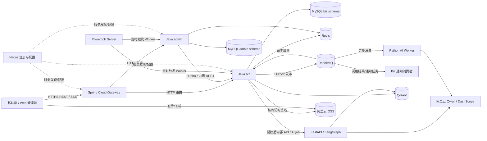

# FaFa 企业级技术架构与服务端开发规范

> 版本：v1.0  
> 编写日期：2026-10-26  
> 适用范围：FaFa 首版后端平台、Java 服务、Python AI 服务、基础设施与服务端联调  
> 配套资料：[前后端交互开发与模块验收手册 v1.0](FaFa_前后端交互开发与模块验收手册_v1.0.md)、[接口与数据契约 v2.1](宠物APP_接口与数据契约_v2.1.md)

---

## 1. 文档目的和架构结论

本文把 FaFa 已确定的技术选型整理成可以指导仓库结构、接口设计、服务部署和联调的架构基线。首版 Java 部署单元为 `gateway`、`admin`、`biz` 三个微服务，另设轻量 `common` 公共库；Python 提供 AI 与文档处理能力。用户、家庭、宠物、照护和隐私业务数据由 Java `biz` 服务负责，Python 只执行受控的 AI/OCR/检索计算，不能直连或写入业务 MySQL。

前后端交互手册原先建议 Java 模块化单体；本次以已明确提出的三服务方案为准。为控制微服务带来的部署、网络和数据一致性成本，首版的业务子域仍聚合在 `biz` 内按 DDD 边界组织，不继续拆成更多 Java 服务。

核心职责划分如下：

| 能力 | 主要职责 |
|---|---|
| Spring Cloud Gateway | 外部 HTTPS 入口、路由、基础认证校验、限流、请求关联信息和 SSE 透传 |
| `admin` | 运营人员身份、内容审核、举报/申诉处理、运营审计和后台管理接口 |
| `biz` | 宠主 API、身份与家庭权限、宠物和全部产品业务、业务数据写入、任务状态及外部服务编排 |
| Python AI | LangGraph/LangChain 工作流、模型适配、OCR/语义处理；输出回答或候选草稿，不拥有业务事实 |
| Nacos | 服务发现与集中配置；按环境隔离，敏感密钥交给密钥管理设施 |
| Dubbo | Java 服务间需要强类型、同步 RPC 的内部调用 |
| RabbitMQ | 异步任务和领域事件传递，按至少一次投递处理 |
| PowerJob | 周期性、固定延迟、补偿和批处理调度；不取代 RabbitMQ |
| MySQL | 业务事实、任务状态、审计索引和 Outbox 等关系数据 |
| Redis | Sa-Token 会话/令牌状态、短期缓存、限流和少量临时状态 |
| OSS | 私有图片、视频、病历附件、导出文件和派生媒体 |
| Qdrant | 可重建的语义索引，不作为授权或业务事实来源 |

## 2. 总体架构与调用方向



**依赖方向**：客户端只访问 Gateway；Gateway 通过 HTTP 路由到 Java 服务；Java 内部根据用例选择 Dubbo、受控内网 HTTP 或 RabbitMQ；Python 通过受控的私网接口或队列接收最小化任务；所有正式业务写操作回到 `biz`。服务间不共享数据库表，不接受客户端提供的 `userId`、角色或权限作为可信身份。

## 3. 技术框架与版本策略

框架版本必须按官方兼容矩阵统一锁定，不采用“每个组件都升级到最新”的方式。此文记录兼容策略而非完整依赖清单；依赖冻结时应在父 POM 和 Python lockfile 中锁定准确补丁版本，并记录升级日期与兼容验证结果。

| 技术 | 建议基线及用途 | 使用边界 |
|---|---|---|
| Java 21 | Java 服务统一运行时与编译版本 | CI、开发机和生产运行时一致；配置编译 release 21 |
| Spring Boot 3.x | 若坚持 3.x，限定在最后的 3.5.x 维护线 | 截至本文日期 3.5.x 已结束 OSS 发布支持；企业生产需安排商业支持，或在依赖兼容验证后转到受支持的 4.x |
| Spring Cloud | 选择与 Boot 3.5 对应的 2025.0.x Release Train | 只引入正在使用的 Gateway、LoadBalancer 等组件；不为“微服务完整度”堆 starter |
| Spring Cloud Alibaba | 选择和 Boot/Cloud 匹配的兼容版本 | Nacos Discovery/Config 依赖统一 BOM；不得覆盖其管理的 Nacos client 版本 |
| Apache Dubbo 3.x | Java 内部同步 RPC | 仅用于确有跨服务同步调用的用例；先定义超时、重试、降级和版本兼容规则 |
| Nacos | 服务发现和非敏感配置 | 按环境、命名空间隔离；限制控制台和管理接口访问；生产配置禁止匿名暴露 |
| PowerJob | 周期任务、延迟触发、补偿扫描、批处理 | Server 是基础设施；Worker 放在现有服务进程/部署单元，不新增业务微服务 |
| MySQL 8.x | 业务持久化，InnoDB，UTC 时间 | 以服务为单位划分 schema/账号；上线前选定受支持的 8.x 维护版本 |
| MyBatis-Plus | Java 持久化适配器内的 CRUD、分页和基础 SQL | Mapper/DO 只存在于 infrastructure；复杂查询写显式 SQL，不把 ORM 对象当领域模型 |
| Flyway（补充） | 数据库迁移版本管理 | 每个服务独立维护 migration；生产迁移向前兼容、可回滚或有修复脚本 |
| Redis + Redisson | Token 会话、缓存、限流、必要时分布式协调 | Redisson 是客户端；缓存不是事实来源；优先数据库唯一约束/乐观锁，避免滥用分布式锁 |
| RabbitMQ | 异步任务、服务间领域事件 | 持久化、Confirm、手动 ACK、有限重试、DLQ 和幂等消费；不承载大文件或敏感原文 |
| Qdrant | AI/RAG、回忆和语义检索向量索引 | 索引可由 MySQL/OSS 原始数据重建；查询必须带权限过滤并再次核对业务授权 |
| Sa-Token | 宠主会话认证与 Java API 鉴权基础 | 角色只做粗粒度授权；宠物/资源范围由 `biz` 根据当前关系实时判定 |
| Hutool | 小范围通用工具 | 优先 JDK/框架原生能力；禁止用工具库隐藏业务规则或引入无谓静态依赖 |
| Knife4j + OpenAPI | 开发联调 API 文档 | OpenAPI 契约为接口事实来源；生产文档关闭或经强认证、网段限制后开放 |
| Micrometer + Actuator | Java 指标、健康探针和 Prometheus 暴露 | Actuator 管理端点只开放必要项目，不能暴露环境变量、配置、线程转储给公网 |
| Python 3.x + FastAPI | 私网 AI 服务 REST/SSE 入口与模型编排 API | Python 版本以 LangChain/LangGraph/FastMCP 支持矩阵为准，并用锁文件固定依赖 |
| LangChain + LangGraph | 模型/检索集成与有状态工作流 | LangGraph 编排可恢复的多步流程；简单单次调用不强行包装成 Agent |
| FastMCP | 为 AI 工作流或内部 Agent 提供受控 MCP 工具接口 | 仅暴露明确 allowlist 工具；默认私网；每个工具做身份、资源范围和参数校验 |
| 阿里云 Qwen | 问答、文本/多模态抽取、AI 辅助内容 | 统一由 Python 模型适配层访问；模型名、区域、超时和额度均配置化 |
| 阿里云 OSS | 私有媒体、病历附件、报告和导出文件 | Java 签发短时、限定对象和方法的上传/下载能力；桶默认私有 |
| 网易云邮箱 SMTP（临时） | 注册验证、密码找回和必要系统通知 | 只发低敏事务邮件；密钥不入库；验证 SMTP/TLS/限额；上线前评估事务邮件服务替换 |
| Prometheus / Grafana / Alertmanager | 指标采集、图表与告警 | Prometheus 存指标，不代替日志系统 |
| OpenTelemetry Collector + Tempo（或 Jaeger） | 跨服务 Trace 与上下文传播 | Gateway、Dubbo、RabbitMQ、Python 之间传播 trace context |
| JSON 日志 + Loki（经 Alloy/Fluent Bit 采集） | 集中查询应用日志 | stdout 输出结构化日志；业务审计日志另行保存和授权查询 |

**Spring Boot 3.x 支持周期决策**：截至 2026-10-26，Spring Boot 3.5.16 是 3.5.x 最后一版 OSS 发布；官方当前列出的活跃维护线为 4.0/4.1。因用户已指定 3.x，本方案保留 3.5.x 作为兼容基线，但不能把它描述为仍有免费 OSS 安全更新。若生产必须使用 3.x，应先明确商业支持来源和持续维护责任；若不购买商业支持，则在开始业务开发前评估 Boot 4.x，并验证 Spring Cloud Alibaba、Dubbo、PowerJob、Sa-Token、MyBatis-Plus、Knife4j 等组合后再冻结版本。Boot 3.0–3.4 不作为新项目基线。

### 3.1 依赖对齐规则

1. 首选 Spring Boot BOM、Spring Cloud BOM 和 Spring Cloud Alibaba 官方版本表；Dubbo 独立 BOM 也纳入兼容检查。
2. 不通过单个 dependency 的手工版本覆盖 BOM，除非已记录原因并完成整条链路兼容验证。
3. Java/Python 均提交锁定版本；升级以一个兼容组合为单位，在隔离环境回归登录、Gateway 路由、Nacos 注册、Dubbo、消息消费、MySQL 迁移及 AI 接口。
4. Nacos 同时服务于 Spring Cloud 和 Dubbo 时，使用明确的环境 Namespace、服务 Group 和命名约定。配置统一由 Spring Cloud Alibaba 管理；Dubbo 是否使用 Nacos Config/Metadata 能力需显式配置，不能依赖不清楚的默认行为。
5. PowerJob、RabbitMQ 与数据库 Outbox 各负其责：PowerJob 负责“何时触发”，RabbitMQ 负责“异步交付和解耦”，MySQL 记录“业务事实和任务最终状态”。

## 4. Java 服务职责与边界

### 4.1 `gateway`

- 对外统一 REST 前缀 `/api/v1`；管理端可用独立 `/admin/api/v1` 路由和独立域名/访问策略。
- 负责 TLS 入口、服务发现路由、CORS、IP/用户级基础限流、请求体大小限制、请求 ID、认证会话校验和访问日志。
- 宠主端默认由 Gateway 和 `biz` 共享受保护的 Sa-Token Redis 会话存储：Gateway 先验证会话，`biz` 再验证原始凭据并独立取得用户主体、执行业务授权；Token 只在私网链路透传，服务实例不对公网开放。必须剥离客户端自带的 `X-User-Id`、`X-Role` 等伪造头。若部署拓扑不能安全共享会话，则改为短时、签名、限定 audience/scope 的内部身份凭据，并由下游验证签名。
- `admin` 使用独立的员工会话配置、token 名称/前缀及 audience，员工 token 不被 `biz` 当成宠主身份，宠主 token 也不能进入运营管理 API。
- 不访问业务表，不判断宠物/家庭资源权限，不计算食品/医疗规则，不将业务写入 Gateway。
- 对 SSE 流式回答配置合理的连接/读超时与断连清理，不缓冲整段响应；普通短请求的超时应短于客户端总等待窗口。

### 4.2 `admin`

- 独立维护运营员工身份、运营角色和后台会话；与宠主会话采用独立 token audience/命名空间，不能把普通宠主账号提升为平台管理员。
- 负责社区审核队列、举报/屏蔽/申诉处置、运营工单和后台操作审计。
- 管理业务侧字典或规则时调用 `biz` 的明确后台 API；`admin` 不直接修改 `biz` 数据库。
- 对每个敏感操作记录操作者、动作、目标资源、时间、结果和关联 `requestId/traceId`；必要时记录变更前后差异，敏感字段只记录脱敏摘要。
- Admin API 的授权由 `admin` 校验员工权限；涉及宠物用户资源时再由 `biz` 校验业务状态和资源归属。

### 4.3 `biz`

`biz` 是首版产品业务服务，按有界上下文组织：

| 子域 | 主要职责/事实 |
|---|---|
| Identity & Access | 宠主账号、邮箱验证、家庭成员关系、宠物范围/资源类型/动作/有效期授权 |
| Family & Pet | 家庭、邀请、宠物档案、归档和删除生命周期 |
| Care & Task | 计划、提醒规则、任务、真实照护事件、执行人、时间和 revision |
| Food & Health | 食品卡、版本、库存、喂养计划、实际投喂、体征和医疗记录 |
| Media & Memory | 上传会话、媒体归属、附件元数据、回忆/日记/删除与派生文件状态 |
| Community | 公开快照、发布状态、评论/点评、举报处置关联和可见性规则 |
| Privacy & Operation | 用户隐私偏好、导出/删除 job、操作状态和关联的清理事件 |
| AI Facade | AI 会话、授权数据范围、运行 job、候选回答/草稿、确认凭据和最终提交入口 |
| Notification | 站内通知状态、邮箱发送任务和发送结果 |

这些子域首版运行在同一 `biz` 部署单元和数据库 schema（可按子域分表），通过清楚的包边界、应用服务和领域事件协作。只有出现明确的独立扩缩容/团队/可用性需要并完成数据迁移方案后，才提出拆分新服务。

## 5. Java 与 Python 工程结构

### 5.1 Java 仓库结构建议

```text
fafa-java/
  pom.xml                         # Java 21、BOM、插件、代码质量基线
  fafa-common/                    # 小型公共契约库，不含业务实体
  fafa-gateway/                   # 外部 HTTP/SSE 入口
  fafa-admin/                     # 运营后台服务
  fafa-biz/                       # 产品业务服务，内部按 bounded context 分包
```

`fafa-common` 只放跨服务稳定且无业务所有权争议的内容：API 错误码/基础响应约定、内部调用身份上下文接口、事件信封、少量稳定 RPC/消息契约。不得放 MyBatis Entity、Repository 实现、领域聚合、业务 DTO 大全集、可变业务规则、全局万能工具类。业务 API DTO 由其所属服务维护；消息契约改变时增加 schema version，保持消费者兼容。

每个业务上下文建议使用以下分层，采用包边界即可，不为每个类机械地套四层：

```text
com.fafa.biz.<context>/
  interfaces/       # REST Controller、消费者入口、DTO 与映射
  application/      # 用例编排、事务边界、权限上下文输入
  domain/           # 聚合、值对象、领域规则、仓储端口、领域事件
  infrastructure/  # MyBatis-Plus Mapper/DO、OSS、Redis、MQ、外部 Client 适配器
```

### 5.2 Python 仓库结构建议

```text
fafa-python/
  pyproject.toml / uv.lock
  src/fafa_ai/
    api/            # FastAPI 路由、Pydantic 请求响应模型
    application/    # 用例与授权上下文编排
    workflows/      # LangGraph graphs/nodes/checkpointing
    integrations/   # Qwen、Qdrant、OSS 读取、OCR/embedding 适配器
    tools/          # FastMCP allowlist 工具
    messaging/      # RabbitMQ consumer、幂等与结果回传
    config/         # 统一 Settings 和密钥读取
```

Python 用类型标注和 Pydantic 契约验证边界；配置集中加载，不在业务代码散读环境变量；运行日志走 `logging`，不使用 `print`；异常按可重试/不可重试/用户可修复分类并返回稳定错误码。

## 6. 中间件与服务交互逻辑

### 6.1 普通同步 API 与身份授权

1. 客户端向 Gateway 发 HTTPS 请求，带会话凭据、`Idempotency-Key`（写操作）和 `traceparent`（如客户端已生成）。
2. Gateway 校验会话/令牌有效性、基础限流和请求大小，生成/续接 `requestId`，将请求按 Nacos 发现的实例路由至 `biz` 或 `admin`。
3. `biz` 从已验证会话取得当前用户；使用家庭成员关系、宠物范围、资源类别、动作和有效期逐次做授权检查。客户端提交的 `householdId/petId` 是查询上下文，不是授权凭据。
4. Controller 校验 DTO 和协议格式，Application Service 执行一个用例并定义事务边界，Domain 层执行业务规则，Repository Port 由 MyBatis-Plus adapter 实现。
5. 本地写事务同时保存业务数据、revision 和需要发布的 Outbox 事件；响应使用手册约定的稳定成功/错误结构。
6. 失败统一映射到稳定业务码：401/403/404/409/422/429/5xx，向用户隐藏 SQL、内部主机和堆栈信息；冲突不盲目覆盖。

对浏览首页的聚合读取可以由 `biz` 应用层组合域内查询；如果读取确实跨 Java 服务，只返回所需字段并设置超时/降级，不让 Gateway 去拼接业务数据。

### 6.2 同步服务调用：Spring Cloud 与 Dubbo 的分工

- 客户端到后端：Gateway HTTP 路由；不向客户端暴露 Dubbo。
- Gateway 到 `biz/admin`：HTTP/REST，以便使用 Gateway 的 HTTP 路由、限流和 SSE 处理。
- Java 服务到 Java 服务：默认先评估是否可使用领域事件。确实需要立即取得结果、且调用契约稳定时使用 Dubbo；例如 `admin` 对 `biz` 发起审核后的显式状态变更。
- 每个 Dubbo 方法设置调用超时、提供方线程池隔离、限次重试策略和幂等规则。非幂等写调用默认不自动重试。禁止 Dubbo RPC 跨公网。
- Spring Cloud 负责 Spring 生态的网关、发现/负载均衡等组件；Dubbo 负责其声明的强类型 RPC。Nacos 是注册基础设施，不意味着所有调用都必须走 Dubbo。

### 6.3 异步任务、RabbitMQ 与 Outbox

手册中要求异步的任务包括：媒体转码/缩略图/标签、食品和病历 OCR、语义索引、通知、报告与导出、AI 长任务、内容审核/索引、隐私删除和 OSS 清理。

推荐完整链路：

1. `biz` 创建 operation/job 记录，初始状态 `ACCEPTED`，写入必要的最小任务参数，并在同一事务写 Outbox；API 返回 `202 + jobId`。
2. Outbox 发布器向 RabbitMQ Topic Exchange 发布版本化消息，启用 publisher confirms 和 unroutable return 检查；只有确认后才标记 Outbox 已发布。
3. Java/Python 消费者手动 ACK；成功完成持久副作用并更新 job 后 ACK。消费者在处理后、ACK 前崩溃会重投，因此以 `messageId/jobId` 唯一键去重。
4. 可恢复错误使用有上限的延迟重试和退避；不可恢复或超过上限的消息进入 DLQ。对 DLQ 的人工重放必须记录操作者、原因和原 job/message 关联。
5. 客户端通过 `GET /api/v1/operations/{jobId}` 查询 `QUEUED/RUNNING/SUCCEEDED/FAILED/CANCELLED`、进度、稳定错误码和是否可重试。`202` 仅表示受理。

消息信封至少包含 `messageId`、`eventId`、`eventType`、`schemaVersion`、`aggregateType`、`aggregateId`、`jobId`（任务消息）、`occurredAt`、`traceId`。不放密码、Token、病历全文、图片二进制、私有 URL 或不必要的个人数据。消费者按 job/业务 ID 到其所属服务取数，并基于任务授权范围处理。

RabbitMQ 的 publisher confirms 与 consumer acknowledgements 解决的是生产端到 Broker、Broker 到消费端两段不同的交付确认；它们不实现跨 MySQL 与 RabbitMQ 的原子事务。Outbox、幂等消费、业务 job 状态和补偿任务共同构成可靠性设计。DLX 也要关注集群转发可靠性，不能假设任何 DLQ 配置都不会丢消息。

### 6.4 PowerJob 与 RabbitMQ 的衔接

PowerJob 适合：按家庭时区生成提醒任务、过期邀请清理、删除/导出状态对账、Outbox/失败任务补偿扫描、媒体孤儿对象清理、周期报表和批量索引重建。

以提醒为例：PowerJob 按配置时区触发 `biz` Worker → Worker 读取到期规则 → 使用数据库唯一键 `(ruleId, dueAt)` 幂等创建任务与通知 Outbox → RabbitMQ 异步送达邮件/站内推送等通道 → 通知记录可查。PowerJob 超时或重复触发时，数据库唯一约束保证不重复造事实；提醒规则和计划时间仍由 `biz` 的 MySQL 数据决定。

PowerJob 不用于代替用户 API 内同步业务写入，也不作为 RabbitMQ 消费任务的通用执行队列。每个 Worker 设置执行超时、并发上限、分片策略（确有必要时）、失败告警和可追溯业务主键。PowerJob Server 使用独立账号和数据库 schema；控制台只允许运营内网/强认证访问。

### 6.5 OSS 媒体上传、访问和删除

1. 客户端先向 `biz` 申请上传会话，说明宠物/附件类型/文件大小/媒体类型；`biz` 完成授权、配额和策略校验。
2. `biz` 生成随机不可猜测对象 Key，签发短时限、指定对象及 PUT 方法的上传 URL/临时凭据；客户端直接上传 OSS，不经 Java 网关转发大文件。
3. 客户端提交 `uploadId` 完成确认；`biz` 校验对象存在、大小、内容类型/校验和并保存媒体元数据，创建处理 job 后返回状态。
4. 图片缩略图、视频转码、OCR 和标签由异步 Worker 处理；未经校验的对象不作为“上传完成/可公开”展示。
5. 查看媒体时，先由 `biz` 再次授权，再签发短时下载 URL；对象桶保持私有，撤销授权后不再发新链接，并通过 TTL 控制既有链接暴露窗口。
6. 删除采取业务软删除/清理任务状态，异步删除原图、派生图、Qdrant 索引和缓存；失败可重试、可审计。

### 6.6 AI、FastAPI、LangGraph、FastMCP 与 Qwen

**同步对话**：客户端 → Gateway → `biz` 校验用户/宠物/家庭范围与 AI 数据使用授权 → `biz` 只取最小必要记录，去除无关字段 → 内网调用 FastAPI → LangGraph 运行检索/模型节点 → Python 返回答案、引用来源和不确定性 → `biz` 校验返回结构并记运行状态 → Gateway 以 SSE 透传文本/进度。

**AI 写入草稿**：AI 解析文本后只返回有 schema 的候选草稿，列出目标宠物、事件类型、时间、数值/单位、未知项及来源。用户可修改后确认；`biz` 检查短期确认凭据、draft hash、revision、权限和幂等键，再通过正常领域用例提交正式事件。取消或过期草稿不写正式数据。Python 不接受任意 SQL、业务库连接或任意 URL 调用能力。

**长任务**：`biz` 保存 job + Outbox 并返回 `202/jobId`；Python AI Worker 消费指定队列，持有受限且短期的服务身份，处理后调用 `biz` 私网结果回传接口；结果及 job 状态只由 `biz` 持久化。AI 服务中断不影响普通照护记录和家庭管理。

LangGraph 用于有状态、需要 checkpoint/恢复、流式步骤或人工确认的流程；LangChain 用于模型、提示、检索器和 provider 集成。FastMCP 提供内部工具协议时，工具范围只读优先，写操作只能创建待确认草稿；工具需要显式权限、参数 schema、超时和审计。FastMCP 服务不因使用了 MCP 就自动获得用户身份或数据授权。

Qwen API Key 只保存在服务器密钥配置中；按模型、区域、超时、最大输入/输出、速率限制和降级策略配置。模型调用错误要区分限流、超时、内容拒绝和输入无效；不得把模型输出未经 schema 验证就落库。运行日志不得记原始病历/完整提示词。

### 6.7 SMTP 邮件

邮件由 `biz` 通知应用统一创建并异步发送。网易云邮箱暂用于验证码、重置密码和低敏状态提醒；SMTP 主机/端口/TLS 模式、发件地址和应用专用凭据以配置/Secret 注入，不写入 Git。发送失败由 RabbitMQ 延迟重试和 job 状态追踪，发送动作有幂等键；邮件正文不带诊断、病历、完整家庭信息或可长期访问的媒体地址。启用前验证服务商当前 SMTP 设置、发送限额、SPF/DKIM/DMARC 和账号安全规则；高频事务通知上线前评估专用事务邮件服务。

## 7. 数据所有权、事务和缓存约定

| 数据类别 | 权威所有者 | 允许的副本/派生数据 |
|---|---|---|
| 宠主、家庭、宠物、照护、食品、医疗、分享状态 | `biz` MySQL | Redis 短缓存、Qdrant 索引、分析只读投影 |
| 运营员工、后台角色、运营操作审计 | `admin` MySQL | 监控指标与脱敏日志 |
| 运营对业务内容的审核动作 | `admin` 记录操作者/审核过程；业务发布状态由 `biz` API 更新 | RabbitMQ 审核事件、搜索索引 |
| 媒体原件和派生文件 | OSS 对象；`biz` 保存授权和元数据 | CDN/缩略图缓存（私有鉴权） |
| 异步任务状态 | `biz` job/operation 表；后台管理 job 可由 `admin` 自己持有 | RabbitMQ 仅作传递，不是状态事实 |
| 向量与搜索索引 | Qdrant/搜索引擎派生副本 | 从权威记录重建；无法作为授权依据 |
| 调度任务配置/执行记录 | PowerJob 元数据数据库；业务规则归 `biz` | job 日志仅作运维排障 |

- 起步可部署在同一受管 MySQL 集群，但创建 `fafa_biz`、`fafa_admin`、`powerjob` 等独立 schema 和最小权限 DB 账号；严禁跨服务账号拥有所有 schema 的写权限。
- 同步事务只覆盖所属服务的 MySQL 本地事务。跨服务一致性用 Outbox + 消费者幂等 + 补偿/状态机，不在首版引入分布式 XA。
- 关键表使用唯一约束和乐观锁/revision；任务完成、计划版本切换、邀请接受和 AI 提交等并发写必须可判冲突。
- Redis 缓存使用明确 TTL、key 命名空间和失效事件；家庭/宠物权限撤销要立即影响新的授权读取，不能依赖长 TTL 的权限缓存。
- 缓存穿透/雪崩通过短 TTL 抖动、负缓存谨慎使用、限流和回源保护处理；缓存故障时必须定义可接受的功能降级。
- 金额用最小货币单位整数；重量和能量等测量值使用明确精度的 DECIMAL；未知值用 NULL/UNKNOWN，不用 0 代替。
- 所有时间戳存 UTC；日程/每日统计显式使用家庭时区和 `localDate`；事件保留 `happenedAt`、`recordedAt`、`recordedBy`、`performedBy` 和 revision。

## 8. DDD 设计与 Java 编码规范

### 8.1 DDD 实施原则

1. 以产品语言和数据所有权识别 bounded context；首版多个上下文在 `biz` 内隔离，不把 DDD 等同于微服务数量。
2. 聚合只覆盖必须保持强一致的事实；聚合根负责不变量，不为每张表创建一个“聚合”。集合读取/报表可以使用只读 Query Model。
3. Domain 层表达业务概念和值对象/规则，不依赖 Spring、MyBatis-Plus、Redis、RabbitMQ、Dubbo 或 HTTP DTO。
4. Application Service 表达一个用户/后台用例：装配身份与权限上下文、调用领域行为、定义本地事务、保存结果并登记 Outbox。不要把规则塞入 Controller 或 Mapper。
5. Infrastructure 实现仓储端口、第三方 API、MyBatis、消息发布/消费和文件存储；领域对象与数据库 DO 之间显式映射。
6. 模块间通过明确的应用服务或事件沟通；不直接跨上下文读取别人的 Mapper/表，不共享可变实体。
7. 领域事件表达已经发生的事实；命令表达希望执行的动作。事件必须可重放/去重，消费者不得以事件顺序假设代替版本检查。

### 8.2 Java 代码质量要求

- 使用 Java 21 语言能力但控制新语法复杂度；统一格式化、命名、空值约定和 import 顺序。
- API 层只处理协议、认证上下文、校验、DTO 映射和响应；不直接执行业务 SQL。
- 入参使用 Bean Validation；跨字段和业务有效性在领域/应用服务再次校验。外部错误信息稳定且不泄露实现细节。
- 所有 I/O 设置连接、读取、整体调用超时；重试仅用于确定可恢复且幂等的操作，禁止无上限重试。
- 不捕获后吞掉异常；日志带异常栈和关联 ID，API 返回稳定错误码；仅在系统边界做异常到协议的转换。
- 不用静态全局状态保存用户身份、Request Context 或可变业务配置；线程池、连接池、消费者并发和队列长度均配置化且受限。
- Controller、Application Service 和 Repository 遵守单一职责；避免无意义 `Manager/Helper/Facade` 包装和万能 BaseService。
- MyBatis-Plus 用于持久化映射与常规 CRUD；分页上限由服务端配置，动态排序使用字段白名单；多租户/宠物范围不能只依赖客户端 SQL 条件。
- 金额/单位/日期规则封装为清楚的领域值对象或纯计算函数；AI 不执行医疗剂量、热量等权威业务计算。
- 敏感日志字段统一脱敏；密码只存带盐自适应哈希，不可逆明文或可解密存储。

## 9. API、消息和异步作业契约

### 9.1 REST API

- 客户端 API 统一 HTTPS 和 `/api/v1` 前缀，JSON 字段命名、分页、时间和错误结构遵循接口契约 v2.1。
- 成功含 `data/meta`；失败含稳定 `code/message/fieldErrors/requestId/retryable`；服务端堆栈不返回客户端。
- 列表使用 cursor；筛选条件变化后废弃旧 cursor。并发修改携带 `revision`/ETag 并返回 409 冲突。
- 所有可能因断网重试的写命令支持 `Idempotency-Key`，服务端按用户/操作域和 key 保存处理结果或唯一命令记录。
- 时间用带时区 ISO 8601 输入输出；数据库 UTC 保存，计划日界线以家庭时区计算。
- `202 Accepted` 仅用于真正异步的操作，返回 `jobId` 和 operation 查询地址；不能展示“任务完成”。
- 对公开 DTO 使用显式白名单，私有病历、日记、费用、家庭成员信息不可通过通用序列化意外公开。

### 9.2 Dubbo 契约

- RPC 接口按应用用例定义，参数/响应使用版本化 DTO，不暴露 Java Entity/DO。
- 调用链透传 Trace Context、操作人/服务身份和 deadline；身份上下文由服务端校验，不把调用方声明的用户字段直接当授权结果。
- RPC 超时必须明确；调用超时不等于下游没有提交，写操作必须可按业务键查询/去重。
- 保持新增字段向后兼容；删除/改义通过新接口版本或迁移期双读写，先升级消费者再切换提供方。

### 9.3 RabbitMQ 事件

- Exchange/Queue/Routing Key 使用环境前缀和领域/用途命名，配置与代码 schema 同步维护。
- 持久业务任务使用 durable queue + persistent message；发布启用 confirms/mandatory return；消费者采用 manual ack 和合适的 prefetch。
- 消费者先完成本地持久副作用或登记可恢复的下一步，后 ACK。异常分为可重试、不可重试、等待人工处理；禁止无上限 requeue。
- 每个消费动作有幂等键，使用 inbox/处理记录/唯一约束之一；重复事件不得重复创建事件、发送邮件或删除用户数据。
- 消息 schema 由生产者维护；消费者忽略兼容的未知字段，对不兼容变化升级 schema 版本并提供迁移期。
- DLQ 按队列监控数量、最老消息年龄、错误类型和重放次数；人工 replay 先核对业务是否已产生副作用。

## 10. 安全、隐私与 AI 边界

- Gateway 做会话/令牌有效性和粗粒度路由保护；`biz/admin` 执行本服务拥有的细粒度授权，不能把网关校验当成唯一授权。
- 权限模型沿用手册：用户 + 家庭成员关系 + 宠物范围 + 资源类型 + 动作 + 有效期。撤权后新 API 请求和媒体签名请求立即拒绝，并清除/失效关联缓存。
- 宠主和运营人员使用不同身份空间；员工高权限采用最小权限，关键审核/删除/导出操作留下审计记录。
- 所有密码和 API Key 经密钥管理/部署 Secret 注入；配置仓库只有变量名和非敏感默认值。禁止把真实 token、数据库口令、SMTP 密钥提交到 Git、镜像或日志。
- OSS bucket 默认私有，对象 Key 不包含邮箱、宠物名等明文个人信息；签名 URL 限定方法、对象和有效期；上传完成前校验文件体积、格式和内容。
- AI 只收到用户授权且当前请求所需的最小字段；提示注入内容作为不可信数据处理。模型输出必须结构校验，来源和未知信息需保留。
- 医疗/食品建议标注数据来源和不确定性；AI 不做诊断、开药、改剂量，也不替代兽医指示。事实计算由确定性 Java 规则负责。
- AI 动作经用户确认后由 Java 领域用例落库；确认凭据短期有效并绑定草稿 hash、宠物、用户、数据 revision 与幂等 key，防止过期/篡改/重放。
- Python 和 FastMCP 工具不能直连 biz MySQL；所有访问必须走带 audience/scope/过期时间的内部身份和最小范围 API。对工具执行做超时、输入长度、调用频率、结果大小和审计限制。
- 日志、Trace、Prompt、异常上下文中不记录密码、完整病历、原始图片、邮件验证码或长期签名 URL。
- 用户数据导出/删除需先通过 `biz` 校验范围和所有权，按 job 追踪 MySQL、OSS、Qdrant、缓存和公开索引清理；无法同步删除的派生数据应有可查询状态和重试机制。

## 11. 监控、日志、链路追踪和告警

### 11.1 指标与健康状态

Java 使用 Actuator/Micrometer 暴露 Prometheus scrape endpoint；Python 采集请求、延迟、错误、队列消费和模型调用指标；基础设施使用官方 exporter 或产品原生指标。Gateway、admin、biz、Python Worker、RabbitMQ、Redis、MySQL、Nacos、Qdrant、PowerJob、OSS 调用都要有可观测的健康/错误信号。

至少监控：

- HTTP/RPC 请求量、P95/P99 延迟、错误率、限流和超时数；登录/鉴权拒绝趋势。
- JVM 堆、GC、线程池、连接池；Python CPU/内存、事件循环延迟、worker 并发。
- RabbitMQ 每队列 ready/unacked 数、最老消息年龄、消费速率、重试和 DLQ 数量、publisher confirm 失败。
- Outbox 未发布数量/最老年龄，operation/job 各状态计数、运行时长、失败率和取消数。
- MySQL 连接、慢查询、锁等待、复制/备份状态；Redis 内存、命中率、连接和淘汰；Qdrant 搜索延迟和索引错误。
- Qwen/OSS/SMTP 的请求数、超时、限额/拒绝和成本相关用量；模型指标使用低基数标签，不能把 userId/petId 做 metric label。

提供 `/actuator/health/liveness` 和 `/actuator/health/readiness` 或等效探针。Liveness 只判断进程是否需重启；Readiness 表示是否能接收业务流量。可选依赖故障应按业务降级定义，不应让单个可恢复外部依赖导致全部实例无故重启。

### 11.2 Trace 与日志格式

使用 OpenTelemetry/统一 instrumentation 把 W3C `traceparent` 跨 Gateway、HTTP、Dubbo、RabbitMQ、FastAPI 传播；异步消息携带 trace context 和 `jobId`，建立生产/消费因果链。

应用输出 JSON 到 stdout，建议字段：`timestamp`、`level`、`service`、`environment`、`traceId`、`spanId`、`requestId`、`operationId/jobId`、`userRef`（不可逆或内部脱敏标识）、`event`、`durationMs`、`errorCode`。异常栈仅进入受控日志平台，不进入用户响应。

生产环境使用 INFO 为主，按需短时调整单服务/包级 DEBUG，并设置自动恢复时间。日志采集到 Loki（或组织已有兼容平台），用 traceId/requestId/jobId 定位同一链路。Prometheus 用于指标，不用日志文本充当指标数据库。

### 11.3 告警与审计

配置告警时优先关注用户可感知的错误率、可用性和队列积压；再覆盖磁盘/内存/数据库连接/证书到期/备份失败。每条告警要有负责人、排查入口、影响说明和恢复动作。具体 SLO、阈值、保留期和 on-call 规则在部署环境上线前由团队定稿，本文不虚构业务阈值。

安全审计与诊断日志分开管理。审计记录采用追加式写入和更严格读权限；日志保留时长、导出权限和脱敏策略需纳入隐私配置，不能依赖开发者个人查看生产库排查问题。

## 12. 部署、配置和运行约定

- 本地开发可以使用 Docker Compose 启动 MySQL、Redis、RabbitMQ、Nacos、Qdrant、PowerJob Server 和监控组件；开发配置与生产 Secret 分开。
- 生产每个 Java/Python 服务无状态化部署，业务状态只在受管 MySQL/Redis/OSS/RabbitMQ/Qdrant；文件不保存在实例本地作为唯一副本。
- `gateway`、`admin`、`biz`、Python API/Worker、PowerJob Server 分别设置 CPU/内存、连接池、线程池、健康检查、优雅退出和滚动升级策略。
- 外部只开放 Gateway 必需端口；Nacos 控制台、Dubbo 端口、RabbitMQ 管理端口、PowerJob 控制台、Actuator、Qdrant 管理端点放私网并限权。
- Nacos、RabbitMQ、MySQL、Redis 生产账号启用认证和网络 ACL；环境之间使用独立 Namespace/vhost/schema/凭据。
- 数据备份覆盖 MySQL、OSS 关键元数据/对象策略、Qdrant 重建方案、Nacos 配置、PowerJob 元数据和 RabbitMQ 拓扑；按目标 RPO/RTO 定期演练恢复。
- 依赖启动应支持有限次数的退避重连和 readiness 控制；配置变更做审计，重要密钥轮换而不经代码发布。
- 所有业务 API 和消费者需设置超时、最大并发和资源上限；对图片/OCR/AI 限制输入大小、推理时长、并行度和结果体积，避免单个用户任务拖垮实例。

## 13. 研发流程、验收和变更管理

1. 以手册模块顺序实施，但这只是工程依赖顺序，已设计的 D1–D10 能力仍属于同一首版范围。
2. 每个模块编码前先明确所属服务、数据所有者、HTTP/Dubbo/消息契约、授权边界、同步/异步状态及故障降级。
3. 修改 API 时先更新接口契约/OpenAPI 与 DTO，再实现服务；修改消息时记录 producer、consumer、schema version、幂等键和 replay 影响。
4. 数据库变更通过 Flyway migration；禁止手工只改生产库。migration 需考虑旧版本实例并存期间的向后兼容。
5. Java 编码完成后至少具备领域规则验证、Repository/数据库集成验证、API 契约验证和跨服务故障场景验证；异步模块覆盖重复投递、ACK 前崩溃、Broker 中断、DLQ 和人工重放。
6. Python AI/OCR 模块验证授权范围、模型超时/限流、结构化输出失败、人工改稿确认、重复确认、取消/恢复和服务不可用降级。
7. 安全相关改动（AI、病历、公开分享、授权撤销、媒体签名、导出/删除）必须更新数据流、日志脱敏和验收矩阵。
8. 模块验收记录沿用手册格式：模块/页面 ID；接口与迁移；通过项；未通过及复现；权限/隐私/失败状态；关联 requestId、jobId、messageId；是否完成。

## 14. 与前后端交互手册的对齐点

本文继续遵守手册的以下产品契约：REST `/api/v1`、身份由服务端确定、资源权限由服务端判定、UTC 时间与家庭时区、cursor 分页、revision 冲突、幂等写操作、202/job 查询、Outbox 和至少一次队列处理、AI 草稿确认、私有 OSS、Qdrant 不取代事实库、撤权/删除后异步清理以及全首版模块范围。

架构更新点是 Java 部署形态：从手册中“模块化单体”调整为 `gateway/admin/biz` 三个 Java 服务。为避免职责漂移，`admin` 定位运营平台，用户身份/家庭/宠物授权和主业务数据仍由 `biz` 管理；Gateway 不承载业务；Python 不直连业务库。新增服务边界后，接口契约需进一步标明 API 归属服务、Dubbo 依赖、消息生产/消费方和数据库 owner。

## 15. 实施前必须冻结的决策

- Spring Boot 3.x 具体维护线、Spring Cloud/Spring Cloud Alibaba/Dubbo/Nacos 兼容组合和 Maven BOM 版本。
- Spring Boot 3.x 的商业支持采购/维护安排，或完成第三方兼容评估后迁移到受支持的 4.x 维护线。
- `biz/admin` 的数据库 schema、账号授权、migration 所有权和备份恢复策略。
- Sa-Token 使用的会话/token 模式、Gateway 与下游的身份传递方式、宠主和员工 token 隔离策略。
- Nacos Namespace/Group、配置命名和密钥来源；Dubbo RPC 接口清单和治理参数。
- RabbitMQ vhost、exchange/queue/routing key、重试上限、延迟策略、DLQ 保留和重放授权。
- PowerJob Server 部署方式、独立 DB、Worker 应用标识、并发/超时/运维入口。
- MySQL 8.x 精确版本、Redis 部署模式、Qdrant 部署/备份和 OSS 地域/私有桶/生命周期策略。
- Qwen 使用区域、模型白名单、数据出境/隐私授权口径、限额和降级；FastMCP 的启用场景及工具 allowlist。
- 网易云邮箱 SMTP 参数、验证码限制、SPF/DKIM/DMARC 配置和后续邮件服务迁移条件。
- 监控/日志/Trace 平台落点、数据保留、业务 SLO、告警负责人、RPO/RTO 与生产变更流程。

## 16. 官方参考资料

- [Spring Boot 系统要求](https://docs.spring.io/spring-boot/system-requirements.html)
- [Spring Boot 3.5.16 最后一版 OSS 发布说明](https://spring.io/blog/2026/06/25/spring-boot-3-5-16-available-now/)
- [Spring Boot 活跃支持版本说明](https://github.com/spring-projects/spring-boot/wiki)
- [Spring Cloud 项目与 Boot 版本兼容关系](https://spring.io/projects/spring-cloud/)
- [Spring Cloud Alibaba 版本说明与组件对应表](https://sca.aliyun.com/en/docs/2025.x/overview/version-explain/)
- [Apache Dubbo Registry 总览](https://dubbo.apache.org/en/overview/mannual/java-sdk/reference-manual/registry/overview/)
- [Apache Dubbo 服务发现配置](https://dubbo.apache.org/en/overview/mannual/java-sdk/tasks/service-discovery/registry/)
- [PowerJob 官方仓库与发行记录](https://github.com/PowerJob/PowerJob/releases)
- [RabbitMQ Publisher Confirms 与 Consumer Acknowledgements](https://www.rabbitmq.com/docs/confirms)
- [RabbitMQ Dead Letter Exchanges](https://www.rabbitmq.com/docs/dlx)
- [OSS 使用预签名 URL 上传文件](https://www.alibabacloud.com/help/en/oss/user-guide/upload-files-using-presigned-urls)
- [阿里云 Model Studio / DashScope Qwen API](https://help.aliyun.com/en/model-studio/qwen-api-via-dashscope)
- [LangGraph Python 文档](https://docs.langchain.com/oss/python/langgraph/overview)
- [LangChain Python API 与集成参考](https://reference.langchain.com/python/)
- [FastAPI 部署概念](https://fastapi.tiangolo.com/deployment/concepts/)
- [FastMCP 文档](https://gofastmcp.com/)
- [Qdrant 多租户设计](https://qdrant.tech/documentation/manage-data/multitenancy/)
- [Qdrant 搜索过滤](https://qdrant.tech/documentation/search/filtering/)
- [Prometheus 监控系统概览](https://prometheus.io/)
- [OpenTelemetry 信号与上下文传播](https://opentelemetry.io/docs/concepts/context-propagation/)
- [MyBatis-Plus 文档](https://baomidou.com/)
- [Sa-Token 文档](https://sa-token.cc/)
- [Redisson 文档](https://redisson.org/)

> 版本兼容、云服务接口和安全配置会随上游发布变化。实际建项和依赖升级时，以对应官方版本矩阵、Release Notes 及部署环境可用能力为准；本文中的版本线是当前架构基线，不构成补丁版本锁定。
