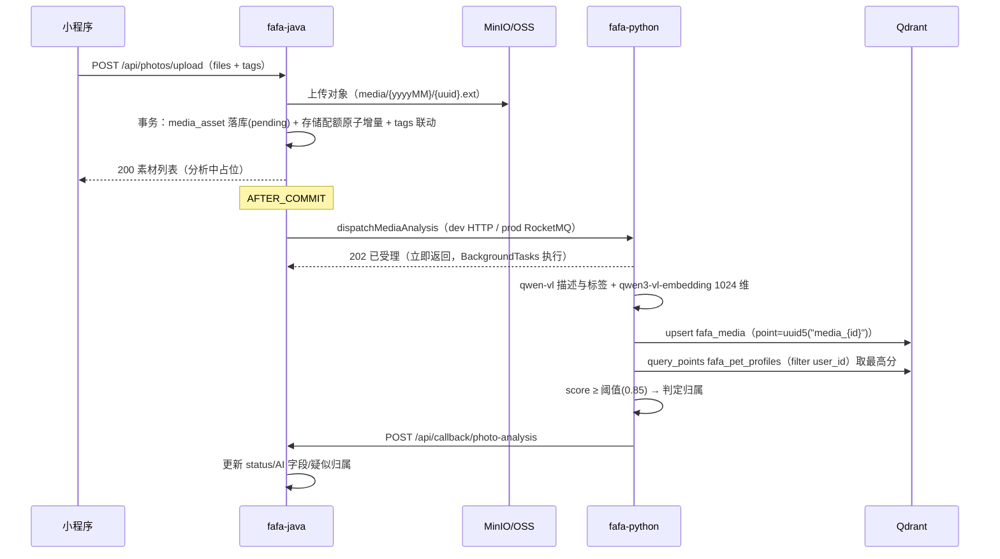

# Phase 4 实施文档：素材管理与成长档案

> 依据：《FaFa产品功能设计-最终版.md》第三章（素材管理）、第七章（成长档案）、1.3（会员体系）；《分阶段开发计划.md》三（阶段总览 Phase 4：素材库与 AI 摄入——照片/视频上传、tags、向量化、语义搜索）；《技术选型与项目框架搭建.md》5.5/6.2/6.3/6.4/七（服务间通信与照片异步链路契约）。
> 状态：**Java/Python 代码已实现，数据库已建表，待真实环境联调验收**。
> 关联：数据库脚本 [V4__create_media_tables.sql](../../fafa-java/src/main/resources/db/migration/V4__create_media_tables.sql)，表记录见 [MySQL数据表记录.md](../MySQL数据表记录.md)。

---

## 1. 阶段目标与范围

Phase 4 实现素材管理闭环与成长档案写入侧补齐：照片/视频上传与对象存储、用户标签体系、AI 视觉理解与向量化（Java↔Python 异步链路首次落地）、宠物个体识别（三视图相似度匹配）、双通道检索（确定性条件 + AI 语义检索）、会员配额机制首次真正落地（存储空间 + AI 检索月次数）。

**核心价值**：
- 照片是养宠用户最高频的记录载体，素材库是「宠物数字档案」的视觉底座
- 上传即自动理解与识别，用户零成本完成数据结构化（数据闭环加速）
- AI 语义检索（「找豆包去年夏天在阳台睡觉的照片」）是 P0 级 AI 价值的第一触点
- 配额机制落地为商业化（会员体系）提供真实的权益差异

### 1.1 本阶段做什么

| 类别 | 说明 | 落地 |
|------|------|------|
| 素材上传 | 照片批量上传（复用同一组 tags）+ 视频上传（存储型） | `media_asset` 表 + 上传接口 + StorageService 复用 |
| 标签体系 | 标签 CRUD、打标（上传/编辑）、宠物创建自动建宠物名标签 | `user_tag` 表（早期已建，本阶段启用） |
| AI 理解 | qwen-vl 生成描述与标签 + qwen3-vl-embedding 向量化入 Qdrant | Python photo_service + Java↔Python 异步链路 |
| 个体识别 | 素材向量 vs 宠物三视图向量相似度匹配，阈值判定归属，「疑似属于」待确认 | Python 识别 + `recognition_confirmed` 确认流 |
| 确定性检索 | 宠物/标签/时间范围分页查询（不限次） | media_asset MySQL 查询 |
| 语义检索 | 自然语言 + 叠加确定性条件，按相关度返回（会员月限额） | Qdrant 向量检索 + Redis 配额计数 |
| 配额机制 | 存储空间限额（2GB/20GB）+ AI 检索月限额（10 次/不限），用量查询 | `user_quota_usage` 启用 + Redis 计数 |
| 手动事件 | 成长档案事件手动创建/编辑/删除（source=manual），打通 tags | `event_record` 写入侧补齐 |
| 删除闭环 | 素材删除：库 + 配额释放 + OSS 对象 + Qdrant point | 四步链路（先删库后删文件） |

### 1.2 本阶段不做什么（明确边界）

- 视频 AI 理解与向量化使用 qwen-vl + qwen3-vl-embedding；视频 URL 需通过对象存储预签名地址提供给百炼，视频视觉描述使用受控抽帧参数
- **不做**事件文本的向量化——技术文档 5.5 仅规划 `fafa_media`/`fafa_pet_profiles` 两个集合，事件文本向量无集合规划且消费方是 Phase 5 Agent，本阶段只做事件 CRUD 与 tags 打通
- **不做**时间轴聚合后端接口——产品 7.3 明确「前端维护时间轴，自动聚合所有内容」；后端各模块按时间查询接口已齐（照片/事件/记录/提醒历史），无需专门聚合端点
- **不做**AI 检索结果的 LLM 归纳文案（如「这些照片多拍摄于去年 7-8 月」）——本阶段返回确定性统计摘要（时间分布），LLM 归纳随 Phase 5 对话能力接入
- **不做**素材备注/相册分组/收藏——产品设计未提及，留待用户反馈
- **不做**分析失败自动重试接口——失败展示 error_message，用户可重新上传；重试队列依赖 MQ 死信治理，当前规模人工兜底
- **不做**Qdrant 向量与 MySQL 的一致性对账任务——删除素材时向量删除失败仅记日志，残留 point 在 Java 侧按 `is_deleted` 二次过滤天然免疫；对账任务待数据量上来后评估
- **不做**宠物重命名时同步更新其名下标签——标签是用户独立资产；宠物名标签仅在创建时自动生成一次，用户可自行管理

---

## 2. 与既有规划的关键决策

### 2.1 user_tag 表：沿用早期已建结构（不重建）

数据库中 `user_tag` 表已存在（早期建库产物，无代码引用、0 行数据、未记录于表文档），结构含 `category`（pet/location/action/object/mood/other）、`usage_count`、`last_used_at`，且唯一约束 `uk_user_tag_name(user_id, tag_name)` 与热度索引 `idx_user_tag_usage(user_id, usage_count)` 齐全。

**决策**：直接启用该结构，不 DROP 重建。理由：结构与产品语义吻合（`usage_count` 支撑「选择已有标签」列表按使用热度排序；`category='pet'` 标记宠物名自动标签），避免破坏性变更。

**usage_count 语义约定**（简化实现，防过度设计）：
- 打标动作（上传素材/编辑素材/创建事件）时，对请求中每个 tag：不存在则创建（count=1），存在则 count+1 并刷新 last_used_at
- 取消打标**不回退**计数——语义是「历史使用热度」而非精确引用计数（幂等性差但实现零成本，列表排序目的下足够）

### 2.2 宠物归属采用「当前归属 + 确认标志」双字段

产品 3.1 要求识别结果以「疑似属于：豆包」展示，用户可确认或修正。设计上不引入独立的 `recognized_pet_id` 字段，而用：

- `pet_id`：当前归属（上传时用户指定 → 直接 confirmed=1；或 AI 识别回填 → confirmed=0 待确认）
- `recognition_confirmed`：归属是否已定（用户确认识别结果或修正归属后置 1）
- `recognition_score`：识别相似度（用户手动指定归属时为 NULL）

「疑似属于」的展示判定：`pet_id IS NOT NULL AND recognition_confirmed = 0`。修正归属 = confirm 接口传新 petId，确认 = confirm 接口传原 petId，两者同一端点。

### 2.3 AI 分析状态机：回调驱动，Java 不维护中间态

```
photo/video: pending（落库即此态）──回调──→ completed / failed
        processing（枚举保留，本阶段不流转，预留 MQ 积压可观测场景）
```

前端对 pending 展示「分析中」占位（对齐技术文档 7.4「小程序对待处理状态展示占位描述，回调完成后刷新」）。重复回调幂等：已终态（completed/failed）的素材直接跳过。

### 2.4 分阶段计划文档 Phase 4 仅有概要行（无详细章节）

《分阶段开发计划》Phase 4-10 为概要说明（文档停在 CONTINUATION MARKER），本实施文档以《产品功能设计》第三章/第七章 + 《技术选型与项目框架搭建》第七章契约为需求基准，风格与 Phase 2/3 实施文档一致。

### 2.5 其余遵循既有约定

- 枚举列 VARCHAR + Java 领域枚举校验（不用 MySQL ENUM），与 Phase 0-3 一致
- `media_asset`/`event_record` 的 tags 用 JSON 快照数组，标签定义删除不影响已打标数据
- 环境差异只走配置：`fafa.ai.dispatcher=http|rocketmq`、`fafa.storage.type=minio|oss`，业务代码零 if-env

---

## 3. 数据库设计（已完成）

两表已通过 MCP 在库 `fafa` 执行完毕，Flyway 脚本 [V4__create_media_tables.sql](../../fafa-java/src/main/resources/db/migration/V4__create_media_tables.sql) 同步（均 `IF NOT EXISTS` 幂等，兼容 user_tag 已存在现状）。完整建表语句与索引说明见 [MySQL数据表记录.md](../MySQL数据表记录.md) Phase 4 章节。

| 表 | 角色 | 删除语义 |
|------|------|------|
| `user_tag` | 用户标签字典（早期已建，启用） | 物理 `DELETE`（字典数据，唯一约束友好） |
| `media_asset` | 素材（照片/视频）+ AI 分析状态 + 归属识别 | 逻辑 `is_deleted`（配额释放按删除后口径） |

**user_quota_usage（Phase 0 已建，本阶段启用）**：新增 `quota_type='STORAGE_USED'`（used_amount 单位字节）；不 ALTER（quota_type 为 VARCHAR(50)）。AI 检索月配额走 Redis 计数（见第 9 节），不落此表。

**Qdrant（无 MySQL 变更，既有集合规划）**：`fafa_media`（素材向量）+ `fafa_pet_profiles`（三视图向量，Phase 1 已用）。素材 point 规则：

- embedding_id：`media_{mediaId}` → point id 由 uuid5 确定性生成（幂等 upsert，沿用 core/qdrant.py 机制）
- payload：`media_id`、`user_id`、`pet_id`（可空）、`media_type`、`tags`（数组）、`taken_ts`（拍摄时间毫秒时间戳，供范围过滤）

---

## 4. 领域层设计

### 4.1 新增包结构

```
domain/
├── model/
│   ├── media/
│   │   ├── MediaAsset.java          # 素材聚合根
│   │   ├── MediaType.java           # photo/video
│   │   ├── MediaAnalysisStatus.java # pending/processing/completed/failed/skipped
│   │   └── TagRef.java              # (可选) 标签引用值对象，若逻辑简单直接用 List<String>
│   └── tag/
│       ├── UserTag.java             # 用户标签实体
│       └── TagCategory.java         # pet/location/action/object/mood/other
├── repository/
│   ├── MediaAssetRepository.java
│   └── UserTagRepository.java
```

> 不为配额建独立聚合——`user_quota_usage` 是纯计量数据（无状态机、无不变式），配额规则（上限判断、身份差异）在应用层 QuotaService 中以策略配置实现，仓储用现有模式扩展。

### 4.2 MediaAsset（聚合根）

```java
public class MediaAsset {
    private Long id;
    private final Long userId;
    private Long petId;                    // 当前归属（可空）
    private final MediaType mediaType;
    private final String fileUrl;
    private final String fileName;
    private final long fileSize;           // 字节
    private final String mimeType;
    private List<String> tags;             // 标签名快照
    private MediaAnalysisStatus status;
    private String aiDescription;
    private List<String> aiTags;
    private BigDecimal recognitionScore;   // cosine 0~1，手动归属时 null
    private boolean recognitionConfirmed;
    private final LocalDateTime takenAt;
    private String errorMessage;
    private boolean deleted;
    private final LocalDateTime createdAt;
    private LocalDateTime updatedAt;

    // 工厂
    public static MediaAsset create(Long userId, MediaType type, String fileUrl, String fileName,
                                    long fileSize, String mimeType, List<String> tags,
                                    Long petId, LocalDateTime takenAt, LocalDateTime now);
    // 校验：type 非空；fileUrl 非空；fileSize>0；tags 去重去空，数量 ≤ 10，单个 ≤ 32 字符；
    //      petId 指定时 recognitionConfirmed=true、recognitionScore=null；
    //      takenAt 非空；photo/video → status=pending

    public static MediaAsset restore(...);   // 仓储反序列化

    // 行为
    /** AI 分析回调成功：置 completed，回填描述/AI标签；识别归属仅在「用户未确认且无归属」时回填（confirmed 保持 0 待确认） */
    public void markAnalysisCompleted(String description, List<String> aiTags,
                                      Long recognizedPetId, BigDecimal score);
    /** AI 分析回调失败：置 failed，记录原因（终态，可重复回调幂等跳过） */
    public void markAnalysisFailed(String errorMessage);
    /** 确认/修正归属：confirmed 置 1；petId 传 null 表示清除归属（清除后 confirmed 复位 0） */
    public void confirmPet(Long petId);
    /** 编辑标签与拍摄时间 */
    public void updateInfo(List<String> tags, LocalDateTime takenAt);
    /** 宠物删除级联：清空归属（素材保留） */
    public void clearPetReference();
}
```

**回调归属回填规则**（markAnalysisCompleted 内聚）：仅当 `petId == null && !recognitionConfirmed` 时用识别结果回填 petId（confirmed 保持 0，前端展示「疑似属于」）；用户上传时已指定归属（confirmed=1）则识别结果只更新 score，不覆盖归属。已终态（completed/failed/skipped）时回调幂等跳过。

### 4.3 UserTag（实体）

```java
public class UserTag {
    private Long id;
    private final Long userId;
    private final String tagName;      // trim 后非空，≤ 50 字符（表列宽）
    private TagCategory category;      // 可空；宠物名自动标签 = PET
    private int usageCount;
    private LocalDateTime lastUsedAt;

    public static UserTag create(Long userId, String tagName, TagCategory category, LocalDateTime now);
    public static UserTag restore(...);
    /** 打标命中：计数+1 并刷新最后使用时间 */
    public UserTag touch(LocalDateTime now);
}
```

### 4.4 EventRecord 扩展（Phase 3 实体补工厂方法）

```java
/** 手动创建（成长档案）：source=MANUAL，sourceId=null */
public static EventRecord createManual(Long petId, Long userId, String eventType, String title,
                                       String content, LocalDate eventDate,
                                       List<String> materialUrls, List<String> tags, LocalDateTime now);
/** 手动编辑 */
public void updateManual(String eventType, String title, String content, LocalDate eventDate,
                         List<String> materialUrls, List<String> tags, LocalDateTime now);
```

校验对齐 Phase 3：title 必填 ≤200；content ≤2000；eventDate ≤ 今天；eventType 取值合法；materialUrls ≤ 9 张；tags ≤ 10 个。手动事件仅 source=manual 的记录可编辑/删除（reminder 生成的不可改，保护完成闭环数据）。

### 4.5 领域服务：无新增

个体识别阈值判断在 Python 侧完成（向量比对在 Qdrant）；Java 侧无跨实体领域逻辑需要独立领域服务（标签打标联动在应用服务编排，规则简单）。配额上限策略属应用层配置策略（见 9.2），不进领域层。

---

## 5. 仓储设计

### 5.1 MediaAssetRepository

```java
public interface MediaAssetRepository {
    Optional<MediaAsset> findById(Long id);
    MediaAsset save(MediaAsset asset);
    void deleteById(Long id);                                   // 逻辑删除
    Page<MediaAsset> search(Long userId, Long petId, List<String> tags,
                            LocalDate startDate, LocalDate endDate, Pageable pageable);  // 确定性检索（tags 任一命中）
    List<MediaAsset> findByIds(Long userId, List<Long> ids);    // 语义检索结果批量补全（含归属过滤）
    List<MediaAsset> findUnconfirmed(Long userId, int limit);   // 待确认列表（pet_id 非空且 confirmed=0）
    int clearPetReference(Long petId);                           // 宠物删除级联（批量置空归属）
}
```

- tags 过滤：MySQL 8 `JSON_OVERLAPS(tags, '["a","b"]')`（任一命中，OR 语义），MyBatis-Plus `apply()` 拼接，参数防注入
- 语义检索补全 `findByIds` 必须过滤 `is_deleted=0 AND user_id=?`（Qdrant 残留 point 免疫层）
- `search` 排序：taken_at DESC

### 5.2 UserTagRepository

```java
public interface UserTagRepository {
    Optional<UserTag> findById(Long id);
    Optional<UserTag> findByUserIdAndName(Long userId, String name);
    List<UserTag> findByUserIdOrderByUsage(Long userId);   // 标签选择列表（usage_count DESC, last_used_at DESC）
    UserTag save(UserTag tag);
    void deleteById(Long id);                              // 物理删除
    /** 批量 upsert：不存在则插入，存在则 usage_count+1 / last_used_at 刷新（打标联动） */
    List<UserTag> upsertAndTouch(Long userId, List<String> tagNames, LocalDateTime now);
}
```

`upsertAndTouch` 实现要点：`INSERT ... ON DUPLICATE KEY UPDATE usage_count = usage_count + 1, last_used_at = VALUES(last_used_at), updated_at = NOW()` 单语句原子完成（避免先查后写的竞态）；新插入行 category=NULL（用户手动标签），宠物名自动标签由应用服务显式指定 category=pet。

### 5.3 PO / Mapper

```
infrastructure/persistence/
├── po/MediaAssetPO.java          # tags/aiTags JSON ↔ TypeHandler（对齐 reminder photo_urls 模式）
├── po/UserTagPO.java             # 常规映射，无逻辑删除
├── mapper/MediaAssetMapper.java
├── mapper/UserTagMapper.java
├── repository/MediaAssetRepositoryImpl.java
└── repository/UserTagRepositoryImpl.java
```

---

## 6. 应用层设计

### 6.1 新增/扩展服务清单

| 服务 | 职责 |
|------|------|
| `MediaApplicationService`（新增） | 上传（批量）、确定性检索、语义检索、详情、编辑、确认归属、删除 |
| `TagApplicationService`（新增） | 标签列表、创建、删除 |
| `QuotaApplicationService`（新增） | 存储配额校验与原子增量/回退、AI 检索计数、配额查询 |
| `EventRecordApplicationService`（扩展） | 手动创建/编辑/删除事件（source=manual） |
| `PetApplicationService`（扩展） | registerPet 自动建宠物名标签；deletePet 级联清空素材归属 |
| `UserQuotaUsageRepository`（新增） | user_quota_usage 表仓储（仅配额服务使用） |

### 6.2 上传流程（MediaApplicationService.upload）

```java
@Transactional
public List<MediaDTO> upload(UploadMediaCommand command) {
    // 前置校验：文件数 1~20；photo ≤ 10MB/个、video ≤ 50MB/个；MIME 白名单（image/*、video/*）
    // 1. 逐个上传 OSS（folder=media，路径 {yyyyMM}/{uuid}.{ext} 对齐技术文档 6.4）
    //    —— OSS 在事务内先行：失败抛异常直接终止（无需回滚补偿）
    // 2. 事务内：逐个 MediaAsset.create + save；配额服务 increaseStorage(userId, ΣfileSize)
    //    —— 配额原子增量失败（affected_rows=0）→ 抛 STORAGE_QUOTA_EXCEEDED，
    //       事务回滚（media insert 一并回滚），已在 finally 中清理已上传 OSS 对象
    // 3. 注册 AFTER_COMMIT 分发：photo/video 逐个 aiTaskDispatcher.dispatchMediaAnalysis(...)
    // 4. 返回素材列表（photo/video status=pending「分析中」）
}
```

要点：
- **OSS 上传在事务内、AI 分发在事务提交后**（`TransactionSynchronizationManager.registerSynchronization` afterCommit，或 `@TransactionalEventListener(phase = AFTER_COMMIT)`）：分发早于提交会让 Python 分析到可能回滚的数据
- 配额不足时整批失败（批量一个事务，要么全成功要么全失败），符合「批量复用同一组 tags」的原子语义
- `tags` 联动 `userTagRepository.upsertAndTouch`
- petId 参数：上传时可指定归属宠物（confirmed=1），也可不指定等 AI 识别

### 6.3 检索流程

**确定性检索 `search`**（不限次、无 AI）：直接走仓储 `search()`，组装分页 DTO（含 AI 描述、识别状态、标签）。

**语义检索 `semanticSearch`**（会员月限额）：

```java
public SemanticSearchDTO semanticSearch(SemanticSearchCommand command) {
    // 1. 会员身份：VIP 直接放行；普通用户 quotaService.tryAcquireAiSearch(userId)
    //    —— Redis INCR 后超限则 DECR 回滚并抛 AI_SEARCH_QUOTA_EXCEEDED（原子不超发）
    // 2. semanticSearchGateway.search(userId, query, petId, startDate, endDate, limit)
    //    —— HTTP 同步调 Python /api/photos/search
    // 3. 网关调用异常：DECR 回滚本次计数（失败请求不占额度），抛基础设施异常
    // 4. mediaRepository.findByIds(userId, ids) 过滤归属/删除，按 score 降序组装
    // 5. 附确定性统计摘要：结果时间分布（最早/最晚/集中月份）、命中宠物分布
}
```

### 6.4 删除流程（先删库后删文件，技术文档 6.4）

```java
@Transactional
public void delete(Long id) {
    // 1. 加载并校验归属；逻辑删除 media
    // 2. quotaService.decreaseStorage(userId, fileSize)   // 配额释放（库删即释放）
    // 3. AFTER_COMMIT：storageService.delete(fileUrl)     // OSS 删除，失败仅记日志
    //                 aiTaskDispatcher.deleteMediaVector(mediaId)  // Qdrant point 删除，失败仅记日志
}
```

### 6.5 回调处理（Python → Java，见 8.3）

```java
/** 幂等：media 不存在/已删 → 404（Python 记日志）；已终态 → 跳过 */
public void handleAnalysisCallback(PhotoAnalysisCallback callback) {
    // success=true  → markAnalysisCompleted(description, aiTags, recognizedPetId, score)
    // success=false → markAnalysisFailed(errorMessage)
}
```

### 6.6 事件手动创建（EventRecordApplicationService 扩展）

```java
@Transactional
public EventRecordDTO createManual(CreateEventCommand command) {
    // 校验宠物归属 → EventRecord.createManual(...) → save
    // tags 联动 userTagRepository.upsertAndTouch
}
// updateManual / deleteManual：仅 source=manual 可操作，否则抛 EVENT_RECORD_NOT_MODIFIABLE
```

### 6.7 DTO 清单

```
application/dto/media/   MediaDTO、SemanticSearchResultDTO（media + score）、UploadMediaCommand、
                          UpdateMediaCommand（tags/takenAt）、SemanticSearchCommand、ConfirmPetCommand
application/dto/tag/     TagDTO、CreateTagCommand
application/dto/event/   CreateEventCommand、UpdateEventCommand（扩展现有 dto/event 包）
application/dto/quota/   QuotaDTO（storage used/limit + aiSearch used/limit + isVip）
```

---

## 7. 接口层设计

### 7.1 REST API（用户侧，Sa-Token 登录态）

| 方法 | 路径 | 说明 |
|------|------|------|
| POST | `/api/photos/upload` | 批量上传（multipart：files[] + tags(逗号/JSON) + petId? + takenAt?），单批 ≤ 20 |
| GET | `/api/photos` | 确定性检索：petId?/tags?/startDate?/endDate?/page/size |
| GET | `/api/photos/pending-recognition` | 识别待确认列表（疑似归属 + score） |
| GET | `/api/photos/{id}` | 详情（含 AI 描述/识别状态） |
| POST | `/api/photos/{id}/reanalyze` | 重置状态并重新投递照片/视频 AI 分析 |
| PATCH | `/api/photos/{id}` | 编辑 tags / takenAt |
| POST | `/api/photos/{id}/confirm-pet` | 确认或修正归属（body petId 可空=清除） |
| DELETE | `/api/photos/{id}` | 删除（四步链路） |
| POST | `/api/photos/search/semantic` | AI 语义检索（query + petId?/startDate?/endDate?/limit≤100） |
| GET | `/api/tags` | 标签列表（usage_count DESC） |
| POST | `/api/tags` | 创建标签（name + category?） |
| DELETE | `/api/tags/{id}` | 删除标签定义（不影响快照） |
| POST | `/api/event-records` | 手动创建事件（source=manual） |
| PUT | `/api/event-records/{id}` | 编辑（仅 manual） |
| DELETE | `/api/event-records/{id}` | 删除（仅 manual） |
| GET | `/api/quota` | 配额与用量（storage + aiSearch + vip） |

> 路径沿用 `/api/photos/**`（springdoc group photo 已预置）；素材语义上含视频，URL 不另设 `/api/media`（对齐既有文档分组与小程序端心智）。

### 7.2 请求校验（Bean Validation + 领域校验双层）

- upload：files 非空 1~20；photo/video 大小上限走配置（见 9.4）；tags ≤ 10、单个 ≤ 32 字符
- semantic search：query 非空 ≤ 100 字符；limit 1~100
- confirm-pet：petId 传 null 表示清除归属
- create tag：name trim 非空 ≤ 50；重复名 → TAG_DUPLICATE

### 7.3 回调接口（Python → Java，内部鉴权）

`POST /api/callback/photo-analysis`（X-Internal-Token 校验，技术文档 7.2），请求体：

```json
{
  "media_id": 123,
  "success": true,
  "description": "一只英短蓝猫趴在阳台地板上晒太阳",
  "ai_tags": ["猫", "晒太阳", "阳台"],
  "recognized_pet_id": 5,
  "recognition_score": 0.91,
  "error_message": null
}
```

契约扩展说明：技术文档 7.3 契约骨架为「photo_id、描述、识别出的 pet_id、tags」，本阶段按「字段级定义随开发细化」补充 `success`/`recognition_score`/`error_message`（失败回调与成功回调同端点，避免双契约）。

---

## 8. 服务间协作设计（Java ↔ Python）

### 8.1 上传异步分析链路（照片）



**AiTaskDispatcher 接口扩展**（既有接口追加，两实现同步）：

```java
/** 分发素材 AI 分析任务（照片；视频不调用） */
void dispatchMediaAnalysis(Long mediaId, Long userId, String url,
                           String mediaType, List<String> tags, Long petId,
                           LocalDateTime takenAt);
/** 删除素材向量（轻量幂等，两环境均 HTTP 直调） */
void deleteMediaVector(Long mediaId);
```

- HTTP 实现：POST `/api/photos/analyze`（Python 立即 202，分析后台执行）；DELETE `/api/vector/media_{mediaId}`
- RocketMQ 实现：topic `fafa_photo_analysis_topic`（对齐技术文档 6.3 命名规范），tag=photo；消息体 camelCase 含 messageId 幂等键；向量删除仍 HTTP 直调（对齐既有 cleanupPetVectors 模式）
- **既有 `fafa_pet_photo_vectorization` topic 不动**（三视图链路已稳定，不迁移不合并）

### 8.2 语义检索链路（同步 HTTP）

Java `SemanticSearchGateway`（infrastructure/ai 新增端口 + Http 实现，复用 pythonRestClient）→ Python `POST /api/photos/search`（契约 schema 已定）→ 返回：

```json
{ "results": [ { "media_id": 123, "score": 0.87 }, { "media_id": 45, "score": 0.79 } ] }
```

- Python 侧：qwen3-vl-embedding 融合文本向量（百炼原生多模态接口）→ Qdrant `query_points`（filter: user_id 必带；pet_id/taken_ts 范围可选；score ≥ 0.3 阈值过滤，limit 截断）
- Java 侧按 media_id 批量补全 + 归属/删除二次过滤（免疫 Qdrant 残留 point）

### 8.3 失败处理矩阵（对齐技术文档 7.5）

| 故障 | 策略 |
|------|------|
| Python analyze 不可用（dev HTTP） | dispatch 记 ERROR 日志不阻断上传；素材停留 pending（不重试，人工兜底） |
| MQ 分发失败（prod） | 同上记日志；消息未发出即丢失，素材停留 pending |
| qwen-vl / embedding 调用失败 | Python 内部不回调失败（可重试错误交 MQ 重试；HTTP 场景直接放弃）→ 素材停留 pending；**确定性错误**（图损坏/下载 404）回调 failed |
| 回调 Java 失败 | Python httpx 重试 3 次（间隔 1s/2s/4s）；最终失败仅记日志（Qdrant 已落，业务状态缺失人工补偿） |
| 语义检索 Python 超时/5xx | Java 网关抛基础设施异常 → AI 检索计数回滚（不占额度）→ 用户重试 |
| 消息重复投递 | Python 按 media_id 幂等（Qdrant upsert 幂等 + 回调幂等） |

### 8.4 Python 侧改造清单（fafa-python）

| 模块 | 改造 |
|------|------|
| `app/service/photo_service.py` | 实现 `analyze()`：下载校验 → qwen-vl（llm.py VISION，内网 URL 复用 dashscope_client 的 Base64 转传）生成描述+标签 → qwen3-vl-embedding → upsert fafa_media → `query_points` fafa_pet_profiles 识别（阈值配置）→ 回调 Java（重试 3 次） |
| `app/api/photos.py` | `/analyze` 实现：参数校验 → BackgroundTasks 执行 analyze → 202 受理；`/search` 实现：qwen3-vl-embedding 融合文本嵌入 → Qdrant `query_points`（含 pet/time 过滤）→ 返回 media_id+score |
| `app/api/vector.py` | `DELETE /{embedding_id}` 实现：按 uuid5 point id 删除（幂等，不存在即成功） |
| `app/consumer/photo_consumer.py` | 订阅扩展：同一 PushConsumer 追加订阅 `fafa_photo_analysis_topic`，handler 按 topic 分发到 photo_service.analyze（消息体 camelCase→snake_case，messageId 判重） |
| `app/core/config.py` | 新增：`recognition_threshold=0.85`、`search_score_threshold=0.3`、`callback_retry=3` |
| `app/core/dashscope_client.py` | 统一处理图片与查询文本的 qwen3-vl-embedding 融合向量（1024 维，百炼原生接口） |
| 新增 `app/service/callback_client.py` | Java 回调 HTTP 客户端（X-Internal-Token + traceId 透传 + 重试） |

---

## 9. 配额机制设计（首次落地）

### 9.1 存储配额（user_quota_usage 表）

- quota_type=`STORAGE_USED`，used_amount=字节
- **检查+扣减单语句原子**（防并发超发）：

```sql
UPDATE user_quota_usage
SET used_amount = used_amount + #{delta}, updated_at = NOW()
WHERE user_id = #{userId} AND quota_type = 'STORAGE_USED'
  AND used_amount + #{delta} <= #{limit};
-- affected_rows=0 → 配额不足（行不存在同判定，插入前置或失败后判定）
```

- 行不存在时先 INSERT（used_amount=delta，delta≤limit 才可插入）；INSERT 冲突（并发首写）退回 UPDATE 路径
- 删除素材：同语句无上限条件反向扣减（`used_amount - delta >= 0` 防负数）
- 释放口径：库逻辑删除成功即释放（OSS 物理删除失败属罕见，日志人工补偿）

### 9.2 会员身份差异（策略配置，对齐 pet.limit 既有模式）

```yaml
fafa:
  quota:
    storage:
      normal-bytes: 2147483648    # 2GB
      vip-bytes: 21474836480     # 20GB
    ai-search:
      monthly-normal: 10         # 普通用户每月次数；VIP 不限
```

会员状态读取：复用 User.isVip() + expireVip()（UserApplicationService 既有过期检查逻辑），不重复实现。

### 9.3 AI 检索月配额（Redis 计数，技术文档 6.2）

- Key：`fafa:quota:ai-search:{userId}:{yyyyMM}`，TTL 至当月末（首次 INCR 时设置）
- 原子不超发：`INCR` 后 `> limit` → `DECR` 回滚并抛 `AI_SEARCH_QUOTA_EXCEEDED`
- 调用失败回滚：网关异常 → `DECR`（失败请求不占额度）
- 不落 user_quota_usage：Redis 当月 key 天然按月隔离（无重置逻辑），数据丢失仅当月计数偏宽，业务可接受；表持久化属过度设计
- VIP 判断在读计数之前：VIP 直接放行不计数

### 9.4 上传约束配置

```yaml
fafa:
  media:
    photo-max-size-bytes: 10485760    # 单图 10MB
    video-max-size-bytes: 52428800    # 单视频 50MB
    batch-max-count: 20               # 单批文件数
```

### 9.5 配额查询（GET /api/quota）

「我的」页用量进度条数据源：storage used/limit、aiSearch used/limit（VIP limit=-1 表示不限）、isVip。存储读取走 user_quota_usage（无缓存，Phase 4 量级直查足够；技术文档 6.2 的 1h 缓存待有性能压力再加）。

---

## 10. 业务规则汇总（开发校验清单）

| # | 规则 | 层 |
|---|------|------|
| R1 | 单批上传 ≤ 20 个文件；单 photo ≤ 10MB、单 video ≤ 50MB（配置） | 应用 |
| R2 | 上传 photo/video 落库 status=pending，均进入 AI 分析链路 | 领域 |
| R3 | 上传指定 petId → recognition_confirmed=1、score=null；未指定 → 等 AI 识别回填（confirmed=0） | 领域 |
| R4 | 存储配额检查+扣减原子（SQL 条件更新）；批量上传整批一事务，配额不足整批失败 | 应用/仓储 |
| R5 | OSS 上传先于事务；配额/落库失败必须清理已上传 OSS 对象 | 应用 |
| R6 | AI 分发必须 AFTER_COMMIT（禁事务内分发） | 应用 |
| R7 | 回调幂等：media 不存在/已删 → 404；已终态跳过 | 应用 |
| R8 | 识别归属回填仅当「petId 为空且未确认」；用户已指定归属不覆盖 | 领域 |
| R9 | 识别相似度 ≥ 0.85 判定归属（Python 配置）；未达阈值 recognized_pet_id=null | Python |
| R10 | 语义检索：VIP 不限；普通 INCR 超限 DECR 回滚；网关失败 DECR 回滚 | 应用 |
| R11 | 语义检索结果必须 Java 侧二次过滤（user_id + is_deleted） | 仓储 |
| R12 | 删除顺序：逻辑删库+配额释放（事务）→ AFTER_COMMIT 删 OSS + 删 Qdrant（失败记日志不阻断） | 应用 |
| R13 | 标签打标：tag 不存在自动创建（≤50 字符）；usage_count+1、last_used_at 刷新；取消打标不回退 | 仓储 |
| R14 | 标签物理删除不影响 media_asset.tags / event_record.tags 快照 | 仓储 |
| R15 | 宠物创建成功自动建 category=pet 标签（宠物名）；重命名不联动 | 应用 |
| R16 | 宠物删除：素材 pet_id 批量置空（confirmed 复位 0，素材保留）；三视图向量清理（既有） | 应用 |
| R17 | 手动事件 eventDate ≤ 今天；仅 source=manual 可编辑/删除 | 领域 |
| R18 | tags ≤ 10 个、单个 ≤ 32 字符（素材）/标签名 ≤ 50 字符（user_tag 列宽） | 领域 |
| R19 | 确定性检索 tags 多选为 OR 语义（JSON_OVERLAPS） | 仓储 |
| R20 | 语义检索 score ≥ 0.3 阈值过滤（Python 配置）+ limit ≤ 100 | Python |

---

## 11. ErrorCode 新增（40xxx 素材与成长档案段）

```java
// ==================== 素材与成长档案 40xxx ====================
MEDIA_NOT_FOUND(40001, "素材不存在"),
MEDIA_FILE_TOO_LARGE(40002, "单个文件超过大小限制"),
MEDIA_FILE_COUNT_EXCEEDED(40003, "单次上传文件数量超过限制"),
MEDIA_TYPE_INVALID(40004, "不支持的文件类型"),
STORAGE_QUOTA_EXCEEDED(40005, "存储空间不足，升级会员解锁更大空间"),
AI_SEARCH_QUOTA_EXCEEDED(40006, "本月 AI 语义检索次数已用完，升级会员解锁不限次"),
TAG_NAME_INVALID(40007, "标签名不能为空且不超过50个字符"),
TAG_DUPLICATE(40008, "标签已存在"),
TAG_NOT_FOUND(40009, "标签不存在"),
EVENT_RECORD_NOT_FOUND(40010, "事件记录不存在"),
EVENT_RECORD_NOT_MODIFIABLE(40011, "提醒生成的事件不可编辑或删除"),
```

> 产品 1.3「触达限额温和提示」：40005/40006 由前端按 code 识别为升级引导场景（非阻断错误样式）。

---

## 12. 单元测试计划（领域层，与 Phase 2/3 同规格）

| 测试类 | 覆盖点 |
|--------|--------|
| MediaAssetTest | create 必填/大小/类型校验；tags 去重去空与上限；photo/video→pending；指定 petId→confirmed=1/score=null；markAnalysisCompleted 回填规则（空归属回填+confirmed 保持 0 / 已确认不覆盖 / 终态幂等）；markFailed；confirmPet 确认/修正/清除（清除后 confirmed 复位）；updateInfo；clearPetReference |
| UserTagTest | create 名称 trim/非空/长度校验；touch 计数与时间刷新；category 枚举合法值 |
| EventRecordTest（扩展） | createManual 必填/eventDate≤今天/tags 与 materialUrls 上限；updateManual；manual 记录 updateManual/deleteManual 通过、reminder 记录拒绝（NOT_MODIFIABLE） |
| MediaEnumsTest | MediaType/MediaAnalysisStatus/TagCategory fromCode 与非法值 |
| QuotaApplicationServiceTest | 存储增量超限判定（mock 仓储 affected_rows=0 → 抛 40005）；AI 计数 INCR 超限 DECR 回滚；网关失败 DECR 回滚（mock Redis 与网关） |

Python 侧：photo_service 核心编排以联调验证为主（现有仓库无 pytest 基建，不强引入；识别阈值与检索过滤逻辑简单，依赖 Qdrant/DashScope 真实环境验证，见验收标准）。

---

## 13. 前端对接要点（信息同步，非本阶段后端交付）

- 上传页：顶部 tags 多选 chips + 新建标签输入框；**批量上传 tags 区只出现一次应用到全部**（产品 3.1）
- 素材列表：pending 态展示「分析中」占位描述，轮询或下拉刷新等待回调完成
- 识别结果：待确认列表「疑似属于：豆包（相似度 91%）」→ 确认 / 修正（换宠物）/ 忽略
- 检索页：搜索框自然语言 + 下方筛选 chips（宠物/标签/时间范围）；普通检索不限次，AI 检索次数余量展示（GET /api/quota）
- 配额触达：40005/40006 温和提示升级会员（不打断操作，产品 1.3）；「我的」页存储/AI 检索用量进度条
- 视频上传后生成 AI 描述、标签和向量，列表与语义检索均可命中

---

## 14. 开发任务清单（执行顺序）

1. ErrorCode 40xxx + 领域枚举（MediaType/MediaAnalysisStatus/TagCategory）+ 配置项（fafa.media/fafa.quota）
2. UserTag / MediaAsset 领域实体 + 仓储接口 + PO/Mapper/RepositoryImpl（JSON TypeHandler、upsertAndTouch、JSON_OVERLAPS 检索）
3. EventRecord 领域扩展（createManual/updateManual）
4. QuotaApplicationService + UserQuotaUsageRepository（存储原子增量 + Redis AI 计数）
5. AiTaskDispatcher 扩展（dispatchMediaAnalysis/deleteMediaVector 双实现）+ SemanticSearchGateway
6. MediaApplicationService（上传/检索/语义检索/编辑/确认/删除/回调处理）
7. TagApplicationService + TagController + PhotoController + 回调 Controller + 请求 DTO；springdoc 分组补充（`/api/event-records/**`、`/api/tags/**`、`/api/quota/**`，三环境 yml 同步——现有 group 未覆盖这些路径）
8. EventRecordApplicationService 扩展（手动 CRUD）+ EventRecordController 扩展
9. PetApplicationService 集成（registerPet 自动建标签、deletePet 清素材归属）
10. Python：photo_service.analyze + photos.py/vector.py 实现 + photo_consumer 订阅扩展 + callback_client
11. 领域层单元测试（第 12 节）
12. `mvn compile` + `mvn test` 全量验证
13. 联调验证（Java+Python+Qdrant+MinIO 全链路）+ 文档收尾

---

## 15. 验收标准

**数据库**：
- [x] user_tag（启用）/ media_asset 已创建（MCP 执行 + Flyway V4 同步 + 表记录文档更新）

**后端代码（Java）**：
- [ ] 领域模型完成：MediaAsset 状态机与归属确认规则；UserTag；EventRecord 手动工厂
- [ ] 仓储完成（JSON 列映射 / upsertAndTouch 原子打标 / JSON_OVERLAPS 检索）
- [ ] MediaApplicationService 上传事务（OSS 先行、配额原子扣减、AFTER_COMMIT 分发）与删除四步链路
- [ ] 配额机制：存储超限拒绝、AI 检索计数不超发、失败回滚
- [ ] PhotoController / TagController / EventRecordController / 回调接口通过 Knife4j 测试

**后端代码（Python）**：
- [ ] /api/photos/analyze 受理即返回，后台完成理解→向量化→识别→回调全链路
- [ ] /api/photos/search 语义检索返回 media_id+score；/api/vector/{id} 删除幂等
- [ ] consumer 扩展订阅 fafa_photo_analysis_topic（Linux 环境验证）

**关键功能（联调）**：
- [ ] 照片上传 → Qdrant fafa_media 可查 point → 回调后 MySQL 状态/描述/疑似归属更新
- [ ] 三视图相似度识别：≥0.85 判定归属并可确认/修正
- [ ] 语义检索：自然语言 + 宠物/时间过滤叠加，按相关度返回；普通用户第 11 次被拒、VIP 不限
- [ ] 存储配额：普通用户超 2GB 上传被拒并提示升级；删除后配额恢复
- [ ] 视频上传/检索正常，完成 AI 描述、标签、向量化和回调
- [ ] 宠物创建自动生成宠物名标签；宠物删除素材归属清空、素材保留
- [ ] 手动事件创建/编辑/删除 + tags 联动；提醒生成事件不可改

**文档**：
- [x] MySQL数据表记录.md 已更新 Phase 4 表结构
- [ ] API 文档通过 Knife4j 自动生成
- [ ] 本文档开发完成后状态更新为「已完成」

---

> 本文档创建：2026-08-23
> 下一步：按第 14 节顺序开始开发。
