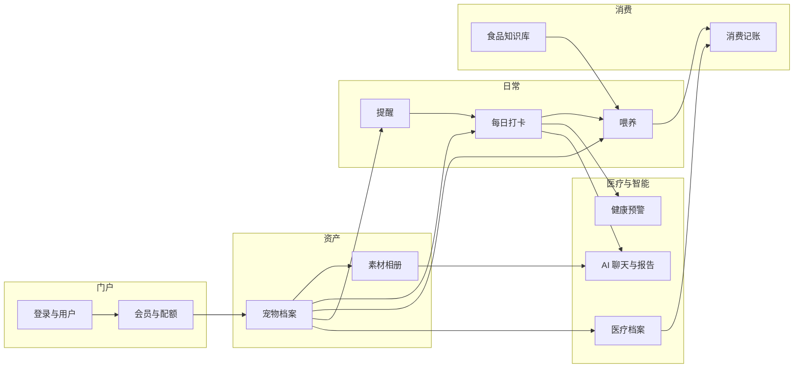
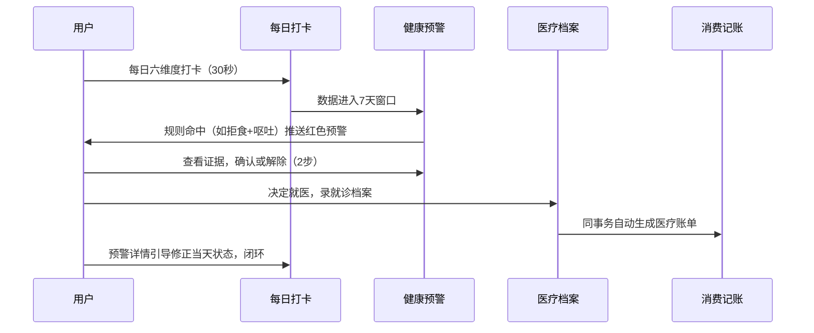

# FaFa 宠物助手 产品总览

文档日期：2026-10-07

本文基于 `fafa-java` 后端 `com.fafa.interfaces.controller` 下 32 个 Controller 逐一分析汇编，是全部模块文档（01–12）的索引与全景视图。模块内细节以对应文档为准。

---

## 1 产品定位

FaFa 是一款微信小程序，面向养宠家庭，把宠物的一生装进一个应用：档案、吃饭、健康、看病、花钱、回忆、内容分享。核心主张有三条。

1. **一次打卡，全链路受益**。用户每天花 30 秒记录宠物状态（食欲、精神、饮水、排泄等六个维度），这些数据同时喂养三个下游能力：健康规则引擎的预警判断、AI 聊天的事实上下文、周期报告的事实快照。数据只录一次。
2. **家庭协作，权限分明**。主人、家庭成员（MEMBER）、临时照护者（CAREGIVER）三种角色通过 17 个细粒度权限码共享同一只宠物的管理权，临时照护者最长 30 天自动过期，适合寄养、出差、帮邻居照看等场景。
3. **AI 是助手不是医生**。识粮、语义搜图、聊天、报告、就诊小结全部由 AI 驱动，但医疗结论在代码层被违禁词表拦截，所有 AI 输出带免责声明，识粮结果必须用户确认才入库。

---

## 2 用户与角色

| 角色 | 来源 | 能力范围 | 典型场景 |
| --- | --- | --- | --- |
| 主人（OWNER） | 创建宠物的人 | 全部 17 项权限，含成员管理、访问审计、急救卡编辑 | 日常管理者 |
| 家庭成员（MEMBER） | 接受邀请 | 10 项权限，无有效期限制，可看可记不可管 | 家人共同养宠 |
| 临时照护者（CAREGIVER） | 接受邀请 | 6 项权限，有效期 1–30 天强制过期 | 出差寄养、邻居代喂 |

会员（VIP）不改变角色权限，只扩展资源上限：存储 2GiB→20GiB、语义检索 10 次/月→不限、识粮 5→50 次/月、报告与内容共享池 3→10 次/月、协作成员 0→5 人。

---

## 3 业务全景

12 个模块按"谁在什么时候用"分为五层。

| 层 | 模块 | 文档 | 核心问题 |
| --- | --- | --- | --- |
| 门户层 | 登录与用户 | 01 | 我是谁 |
| 门户层 | 会员与配额 | 12 | 我能用多少 |
| 资产层 | 宠物档案与标签 | 02 | 我的宠物是谁 |
| 资产层 | 素材与相册 | 08 | 我宠物的照片视频 |
| 日常层 | 日常记录与体重 | 03 | 今天过得怎么样 |
| 日常层 | 喂养管理 | 04 | 今天吃什么吃多少 |
| 日常层 | 提醒与成长时间线 | 07 | 别忘了什么事 |
| 消费层 | 食品知识库 | 05 | 吃的东西好不好 |
| 消费层 | 消费记账 | 11 | 花了多少钱 |
| 医疗层 | 医疗健康 | 06 | 生病了怎么办 |
| 智能层 | AI 助手与内容报告 | 09 | 系统替我想什么说什么 |

---

## 4 跨模块核心链路

### 4.1 新用户冷启动（登录 → 第一只宠物 → 第一次打卡）

1. 微信一键登录，首次自动注册，`newUser=true` 触发引导。
2. 引导页填昵称等资料（可跳过），进入首页。
3. 首页空状态引导创建宠物：名称、类型、性别、绝育 + 三张定位照片（头像、正面、侧面）。
4. 创建完成，系统自动派发向量化任务，同时首页出现"今日打卡"与"今日提醒"卡片。
5. 用户点"一键一切正常"，30 秒完成第一次打卡。

### 4.2 每日闭环（打卡 → 预警 → 医疗 → 记账）

### 4.3 AI 数据消费链（素材/打卡/喂养 → AI → 行动）

- 语义搜图：素材上传后向量化，聊天与搜索走 `/api/photos/search` 语义通道（占月配额，失败不扣）。
- AI 聊天：模型通过 `/internal/ai/**` 只读端点拿宠物事实（体重、打卡、喂养、医疗），回复中 blocks 携带 stat/chart 卡片；当用户说"今天吐了一次"，recordDraft 置信度 ≥0.80 时提示一键落记录，免去跳页表单。
- 周期报告：周/月/季/年报从 10 类事实快照组装（report-facts-v1），与内容生成共享 3/10 次月配额，生成失败不扣次并降级为确定性摘要。
- 内容创作：分享笔记/小红书草稿从报告与素材取材，定时发布按 7/15/30 天周期自动生成。

### 4.4 喂养闭环（食品 → 计划 → 记录 → 分析）

粮票登记（或拍照识粮）→ 建喂养计划（≤12 项，规则推荐非 AI）→ 每日今日清单打卡（计划项 × 实际记录联查）→ 喂养分析看趋势 → 换粮期建 3–30 天逐日比例计划 → 反应记录异常时回到健康预警。

---

## 5 关键规则速查

### 5.1 配额总表

| 资源 | 免费 | VIP | 触顶错误码 |
| --- | --- | --- | --- |
| 存储空间 | 2GiB | 20GiB | 40005 |
| AI 语义检索 | 10 次/月 | 不限（-1） | 40006 |
| AI 识粮 | 5 次/月 | 50 次/月 | 40016 |
| 报告+内容共享池 | 3 次/月 | 10 次/月 | 71004 |
| 宠物数量 | 2（[待确认]） | 不限（999） | — |
| 协作成员 | 0（[待确认]） | 5 | 72005 |

### 5.2 步数原则落地对照

用户要求"一个逻辑不超过 2–3 步"，各模块的主路径设计：

| 场景 | 步数 | 路径 |
| --- | --- | --- |
| 每日打卡 | 1 步 | 一键"一切正常" |
| 每日打卡（同昨日） | 2 步 | 预览 → 确认复制 |
| 提醒完成 | 2 步 | 点完成 → 空体提交即成 |
| 聊天落记录 | 1 步 | recordDraft 卡片点"保存" |
| 识粮入库 | 3 步 | 拍照 → 核对草稿 → 确认 |
| 喂哺打卡 | 2 步 | 今日清单点项 → 确认 |
| 预警处理 | 3 步 | 看列表 → 看证据 → 确认/解除 |
| 语义搜图 | 1 步 | 输入自然语言直接出结果 |
| 创建宠物 | 3 步 | 基础信息 → 三照片 → 提交 |

### 5.3 不可变与自动行为

| 行为 | 规则 |
| --- | --- |
| 医疗系统账单 | 就诊同事务生成，用户只读，误删后改费用自动恢复 |
| 提醒生成的成长事件 | 不可编辑删除，manual 事件才可改 |
| MEDICATION 提醒 | 只能由用药计划派生，手动创建报 MEDICATION_PLAN_REQUIRED |
| 换粮比例 | 每日步进合计必须恰为 100% |
| 健康预警指纹 | SHA-256 去重，同证据不重复打扰，红色 24h 后可重报 |
| 邀请令牌 | 30 分钟一次性，库存摘要不存原文 |

### 5.4 支付与推送现状

支付未接入，会员开通接口调用即生效，属上线前硬风险。微信订阅消息通道未接入，提醒推送目前仅落投递记录。两者在对应模块文档中标注 [待确认]。

---

## 6 模块文档索引

| 文档 | 主题 | Controller |
| --- | --- | --- |
| 01-登录与用户 | 登录、资料、头像 | AuthController, UserController, PingController |
| 02-宠物档案与标签 | 档案、三视图、标签 | PetController, TagController |
| 03-日常记录与体重 | 六维打卡、体重趋势 | DailyRecordController, WeightRecordController |
| 04-喂养管理 | 计划、喂哺、分析 | FeedingPlan/Record/AnalysisController |
| 05-食品知识库 | 粮票、识粮、评分、换粮 | FoodCard/Recognition/SafetyScore/TransitionController |
| 06-医疗健康 | 就诊、用药、预警、小结 | MedicalController, HealthAlertController |
| 07-提醒与成长时间线 | 提醒、推送、事件 | ReminderController, EventRecordController |
| 08-素材与相册 | 上传、检索、归属 | PhotoController |
| 09-AI助手与内容报告 | 聊天、报告、草稿、定时 | Chat/Report/ContentDraft/ContentSchedule/Callback/InternalAiQueryController |
| 10-家庭协作与权限 | 邀请、权限、审计、急救卡 | PetCollaboration/Invitation/AccessAudit/EmergencyCardController |
| 11-消费记账 | 账单、统计 | ExpenseController |
| 12-会员与配额 | VIP、配额 | QuotaController |
