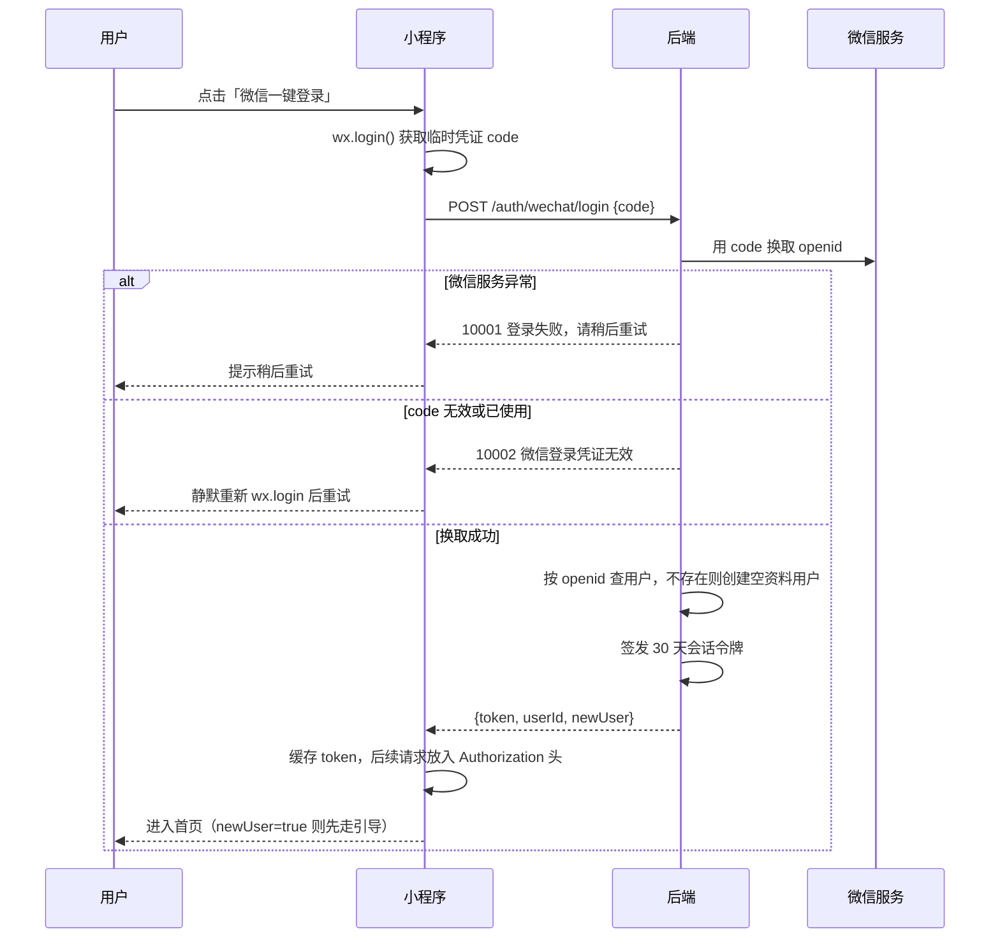
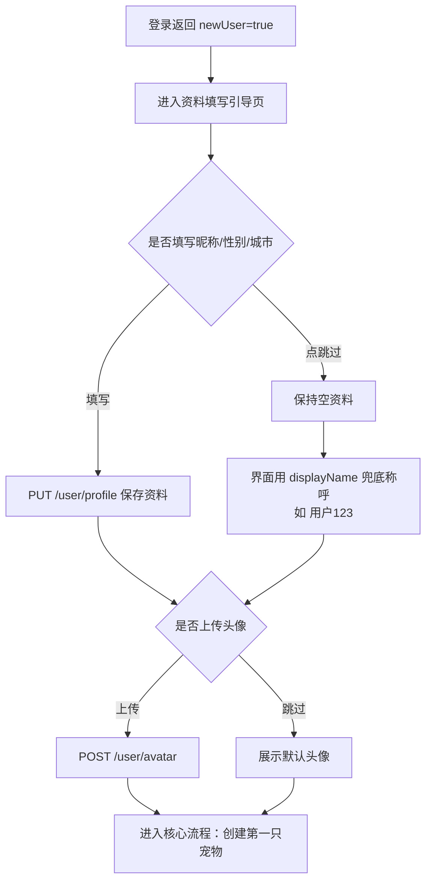

# 登录与用户

> 文档日期：2026-10-07
> 对应后端模块：AuthController、UserController、PingController

## 一、模块定位

登录与用户模块解决"谁在使用小程序"这一个问题：其余所有功能（宠物档案、素材、AI 能力）都建立在一个已登录的账号之上。模块对外提供四类能力：

- 登录：仅微信一键登录一种方式，没有手机号密码、没有独立注册流程
- 会话：登录凭证 30 天有效，期间再次进入小程序自动登录，用户无感
- 资料：昵称、手机号、性别、年龄、城市、头像可随时补充或修改，全部非强制
- 探活：`GET /api/ping` 免登录健康检查，用于前端连通性自检

用户不需要记住任何账号密码。卸载小程序、更换手机后，只要是同一个微信账号，登录回来仍是原来的数据。

## 二、用户与场景

| 场景 | 用户动作 | 系统行为 |
| --- | --- | --- |
| 首次进入 | 点击「微信一键登录」按钮 | 一步完成登录与注册，返回 newUser=true，触发新手引导 |
| 日常回访 | 直接打开小程序 | 用本地缓存凭证自动访问；凭证失效时静默重新登录 |
| 补充/修改资料 | 进入资料编辑页，修改昵称、城市等 | 校验字段后保存，返回最新资料回显 |
| 设置头像 | 从相册选图或拍照 | 上传头像图片并更新头像地址 |
| 结束使用 | 点击「退出登录」（若前端提供） | 销毁当前会话，下次需重新登录 |

## 三、微信 code 登录（首次自动注册）

### 3.1 业务逻辑

触发条件：用户在登录页点击登录按钮；或前端发现会话失效，需要重新换取身份。

处理规则：

1. 小程序调用 `wx.login()` 获得临时登录凭证 code。code 只能用一次，用过即失效；其有效期由微信侧控制，后端代码未标注 [待确认]
2. 前端调用 `POST /auth/wechat/login`，请求体为 `{"code": "..."}`。code 必填，缺失或空字符串提示「code 不能为空」
3. 后端拿 code 向微信服务换取该微信用户在本小程序内的唯一标识 openid；code 属于敏感凭证，不写入日志
4. 后端按 openid 查找用户：
   - 查到：老用户，`newUser = false`
   - 查不到：**当场创建新用户**，`newUser = true`。新用户昵称、手机号、性别、年龄、城市、头像全部为空，默认非会员，不强制填写任何资料
5. 身份确认后签发会话令牌（随机字符串格式，**30 天有效**），连同 userId 返回

输出结果：`token`、`userId`、`newUser` 三个字段。前端把 token 存到小程序本地，后续请求统一放入 Authorization 请求头；`newUser = true` 是判断"是否新用户、要不要走引导流程"的唯一依据。

异常分支：

- 微信服务调用失败（网络异常等）→ 返回 10001「登录失败，请稍后重试」
- code 无效、已被使用，或微信返回错误码 → 返回 10002「微信登录凭证无效」，前端应重新执行 `wx.login()` 再试

### 3.2 交互逻辑

| 用户动作 | 系统响应 | 页面变化 |
| --- | --- | --- |
| 打开小程序 | 前端尝试用本地缓存 token 调用 `GET /user/me`；成功则已登录 | 直接进入首页/我的页 |
| 点击「微信一键登录」 | 前端静默取 code 并调用登录接口，无需弹窗授权手机号 | 成功后进入首页；newUser=true 时跳转到资料引导页 |
| 登录失败（10001/10002） | 前端提示「登录失败，请稍后重试」或重新自动发起登录 | 停留在登录页，按钮可再次点击 |
| 会话过期后访问功能 | 接口返回 1002，前端自动重新登录并重放请求 | 用户无感知；连续失败才回到登录页 |

登录页只有一个按钮。微信登录不向用户索取昵称/头像授权，资料一律由用户在引导页自行填写。

### 3.3 登录时序

## 四、登出

### 4.1 业务逻辑

触发条件：用户主动退出，或前端切换账号前清理会话。

处理规则：调用 `POST /auth/logout`（需登录态），后端销毁当前会话。该 token 此后访问任何需登录接口都会返回 1002。对其他设备登录态的影响 [待确认]。

输出结果：无数据返回（data 为空），前端清除本地缓存的 token。

### 4.2 交互逻辑

小程序产品的常规做法是不放显式的「退出登录」按钮（微信体系下用户可通过删除小程序、微信授权管理来重置授权）[待确认]。若前端提供退出入口：点击 → 调用登出接口 → 清本地 token → 回到登录页。登出不会删除任何用户数据，重新登录（同一微信）即恢复。

## 五、会话与鉴权规则

- 令牌放在 **Authorization 请求头**，有效期 30 天；同一账号允许多端/多次并发登录
- 免登录白名单仅包含：`/auth/wechat/login`、`/api/ping`、回调 `/api/callback/**`、内部接口 `/internal/**`、运维健康检查，以及接口文档页
- 白名单以外的全部接口未登录访问返回 1002「未登录或登录已过期」
- 访问不存在的接口路径返回 1004「资源不存在」，不会误报未登录
- 前端处理约定：收到 1002 时自动重新走登录流程并重放原请求，用户无感

## 六、用户资料查看与更新

### 6.1 查看：GET /user/me（需登录）

返回当前用户完整资料：id、openId、nickname、phone、gender、age、avatarUrl、city、vip、vipExpireTime、displayName。

其中 displayName 是后端计算的展示名，规则为：昵称非空用昵称；否则手机号非空用手机号；否则用「用户 + id」兜底。这保证新用户在任何资料都没填时，界面仍有可用的称呼（如"用户123"）。

### 6.2 更新：PUT /user/profile（需登录）

业务逻辑：触发条件为用户在资料编辑页点击保存。后端依次校验五个字段（见下表），任一不合法即返回 1001，且只提示第一个出错字段的文案；全部通过则保存并返回更新后的完整用户信息。

字段规则（全部提取自后端校验代码）：

| 字段 | 类型 | 是否必填 | 校验规则 | 校验失败提示 |
| --- | --- | --- | --- | --- |
| nickname | 字符串 | 否 | 长度不超过 50 字符 | 昵称不能超过50个字符 |
| phone | 字符串 | 否 | 须匹配 `^1[3-9]\d{9}$`（11 位大陆手机号） | 手机号格式不正确 |
| gender | 字符串 | 否 | 期望值 男 / 女 / 未知；后端未做强制枚举校验 [待确认] | 无 |
| age | 整数 | 否 | 0 ≤ age ≤ 150 | 年龄不能小于0 / 年龄不能大于150 |
| city | 字符串 | 否 | 长度不超过 50 字符 | 城市不能超过50个字符 |

两条重要的实现语义，前端与产品都必须知道：

1. **全量覆盖**：保存动作无条件用本次请求体的 5 个字段覆盖旧值。请求里没带（或带 null）的字段会被清空。资料编辑页必须先回填当前资料，再整体提交，不能只提交改动项。
2. 必填与否只由交互层保证：手机号、年龄确实不强制；背景设计意图中"性别、城市在引导页必填"仅靠前端引导页约束，后端接口层面允许为空 [待确认] 是否要在服务端补强制校验。

### 6.3 交互逻辑

| 用户动作 | 系统响应 | 页面变化 |
| --- | --- | --- |
| 进入「我的-资料编辑」 | 调 `GET /user/me` 回填各字段 | 已填字段显示旧值，未填显示占位提示 |
| 修改昵称超过 50 字后保存 | 返回 1001「昵称不能超过50个字符」 | 页面顶部/字段下方提示，旧值保留 |
| 手机号输入 10 位后保存 | 返回 1001「手机号格式不正确」 | 同上，前端宜在输入时先行校验 |
| 正常保存 | 返回最新用户信息 | 提示保存成功，「我的」页同步刷新 |

### 6.4 关于重复昵称

后端**不校验昵称唯一性**（代码中仅宠物名称在同用户名下做唯一约束），两个用户可以填同一个昵称，系统不会冲突或提示 [待确认] 产品是否需要限制重复昵称。

## 七、头像上传

### 7.1 业务逻辑

触发条件：用户在资料页点击头像区域并选定图片。

处理规则：前端以 multipart 表单调用 `POST /user/avatar`，文件参数名固定为 `file`。后端把图片存入对象存储（开发环境 MinIO，生产环境阿里云 OSS，按用户目录归档），随后把可访问的图片地址写回用户资料的 avatarUrl 字段，返回更新后的完整用户信息。

补充规则：

- 头像上传**不消耗宠物料存储空间配额**（配额只统计宠物素材）
- 后端未对图片格式、尺寸做专门校验，仅受全局上传大小限制（单文件 50MB，整个请求 100MB）约束；超限当前会落到通用系统异常提示而非专门文案 [待确认] 是否需要对头像做图片类型与大小校验
- 新注册用户头像字段为空，小程序端应展示默认可爱头像占位图 [待确认] 默认头像素材与更换入口

### 7.2 交互逻辑

点击头像 → 弹出「从相册选择 / 拍照」→ 选定图片后自动上传 → 成功后头像区域立即显示新图并持久化 → 失败提示重试。重新上传即覆盖旧头像（旧图片的清理策略 [待确认]）。

## 八、新用户引导场景

### 8.1 业务逻辑

后端没有独立的"引导"接口，引导完全由登录响应中的 `newUser = true` 驱动：首次登录自动注册的用户资料全空，需要引导页补齐；此后每次登录 `newUser = false`，不再触发引导。引导过程中调用的就是第六章的资料保存接口和第七章的头像上传接口，允许用户跳过（后端本就允许全部为空）。

### 8.2 交互逻辑

背景设计意图（以代码为准的部分见第六、七章）：昵称引导文案建议亲昵称呼风格，如"铲屎官""小主一号"；性别与城市是运营希望必填的项 [待确认] 引导文案与是否强制。

## 九、规则与边界汇总

| 边界情形 | 系统行为 |
| --- | --- |
| 未登录/会话过期访问需登录接口 | 返回 1002「未登录或登录已过期」，前端静默重登 |
| 登录请求缺 code 或 code 为空串 | 返回 1001「code 不能为空」 |
| code 被重复使用 / 微信侧报错 | 返回 10002「微信登录凭证无效」 |
| 微信服务网络异常 | 返回 10001「登录失败，请稍后重试」 |
| 有登录态但用户记录已不存在 | 返回 10003「用户不存在」；注销/删号流程目前代码中不存在 [待确认] |
| 资料字段校验失败 | 返回 1001 + 第一个出错字段的提示文案 |
| 资料请求只带部分字段 | 视为全量更新，未带字段被清空（见 6.2） |
| 不同用户填写相同昵称 | 服务端不拦截，允许重复 |
| 头像文件超过全局上传限制 | 上传失败，当前无专门提示文案 [待确认] |
| 访问不存在的接口路径 | 返回 1004「资源不存在」，不误报未登录 |
| 微信侧返回的 unionid | 当前登录与注册只依赖 openid，unionid 未使用 [待确认] 用途 |

## 十、错误码索引

| 错误码 | 提示文案 | 出现场景 |
| --- | --- | --- |
| 1001 | 参数校验失败（附具体字段提示） | code 为空、资料字段超限/格式错误 |
| 1002 | 未登录或登录已过期 | 未带令牌、令牌过期、登出后访问 |
| 1004 | 资源不存在 | 访问不存在的路径 |
| 10001 | 登录失败，请稍后重试 | 调用微信服务异常 |
| 10002 | 微信登录凭证无效 | code 无效、已使用或微信返回错误 |
| 10003 | 用户不存在 | 登录态有效但用户记录缺失 |
| 9999 | 系统异常 | 未预期错误，含头像超大等边界 |

## 十一、API 索引

| 方法 | 路径 | 功能 | 需登录 |
| --- | --- | --- | --- |
| POST | /auth/wechat/login | 微信一键登录（首次自动注册） | 否 |
| POST | /auth/logout | 登出 | 是 |
| GET | /user/me | 获取当前用户资料 | 是 |
| PUT | /user/profile | 更新资料（全量覆盖 5 字段） | 是 |
| POST | /user/avatar | 上传头像（multipart，参数名 file） | 是 |
| GET | /api/ping | 健康检查，返回 pong | 否 |

响应统一结构：`{ code, message, data }`，code=0 表示成功，非 0 见错误码索引。
