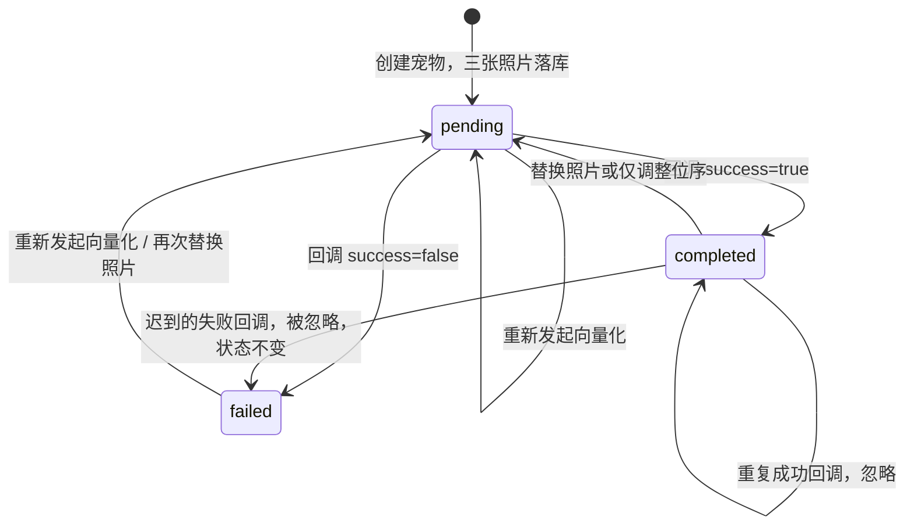
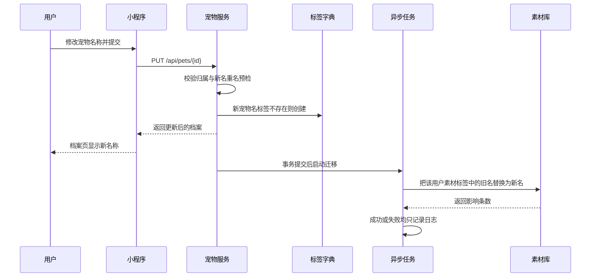

# 宠物档案与标签

文档日期：2026-10-07

对应 Controller：`PetController`（`/api/pets`）、`TagController`（`/api/tags`）、`CallbackController`（`/api/callback/pet-vectorization`，三视图向量化回调，服务间调用）

本文规则全部提取自上述接口对应的应用服务与领域模型源码，接口说明与代码不一致处以代码为准并标注差异。

---

## 1 功能定位

用户侧能完成的事：

- 为自家宠物建立档案，一次录入名称、类型、品种、性别、出生日期、绝育状态、到家日期、体重
- 上传三张定位照片（头像 + 正面照 + 侧面照）作为宠物的视觉身份
- 查看宠物列表与详情，修改资料，替换或重排三张照片
- 手动重新发起三视图向量化，调整多只宠物的展示顺序，删除宠物
- 维护个人标签字典：查看、新建、删除标签

系统侧承担的事：宠物照片入对象存储、三视图向量化任务派发与状态回收、宠物名自动生成标签、宠物改名后素材标签迁移、删除宠物时的关联数据清理。

---

## 2 创建宠物

`POST /api/pets`，`multipart/form-data`，需登录。

### 2.1 字段与必填规则

| 字段 | 类型 | 必填 | 规则来源与说明 |
| --- | --- | --- | --- |
| name | 文本 | 是 | 不能为空白；提交后服务端 trim 再落库；同一用户下不可重复 |
| type | 文本 | 是 | 取值 `cat` / `dog` / `other`；非法值抛 `Invalid pet type` |
| breed | 文本 | 否 | 品种，自由文本，无长度校验 |
| gender | 文本 | 是 | 取值 `male` / `female` / `unknown`；非法值抛 `Invalid gender` |
| birthDate | 日期 | 否 | 语义为"出生日期（外推）" |
| isNeutered | 布尔 | 是 | 缺省即报"绝育状态不能为空"；落库时空值按 `false` 处理 |
| adoptDate | 日期 | 否 | 到家日期 |
| weight | 数值 | 否 | 当前体重，单位 kg |
| photos | 文件数组 | 是 | 必须恰好 3 个图片文件，按位序对应位1/位2/位3 |

创建流程中不校验单张照片体积。宠物照片接口本身没有大小上限校验，配置项 `media.photoMaxSizeBytes=10485760`（10MB）在其他上传通道生效，宠物照片通道是否复用该校验 [待确认]。

### 2.2 三张定位照片规则

三张照片是一个整体，位序即语义：

| 位序 | 语义 | 存储目录（替换场景） | 校验失败提示 |
| --- | --- | --- | --- |
| 位1 | 头像 | `avatar/pet/{petId}` | 第1张照片不能为空 / 必须是图片文件 |
| 位2 | 正面照 | `profile/pet/{petId}/front` | 第2张照片不能为空 / 必须是图片文件 |
| 位3 | 侧面照 | `profile/pet/{petId}/side` | 第3张照片不能为空 / 必须是图片文件 |

- 数量硬性要求：`photos` 为 null 或数量不等于 3，一律拒绝，提示"必须上传三张照片：位1头像、位2正面照、位3侧面照"
- 单个文件为空（未选文件）拒绝，提示"第N张照片不能为空"
- 文件的 `contentType` 必须以 `image/` 开头，否则提示"第N张照片必须是图片文件"
- 创建时宠物尚无 ID，照片按用户目录存放（`avatar/user/{userId}`、`profile/user/{userId}/front`、`profile/user/{userId}/side`）
- 对象名含 UUID，重复文件名不会覆盖已有对象

### 2.3 同用户名称唯一

判定口径为 trim 后精确匹配，区分大小写，不做拼音或近似名归一。

两道防线：

1. 落库前预检当前用户全部宠物，命中重复即抛"同一用户下宠物名称不能重复"
2. 保存时若触发数据库唯一约束冲突，同样转换为"同一用户下宠物名称不能重复"

已删除宠物是否仍占用名称由仓储查询范围决定：预检基于"当前用户宠物列表"查询结果 [待确认]（逻辑删除记录是否被排除取决于仓储实现）。

### 2.4 数量上限

接口文档描述为"普通用户限2只，会员不限"，配置项存在 `pet.limit.normal=2`、`pet.limit.vip=999`，但创建流程 `registerPet` 中没有任何数量校验调用，也没有计数查询被使用。

结论：**当前代码未强制宠物数量上限**，任意用户可无限创建宠物。该差异需产品确认后补齐实现或修正文案。

### 2.5 业务逻辑

触发：用户提交创建表单。

处理规则，按顺序：

1. 名称 trim 后做重名预检，重复即终止
2. 校验三张照片数量、非空、图片类型
3. 三张照片在数据库事务之外并行上传对象存储（虚拟线程，一次并发 3 个），避免慢速网络 IO 长时间占用数据库连接
4. 开启短事务：构造宠物对象（向量化状态置 `pending`、排序号取当前用户最大值 +1 即追加到列表末尾、未删除）→ 保存 → 自动创建宠物名标签（`category=pet`，已存在则跳过）→ 注册事务提交后的向量化派发
5. 事务提交成功后，异步派发三视图向量化任务给 AI 侧
6. 输出：返回宠物详情，`vectorizationStatus=pending`

失败与补偿规则：

- 第 3 步任一照片上传失败，整个请求失败，不产生宠物记录
- 第 4/5 步（落库、建标签、保存）抛出异常时，异步删除本次已上传的三张照片，避免遗留不可引用的对象，随后异常原样返回给用户

### 2.6 交互逻辑

| 用户动作 | 系统响应 | 页面变化 |
| --- | --- | --- |
| 进入创建页 | 拉取标签字典用于展示已有宠物名标签 | 表单空白，照片区为 3 个固定位次的坑位 |
| 依次选择头像、正面、侧面 3 张图 | 无请求 | 三个坑位分别显示本地预览，头像位作为列表卡片主图预览 |
| 少选 1 张并提交 | 返回"必须上传三张照片" | 停留在表单，提示补齐，坑位不清空 |
| 上传非图片文件 | 返回"第N张照片必须是图片文件" | 停留在表单，定位到对应坑位提示 |
| 名称与他人无关但与自己已有宠物重名 | 返回"同一用户下宠物名称不能重复" | 名称输入框报错，保留已选照片 |
| 校验全部通过 | 上传期间显示加载态，返回新宠物详情 | 跳转宠物列表或档案页，新宠物排在最后，头像立即显示，向量化状态显示"处理中" |
| 向量化完成回调到达 | 状态转为已完成 | 档案页向量化标识消失或显示"已完成"，AI 找图对该宠物可用 |

创建接口在一次请求内完成上传与落库，照片体积大时用户会感到提交耗时较长，需要保留加载态并禁止重复提交。

---

## 3 查看与更新档案

### 3.1 列表与详情

| 接口 | 可见范围 | 权限口径 |
| --- | --- | --- |
| `GET /api/pets` | 仅当前登录用户名下的宠物，按排序号升序 | 直接按用户归属查询，不含协作宠物 |
| `GET /api/pets/{id}` | 单只宠物详情 | 走协作权限 `READ_PROFILE`，主人与已接受的成员/临时照护者均可读取 |

响应字段：`id`、`userId`、`name`、`type`、`breed`、`gender`、`birthDate`、`isNeutered`、`adoptDate`、`weight`、`avatarUrl`、`frontPhotoUrl`、`sidePhotoUrl`、`photos`（按位序数组）、`vectorizationStatus`、`sortOrder`。

`PetDetailResponse` 定义了 `createdAt` / `updatedAt`，但装配代码未赋值，实际返回恒为空 [待确认] 是补数据还是删字段。

`photos` 数组按位序返回，存量宠物若缺某张照片，对应位置为空值，前端需按空值兜底。

### 3.2 更新资料

`PUT /api/pets/{id}`，JSON，仅主人可改（校验宠物归属，非主人返回"无权操作此宠物"）。协作成员没有修改档案的入口。

字段覆盖规则决定了前端必须整表提交：

| 字段 | 传 null 或不传时的结果 | 说明 |
| --- | --- | --- |
| name | 请求层要求非空白；领域层仅在非空白时覆盖 | 传空白串不报错但保留旧名 |
| breed | 清空 | 无条件覆盖 |
| gender | 保留旧值 | 非空才覆盖，非法值抛 `Invalid gender` |
| birthDate | 清空 | 无条件覆盖 |
| isNeutered | 置为 `false` | 空值按未绝育处理 |
| adoptDate | 清空 | 无条件覆盖 |
| weight | 不生效 | 请求含 weight，但更新命令未携带该字段；体重由体重记录功能维护 |

产品含义：编辑页必须先用详情数据回填全部字段再提交，否则品种、出生日期、到家日期会被静默清空，绝育状态会被重置为未绝育。

名称变化时的附加规则：

- 新旧名不同才做重名预检（同名提交不会因自己撞自己而报错）
- 新名自动创建 `category=pet` 标签
- 事务提交后异步迁移素材标签，见第 9 节

---

## 4 替换三视图照片

`PUT /api/pets/{id}/photos`，`multipart/form-data`，仅主人。

头像与三视图是同一套照片，不存在独立的头像上传接口。每个位次提供两种输入，二选一：

| 位次 | 上传新文件 | 复用现有照片 URL |
| --- | --- | --- |
| 位1 头像 | `avatarFile` | `avatarUrl` |
| 位2 正面照 | `frontFile` | `frontUrl` |
| 位3 侧面照 | `sideFile` | `sideUrl` |

### 4.1 校验规则

| 场景 | 系统提示 |
| --- | --- |
| 某位次既不传文件也不传 URL | 第N张照片缺失：需上传新文件或传入现有照片URL |
| 文件为空 | 第N张照片不能为空 |
| 文件不是图片 | 第N张照片必须是图片文件 |
| 传入的 URL 不在该宠物现有三张照片中 | 第N张照片复用的URL不属于该宠物现有照片 |
| 宠物不存在 | 宠物不存在 |
| 非主人操作 | 无权操作此宠物 |

复用 URL 只能是该宠物当前已有的三张之一，因此本接口只能"换新图"和"重排位次"，不能跨宠物搬图。

### 4.2 业务逻辑

触发：用户提交替换请求。

处理规则：

1. 事务外读取宠物并校验归属、校验三个位次
2. 区分新文件位次与复用位次，复用位次的 URL 直接沿用
3. 若三个位次全部为复用、位序与内容完全未变、且向量化已完成，直接返回当前档案，不重传也不重新派发（幂等，避免误触发生成重复向量）
4. 仅调整位序（三张 URL 相同但顺序变化）仍会重新派发向量化，因为向量库按正面/侧面/头像分别入库，位次与向量的对应关系已经改变
5. 有新文件的位次，事务外并行上传
6. 短事务：写入三张新 URL（领域层再次强制三张齐全）并把向量化状态重置为 `pending` → 保存 → 注册提交后动作
7. 事务提交后异步执行：删除未在新位序中被复用的旧照片对象，然后派发向量化
8. 落库失败时异步清理本次新上传的文件，被复用的旧 URL 不受影响

输出：返回更新后的宠物档案，`vectorizationStatus=pending`。

### 4.3 交互逻辑

| 用户动作 | 系统响应 | 页面变化 |
| --- | --- | --- |
| 只换头像，正面侧面选"保持" | 仅上传头像，旧头像对象在提交后删除 | 头像更新，向量化状态转为处理中，数秒后恢复完成 |
| 把现有正面照挪到头像位 | 免重传，直接换位 | 三张图重排，触发重新向量化 |
| 位次顺序原样重新提交且已完成向量化 | 无变化，直接返回成功 | 页面无变化，不出现重复处理 |
| 把某个位次的 URL 写成别的宠物的照片地址 | 返回"第N张照片复用的URL不属于该宠物现有照片" | 保持原图，提示重新选择 |
| 向量化处理中查看档案 | 状态为 pending | 档案页显示处理中，AI 找图结果可能不含该宠物 |

---

## 5 三视图向量化状态机

向量化让 AI 能按照片识别宠物，是"AI 找图"能力的前置条件。任何照片变化都会让状态回到待处理。

| 状态码 | 含义 | 写入方 |
| --- | --- | --- |
| pending | 已落库、待处理或处理中 | 宠物服务（创建、替换照片、重新向量化） |
| processing | 向量化中 | 枚举已定义，Java 侧无写入点 [待确认]，推测由 AI 侧更新 |
| completed | 已完成 | AI 回调成功 |
| failed | 处理失败 | AI 回调失败 |

### 5.1 回调规则

AI 处理完成后调用 `POST /api/callback/pet-vectorization`，请求体为下划线字段：`pet_id`、`success`、`message`。

- `success=true`：置 `completed`，允许从任意状态覆盖（失败后重试成功要能翻转）
- `success=false`：置 `failed`，但已是 `completed` 的宠物不降级，防止乱序的迟到失败回调把成功结果冲掉
- 状态未发生变化：视为重复或过期通知，直接忽略，不产生写库
- 宠物 ID 不存在：抛"宠物不存在: {petId}"

### 5.2 重新向量化

`POST /api/pets/{id}/photos/revectorize`，无请求体，仅主人。这是向量化失败或任务丢失时的人工补偿入口。

| 前置条件 | 结果 |
| --- | --- |
| 三张照片不齐全 | 拒绝，提示"宠物三视图照片不齐全，请先补齐照片再重新向量化" |
| 当前已完成向量化 | 拒绝，提示"当前向量化已完成，无需重新处理" |
| 状态为 pending / failed | 重置为 pending，提交后重新派发任务，返回档案 |

`processing` 状态下的重复点击同样会重置并派发 [待确认] 是否需要防抖。

### 5.3 用户可感知的差异

| 向量化状态 | 档案页 | AI 找图 |
| --- | --- | --- |
| pending | 处理中标识 | 该宠物可能检索不到或结果不全 |
| completed | 无异常标识 | 正常 |
| failed | 失败提示 + 重新向量化入口 | 该宠物不参与基于照片的识别 |

---

## 6 删除宠物与级联清理

`DELETE /api/pets/{id}`，仅主人，逻辑删除，列表和详情不再返回。

| 关联对象 | 处理规则 | 产品含义 |
| --- | --- | --- |
| 宠物档案 | 逻辑删除 | 不可通过本接口恢复 [待确认] 是否提供恢复 |
| 素材（照片/视频） | 保留素材本体，仅清空宠物归属 | 用户的图片不因删除宠物而丢失，变为未归属宠物的素材 |
| 提醒（待办） | 级联逻辑删除该宠物全部提醒 | 不再被扫描与推送 |
| 提醒完成历史、事件记录 | 保留 | 历史记录可独立展示，不依赖宠物存在 |
| 照片向量 | 删除该宠物在向量库中的全部向量 | AI 不再按照片识别该宠物；清理失败不影响删除结果 |
| 宠物名标签 | 保留在标签字典中 | 标签是用户字典数据，不随宠物消失；使用次数不变 |
| 协作成员与邀请 | 代码中无清理动作 [待确认] | 删除宠物后成员关系可能残留，需确认清理策略 |

删除接口同步返回成功，向量清理为幂等非关键动作。

---

## 7 宠物排序

`PUT /api/pets/{id}/sort?sortOrder=N`，仅主人，`N` 越小越靠前。

规则：

1. 取当前用户全部宠物（已按序号升序）
2. 移除目标宠物，把目标位置 clamp 到 `[1, 宠物数量]` 区间内，越界自动收敛（填 0 或 99 都不报错）
3. 目标宠物插入到第 N 位，其余宠物顺延
4. 全部宠物重排为从 1 开始的连续序号并批量更新

输出无返回体，仅表示成功。列表接口按新序号返回，档案详情中的 `sortOrder` 同步变化。

新建宠物自动追加到末尾（当前最大序号 +1）。

用户动作与响应：拖动或点击排序 → 系统返回成功 → 列表立即按新顺序渲染，且所有宠物的序号都变为连续值。

---

## 8 标签字典

标签是用户级私有字典，供素材与事件打标时选择；打标动作本身在素材/事件接口编排，本模块只负责字典维护。

| 接口 | 说明 |
| --- | --- |
| `GET /api/tags` | 当前用户全部标签，按使用次数降序、最后使用时间降序 |
| `POST /api/tags` | 新建标签 |
| `DELETE /api/tags/{id}` | 删除标签定义 |

### 8.1 字段规则

| 字段 | 必填 | 规则 |
| --- | --- | --- |
| name | 是 | 非空白，trim 后长度 1–50；违规返回 40007"标签名不能为空且不超过50个字符" |
| category | 否 | 取值 `pet` / `location` / `action` / `object` / `mood` / `other`；可不传（无分类）；非法值返回参数错误并附"标签分类取值非法: xxx" |

响应字段：`id`、`tagName`、`category`、`usageCount`、`lastUsedAt`。

### 8.2 同名与重复

同一用户下标签名唯一。创建时命中已有同名标签返回 40008 `TAG_DUPLICATE`。名称比较基于 trim 后的精确匹配，不做大小写归一。

`category=pet` 的标签由系统自动创建，用于把宠物名称沉淀为可复用的标签；自动创建时名称超过 50 字符会截断到 50 字符，且已存在同名标签则跳过（宠物名与手工标签同名时不会报错）。

### 8.3 使用次数

`usageCount` 只增不减：每次被素材或事件使用即 +1，并刷新 `lastUsedAt`。删除标签后计数丢失，重建同名标签从 0 开始。

### 8.4 删除与快照

删除是物理删除标签定义，返回结果：标签不存在 40009 `TAG_NOT_FOUND`；标签属于他人 403。

关键规则：素材和事件保存的是标签名快照，删除字典项不会回写、不会清空历史素材上已打的标签。用户视角表现为"标签从选择列表消失，但老照片上仍显示该标签"。

---

## 9 宠物改名触发的素材标签异步迁移

改名影响的是历史素材上以宠物名形式存在的标签。系统采用"改名立即生效、标签后台迁移、失败不阻断"的策略。

规则要点：

- 只有名称实际发生变化才触发迁移
- 迁移在数据库事务提交之后执行，与改名主流程解耦
- 迁移失败仅记录错误日志，不回滚改名、不自动重试，因此可能出现旧名标签在部分素材上残留 [待确认] 是否需要补偿入口
- 迁移范围限定为改名人自己用户名下的素材

---

## 10 接口一览

| 方法 | 路径 | 用途 | 权限 |
| --- | --- | --- | --- |
| POST | `/api/pets` | 创建宠物（含 3 张照片） | 主人 |
| GET | `/api/pets` | 我的宠物列表 | 本人 |
| GET | `/api/pets/{id}` | 宠物详情 | `READ_PROFILE`（含协作成员） |
| PUT | `/api/pets/{id}` | 更新资料 | 主人 |
| PUT | `/api/pets/{id}/photos` | 替换三视图（新文件或调位序） | 主人 |
| POST | `/api/pets/{id}/photos/revectorize` | 重新向量化 | 主人 |
| PUT | `/api/pets/{id}/sort` | 调整排序 | 主人 |
| DELETE | `/api/pets/{id}` | 删除宠物 | 主人 |
| POST | `/api/callback/pet-vectorization` | 向量化结果回调 | 服务间调用 |
| GET | `/api/tags` | 标签列表 | 本人 |
| POST | `/api/tags` | 新建标签 | 本人 |
| DELETE | `/api/tags/{id}` | 删除标签 | 本人 |

---

## 11 边界与异常清单

| 场景 | 表现 |
| --- | --- |
| 照片数量不足或超过 3 张 | 拒绝创建/拒绝替换 |
| 上传 pdf、视频、0 字节文件 | 按位次提示非图片或为空 |
| 与自己已有宠物重名 | 明确提示，并发时同样收敛为提示 |
| 更新资料漏传可选字段 | 对应字段被清空，绝育状态被重置为未通过 |
| 编辑页反复提交相同三张图且已完成向量化 | 幂等返回，不重复处理 |
| 复用别的宠物的照片 URL | 拒绝，防止跨宠物身份混淆 |
| 向量化失败后不处理 | 档案可正常使用，AI 找图识别不到该宠物 |
| 存量宠物缺照片 | 列表与详情对应位次返回空值，重新向量化被拒绝 |
| 删除宠物 | 素材保留、提醒清除、向量清除、标签保留 |
| 排序值越界 | 自动收敛到首尾，不报错 |

---

## 12 待确认清单

1. 宠物数量上限（普通 2 只 / 会员不限）在创建流程无校验代码，需确认是实现缺失还是策略变更
2. `processing` 向量化状态在 Java 侧无写入点，需确认是否由 AI 服务直接更新
3. `PetDetailResponse.createdAt/updatedAt` 未赋值，需确认补齐或移除
4. 宠物照片上传是否受 10MB 单图上限约束
5. 已逻辑删除宠物的名称是否仍可被重新使用
6. 删除宠物后协作成员与待处理邀请的清理策略
7. 素材标签异步迁移失败后的补偿或重试机制
