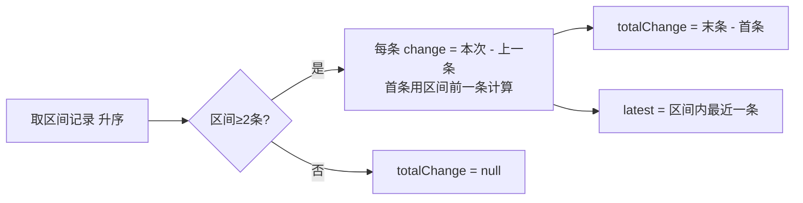

# 日常记录与体重

- 日期：2026-10-07
- 对应 Controller：`DailyRecordController`（前缀 `/api/daily-records`）、`WeightRecordController`（前缀 `/api/weight-records`）

## 1 功能总览

主人每天为宠物做一次状态打卡：从食欲、精神活动、饮水、排便、呕吐、排尿六个维度中，为每个维度选一个档位，形成"一天一格"的日常记录。体重则在周期称重时单独录入，系统会自动同步宠物档案上的当前体重，并提供逐条变化与区间趋势两种查看方式。

日常记录不只是留档：系统会周期性读取近况记录，命中异常组合时产生健康预警（见第 7 节）。打卡页的选项、顺序、必填与医学提示由后端按宠物物种统一下发，前端不硬编码（见第 3 节）。

## 2 每日状态打卡

### 2.1 用户操作与快捷路径

用户在打卡页选择宠物、选择日期（默认今天），逐维度点选档位后提交。围绕"少点击"，系统提供三条完成路径：

| 路径 | 步骤 | 对应接口 |
| --- | --- | --- |
| 一键一切正常 | 1 步：点一下按钮即完成当天打卡 | `POST /api/daily-records/record-normal` |
| 同上次复制 | 2 步：预览上一条记录 → 确认后一键复制生成 | `GET /latest` + `POST /copy-last` |
| 手动逐项填写 | 按维度配置逐项选择后提交 | `POST /api/daily-records` |

手动提交时，`POST /api/daily-records` 对同宠物同日执行覆盖写入（upsert）：重复提交不报错、不新增，以最后一次提交为准。因此用户可随时修改当天记录，交互上不需要"先删再记"。

### 2.2 六维度与档位取值

| 维度 | 请求字段 | 档位（code=label） | 异常档 | 中性档 |
| --- | --- | --- | --- | --- |
| 食欲 | `appetite` | excellent=很好、normal=正常、decreased=下降、refused=拒食 | decreased、refused | 无 |
| 精神活动 | `energy` | active=活跃、normal=正常、lethargic=低迷 | lethargic | 无 |
| 饮水 | `waterIntake` | normal=正常、more=偏多、less=偏少、not_noticed=没注意 | more、less | not_noticed |
| 排便 | `defecation` | normal=正常、soft=偏软、diarrhea=腹泻、constipation=便秘、not_seen=没看到 | soft、diarrhea、constipation | not_seen |
| 呕吐 | `vomiting` | none=无、once=一次、multiple=多次 | once、multiple | none 为默认档 |
| 排尿 | `urination` | normal=正常、abnormal=异常、not_seen=没看到 | abnormal | not_seen |

补充规则（均出自枚举与服务层校验）：

- 呕吐不填时按 none（无）处理。
- 数值字段：`appetiteAmount` 进食克数、`waterAmount` 饮水毫升数，均选填且不得为负；`notes` 备注最长 500 字符。
- 响应中的 `allNormal` 表示当天是否全部档位正常；`abnormalDimensions` 返回异常维度的编码列表，供前端高亮与预警展示。判断"全部正常"时，未填写（null）的维度不参与判断。

### 2.3 物种维度差异策略

打卡的维度集合、顺序与必填要求按宠物物种差异化配置，规则集中在领域策略 `SpeciesRecordPolicy`：

| 物种 | 展示顺序（*=必填，选=选填） | 排尿维度 |
| --- | --- | --- |
| 猫（other 复用猫配置） | 食欲*、精神活动*、饮水*、排便*、呕吐(选)、排尿* | 必填，且附带急症提示 |
| 狗 | 食欲*、精神活动*、排便*、饮水*、呕吐(选) | 不展示；一键正常时排尿字段留空 |

两个维度带固定医学提示（tip）：

- 猫·饮水：**多饮多尿可能是肾病/糖尿病/甲亢的早期信号**
- 猫·排尿：**排尿困难（频繁蹲姿、尿量少、嚎叫）是按小时计的急症，请立即就医**

狗的配置不附带 tip，且排便排在饮水之前（狗主人更容易直接观察到排便异常）。猫把排尿设为必填的设计动机（代码注释）：公猫排尿困难是按小时计的急症，宁可多问一步也不能漏。

必填校验只在手动提交（`POST`）时执行：缺少该物种任一必填维度即失败，错误码 `DAILY_DIMENSION_MISSING`，提示文案列出缺失的维度名称。"一键一切正常"由系统自动填满全部维度，天然不受此校验约束。

### 2.4 逃生值 not_seen 与 not_noticed 的中性语义

排便/排尿的 `not_seen`（没看到）与饮水的 `not_noticed`（没注意）是**逃生档**，语义上兼顾两头：

- 算"已填写"：满足必填校验。主人确实没观察到，选它即完成该维度作答，不会被系统追问。
- 不算"异常"：不进入 `abnormalDimensions`，不影响 `allNormal` 判断。

产品原则是"漏记不惩罚"：没观察到本身是一条有效记录，既不阻塞打卡，也不制造虚假预警。它与"未填写"（null）的区别在于：null 表示跳过，not_seen 表示主动确认过"今天没看到"。

### 2.5 每日一条与日期约束

- 每宠物每天仅一条记录，同日重复提交为整体覆盖（upsert）。
- `recordDate` 不得晚于今天，违者报 `RECORD_DATE_IN_FUTURE`；允许补记过去的日期。
- 写操作需要宠物写权限（`CREATE_RECORD`），协作场景下照护者可为宠物打卡。

### 2.6 一键一切正常

`POST /api/daily-records/record-normal?petId&date`，无请求体，一次点击完成当天打卡。系统按宠物物种把全部维度填为"正常"档：猫含排尿=正常；狗不含排尿。呕吐填为 none（无）。该接口同样遵循同日覆盖语义。

### 2.7 同上次复制

两步交互：先预览、再复制。

1. 预览：`GET /api/daily-records/latest?petId&before`。`before` 为可选日期，返回严格早于该日期的最近一条记录；缺省时包含今天。宠物尚无任何记录时返回 `data=null`，前端据此隐藏"同上次"入口。
2. 复制：`POST /api/daily-records/copy-last?petId&date`。系统取**严格早于目标日期**的最近一条记录，复制其六维度与数值字段生成目标日记录；**不复制备注**（备注多为当日特定情境，机械复制易造成污染）。无任何历史记录时报 `RECORD_NO_PREVIOUS`。

复制结果同样覆盖目标日已有记录。

### 2.8 查询与删除

| 场景 | 接口 | 规则 |
| --- | --- | --- |
| 查看某天 | `GET /api/daily-records?petId&date` | 未记录返回 `data=null`，日历格显示"灰格未记录" |
| 查看区间 | `GET /api/daily-records/list?petId&startDate&endDate` | 按日期升序；区间不得超过 366 天 |
| 删除某天 | `DELETE /api/daily-records?petId&date` | 物理删除，仅宠物主人可执行；删除后当天回到未记录状态 |

## 3 维度配置接口与前端渲染

`GET /api/daily-records/dimensions?petType`，`petType` 取 `cat`/`dog`/`other`，缺省按 `other` 处理，`other` 复用猫的配置。返回按展示顺序排列的数组，每项结构：

```json
{
  "dimension": "urination",
  "label": "排尿",
  "required": true,
  "tip": "排尿困难（频繁蹲姿、尿量少、嚎叫）是按小时计的急症，请立即就医",
  "options": [
    { "code": "normal", "label": "正常" },
    { "code": "abnormal", "label": "异常" },
    { "code": "not_seen", "label": "没看到" }
  ]
}
```

前端渲染规则：

- 数组顺序即打卡页维度的自上而下顺序，狗不会出现排尿项。
- `required=true` 的维度必须作答才能提交；`required=false`（呕吐）可跳过。
- `options` 直接渲染为单选控件，`code` 为提交值、`label` 为展示文案。
- `tip` 非空时在维度旁展示医学提示，用于教育性提醒而非拦截提交。

维度配置硬编码在策略代码而非数据库表：新增一个维度必然伴随枚举扩展与前端改造，配置与代码保持同源。这样调整顺序、文案、必填规则只需服务端发布，小程序无需改版。

## 4 每日打卡接口清单

| 方法与路径 | 入参 | 返回 | 失败码 |
| --- | --- | --- | --- |
| `GET /api/daily-records/dimensions` | petType（可选，cat/dog/other，缺省 other） | 维度配置数组 | 无 |
| `POST /api/daily-records` | 请求体：petId*、recordDate*、六维度字段、appetiteAmount、waterAmount、notes | 保存后的记录 | RECORD_DATE_IN_FUTURE、DAILY_DIMENSION_MISSING |
| `POST /api/daily-records/record-normal` | petId*、date*（查询参数） | 保存后的记录 | RECORD_DATE_IN_FUTURE |
| `GET /api/daily-records/latest` | petId*、before（可选） | 最近一条或 `data=null` | 无 |
| `POST /api/daily-records/copy-last` | petId*、date* | 复制生成的记录 | RECORD_NO_PREVIOUS |
| `GET /api/daily-records` | petId*、date* | 当天记录或 `data=null` | 无 |
| `GET /api/daily-records/list` | petId*、startDate*、endDate* | 升序记录数组 | 区间超 366 天报参数错误 |
| `DELETE /api/daily-records` | petId*、date* | 无数据 | 非宠物主人无权限 |

返回体 `DailyStatusDTO` 字段：`id`、`petId`、`recordDate`、六维度 code、`appetiteAmount`、`waterAmount`、`notes`、`allNormal`、`abnormalDimensions`、`createdAt`、`updatedAt`。

## 5 体重记录

### 5.1 用户操作

主人按周期（如每周/每次就医）称重后录入：填写体重（kg）与日期即可保存，1 步完成。体重录入是**独立入口**，与每日打卡互不绑定：同一天可录入多条体重记录，没有覆盖语义；打卡也不要求填体重。

### 5.2 新增记录与档案联动

`POST /api/weight-records`，请求体字段与校验：

| 字段 | 必填 | 规则 |
| --- | --- | --- |
| petId | 是 | 宠物归属校验 |
| recordDate | 是 | 不得晚于今天，违者报 `RECORD_DATE_IN_FUTURE` |
| weight | 是 | 单位 kg，最小 0.01（必须为正数） |
| notes | 否 | 最长 500 字符 |

**同事务联动**：保存体重记录的同时，系统把宠物档案的"当前体重"更新为本次录入值。二者要么同时成功、要么同时失败，档案体重永远等于最近一次成功录入的体重值。用户无需再去宠物资料页手动同步。

### 5.3 最近 N 条与逐条变化

`GET /api/weight-records/latest?petId&limit`：按日期倒序返回最近 `limit` 条（缺省 10，上限 100）。每条带 `change` 字段：**本次体重减去时间上一条记录的体重**，正值表示长重、负值表示掉重。最早一条的 `change` 为 null——服务端实现上会多取一条更早的记录参与计算，保证返回结果中最早一条也能给出变化值。

### 5.4 体重趋势

`GET /api/weight-records/trend?petId&startDate&endDate`：

- 区间可缺省，缺省为最近 90 天；区间跨度上限 366 天，超界报参数错误。
- 返回三部分：`records`（区间内按日期升序，含逐条 `change`）、`latest`（区间内最近一条）、`totalChange`（末条减首条的区间总变化，记录不足 2 条时为 null）。
- 区间首条的 `change` 用区间前一条记录计算，趋势曲线上的每个点都有变化含义，不会出现"首点无理由空缺"。



### 5.5 删除与不回滚

`DELETE /api/weight-records/{id}`：逻辑删除，仅宠物主人可执行。删除记录**不回滚**宠物档案体重——即使删掉的正是最近一条，档案上的"当前体重"仍保持删除前的值，系统不自动回退到次新记录。

这一取舍的产品语义是：档案体重字段代表"最近已知体重"，冗余字段以写入时联动为唯一更新来源，避免删除操作引发连锁重算。若主人发现录错，推荐路径是删除错误记录后重新录入一条正确值。[待确认：档案体重是否需要支持从剩余记录手动重算，当前代码未提供该入口]

## 6 体重接口清单

| 方法与路径 | 入参 | 返回 | 失败码 |
| --- | --- | --- | --- |
| `POST /api/weight-records` | 请求体：petId*、recordDate*、weight*（≥0.01）、notes | 记录（含 change） | RECORD_DATE_IN_FUTURE、参数校验错误 |
| `GET /api/weight-records/latest` | petId*、limit（默认 10，上限 100） | 倒序记录数组，逐条含 change | 无 |
| `GET /api/weight-records/trend` | petId*、startDate、endDate（缺省近 90 天） | records、latest、totalChange | 区间超 366 天报参数错误 |
| `DELETE /api/weight-records/{id}` | 路径 id | 无数据 | RECORD_NOT_FOUND、非主人无权限 |

## 7 记录如何进入健康预警

本节只说明日常记录与体重的**消费关系**，预警的生成、通知与处理完整规则见健康预警产品文档（实现为 `HealthRuleEngine` 与 `HealthAlertScheduler`）。

系统每 30 分钟扫描一次宠物近 7 天的日常记录与用药数据，命中规则即产生黄/红两级预警。日常六维度是规则的主要输入源：

| 规则编码 | 触发的记录组合 | 级别 | 默认阈值 |
| --- | --- | --- | --- |
| REFUSAL_WITH_VOMITING | 同日拒食 + 出现呕吐 | 红色 | — |
| APPETITE_ENERGY_DECLINE | 食欲下降/拒食 且 精神低迷，连续发生 | 黄色 | 连续 2 天 |
| INCREASED_WATER | 饮水偏多 | 黄色 | 连续 3 天 |
| DIARRHEA | 排便腹泻 | 黄色 | 连续 2 天 |
| VOMITING_MULTIPLE | 同日多次呕吐 | 黄色 | — |
| MEDICATION_MISSED | 用药漏服/跳过 | 黄色 | ≥2 次 |

对打卡体验的两点回指：

- 猫·饮水维度的"多饮多尿"提示与 INCREASED_WATER 规则同源：前者是打卡时的即时教育，后者是事后主动预警。
- 逃生档（not_seen/not_noticed）不触发任何规则，"没看到"不会被误读成"没事"或"出事"。

红色预警另有 24 小时去重窗口，避免同一异常在扫描周期间反复打扰。体重记录目前未参与上述规则，体重异常预警属后续规划。[待确认]
