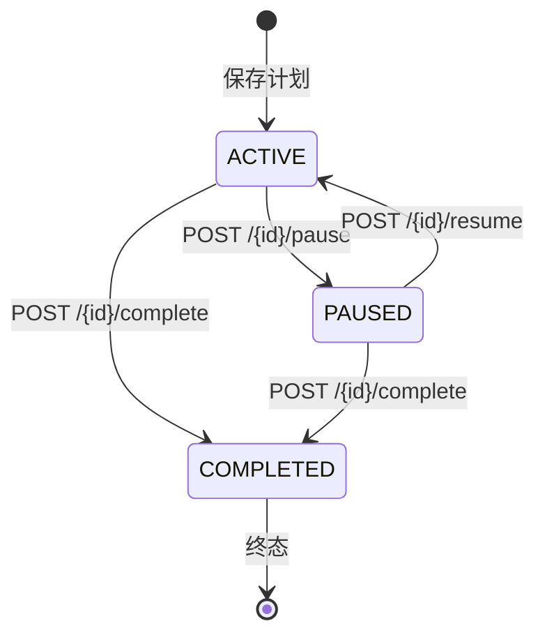
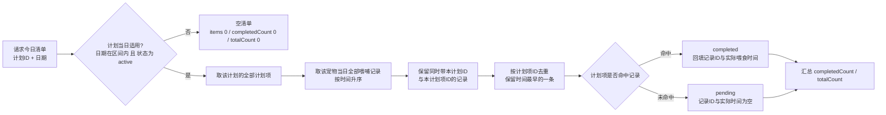

# 喂养管理

文档日期：2026-10-07

对应 Controller：`FeedingPlanController`（`/api/feeding-plans`）、`FeedingRecordController`（`/api/feeding-records`）、`FeedingAnalysisController`（`/api/feeding-analysis`）

本文规则全部提取自上述接口对应的应用服务与领域模型源码，接口说明与代码不一致处以代码为准并标注差异。

---

## 1 功能定位

用户在这一模块做的事只有四类：

- 定计划：挑好几张粮票、定好每天几顿几点、给一个每日目标量，先看系统排出来的建议，认可后才保存成计划
- 打卡：每天打开今日清单，看哪几顿还没喂，喂完记一条
- 记流水：计划外的临时喂哺（加个罐头、喂点零食）单独记一条，不强绑计划
- 看趋势：选一段日期，看吃了多少、体重怎么变、有没有软便或拒食

系统承担的部分：

- 每餐分量按固定算术规则均分，不调用任何模型
- 今日清单把"计划项"与"当天真实喂哺记录"做联查，逐项给出待办或已完成
- 喂哺记录写入时做时间合法性、成员权限、重复提交三项判定
- 喂养分析只输出 Java 统计出的事实，加三条规则化观察

三块能力的开放范围不同：计划与分析只对宠物主人开放，喂哺记录允许协作者读取和新增，但改与删只允许主人。

---

## 2 喂养计划

### 2.1 用户操作路径

1. 选食品：从本宠物的粮票里勾选要纳入计划的食品卡
2. 定餐次：填每天几顿、分别几点
3. 给目标：填每日目标喂食量（可选再填目标能量）
4. 看建议：请求建议预览，检查每餐分到的克数
5. 存计划：确认后保存，计划立即进入进行中
6. 之后每天在今日清单打卡，需要中断就暂停，回来后恢复，收尾时标记完成

第 4 步可以跳过，第 5 步的所有字段也允许用户直接手填而不经过预览。

### 2.2 建议预览

`POST /api/feeding-plans/recommendations`

| 字段 | 必填 | 说明 |
| --- | --- | --- |
| petId | 是 | 必须是当前用户自己的宠物 |
| foodIds | 是 | 参与计算的食品卡 ID 列表，不可为空 |
| startDate | 是 | 字段必填，但不参与预览计算 |
| dailyTargetAmount | 否 | 每日目标喂食总量 |
| targetCalories | 否 | 每日目标能量（kcal） |
| unit | 否 | `g` / `ml`，不填按 `g` |
| mealCount | 否 | 填了必须与 `mealTimes` 长度相等 |
| mealTimes | 是 | 进餐时间列表，不可为空、不可重复 |
| activityLevel | 否 | 代码中未被读取，不进入计算 [待确认] |
| userNote | 否 | 代码中未被读取，不进入计算 [待确认] |

计算规则：

| 输出项 | 算法 | 边界情况 |
| --- | --- | --- |
| 每餐建议量 amount | `dailyTargetAmount ÷ 餐次数`，保留 3 位小数四舍五入 | 未填目标量时为 null，不虚构克数 |
| 每餐占比 percentage | `100 ÷ 餐次数`，保留 2 位小数四舍五入 | 恒定输出 |
| 建议项标识 itemKey | 依次生成 `meal-1`、`meal-2` … | 与保存计划时的默认值一致 |
| 食品分配 | 第 i 餐取 `foodIds` 的第 `min(i, 食品数-1)` 个 | 餐次多于食品时后续餐次重复最后一张粮票；食品多于餐次时多余粮票不参与 |
| 单位 unit | 输入 trim 转小写，空则 `g` | |
| estimate | `dailyTargetAmount` 或 `targetCalories` 任一有值即为 true | |
| recommendationId | `rec-` 拼 UUID | 仅用于展示，服务端不存储预览结果 |
| source | 固定 `rule` | |
| policyVersion | 取配置 `feeding.policyVersion`（v1） | |

拒绝情形（均返回 `FEEDING_PLAN_INVALID` 40022）：

| 情形 | 提示 |
| --- | --- |
| `foodIds` 为空 | 至少选择一张 active 食品卡 |
| `mealTimes` 为空，或 `mealCount` 与其长度不等 | 餐次和时段数量必须一致 |
| 餐次数超过 12，或时段列表内有重复 | 计划项数量超过限制 |
| 任一 `foodId` 不是本宠物未删除且启用的粮票 | 食品卡不可用于当前计划 |

**建议文案与免责**为常量数组，前端原样展示：

- `explanations`：建议仅作为计划草稿，请结合包装建议和实际记录确认
- `warnings`：这不是处方或固定减重方案 / 未提供目标量时不会虚构每餐克数

预览结果不落库，也就没有"稍后再确认"的能力：用户若关掉页面，需要重新请求一次。

### 2.3 保存计划

`POST /api/feeding-plans`

| 字段 | 必填 | 规则 |
| --- | --- | --- |
| petId | 是 | 必须属于当前用户 |
| name | 否 | ≤100 字符 |
| startDate | 是 | |
| endDate | 否 | 不传表示长期计划；传了不得早于 `startDate` |
| dailyTargetCalories | 否 | 传值必须 > 0 |
| dailyTargetAmount | 否 | 传值必须 > 0 |
| unit | 否 | 仅 `g` / `ml`，空则 `g` |
| recommendationSource | 否 | `user_input` / `rule` / `ai_assisted`，不传按 `user_input` |
| policyVersion | 否 | 不传按配置 v1 |
| notes | 否 | ≤500 字符 |
| items | 是 | 1 至 12 项 |
| items[].itemKey | 否 | 同一计划内唯一；不传按 `meal-{序号}` 生成 |
| items[].foodId | 是 | 必须是本宠物未删除且启用的粮票 |
| items[].mealTime | 是 | 同一计划内不可重复 |
| items[].amount | 是 | 必须 > 0 |
| items[].unit | 否 | 仅 `g` / `ml`，空则 `g` |
| items[].percentage | 否 | 0 至 100 |
| items[].cycleType | 否 | `daily` / `weekly` / `custom`，不传按 `daily` |
| items[].cycleValue | 否 | 自由文本，格式由 `cycleType` 决定，服务端不校验 |

保存时的两个隐含动作：

- 每个计划项都会生成一份营养快照 JSON，内容为当时粮票的 `foodName`、`energyKcal`、`energyUnit`；快照生成失败即整单拒绝
- **保存即生效**：新计划直接进入 `active`，`version` 为 1，`acceptedAt` 记为保存时刻，没有"先存草稿再启用"这一步

计划没有修改和删除接口。可执行的只有状态流转，字段填错只能另建新计划。旧计划若仍为 `active`，会继续出现在今日清单入口里，需要手动 `complete` [待确认]。

### 2.4 查询与状态机

| 接口 | 说明 |
| --- | --- |
| `GET /api/feeding-plans?petId&status` | 列表，`status` 不传表示不按状态过滤，取值 `draft`/`active`/`paused`/`completed`/`cancelled` |
| `GET /api/feeding-plans/{id}` | 详情，返回全部计划项 |
| `POST /api/feeding-plans/{id}/pause` | 暂停 |
| `POST /api/feeding-plans/{id}/resume` | 恢复 |
| `POST /api/feeding-plans/{id}/complete` | 完成 |

| 动作 | 允许的前置状态 | 失败提示 |
| --- | --- | --- |
| pause | 仅 active | 喂食计划当前状态不支持操作: {当前状态} |
| resume | 仅 paused | 同上 |
| complete | active 或 paused | 喂食计划当前状态不可完成 |

状态枚举中还定义了 `draft` 与 `cancelled`，但当前七个接口没有任何一条路径能把计划置成这两种状态；列表接口的 `status` 过滤参数按字符串透传，筛这两种值只会返回空 [待确认]。计划不存在或不属于当前用户统一返回 `FEEDING_PLAN_NOT_FOUND` 40021。

### 2.5 今日清单：计划项与喂哺记录的联查

`GET /api/feeding-plans/{id}/today?date=2026-09-01`

清单不是存储实体，每次请求实时联查。生效前提是计划在该日期适用：`date` 落在 `[startDate, endDate]` 区间内（未填 `endDate` 视为无上限），且计划状态为 `active`。不满足时返回空清单且不报错，只回计划状态。

| 联查细节 | 规则 |
| --- | --- |
| 匹配键 | 记录的 `feedingPlanItemId` 等于计划项 ID，且 `feedingPlanId` 等于本计划 ID |
| 同一计划项当天多条记录 | 只认时间最早的一条，其余记录不参与清单判定但仍能在流水列表看到 |
| 计划时间 plannedAt | 由查询日期与计划项 `mealTime` 拼成 |
| 粮票已被删除 | `foodName` 显示"已删除食品"，`foodId` 照常返回，不会因此报错 |
| 完成计数 | `completedCount` 为 completed 项数，`totalCount` 为计划项总数 |

清单本身不写数据。用户点"喂了"要调喂哺记录接口并带上 `feedingPlanId` 与 `feedingPlanItemId`，下一次刷新清单项即变为 completed；删除那条记录，清单项回到 pending。

---

## 3 喂哺记录

### 3.1 记录形态

一条记录等于一次喂哺事件，精确到分钟，一天允许多条。它与今日清单是两套视图：清单是计划视角的待办，记录是事实视角的事件流。不关联计划的手工喂哺是合法记录，关联计划的记录也允许事后修改。

### 3.2 新增

`POST /api/feeding-records`

| 字段 | 必填 | 规则 |
| --- | --- | --- |
| petId | 是 | |
| feedingTime | 是 | 不得晚于当前时间 + 5 分钟，否则 `FEEDING_TIME_IN_FUTURE` 30005；这 5 分钟容差覆盖"刚喂完手速提交"的场景 |
| foodType | 是 | `main_food` 主食 / `snack` 零食 / `can` 罐头 / `other` 其他；传 `canned` 也接受，出参统一为 `can`；非法值返回 `PARAM_INVALID` |
| amount | 否 | ≥ 0，允许不填数量 |
| unit | 否 | 仅 `g` / `ml`，空则 `g`，其他值报"单位仅支持 g 或 ml" |
| foodId | 否 | 填了必须是本宠物的粮票，否则 `FOOD_NOT_FOUND` 40012 |
| feedingPlanId | 否 | 与 `feedingPlanItemId` 成对，见 3.3 |
| feedingPlanItemId | 否 | 同上 |
| plannedAt | 否 | 计划时段，仅作展示与追溯 |
| foodNameSnapshot | 否 | ≤100 字符，由调用方传入，服务端不自动从粮票补全 |
| notes | 否 | ≤500 字符 |

权限入口是 `require(CREATE_RECORD)`：主人拥有一切权限；协同成员（MEMBER）与临时照护者（CAREGIVER）的角色权限集合都包含 `CREATE_RECORD`，因此协作者可以记账。协同开关关闭时，非主人调用一律返回 `COLLABORATION_FEATURE_UNAVAILABLE` 72001；成员临时照护权限已过期返回 72010；权限不足返回 72009。

记录落库时写入 `operatorId` 为当前操作人，用于区分是谁记的账，该字段不在返回体中。

### 3.3 计划执行记录

从今日清单点"喂了"时，请求额外携带计划关联字段。

| 规则 | 说明 |
| --- | --- |
| 成对校验 | `feedingPlanId` 与 `feedingPlanItemId` 只给一个即拒绝，提示"计划关联字段必须同时提供" |
| 归属校验 | 计划必须属于本宠物，且该 `feedingPlanItemId` 必须是该计划下的计划项，否则提示"计划项不存在" |
| 食品快照 | 计划项上已存粮票名，清单接口会把 `foodName` 返回给前端；写记录时由前端把该名称填入 `foodNameSnapshot`，这样粮票后续改名或删卡都不影响历史记录的可读性 |
| **幂等复用** | 同一宠物、同一自然日、同一计划项已存在记录时，不再新增，直接返回那条已有记录；接口仍返回成功 |

| 幂等细节 | 规则 |
| --- | --- |
| 判定维度 | `petId` + `feedingPlanId` + `feedingPlanItemId` + `feedingTime` 所在日期 |
| 命中时行为 | 返回既有记录完整内容，不覆盖其时间、数量、备注 |
| 命中后再改 | 需要走 `PUT /api/feeding-records/{id}` 修改那条记录 |
| 未使用的错误码 | 40023 `FEEDING_RECORD_DUPLICATE`（该计划时段已经完成）已定义但在创建路径没有抛出点，重复提交走的是静默复用 [待确认] |

跨日重复不受该幂等规则约束：同一计划项在第二天可以再记一条，这符合"计划按天复用"的预期。

### 3.4 修改与删除

| 接口 | 语义 | 校验 |
| --- | --- | --- |
| `PUT /api/feeding-records/{id}` | 全量覆盖，未传的可选项会被清空 | 与新增完全一致（未来时间容差、食物类型、单位、计划项归属） |
| `DELETE /api/feeding-records/{id}` | 逻辑删除 | 仅存在性校验 |

两者都走 `requireOwner`，即**只有宠物主人可以改删**，非主人一律 `COLLABORATION_MEMBER_MANAGEMENT_FORBIDDEN` 72004。权限集合里另有 `EDIT_OWN_RECORD` 一位，喂哺记录服务未使用，协作者无法修改自己刚记错的账 [待确认]。

记录不存在返回 `RECORD_NOT_FOUND` 30001；先用记录上的 `petId` 反查归属，宠物不属于当前用户同样拒绝。

### 3.5 查询

| 接口 | 参数 | 规则 |
| --- | --- | --- |
| `GET /api/feeding-records?petId&date` | petId、date 均必填 | 当天记录，按喂食时间升序 |
| `GET /api/feeding-records/range?petId&startDate&endDate` | 三者均必填 | 按喂食时间升序；跨度超过 366 天拒绝，提示"查询范围不能超过 366 天" |

范围校验的三条拒绝：起止日期为空、开始日期晚于结束日期、`endDate - startDate` 的天数严格大于 366。两个查询都走 `require(READ_RECORD)`，即主人和两类协作者都能读。

366 天是硬编码在服务常量里的；喂养分析的上限走同一数值的配置项 `feeding.maxRangeDays`，两处口径一致但来源不同 [待确认]。

### 3.6 权限矩阵

| 能力 | 主人 | 协同成员 | 临时照护者 | 校验方式 |
| --- | --- | --- | --- | --- |
| 新增喂哺记录 | 可 | 可 | 可 | `require(CREATE_RECORD)` |
| 读当天/范围记录 | 可 | 可 | 可 | `require(READ_RECORD)` |
| 修改/删除记录 | 可 | 不可 | 不可 | `requireOwner` |
| 计划全部接口 | 可 | 不可 | 不可 | `checkPetOwnership` |
| 喂养分析 | 可 | 不可 | 不可 | `checkPetOwnership` |

由此带来一个使用上的断点：协作者打开今日清单需要计划详情接口，而非主人会被归属校验挡下；协作者只能凭喂哺流水列表自行判断还差哪几顿 [待确认]。

---

## 4 喂养分析

`GET /api/feeding-analysis?petId&startDate&endDate`

三个参数均必填。权限为宠物主人。范围校验：起止非空、开始不晚于结束、跨度不超过配置 `feeding.maxRangeDays`（366 天），否则 `FEEDING_ANALYSIS_RANGE_INVALID` 40024。

输出口径是 **java_stats**：`analysisSource` 固定为 `java_stats`，`policyVersion` 取配置 `feeding.policyVersion`。整个分析不调用模型，输入只有三类已存事实：喂哺记录、体重记录、每日状态；输出只有事实数字与规则化文本，不含分数、拟合曲线或预测值。

### 4.1 事实统计的计算口径

| 返回字段 | 计算方式 | 空值与陷阱 |
| --- | --- | --- |
| feedingDays | 按自然日聚合出有喂食量的天数 | 单位不同的记录不计入 |
| unit | 取遍历到的第一条带数量的记录的 `unit` | 之后所有 `unit` 与它不同的记录整条跳过，不做换算 |
| averageDailyAmount | 计入各日的总量之和 ÷ feedingDays，保留 2 位小数四舍五入 | 无数据时为 null |
| plannedDays | 带 `feedingPlanId` 的记录条数 | 与字段描述"计划覆盖天数"口径不一致，实为条数而非天数 [待确认] |
| planCompletionRate | 首版未实现，恒为 null | 前端不能按 0 处理，需显示"暂无" |
| weight.firstKg / lastKg | 区间内最早 / 最晚记录日期的体重 | 无体重记录时均为 null |
| weight.changeKg | `lastKg - firstKg` | 任一为空则 null |
| weight.sampleCount | 区间体重记录条数 | |
| dailyStatus.appetiteNormalDays | 食欲为 `normal` 的天数 | |
| dailyStatus.softStoolDays | 便便为 `soft` 的天数 | |
| dailyStatus.refusalDays | 食欲为 `refused` 的天数 | |

混合单位场景的实际表现：若某宠物一天里既记了克数又记了毫升，只统计先出现的那一种单位，另一部分数量被丢弃且不提示，界面宜在存在多种单位时给出说明。

### 4.2 观察结论的生成规则

| key | 触发条件 | 文案 | evidence |
| --- | --- | --- | --- |
| amount_vs_weight | 喂哺记录非空 且 体重样本数 > 0 | 记录期间喂食量和体重均有数据，可继续观察趋势 | feeding_record, weight_record |
| reaction | 软便天数 > 0 或 拒食天数 > 0 | 记录中出现软便或拒食，请结合换粮过程和其他事实复核 | daily_status, feeding_record |
| insufficient | 前两条都不成立 | 当前范围内可用关联事实较少，暂不生成趋势判断 | feeding_record |

呈现方式：`observations` 是按上表判定顺序生成的数组，前两条可同时出现，`insufficient` 只在前两条都不成立时单独出现。前端逐条渲染文本卡片即可，没有等级、颜色权重或置信度字段。

### 4.3 固定建议与限制文案

| 字段 | 内容 |
| --- | --- |
| reviewSuggestions | 复核包装建议和当前活动变化 / 软便或拒食持续时咨询兽医 |
| limitations | 未记录不等于未发生 / 结果是数据观察，不是诊断或减量处方 |

两组文案是常量，与数据无关，任何分析结果都会返回，界面需要与观察结论区分展示，避免用户把"限制说明"读成结论。

---

## 5 错误码对照

| 错误码 | 名称 | 触发场景 |
| --- | --- | --- |
| 1001 | PARAM_INVALID | 食物类型为空或非法、喂食时间为空、起止日期为空或倒序、范围超 366 天 |
| 30001 | RECORD_NOT_FOUND | 修改或删除的喂哺记录不存在 |
| 30005 | FEEDING_TIME_IN_FUTURE | 喂食时间晚于当前时间 + 5 分钟 |
| 40012 | FOOD_NOT_FOUND | 记录关联的 `foodId` 不是本宠物粮票 |
| 40021 | FEEDING_PLAN_NOT_FOUND | 计划不存在或不属于当前用户 |
| 40022 | FEEDING_PLAN_INVALID | 计划与建议的全部参数错误、计划状态不允许流转、计划项归属校验失败 |
| 40023 | FEEDING_RECORD_DUPLICATE | 已定义，当前创建路径未使用 |
| 40024 | FEEDING_ANALYSIS_RANGE_INVALID | 分析日期范围无效 |
| 72001 | COLLABORATION_FEATURE_UNAVAILABLE | 协同关闭时的非主人访问 |
| 72004 | COLLABORATION_MEMBER_MANAGEMENT_FORBIDDEN | 协作者尝试改删喂哺记录 |
| 72009 | COLLABORATION_PERMISSION_DENIED | 成员权限不足 |
| 72010 | COLLABORATION_CAREGIVER_EXPIRED | 临时照护权限已过期 |
