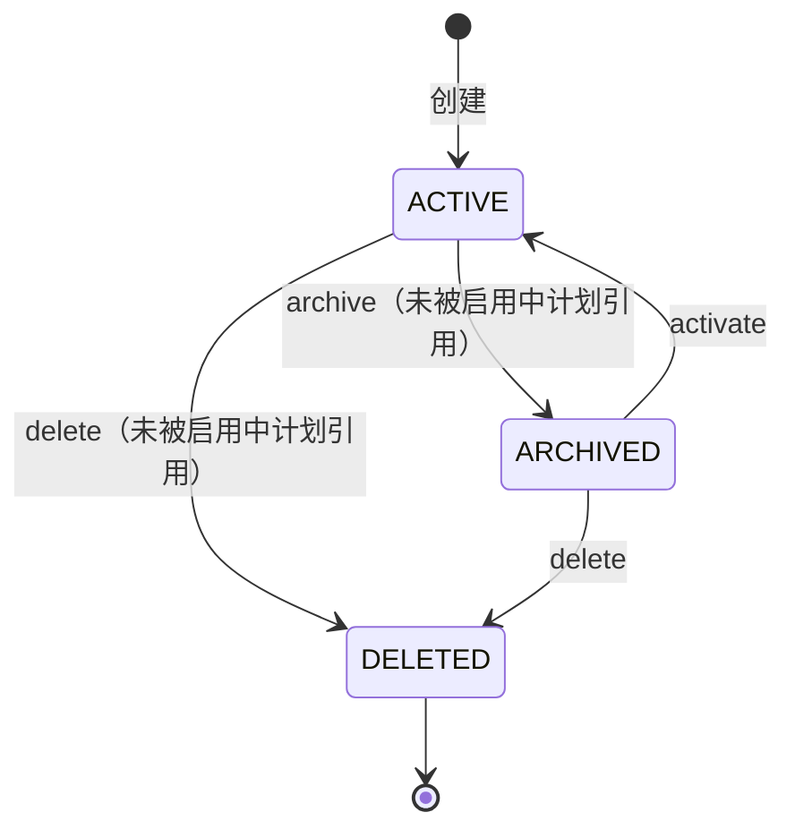
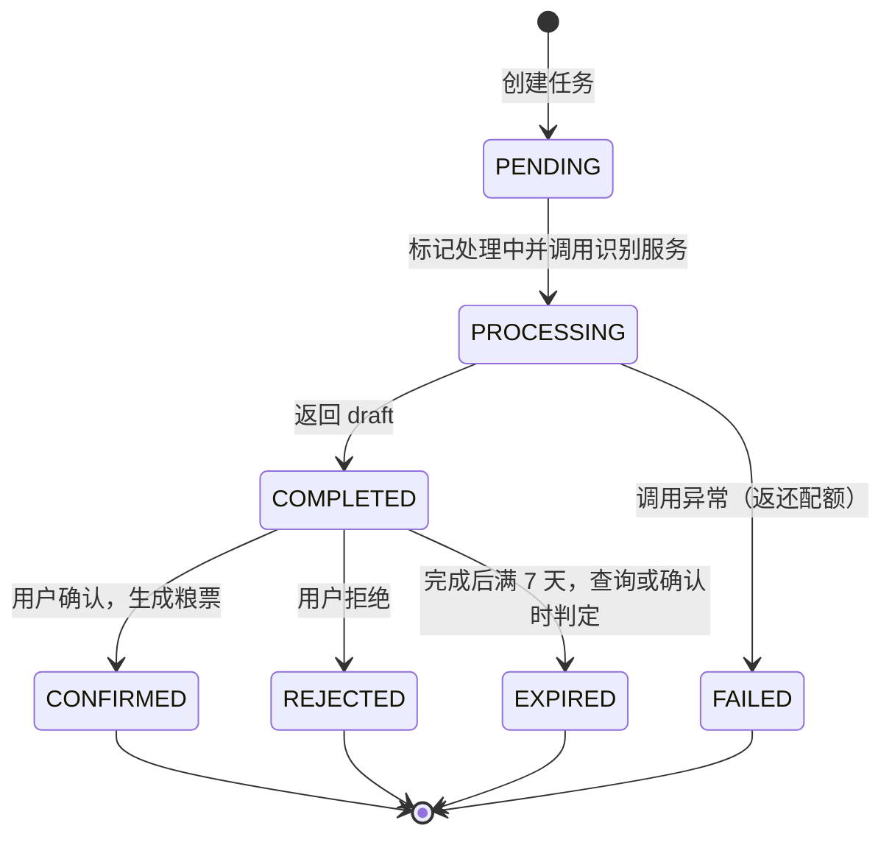
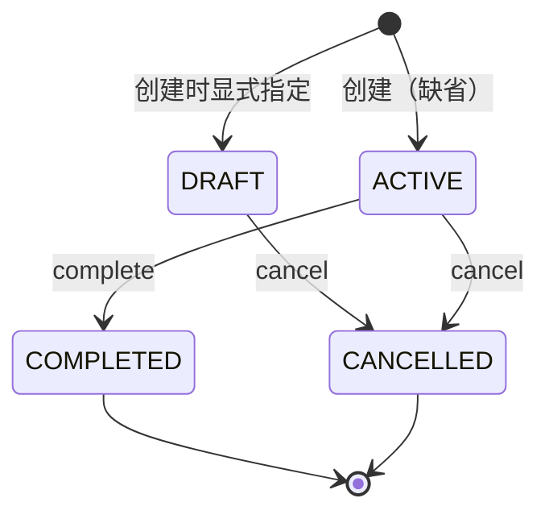

# 食品知识库

文档日期：2026-10-07

对应 Controller：`FoodCardController`（`/api/foods`）、`FoodRecognitionController`（`/api/foods/recognitions`）、`FoodSafetyScoreController`（`/api/foods`）、`FoodTransitionController`（`/api/food-transitions`）

本文规则全部提取自上述接口对应的应用服务与领域模型源码，接口说明与代码不一致处以代码为准并标注差异。

---

## 1 功能定位

用户在这一模块做四类事：

- 建粮票：把宠物在吃的食品一张张登记成食品卡，填名称、类型、营养标注、开封与保质期
- 拍包装：对着粮袋营养成分表拍照，让识别服务把字段抠出来，用户核对后一键存成粮票
- 看提示：对某张粮票查看配方信息提示分，判断这张卡录得更完整还是缺关键项
- 换粮：旧粮停、新粮上时建一份逐日比例计划，每天记一条宠物反应

系统承担的部分：

- 粮票字段按固定校验规则把关，百分比、单位、日期先后关系不合规则拒绝写入
- 识粮任务记录幂等键与月度配额，识别结果只作为草稿返回，不自动入库
- 提示分由四条可解释规则现场计算，不调用模型
- 换粮计划校验比例步进合计与日期连续性，反应记录只保留最近一条

开放范围与喂养模块不同：**本模块全部操作要求宠物属于当前登录用户本人**（`checkPetOwnership` 直接比对宠物主人），协作者不能代为登记粮票、发起识粮或建换粮计划；粮票、识粮任务、换粮计划的读写也都按当前用户隔离。宠物校验失败抛出的是普通异常而非业务错误码，返回体格式 [待确认]。

---

## 2 食品卡（粮票）

### 2.1 用户操作路径

手工登记共 4 步：

1. 选定所属宠物
2. 填基础信息：名称、类型，可选品牌、规格、包装重量、价格、开封日期、保质期
3. 填营养标注：7 项百分比、能量、标注基准，可选蛋白来源、配料表、添加物提示、阶段标签
4. 保存，粮票默认为"使用中"

拍照识别路径见第 3 节，最终同样落到这张卡上，并自动回填来源照片与来源任务。

### 2.2 字段与校验

| 字段 | 必填 | 规则 |
| --- | --- | --- |
| petId | 是 | 必须是本人宠物 |
| name | 是 | 不超过 100 字符 |
| foodType | 是 | `main_food` / `canned` / `snack` / `supplement` / `homemade` / `other`，其余值报 `FOOD_FIELD_INVALID` |
| brand / specification | 否 | 各不超过 100 字符 |
| packageWeight | 否 | 大于 0；填了必须同时填 `packageWeightUnit` |
| packageWeightUnit | 否 | `g` / `ml` |
| price | 否 | 不小于 0 |
| currency | 否 | 空则默认 `CNY`，写入前转大写 |
| openedAt / expiresAt | 否 | `expiresAt` 不得早于 `openedAt` |
| proteinPercent、fatPercent、fiberPercent、moisturePercent、ashPercent、calciumPercent、phosphorusPercent | 否 | 各项取值 0-100 |
| energyKcal / energyUnit | 否 | `energyKcal` 必须大于 0；填了必须同时填 `energyUnit`（`kcal_per_100g` / `kcal_per_100ml` / `kcal_per_serving`） |
| nutritionBasis | 否 | `per_100g` / `per_100ml` / `serving` / `unknown`，空则按 `unknown` |
| proteinSources / ingredients / additiveFlags | 否 | 字符串列表，分别用于提示分的三个维度 |
| lifeStageLabel | 否 | 包装标注的适用阶段文字，如"成猫" |
| sourceMediaId / sourceRecognitionTaskId | 否 | 手工建卡一般为空；识粮确认时由系统回填 |
| notes | 否 | 不超过 500 字符 |

任一校验不通过统一返回 `FOOD_FIELD_INVALID`（40013），消息为领域层原文。

### 2.3 接口清单

| 方法与路径 | 用途 | 关键行为 |
| --- | --- | --- |
| `POST /api/foods` | 新建粮票 | 校验后保存，状态默认 `active` |
| `GET /api/foods?petId=&status=` | 列表 | 按更新时间倒序；`status` 可选过滤；已删除的卡不返回 |
| `GET /api/foods/{id}` | 详情 | 只能查到本人的卡，否则 `FOOD_NOT_FOUND` |
| `PUT /api/foods/{id}` | 全量更新 | 所有业务字段整卡覆盖；`petId` 不允许变更 |
| `PATCH /api/foods/{id}/archive` | 归档 | 使用中转已归档 |
| `POST /api/foods/{id}/activate` | 启用 | 已归档转回使用中 |
| `DELETE /api/foods/{id}` | 删除 | 逻辑删除，卡变为 `deleted` |

`FoodCardController` 源码内留有注释"需要增加视觉扫描的接口"，视觉扫描入口目前独立在识粮接口下，本控制器未实现。[待确认]

### 2.4 状态流转与删除限制

- 归档与删除前都会检查引用：该卡若被任一条启用中的喂养计划或启用中的换粮计划使用，返回 `FOOD_IN_ACTIVE_PLAN`（40014），需先处理计划再操作
- 启用（activate）不做引用检查，任何非删除状态的卡都可重新启用
- 已删除的卡对 archive、activate 均报"已删除食品卡不可操作"，也不出现在列表里
- 更新时若传入的 `petId` 与卡不一致，报 `FOOD_FIELD_INVALID`"食品卡所属宠物不能修改"
- `FoodStatus` 定义了 `DELETED`，对外状态字典含 `active` / `archived` / `deleted`；`draft` 一类的前置状态无写入路径 [待确认]

### 2.5 可被计划选用与完整度

- 喂养计划与换粮计划选卡时只接受 `canBeUsedForNewPlan` 的卡：未删除且状态为 `active`
- 列表与详情返回 `nutritionCompleteness`：蛋白质、脂肪、能量、钙、磷五项中已填写的项数除以 5，保留 2 位小数，供前端展示"这张卡录全了没有"

---

## 3 AI 识粮（食品包装识别）

### 3.1 用户操作路径

拍照到入库共 6 步，其中第 1 步走媒体接口、后 5 步走本节接口：

1. 拍摄包装营养成分表照片并上传，拿到 `mediaId`
2. 用 `petId + mediaId` 创建识别任务（可带幂等键）
3. 等待同步返回的识别草稿（接口内部同步调用识别服务，返回时任务已是完成态）
4. 核对草稿字段，可修改
5. 确认：提交完整粮票字段，系统建卡并把卡挂回任务
6. 或拒绝：放弃这份草稿

用户不确认则粮票不入库；草稿自完成起保留 7 天，过期后不能再确认。

### 3.2 接口清单

| 方法与路径 | 用途 | 关键行为 |
| --- | --- | --- |
| `POST /api/foods/recognitions` | 创建识别任务 | `petId`、`mediaId` 必填，`idempotencyKey` 可选（≤100 字符） |
| `GET /api/foods/recognitions/{id}` | 查询任务 | 惰性判定草稿是否过期，过期则状态改为 `expired` |
| `POST /api/foods/recognitions/{id}/confirm` | 确认并生成粮票 | 请求体为整套粮票字段（同 `SaveFoodCardRequest`，但不含 petId 与来源字段），返回 `FoodCardDTO` |
| `POST /api/foods/recognitions/{id}/reject` | 拒绝草稿 | 请求体可选，`reason` 不超过 200 字符 |

### 3.3 创建任务的前置判定

按顺序执行，任一步不过即失败：

1. 宠物必须属于当前用户
2. `mediaId` 对应的媒体必须同时满足：属于当前用户、类型为 `PHOTO`、未被删除；否则 `FOOD_MEDIA_INVALID`（40015）
3. 幂等：同一用户同一 `idempotencyKey` 已有任务时直接返回该任务，不重复识别、不重复扣配额；未传幂等键时系统自动生成 `food-recognition-` 加随机串，即每次请求都会新建任务
4. 扣减当月识粮配额（配额月按当前 `YearMonth` 计），超限报 `FOOD_RECOGNITION_QUOTA_EXCEEDED`（40016）

配额规则：

| 用户类型 | 每月识粮次数 |
| --- | --- |
| 普通用户 | 5 |
| VIP 用户 | 50 |

配额查询接口对 VIP 返回上限 `-1` 的写法与实际 50 次不一致 [待确认]。

### 3.4 识别执行

任务先落库为待处理，随即标记处理中并记录提示词版本 `food-recognition-v1`，然后**同步**调用识别服务：

- 网关向 Python 服务 `POST /api/foods/recognize` 发送任务 ID、用户 ID、宠物 ID、媒体 ID、图片 URL、提示词版本与 `X-Trace-Id` 请求头
- 响应必须包含 `draft` 对象，否则视为失败；`warnings`、`model`、`promptVersion` 一并存回任务
- 任何调用异常：返还本次配额、任务标记 `failed`（错误码 `FOOD_RECOGNITION_FAILED`），对外抛 `AI_SERVICE_UNAVAILABLE`（90001）
- 配置项 `timeout-seconds: 90`、`max-image-bytes: 10485760` 在 `FaFaProperties` 中定义，Java 侧未见读取代码，超时与图片大小实际由哪一层控制 [待确认]

### 3.5 确认与拒绝

确认（`confirm`）分支逻辑：

| 任务当前状态 | 结果 |
| --- | --- |
| `CONFIRMED` | 幂等返回已生成的粮票 |
| `EXPIRED` | `FOOD_RECOGNITION_EXPIRED`（40018），需重新拍照 |
| 非 `COMPLETED` 的其他状态 | `FOOD_RECOGNITION_NOT_READY`（40017） |
| `COMPLETED` 且已存在由本任务生成的卡 | 补挂关联并返回该卡（防重复建卡） |
| `COMPLETED` 且无卡 | 用提交字段创建粮票（自动回填 `sourceMediaId`、`sourceRecognitionTaskId`），任务转 `CONFIRMED` 并记录 `foodCardId` |

确认时提交的字段仍是粮票全套校验，用户手改草稿同样受第 2.2 节规则约束。

拒绝（`reject`）分支逻辑：已是 `REJECTED` 静默返回；否则要求任务处于 `COMPLETED`，不然 `FOOD_RECOGNITION_NOT_READY`；`reason` 存入任务的错误信息字段并刷新完成时间（即拒绝不延长也不缩短草稿期，过期判定只在查询与确认时惰性执行）。

### 3.6 任务状态机

- 状态对外编码：`pending` / `processing` / `completed` / `confirmed` / `rejected` / `failed` / `expired`
- `fail` 对已确认或已拒绝的任务抛"已结束的识别任务不可失败"，正常流程中不会触达
- 错误码 `FOOD_RECOGNITION_CONFIRM_CONFLICT`（40019）已定义，代码中未见抛出点 [待确认]

---

## 4 食品安全提示分

### 4.1 定位与入口

`GET /api/foods/{id}/safety-score`，只查本人粮票，现场计算不落库。它衡量的是"这张粮票的配方信息录得多完整"，源码注释明确：不调用模型，不宣称食品安全认证。返回值固定附带一条警告：

> 该结果是配方信息提示，不是食品安全认证或医疗建议

### 4.2 评分规则

四个维度各 25 分，策略版本 `v1`（参数来自配置，可调整）：

| 维度 | 满分条件（25 分，status=known） | 折半条件（12 分，status=partial） | 0 分（status=unknown） | 评分依据 evidence |
| --- | --- | --- | --- | --- |
| 蛋白来源清晰度 `protein_source` | `proteinSources` 非空 | 无蛋白来源但 `ingredients` 非空，证据为"已录入配料表，但未确认明确蛋白来源" | 两者都空 | 蛋白来源列表 |
| 添加物提示 `additives` | `ingredients` 非空且 `additiveFlags` 为空 | `ingredients` 非空且有旗标：得分 = 25 − 旗标数 × 5，最低 0 | `ingredients` 为空 | 旗标列表本身 |
| 钙磷信息 `calcium_phosphorus` | 钙磷均有值、磷 > 0，且比值 `钙/磷`（2 位小数四舍五入）落在 [1.0, 2.0] | 有值但比值出区间 | 钙或磷缺失，或磷 ≤ 0 | `Ca/P=x.xx` |
| 阶段标注 `life_stage` | `lifeStageLabel` 非空 | 无此档 | 阶段文字为空 | 阶段文字本身 |

### 4.3 总分与缺失项

- **四个维度全部不是 unknown 时才给出总分**，总分 = 四维之和（此时等级 `信息较完整`）
- 任一维度为 unknown：总分返回 `null`，等级为 `数据不足`，另附警告"营养信息不完整，暂不生成总分"，并把该维度名称列入 `missingFields`
- 返回结构：`foodId`、`score`、`label`、`policyVersion`、`dimensions`（每维含 key/label/score/maxScore/status/evidence）、`missingFields`、`warnings`
- `FoodSafetyScoreDTO` 的接口注释示例写"protein、满分 20"，与实际四维各 25 不符，以计算代码为准

前端呈现建议（从数据字段推出，非代码约束）：总分大数字 + 等级文字 + 四维条形明细 + 缺失项列表 + 固定免责声明。

---

## 5 换粮计划

### 5.1 用户操作路径

创建计划共 5 步：

1. 选定旧粮与新粮两张粮票（都必须是本宠物、使用中）
2. 定起止日期，天数须在 3-30 天之间
3. 逐日填新旧比例步进（例如 75/25 → 50/50 → 25/25 → 0/100）
4. 填每日目标总量与单位（可选）
5. 提交，计划默认直接进入"进行中"

执行期每天打卡 2 步：打开计划详情，当天记录一条反应（日期 + 反应 + 可选备注）。收尾 1 步：点"完成"；中途放弃点"取消"。

### 5.2 接口清单

| 方法与路径 | 用途 | 关键行为 |
| --- | --- | --- |
| `POST /api/food-transitions` | 创建计划 | 全套校验见 5.3 |
| `GET /api/food-transitions?petId=&status=` | 列表 | 需本人宠物，`status` 可选过滤 |
| `GET /api/food-transitions/{id}` | 详情 | 查不到报 `FOOD_TRANSITION_INVALID`"换粮计划不存在" |
| `PUT /api/food-transitions/{id}/reaction` | 记录每日反应 | 覆盖式，只保留最近一条 |
| `POST /api/food-transitions/{id}/complete` | 完成 | 仅"进行中"可点 |
| `POST /api/food-transitions/{id}/cancel` | 取消 | 已完成的不可取消，其余状态均可 |

### 5.3 创建校验

| 规则 | 违反时 |
| --- | --- |
| 旧粮、新粮都属于当前用户且属于该宠物 | `FOOD_TRANSITION_INVALID`"食品卡不属于当前宠物" |
| 两张卡都是 `active` 且未删除（`canBeUsedForNewPlan`） | `FOOD_TRANSITION_INVALID`"旧粮和新粮必须为 active 食品卡" |
| `oldFoodId` 不等于 `newFoodId` | `FOOD_TRANSITION_INVALID`"换粮计划基础参数无效" |
| `startDate` 不晚于 `endDate`，天数 = 差值 + 1，须在 3-30 之间 | "换粮天数超出配置范围" |
| 步骤数必须等于天数，日期从 `startDate` 起逐日连续无缺口 | "换粮比例必须覆盖每天" / "换粮比例日期必须连续" |
| 每步 `oldPercent + newPercent` 恰等于 100，各自 0-100 | "每天新旧食品比例之和必须为100" / "换粮比例必须在0到100之间" |
| `dailyTargetAmount` 不小于 0（可空） | "每日目标量不能为负" |
| `unit` 只允许 `g` / `ml`（大小写不敏感），空则按 `g` 存储 | "单位仅支持 g 或 ml" |
| `status` 传入 `draft` / `active` / `completed` / `cancelled` 之一；**不传时服务按 `active` 创建** | 非法编码报 `FOOD_TRANSITION_INVALID` |

接口注释示例把 `status` 写作 `draft`，但服务层缺省传 `active`（领域层对 null 才落 `DRAFT`，而服务层不会出现 null）[待确认]。由此带来一个流程事实：**没有把草稿计划转为进行中的接口**（`PUT` 只更新反应），`draft` 状态的计划无法走"完成"，只能取消或重建。[待确认] 是否有意如此。

### 5.4 反应记录

- 请求字段：`date`（必填，必须落在计划起止区间内）、`reaction`（必填，自由描述或编码，两端空格会被去掉）、`note`（可选，不超过 500 字符）
- 计划上只有 `reactionDate` / `reactionCode` / `reactionNote` 三个槽位，**后写覆盖先写，系统只保留最近一条反应**；同一天补记会直接替换旧值
- 反应记录不校验计划状态，取消后仍可写入 [待确认] 产品是否需要拦截

### 5.5 状态机

- `complete` 只接受 `active`，其余状态报"换粮计划当前状态不可操作: 编码"
- `cancel` 只拦 `completed`，草稿、进行中都可取消；已取消的再次取消会落入 `cancel` 之外的分支 [待确认]（代码未阻止重复取消）
- 换粮计划自身没有删除接口；启用中的换粮计划会阻止所引用粮票被归档或删除

---

## 6 错误码对照

| 错误码 | 名称 | 触发场景 |
| --- | --- | --- |
| 1001 | `PARAM_INVALID` | 请求体必填缺失、长度超限等 Bean 校验 |
| 40012 | `FOOD_NOT_FOUND` | 粮票或识粮任务不属于当前用户 / 不存在 |
| 40013 | `FOOD_FIELD_INVALID` | 粮票字段校验失败、所属宠物被修改 |
| 40014 | `FOOD_IN_ACTIVE_PLAN` | 归档或删除被启用中计划引用的粮票 |
| 40015 | `FOOD_MEDIA_INVALID` | 识粮媒体非本人、非照片或已删除 |
| 40016 | `FOOD_RECOGNITION_QUOTA_EXCEEDED` | 当月识粮次数用尽 |
| 40017 | `FOOD_RECOGNITION_NOT_READY` | 任务未处于完成态就确认或拒绝 |
| 40018 | `FOOD_RECOGNITION_EXPIRED` | 草稿超过 7 天保留期后确认 |
| 40019 | `FOOD_RECOGNITION_CONFIRM_CONFLICT` | 已定义，未见抛出点 [待确认] |
| 40020 | `FOOD_TRANSITION_INVALID` | 换粮计划各项校验与状态操作失败 |
| 90001 | `AI_SERVICE_UNAVAILABLE` | 识别服务调用失败（本次配额已返还） |
