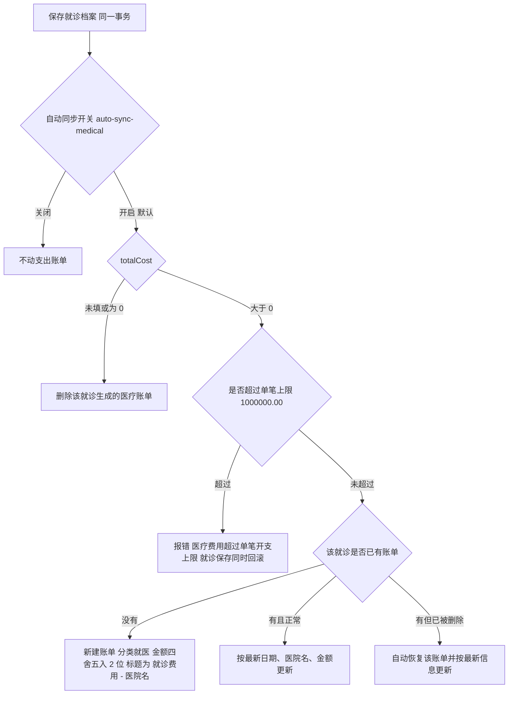
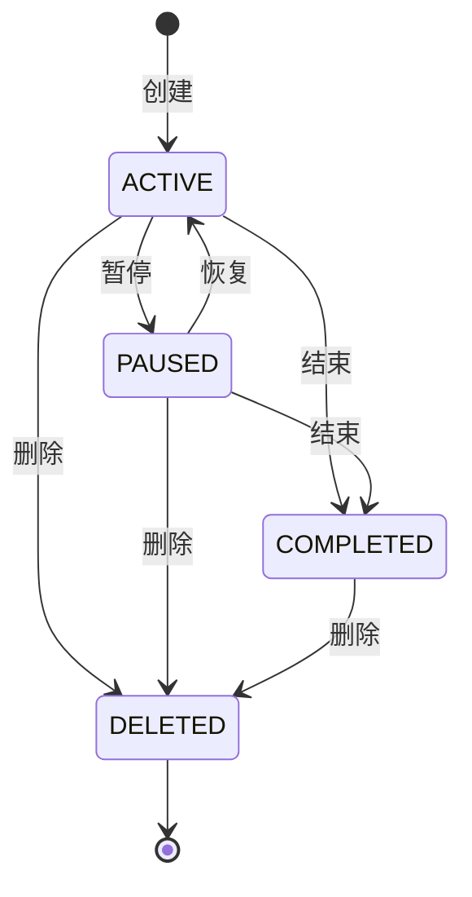
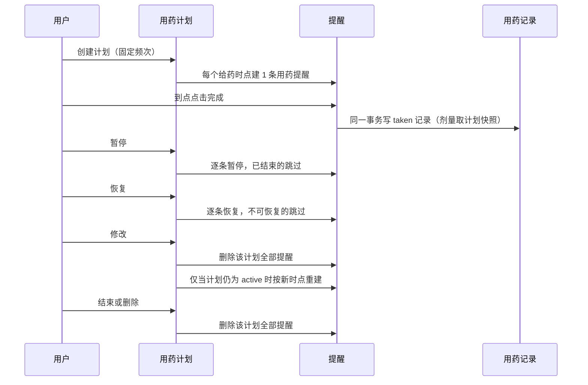
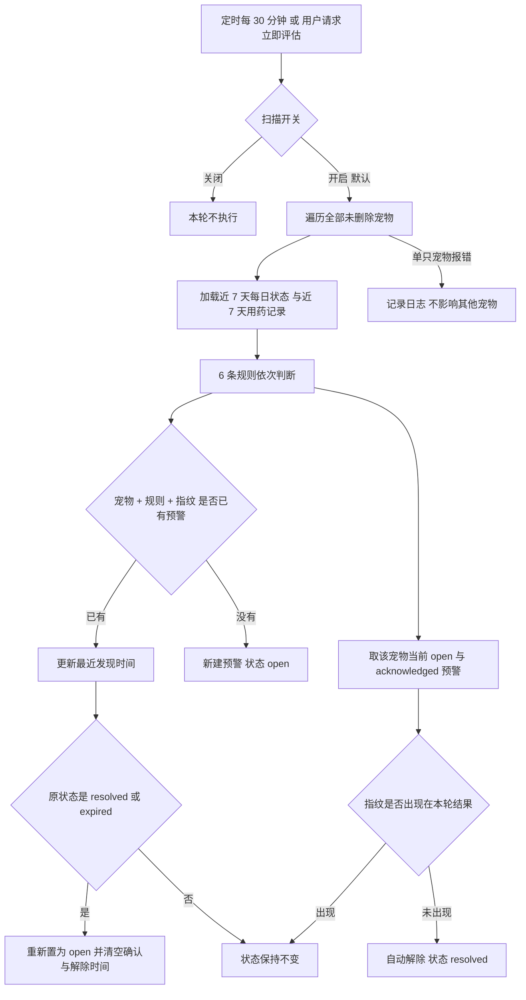
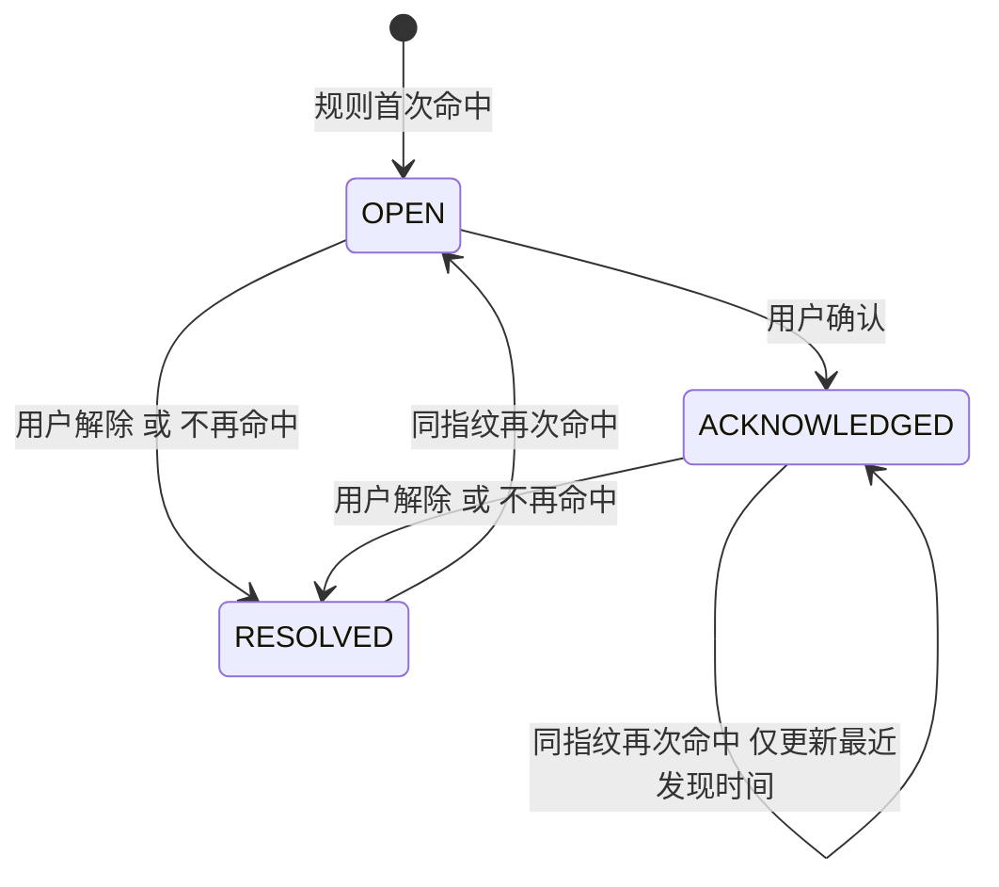

# 医疗健康

文档日期：2026-10-07

对应 Controller：

- `MedicalController`：`/api/medical`，19 个端点（就诊档案 7、健康时间线 1、用药计划 8、用药记录 2、就诊小结 1）
- `HealthAlertController`：`/api/health-alerts`，5 个端点

协作模块：支出记录（就诊费用同事务同步）、提醒（用药计划双向联动）、每日状态记录（健康预警的事实来源）。

## 1 模块解决什么问题

宠物生病时信息散在聊天记录、纸质病历、药盒说明书和转账备注里；按医嘱喂药容易漏掉某一顿；出现"不吃又吐"这类组合变化时，家长很难判断该不该立刻跑医院。医疗健康模块把这些收敛成四个可操作对象——就诊档案、用药计划、用药记录、健康预警，再用一条健康时间线把它们串起来：一次录入，多处复用。

| 用户动作 | 系统回应 |
|---|---|
| 记一次就诊、贴化验单照片 | 生成就诊档案；填了费用的同时自动生成一条"就医"支出账单 |
| 开一个用药计划 | 按每日给药时点自动创建用药提醒；暂停/恢复/结束/删除计划时提醒同步变化 |
| 在提醒里点"完成" | 同一事务写一条 taken 用药记录，无需二次填写 |
| 每天记食欲、精神、饮水、呕吐、排便 | 每 30 分钟扫描近 7 天记录，命中规则生成预警；不再命中自动解除 |
| 查看健康时间线、生成就诊小结 | 聚合就诊、手动事件、疫苗/驱虫/体检完成记录、用药记录；小结由 AI 整理成文字 |

## 2 就诊档案

### 2.1 新建就诊

用户步数：宠物详情 → 医疗 → 新增就诊 → 填写内容 → 保存。一次填完即可，只有医院名称和就诊日期是必填。

`POST /api/medical/visits`

| 字段 | 必填 | 规则 |
|---|---|---|
| petId | 是 | 只能是当前主人自己的宠物 |
| visitDate | 是 | **不能晚于今天**，否则返回"就诊日期不能晚于今天" |
| hospitalName | 是 | ≤200 字符，去掉首尾空格后不能为空 |
| doctorName | 否 | ≤100 字符 |
| chiefComplaint | 否 | ≤1000 字符，主诉 |
| diagnosis | 否 | ≤2000 字符 |
| prescription | 否 | ≤3000 字符，本模块字段上限最长 |
| treatment | 否 | ≤2000 字符 |
| totalCost | 否 | ≥0，负数返回"就诊费用不能为负"；填 0 或不填都不产生支出账单 |
| notes | 否 | ≤2000 字符 |

字段超长返回"XX不能超过 N 字符"。空白字符串按未填写处理。

### 2.2 修改与删除

`PUT /api/medical/visits/{id}` 的请求体不含 petId 与 visitDate：**宠物归属和就诊日期建档后不可修改**，其余字段可整体覆盖。改动 totalCost 会同步改动自动生成的支出账单（见 2.5）。

`DELETE /api/medical/visits/{id}` 删除就诊的同时，删除由它生成的医疗支出账单。

修改、删除、附件操作都要求当前用户是这条就诊档案的创建者；他人访问返回"就医记录不存在"，不提示越权。协同成员可以读，不能写。

### 2.3 附件（最多 9 张）

化验单、B 超图、处方笺、缴费小票先把照片传到素材库，再关联到就诊档案。

| 端点 | 说明 |
|---|---|
| `POST /api/medical/visits/{id}/attachments` | 批量关联，请求体 `mediaIds`（必填，去重后 1–9 个）、`attachmentType`（默认 `other`） |
| `DELETE /api/medical/visits/{id}/attachments/{mediaId}` | 解除单张关联，素材本身不删 |

关联规则：

- `attachmentType` 白名单 `receipt`=票据、`report`=检查报告、`prescription`=处方、`other`=其他，其他值返回"附件类型不支持"。
- 传入的素材必须全部属于当前用户，混入他人素材时整批拒绝："存在不属于当前用户的素材"。
- 已关联过的素材静默跳过，不报错，因此可以重复提交同一批素材。
- `mediaIds` 的提交顺序即档案详情页的展示顺序。
- 单次请求上限 9 张；代码未校验一张就诊档案累计是否超过 9 张（见第 9 节）。

### 2.4 查询

| 端点 | 参数与规则 |
|---|---|
| `GET /api/medical/visits` | `petId`、`startDate`、`endDate` 均必填；`page` 默认 1；`size` 默认 20、上限 50。结束日期不能晚于今天，跨度 ≤366 天，否则返回"查询范围不能超过 366 天"。返回分页结构与总数 |
| `GET /api/medical/visits/{id}` | 详情，包含附件列表和创建/更新时间；需要有该宠物的 `READ_MEDICAL` 权限 |

列表与详情返回的附件素材按当前用户可见性读取，主人和协同成员看到的都是同一组素材。

### 2.5 就诊费用自动进入支出账单

用户只需要填就诊费用，不需要再去支出模块记一笔。就诊档案与支出账单在同一个事务里落库：账单写入失败时，就诊保存一并回滚，不会出现"有就诊没账单"或"改了费用账单没跟上"。

自动账单的产品约束：标题固定为"就诊费用 - 医院名"（截断 100 字符），备注固定为"由就医档案自动同步"，分类为就医，标记为系统生成。用户**不能修改也不能删除**自动账单（错误码 `EXPENSE_AUTO_RECORD_IMMUTABLE`）；要调整金额只能回到就诊档案改 totalCost。如果用户手动删掉了这条自动账单，之后又修改了就诊费用，系统会把它恢复并按最新金额更新。金额按 2 位四舍五入，币种取系统默认（当前为 CNY）。

## 3 健康时间线

用户在医疗页切到"时间线"，选一段日期，就能看到这段时间里所有与健康有关的动作，而不是分四个列表自己拼。

`GET /api/medical/timeline?petId&startDate&endDate`，日期必填、结束日 ≤ 今天、跨度 ≤366 天；返回不分页的条目列表，按日期倒序。需要 `READ_MEDICAL` 权限，协同成员可读。

时间线聚合 4 个来源：

| type | 来源 | title | summary | status |
|---|---|---|---|---|
| `medical_visit` | 就诊档案 | 医院名称 | 主诉 | `recorded` |
| 事件类型码（如 `vaccine`、`deworming`、`checkup`、`custom`） | 手动创建的宠物事件 | 事件标题 | 事件内容 | `recorded` |
| `vaccine` / `deworming` / `checkup` | 提醒完成记录（只取这三类） | 提醒标题快照 | 完成备注 | `completed` |
| `medication` | 用药记录 | "用药：" + 剂量数值 + 单位 | 用药备注 | `taken` / `skipped` / `missed` / `cancelled` |

组织方式说明：

- 一次就诊是一条条目，附件不单独出现在时间线上，点进详情看。
- 只有手动创建的事件参与，提醒自动生成的事件不重复出现，避免同一天同一件事两条记录。
- 用药条目按计划服药时间归日，不按实际服药时间归日；跨天的补录会出现在计划那天。
- 就诊条目最多取 200 条，其余来源不限量。
- 同一天多来源条目的先后顺序未定义。

## 4 用药计划

### 4.1 新建计划

用户步数：就诊详情里点"开用药计划"，或医疗页直接新建 → 填药名、剂量、频次、每日时间点、餐前餐后、起止日期 → 保存。

`POST /api/medical/medication-plans`

| 字段 | 必填 | 规则 |
|---|---|---|
| petId | 是 | 当前主人的宠物 |
| sourceVisitId | 否 | 关联来源就诊；必须是同一主人、同一宠物的就诊，否则返回"就医记录不存在" |
| medicationName | 是 | ≤200 字符，去空格后不能为空 |
| specification | 否 | ≤100 字符，如 50mg/粒 |
| purpose | 否 | ≤500 字符 |
| dosageValue | 是 | **必须为正数** |
| dosageUnit | 是 | 不能为空 |
| frequencyType | 是 | `daily` / `every_days` / `weekly` / `as_needed` |
| frequencyValue | 条件 | 固定频次必须为正数；`as_needed` 可为空，填了必须为正数 |
| administrationTimes | 条件 | 固定频次必填、**最多 6 个**、不能为空或重复、自动升序排列；`as_needed` 必须为空 |
| mealRelation | 是 | `before_meal` / `after_meal` / `any` |
| startDate | 是 | 不能晚于今天，否则"疗程开始日期不能晚于今天" |
| endDate | 否 | 不填表示长期计划；填了不能早于开始日期 |
| notes | 否 | ≤1000 字符 |

频次含义：

| frequencyType | frequencyValue 含义 | 给药时点 | 生成的提醒 |
|---|---|---|---|
| `daily` | 不使用（提醒间隔固定按 1 天） | 必填 ≤6 个 | 每个时点 1 条，间隔类型 DAYS |
| `every_days` | 每隔 N 天 | 必填 ≤6 个 | 每个时点 1 条，间隔类型 DAYS、间隔值 N |
| `weekly` | 星期几（1–7） | 必填 ≤6 个 | 每个时点 1 条，间隔类型 WEEKLY |
| `as_needed` | 可选 | 必须为空 | 不生成任何提醒 |

`as_needed`（按需用药，如止吐药、应激用药）**不允许配置固定执行时间**，违反返回"按需用药不能配置固定执行时间"；这类计划只有医嘱文本，靠用药记录手工登记。

提醒的首次触发时间计算：从开始日期 + 时点起，按频次步进直到晚于当前时刻；WEEKLY 从开始日期起逐日找到第一个"星期匹配且晚于当前时刻"的日期。若算出的日期已晚于结束日期，则该时点不建提醒。提醒标题固定为"用药：" + 药名，描述为"每次 剂量+单位，餐关系码值"。

### 4.2 计划状态机

- `active` 与 `paused` 可来回切换，分别只能从 `active` 暂停、从 `paused` 恢复，状态不对返回"用药计划当前状态不支持该操作"。
- `complete` 允许从 `active` 或 `paused` 结束；已结束的再操作返回"当前用药计划不可结束"。
- `delete` 对任意状态都可执行，执行后计划不再出现在列表里。
- 已结束（`completed`）或已删除（`deleted`）的计划不可编辑，返回"当前用药计划不可编辑"。
- 修改计划不能换宠物，否则"宠物不能修改"。

### 4.3 计划与提醒的双向联动

联动细节：

- 提醒是计划的派生物，用户不能用普通提醒接口创建用药类型提醒，必须走用药计划（错误码 `MEDICATION_PLAN_REQUIRED`）。
- 暂停/恢复是"尽力而为"：单条提醒状态不允许变化时跳过并记日志，其余提醒照常处理，计划本身的状态变更不会因此回滚。
- 修改计划是"整批重建"：先删旧提醒，再按新配置重建，因此修改后的首次提醒时间会重新计算；暂停状态下修改不会重建提醒，恢复时也只恢复既有提醒，不补建。
- 计划响应里返回 `reminderIds`，前端可据此把计划与提醒列表对齐展示。
- 删除计划会删除提醒，但已产生的用药记录保留。

### 4.4 查询

| 端点 | 规则 |
|---|---|
| `GET /api/medical/medication-plans` | `petId` 必填，`status` 可选（`active` / `paused` / `completed`），需 `READ_MEDICAL`，协同成员可用 |
| `GET /api/medical/medication-plans/{id}` | 详情，按归属人校验，非主人返回"用药计划不存在"（见第 9 节） |

## 5 用药记录

### 5.1 两种产生路径

用户在提醒上点"完成"即等于喂过药，系统自动记一笔；忘记点提醒、或者按需用药，再到"用药记录"手工补录。

| 路径 | 端点 | 写入内容 |
|---|---|---|
| 提醒完成 | `POST /api/reminders/{id}/complete`（提醒模块） | 同一事务调用用药服务，生成 `taken` 记录，剂量取计划当前值，备注取完成备注，计划服药时间取点击完成前的下一次提醒时间 |
| 手工登记 | `POST /api/medical/medication-records` | 由用户指定状态与时间 |

手工补录时记录归属主人；协同成员通过完成提醒写入的记录，归属仍是主人，但记录人保存为该成员。

### 5.2 状态与字段规则

`POST /api/medical/medication-records` 请求：`petId`、`medicationPlanId`、`scheduledAt`、`status`、`dosageValue`、`dosageUnit` 必填，`takenAt`、`notes` 可选。

| status | 含义 | 规则 |
|---|---|---|
| `taken` | 已服用 | **必须填 takenAt**，否则"已用药记录必须填写实际时间"；takenAt 晚于当前时间 5 分钟以上拒绝（"实际用药时间不能晚于当前时间"），容忍 5 分钟设备时钟偏差 |
| `skipped` | 主动跳过 | takenAt 可不填 |
| `missed` | 漏服 | takenAt 可不填；系统不会自动生成，只能手工登记 |
| `cancelled` | 取消 | takenAt 可不填 |

通用校验：剂量必须为正数，单位不能为空，备注 ≤500 字符；`status` 传其他值返回状态码解析错误。计划与宠物不匹配返回"用药计划不存在"。

### 5.3 幂等

一条计划下同一个 `scheduledAt` 只能有一条记录。重复提交相同 `scheduledAt` 直接返回已有记录，不报错、不新增；提醒完成和手工补录撞到同一时点时以先到者为准。因此用户可以放心重复点"完成"或重复同步。

### 5.4 查询

`GET /api/medical/medication-records?petId&startDate&endDate`：日期必填、结束日 ≤ 今天、跨度 ≤366 天，超出返回"用药查询日期范围无效"；按计划服药时间归日区间（含结束日全天）查询，需 `READ_MEDICAL` 权限。

## 6 AI 就诊小结

用户步数：医疗页 → 就诊小结 → 选起止日期、是否包含素材 → 生成，等待结果返回。

`POST /api/medical/summaries`，请求：`petId`、`startDate`、`endDate` 必填，`includeMedia` 可选。

| 规则 | 内容 |
|---|---|
| 谁能用 | 仅宠物主人 |
| 窗口 | 开始 ≤ 结束、结束 ≤ 今天、**跨度 ≤90 天**，违反返回"摘要日期范围无效，且不能超过 90 天" |
| 调用方式 | 同步调用 AI 服务，超时上限 45 秒，携带链路 traceId 便于排查 |
| 失败降级 | AI 返回空概览 → `HEALTH_SUMMARY_INVALID`"医疗摘要返回为空"；网络或其他异常 → `AI_SERVICE_UNAVAILABLE`。小结不落库，失败后重新生成即可 |

返回结构：宠物基础资料、统计区间、概览 `overview`、症状时间线 `symptomTimeline`、就医档案摘要 `medicalVisits`、用药摘要 `medications`、重点关注事项 `attentionItems`、生成警告 `warnings`、纯文本 `plainText`（适合直接复制或分享）、免责声明 `disclaimer`。前端应把 `disclaimer` 常驻展示，而不是只在生成失败时提示。

## 7 健康预警

### 7.1 从发现到解除的用户路径

系统每 30 分钟自动扫描一次，用户不需要做任何触发操作。发现异常后的路径是"看到 → 确认 → 解除"，共 3 步：

| 步 | 用户动作 | 系统状态变化 |
|---|---|---|
| 1 | 打开预警列表（或点角标） | 无变化，列表按红色优先、最近发现时间倒序排列 |
| 2 | 点开一条预警看证据（哪天、哪个字段、什么值） | 无变化 |
| 3 | 点"确认我去处理"或"解除" | 确认：`open` → `acknowledged`；解除：→ `resolved` |

要点：确认表示"我知道了、正在处理"，预警仍留在未闭环列表；解除表示"这件事结束"。如果底层记录仍然命中同一规则，解除不会生效——下一轮扫描会把同指纹预警重新置为 `open`。真正让预警消失的办法是补上或修正当天的每日状态。红色预警文案固定引导"尽快联系兽医"，系统不会替用户拨打医院电话，也不会自动创建就诊档案。

### 7.2 规则表

判定基于近 7 天的每日状态记录和近 7 天的用药记录；同一天存在多条状态记录时取第一条。

| 规则 | 等级 | 窗口 | 触发条件 | 证据 | 标题 | 建议文案 |
|---|---|---|---|---|---|---|
| `REFUSAL_WITH_VOMITING` | 红 | 单日命中 | 食欲 = 拒食 且 呕吐不为"无"且有值 | 当天 appetite + vomiting | 今日出现需要关注的组合变化 | 记录显示今日出现拒食与呕吐组合，建议尽快联系兽医。 |
| `APPETITE_ENERGY_DECLINE_2D` | 黄 | **连续 2 天**，不允许断档 | 食欲为下降或拒食 且 精神 = 低迷 | 每天的 appetite + energy | 连续记录出现食欲和精神变化 | 最近连续记录中出现食欲下降且精神低迷，建议持续观察并咨询兽医。 |
| `INCREASED_WATER_3D` | 黄 | 连续 3 天，不允许断档 | 饮水 = 偏多 | 每天的 waterIntake | 连续记录出现饮水偏多 | 最近连续记录中饮水偏多，建议持续观察相关变化并咨询兽医。 |
| `DIARRHEA_2D` | 黄 | 连续 2 天，不允许断档 | 排便 = 腹泻 | 每天的 defecation | 连续记录出现腹泻 | 最近连续记录中出现腹泻，建议持续观察并咨询兽医。 |
| `VOMITING_MULTIPLE` | 黄 | 单日命中 | 呕吐 = 多次 | 当天的 vomiting | 记录中出现多次呕吐 | 记录显示当天出现多次呕吐，建议尽快关注并咨询兽医。 |
| `MEDICATION_MISSED_2` | 黄 | 7 天窗口累计 | `missed` + `skipped` 记录 ≥2 条 | 每条记录的 status 与日期，最多列 10 条 | 用药计划有多次未完成记录 | 记录显示用药计划有多次跳过或漏记，请按医生医嘱确认后续安排。 |

- 观察区间：单日规则 `observedFrom` = `observedTo` = 命中当天；连续型规则 `observedFrom` = 连续区间首日、`observedTo` = 首日 + (所需天数 − 1)；漏药规则的观察区间就是整个 7 天窗口。
- 6 条规则各自独立判断，一次扫描最多产出 6 条预警，同一天宠物可以既有红色预警又有黄色预警。
- 阈值可配置：连续天数 2/2/3、漏药次数 2、窗口 7 天。

### 7.3 扫描流程与去重

指纹由"规则码 + 观察起止日 + 全部证据（来源类型、来源 ID、字段、值、观察日期）排序后拼接"做 SHA-256 得到。含义是：**同样的证据不会重复提醒**。红色预警同理——只要当天证据不变，重复扫描只更新最近发现时间；第二天出现新的拒食加呕吐记录，证据变化产生新指纹，因而生成一条新的红色预警。

自动解除是同一轮扫描里对"不再命中"的开放预警执行，用户不需要手动清理历史预警。

### 7.4 预警状态机

- `acknowledge` 只在 `open` 状态下可执行，重复点击返回"当前预警不可确认"。
- `resolve` 幂等，已是 `resolved` 再点不报错、不覆盖原解除时间。
- 枚举里还有 `expired`，但当前代码没有任何路径写入该状态。

### 7.5 端点

| 端点 | 规则 |
|---|---|
| `GET /api/health-alerts` | `petId` 必填；`status` 可选 `open` / `acknowledged` / `resolved`；`limit` 默认 20，收敛到 1–100；需 `READ_MEDICAL`；排序为红色优先、最近发现时间倒序 |
| `GET /api/health-alerts/{id}` | 详情，含证据列表（来源类型、来源 ID、字段、值、观察日期）；需 `READ_MEDICAL` |
| `POST /api/health-alerts/{id}/acknowledge` | 确认，仅主人 |
| `POST /api/health-alerts/{id}/resolve` | 解除，仅主人 |
| `POST /api/health-alerts/evaluate` | 立即评估，仅主人，请求 `petId` 必填、`asOfDate` 可选且不能晚于今天；返回本轮命中的全部预警，用于用户补录当天记录后马上看结果，而不必等下一个 30 分钟 |

## 8 权限与协作边界

| 能力 | 宠物主人 | 家庭协作成员 | 临时照护者 |
|---|---|---|---|
| 就诊列表 / 详情 / 附件查看 | 可 | 可（需 `READ_MEDICAL`） | 不可 |
| 健康时间线、用药计划列表、用药记录查询、预警列表与详情 | 可 | 可（需 `READ_MEDICAL`） | 不可 |
| 新建 / 修改 / 删除就诊、关联附件 | 可 | 不可 | 不可 |
| 新建 / 修改 / 暂停 / 恢复 / 结束 / 删除用药计划 | 可 | 不可 | 不可 |
| 手工登记用药记录、确认 / 解除预警、立即评估 | 可 | 不可 | 不可 |
| 完成用药提醒（会写一条 taken 用药记录） | 可 | 可（有 `COMPLETE_REMINDER`） | 不可 |
| 生成 AI 就诊小结 | 可 | 不可 | 不可 |

- 写操作按"归属人"校验：不是这条数据的创建者就当不存在处理，因此协同成员不会误删主人的就诊与计划。
- 协作功能总开关关闭时，非主人访问任何需要协作判断的读接口都会得到协作功能不可用的错误，只有主人可用。
- 权限清单里定义了 `MANAGE_MEDICAL`，但医疗模块没有使用它；当前协同成员对医疗数据事实上只读。

## 9 免责声明与待确认事项

免责声明：健康预警完全来自用户自己记录的每日状态与用药数据，只做规则匹配，不做诊断；红色预警的文案是"建议尽快联系兽医"，不能替代兽医检查。就诊小结同样只整理 FaFa 内已记录的事实，明确声明"不构成诊断、处方或治疗建议；如有担忧请咨询兽医"。数据缺失或记录不准时预警会漏报、误报，这一点需要在预警详情和生成小结的结果页向用户说明。

以下事项在代码中读不出确切产品意图，标注待确认：

- 红色预警 24 小时后重报（`redRepeatHours=24`）与预警保留 180 天（`retentionDays=180`）只有配置项、没有实现处。实际行为是：红色预警靠次日新证据产生新指纹形成新预警，历史预警不会被过期清理，`expired` 状态永不出现。
- 附件 9 张上限只在单次请求校验，一张就诊档案累计可超过 9 张。
- `mealRelation` 枚举实际取值为 `before_meal` / `after_meal` / `any`，接口注释写作"with_meal=随餐，anytime=不限"，与代码不一致。
- `missed`（漏服）没有自动生成路径，依赖用户手工登记；这意味着 `MEDICATION_MISSED_2` 规则中的漏服部分覆盖率取决于用户是否补记，跳过（`skipped`）可由记录接口写入。
- 用药计划详情按归属人校验、列表按 `READ_MEDICAL` 校验，协同成员能列出计划却打不开详情，需要确认是否为有意设计。
- 时间线同一天多来源条目的排序未定义；就诊条目上限 200 条、其余来源不限量，长时间跨度下可能不完整。
- `MedicationPlan.isEffectiveOn` 已实现但没有调用方，"按日期判断计划是否在疗程内"的前端展示逻辑尚未接入。
