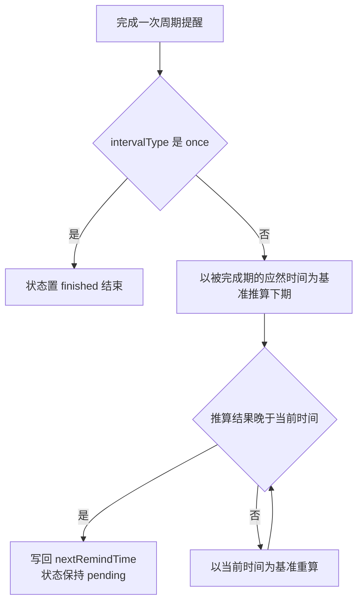
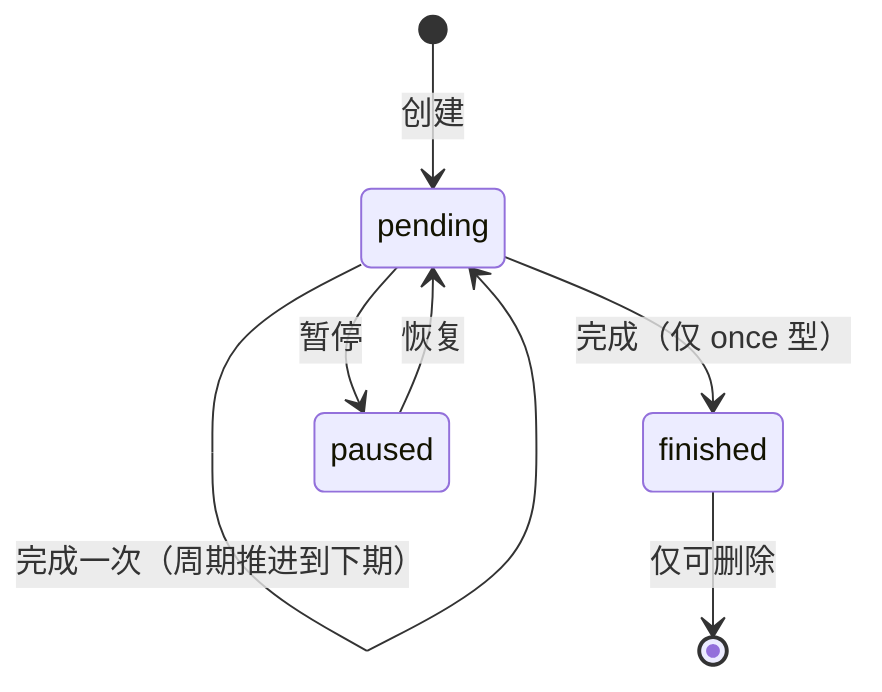
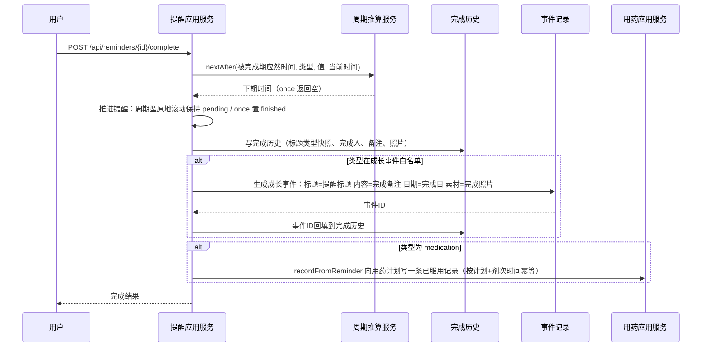

# 提醒与成长时间线

- 日期：2026-10-07
- 对应 Controller：`ReminderController`（前缀 `/api/reminders`）、`EventRecordController`（前缀 `/api/event-records`）

## 1 功能总览

提醒承担养宠生活中周期性、不该忘的小事：疫苗、驱虫、洗澡、剪指甲、体检、用药、生日、每日打卡，以及主人自定义事项。它的关键设计是**完成即归档**：点一下"完成"，系统不只划掉待办，还会把这件事变成宠物成长时间线上的一条事件记录，用药提醒还会同步在用药计划里记一次服药。后台定时扫描到期与临期提醒并发起推送，主人不需要自己盯日历。

## 2 提醒类型全集

| 类型 code | 名称 | 完成时生成成长事件 | 提前 1 天推送 | 特殊规则 |
| --- | --- | --- | --- | --- |
| vaccine | 疫苗 | 是 | 是 | — |
| deworming | 驱虫 | 是 | 是 | — |
| bath | 洗澡 | 是 | 否 | — |
| nail_trim | 剪指甲 | 是 | 否 | — |
| checkup | 体检 | 是 | 是 | — |
| medication | 用药 | 否 | 否 | 只能由用药计划创建；完成时写用药记录 |
| birthday | 生日 | 否 | 否 | 纯提醒 |
| daily_record | 每日打卡 | 否 | 否 | 纯提醒 |
| custom | 自定义 | 是 | 否 | — |

两类派生属性由枚举直接定义：`generatesEvent` 白名单（疫苗/驱虫/洗澡/剪指甲/体检/自定义）决定完成时是否沉淀成长事件；`isImportant`（疫苗/体检/驱虫）决定是否享受"明日重要"提前一天推送。生日与每日打卡是纯提醒：完成只记完成历史，不进时间线。

### 2.1 用药提醒禁止手动创建

创建接口收到 `type=medication` 直接拒绝，报 `MEDICATION_PLAN_REQUIRED`。用药提醒的唯一来源是用药计划模块：建计划时批量生成各剂次提醒，每条提醒持有对应计划引用。完成用药提醒会在同一事务向计划回写一条"已服用"用药记录（见 5.3），并按计划与剂次时间去重，重复完成不会记两笔。这条约束保证用药数据只有一个来源，避免出现写不出用药记录的"假用药提醒"。

## 3 创建与管理

### 3.1 创建

`POST /api/reminders`，请求体字段：

| 字段 | 必填 | 规则 |
| --- | --- | --- |
| petId | 是 | 校验宠物归属 |
| type | 是 | 9 类之一；medication 被拒（`MEDICATION_PLAN_REQUIRED`） |
| title | 是 | 最长 200 字符 |
| description | 否 | 最长 500 字符 |
| intervalType | 是 | once/days/weekly/monthly/months/yearly |
| intervalValue | 视类型 | 约束见 4.1，配置非法报参数错误 |
| nextRemindTime | 是 | 必须晚于当前时间 |

### 3.2 编辑

`PUT /api/reminders/{id}`：可改类型、标题、描述、周期与下次提醒时间；**所属宠物不可改**（换宠物等价于删旧建新，接口不支持）。编辑后的下次提醒时间早于当前时间报 `REMINDER_TIME_IN_PAST`——把周期提醒改到过去不会自动快进，主人需选一个未来时间。

### 3.3 删除与历史保留

`DELETE /api/reminders/{id}` 为逻辑删除。完成历史不随提醒删除而消失：每条历史冗余存了当时的提醒标题与类型快照，提醒本体删掉后，历史记录与由它生成的成长事件仍然完整可读。想清除成长时间线上的对应事件，需另行删除事件记录（仅手动事件可删，见 8.2）。

### 3.4 权限模型

提醒归属于宠物主人。列表、详情、编辑、删除、暂停、恢复都要求操作者是提醒所属宠物的主人；**完成动作放宽给可访问该宠物的协作成员**——照护者上门做了体内外驱虫，可以自己点完成，历史里记下真实完成人。

## 4 重复规则与下期推算

### 4.1 周期类型语义

| intervalType | 含义 | intervalValue 约束 | 从基准时间推算下期 |
| --- | --- | --- | --- |
| once | 仅一次 | 不使用（任意值合法） | 无下期 |
| days | 每 N 天 | N ≥ 1 | 基准 + N 天 |
| weekly | 每周固定星期几 | 1（周一）~ 7（周日） | 基准之后下一个该星期几；基准恰好是该星期几则顺延 7 天 |
| monthly | 每月固定几号 | 1 ~ 31 | 下月的 value 号；超过下月最后一天则钳制到月末 |
| months | 每 N 个月 | N ≥ 1 | 基准 + N 个自然月；目标月无对应日则钳制到月末 |
| yearly | 每年（生日类场景） | 不使用 | 基准 + 1 年（2 月 29 日出生的在平年钳到 2 月 28 日） |

所有推算都在基准时间上做日期偏移，**提醒时刻（时分）自然沿用**，改周期不会把早上 9 点的提醒变成别的钟点。

### 4.2 三条推算原则

- **以应然时间为准，防漂移**：下期基准是"刚完成那一期的计划时间"，不是点完成的时刻。计划 8 月 1 日的每 3 月驱虫拖到 8 月 3 日才完成，下期仍是 11 月 1 日，不会被越拖越晚。
- **补记后过期重算**：若按上条推算出的下期仍不晚于当前时间（长期逾期后补完成），改以当前时间为基准重新推算，直到落进未来。滚动结果恒在未来，不会出现创建完就永远过期的提醒。
- **月末钳制**：每月 31 号的提醒遇到 2 月落在 28/29 日，3 月回到 31 号，不报错、不跳月。

### 4.3 提醒状态机

提醒只有三个持久状态。**周期性提醒没有"已完成"状态**：完成一次只推进周期时间，状态仍是生效中；只有 once 型完成一次后进入已结束。周期提醒除非删除，不会自然走向结束。

- 暂停仅允许对 pending 执行，恢复仅允许对 paused 执行，非法转移报 `REMINDER_STATE_INVALID`。
- **暂停不改提醒时间**：恢复后 `nextRemindTime` 仍是暂停前的值。若暂停期间时间已过，恢复即处于逾期状态，今日视图标逾期、推送按到期处理；此时完成一次，按 4.2 的过期重算规则滚动到未来。暂停的语义是"这段时间别打扰我"，不是"周期顺延"。

## 5 完成动作与事务联动

### 5.1 用户路径

今日视图里待办项右侧就是完成按钮：①点"完成"②在弹层确认（可选写备注、传照片），点击提交即结束——**2 步内完成**。什么补充信息都不需要时，请求体可整体省略，①点完成 ②直接提交，实质一步。

### 5.2 完成接口规则

`POST /api/reminders/{id}/complete`：

| 字段 | 规则 |
| --- | --- |
| completionTime | 选填，缺省取当前时间；允许补填过去时间，但不得晚于当前时间 + 5 分钟容差，超出报 `REMINDER_COMPLETION_TIME_INVALID` |
| notes | 选填，最长 500 字符 |
| photoUrls | 选填，最多 9 张 |

完成后接口返回更新后的提醒（周期型可见推进后的下期时间）。

### 5.3 同事务联动

一次"完成"最多串联四步写入，全部在同一个数据库事务内：推进提醒、写完成历史、按需生成成长事件、按需写用药记录。任何一步失败整体回滚，不会出现"待办划掉了但时间线没记上"的中间态。

事件内容映射值得注意：完成备注成为事件正文、完成照片成为事件素材，所以"完成洗澡提醒时顺手传的 1 张照片"会原样出现在成长时间线上。

### 5.4 完成历史

`GET /api/reminders/{id}/history` 按完成时间倒序返回，每条含：完成时间、备注、照片、提醒标题与类型快照、完成人生成的**事件记录 ID**。事件 ID 让前端能从"这一次完成"直接跳到对应成长事件，形成待办与时间线的双向通路。

## 6 今日视图与列表

### 6.1 今日待办

`GET /api/reminders/today` 是首页提醒卡片的唯一数据源，规则：

- 范围：用户名下**全部宠物**合并返回，待办为下次提醒时间不晚于明日零点的提醒（含逾期已久的），并合并当日已完成项。
- 排序：未完成在前——先逾期项、再按下次提醒时间升序；已完成沉底，按完成时间倒序。刚做完的事就在列表顶部下方，方便检查"做没做全"。
- 每条带三个判断位：`overdue`（是否逾期）、`completedToday`（今日已完成）、完成时间，宠物名随条目返回用于区分多宠。
- 生日与每日打卡类提醒同样进入今日清单，完成即打勾，不产生额外记录。

### 6.2 管理列表

`GET /api/reminders?petId&status`：按宠物与状态过滤（pending/paused/finished），返回提醒完整字段，含最近一次完成时间与备注，供管理页展示"上次 8 月 1 日做过"这类信息。

## 7 推送扫描

### 7.1 扫描频率

推送由周期任务驱动，频率走配置键 `fafa.collaboration.reminder-delivery-cron`：代码缺省为每小时整点，当前 dev/test/prod 环境配置为**每 5 分钟一轮**。[待确认：调度器注释仍写"每小时整点扫描"，与环境配置覆盖值不一致，建议统一口径] 无论哪种频率，去重机制保证用户体验不变（见 7.3）。单轮扫描异常只记日志不中断，等待下一轮。

### 7.2 扫描命中范围

每轮扫描两个窗口：

| 窗口 | 命中条件 | 含义 |
| --- | --- | --- |
| 到期窗口 | 状态 pending 且 下次提醒时间 ∈ [当前时间 - 366 天, 当前时间] | 此刻到期与逾期中的提醒 |
| 明日重要窗口 | 状态 pending 且类型为疫苗/体检/驱虫，且下次提醒时间落在明日全天 | 重要事项提前 1 天打招呼 |

逾期回溯上限 366 天：被遗忘太久的逾期提醒不再无限推送。暂停与已结束状态不出现在任何窗口。

### 7.3 去重、幂等与重试

- **单用户模式**：每条提醒记录最近推送时间，同一提醒每日至多推送一次，后续扫描轮命中同一提醒直接跳过。高频扫描不等于高频打扰。
- **协作模式**（协作功能开启时）：收件人扩展为宠物主人加全体活跃协作成员。投递逐人建幂等记录，按（提醒 × 收件人 × 窗口）去重——主人和照护者各自每天每窗口只收到一条，互不影响。
- **失败重试**：投递失败的记录允许在后续扫描轮重试，累计上限 3 次（`reminderMaxRetries`），超限不再投递，防止坏收件人拖垮任务。

### 7.4 当前实现状态

推送动作目前只落日志，**微信订阅消息通道尚未接入**，端上真实通知暂未生效；推送文案按"宠物名 + 提醒标题"组装，取不到宠物名时降级只发标题。[待确认：订阅消息模板与用户授权订阅流程属接入时的工作，代码尚未定义]

## 8 事件记录与成长时间线

### 8.1 手动记录成长事件

主人在宠物时间线页记录"发生了的一件事"：填类型、标题、日期，可选正文、素材、标签。

`POST /api/event-records` 字段规则：

| 字段 | 必填 | 规则 |
| --- | --- | --- |
| petId | 是 | 校验宠物归属 |
| eventType | 是 | vaccine=疫苗、deworming=驱虫、bath=洗澡、nail_trim=剪指甲、checkup=体检、custom=自定义 |
| title | 是 | 最长 200 字符 |
| content | 否 | 最长 2000 字符 |
| eventDate | 是 | 不得晚于今天 |
| materialUrls | 否 | 最多 9 个素材 |
| tags | 否 | 最多 10 个，单个最长 32 字符，自动去空白与去重 |

保存事件时同步维护用户个人标签的使用热度（每次保存刷新标签活跃度），为后续标签推荐提供依据。

### 8.2 两种来源与不可变性

| source | 产生方式 | 可编辑/删除 |
| --- | --- | --- |
| manual | 主人在时间线页手动创建 | 可以，且仅创建者可操作 |
| reminder | 提醒完成时系统生成 | 不可以，完全不可变 |

`PUT /api/event-records/{id}`、`DELETE /api/event-records/{id}` 校验来源：对 reminder 事件的操作请求报 `EVENT_RECORD_NOT_MODIFIABLE`。提醒事件的不可变是审计设计——事件是"某次完成行为"的存证，与完成历史一一对应（事件回链 sourceId=提醒 ID，历史回链事件 ID），允许单边篡改会破坏两边对得上账的事实。信息有补充请另建一条手动事件。

前端按 `source` 字段区分渲染：提醒生成的事件不带编辑入口，可展示"来自提醒完成"标识；手动事件提供修改与删除。

### 8.3 时间线查询

`GET /api/event-records?petId&startDate&endDate`：按事件日期升序返回，区间上限 366 天，读取需宠物读权限。返回含来源、类型、标题、正文、日期、素材与标签，时间线页直接按日期轴渲染即可。

## 9 接口清单

| 方法与路径 | 说明 | 主要失败码 |
| --- | --- | --- |
| `POST /api/reminders` | 创建提醒 | MEDICATION_PLAN_REQUIRED、时间/周期参数非法 |
| `GET /api/reminders/today` | 今日待办 + 今日已完成合并视图 | 无 |
| `GET /api/reminders` | 按宠物与状态过滤的管理列表 | 无 |
| `GET /api/reminders/{id}` | 提醒详情 | 无 |
| `PUT /api/reminders/{id}` | 编辑（宠物不可改） | REMINDER_TIME_IN_PAST |
| `DELETE /api/reminders/{id}` | 逻辑删除（历史保留） | 无 |
| `POST /api/reminders/{id}/complete` | 完成（请求体可省略） | REMINDER_COMPLETION_TIME_INVALID |
| `POST /api/reminders/{id}/pause` | 暂停（仅 pending） | REMINDER_STATE_INVALID |
| `POST /api/reminders/{id}/resume` | 恢复（仅 paused） | REMINDER_STATE_INVALID |
| `GET /api/reminders/{id}/history` | 完成历史（倒序） | 无 |
| `POST /api/event-records` | 手动创建事件 | 字段校验错误 |
| `PUT /api/event-records/{id}` | 编辑手动事件 | EVENT_RECORD_NOT_MODIFIABLE、EVENT_RECORD_NOT_FOUND |
| `DELETE /api/event-records/{id}` | 删除手动事件 | 同上 |
| `GET /api/event-records` | 区间查询时间线 | 区间超 366 天报参数错误 |
