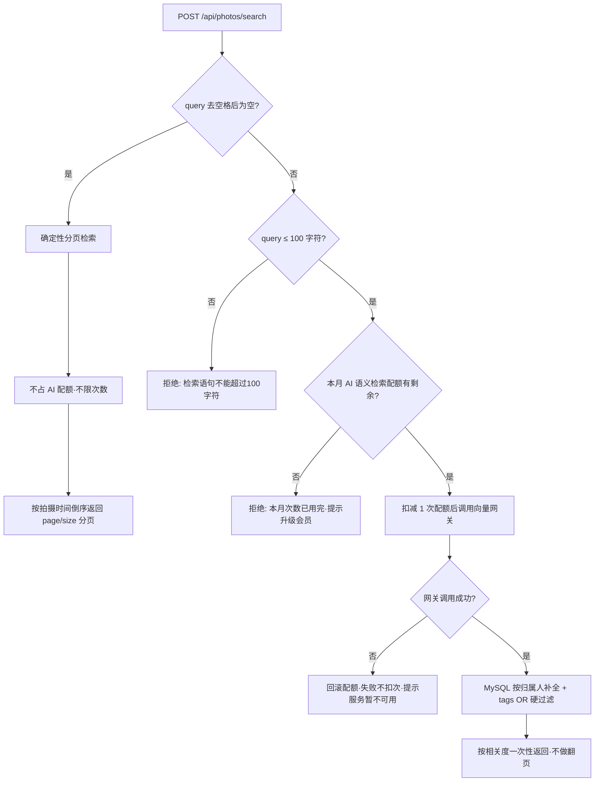

# 08 素材与相册

- 文档日期：2026-10-07
- 对应 Controller：`PhotoController`（路由前缀 `/api/photos`，含照片与视频两类素材）

## 1 模块定位

用户把宠物照片、视频存进相册，系统代为完成三件事：控制占用的存储空间、自动判断素材属于哪只宠物、让素材可以被"用一句话找出来"。所有接口统一走 `/api/photos/**`，路径中的 photos 沿用历史命名，实际语义覆盖视频。

素材由 MediaDTO 承载，用户侧可见的完整字段：

| 字段 | 含义 |
| --- | --- |
| id | 素材ID |
| petId / petName | 归属宠物；未确认归属时 petId 为空 |
| mediaType | photo=照片，video=视频 |
| fileUrl | 素材访问地址 |
| fileName / fileSize / mimeType | 原始文件名、字节大小、MIME 类型 |
| tags | 用户标签与系统标签的合并列表 |
| status | 向量化处理状态：pending / processing / completed / failed / skipped |
| aiDescription / aiTags | AI 生成的画面描述与识别标签 |
| recognitionScore | 宠物归属识别相似度，0-1 |
| recognitionConfirmed | 归属是否已确认（用户指定或 AI 唯一命中） |
| takenAt | 拍摄时间，相册排序依据 |
| errorMessage | 处理失败原因，成功时为空 |
| createdAt | 上传时间 |

## 2 批量上传

### 2.1 用户路径

相册页 → 点上传 → 多选文件（一批最多 20 个）→ 可选填标签、选择宠物、选择拍摄时间 → 确认 → 等待一次请求返回。用户操作共 4 步，一批素材只发 1 次请求；上传成功即返回素材列表，AI 分析在后台继续，不需要用户等待或停留。

### 2.2 接口

`POST /api/photos/upload`（multipart/form-data）

| 参数 | 必填 | 规则 |
| --- | --- | --- |
| files | 是 | 素材文件列表；单批 ≤20 个；照片 ≤10MB/个，视频 ≤50MB/个；MIME 仅接受 image/*（判为照片）与 video/*（判为视频），其他类型整批拒绝 |
| tags | 否 | 逗号分隔标签，应用到本批全部素材 |
| petId | 否 | 归属宠物；一旦指定即视为用户已确认归属，AI 不再改判 |
| takenAt | 否 | 拍摄时间（ISO 日期时间）；缺省取上传时刻 |

返回 `List<MediaDTO>`，顺序与提交文件一致。

### 2.3 系统规则

**校验全部先行**：任何一个文件的类型或大小不合法，请求立即失败，不会有一半文件已传一半被拒的情况。配额同理——上传前对整批文件总大小做一次性扣减校验，**存储配额不足时一个文件都不会上传**，直接返回"存储空间不足，升级会员解锁更大空间"。配额校验与扣减是原子的，两个设备同时上传也不会超额。

**并行上传**：配额扣减通过后，全部文件用虚拟线程并行传输到对象存储，接口耗时取决于最慢的一个文件，而不是所有文件之和。

**失败回滚与孤儿清理**：传输或落库阶段出现任何异常，系统回滚本次已扣减的配额，并删除本批中已经传上去的所有对象，不会留下占用存储却查不到的"孤儿文件"。

**拍摄时间**：未提供 takenAt 时统一按上传时刻记录；用户可在上传时或后续编辑时修正。

## 3 AI 归属识别

### 3.1 识别时机与结果

上传事务提交后，系统对每个素材异步发起 AI 分析（embedding 向量化 + 宠物识别），不阻塞上传返回。识别遵循一条核心规则：**恰好匹配到一只宠物才自动写入归属**。

| 场景 | 系统行为 |
| --- | --- |
| 上传时已指定 petId | 直接确认归属，AI 不再改判，并自动追加该宠物名称标签 |
| 用户仅有一只宠物且未指定 petId | 上传即自动归属该宠物，追加宠物名称标签 |
| 用户有多只宠物且未指定 petId | 上传时不预设归属，把全部候选宠物交给 AI |
| AI 恰好命中 1 只 | 自动写入 petId 并标记归属已确认，同时把命中宠物名追加为标签 |
| AI 命中多只 | 不写 petId，只把各命中宠物名追加为标签，用户可手动修正 |
| AI 命中 0 只或识别失败 | 不写归属，状态落 failed 并给出失败原因 |

用户后续手动确认的归属不会被 AI 回调覆盖；重新分析同样遵循"仅一只命中才回填"的限制。

### 3.2 手动修正入口

`POST /api/photos/{id}/confirm-pet`，请求体字段 petId 可为 null 表示清除归属。指定宠物时校验归属权、写入素材，并同步追加该宠物名称标签。该入口同时兼容旧客户端；`GET /api/photos/pending-recognition` 返回历史待确认素材（上限 50 条），新上传素材不再进入待确认流程。

### 3.3 关联变动

宠物被删除时，其素材保留，仅清空 petId 归属与确认标记。宠物改名后新名称用于后续识别与检索匹配，历史素材的名称标签迁移规则 [待确认]。

## 4 标签规则

- 用户上传时填写的手动标签，单条素材最多 10 个；超出报错。
- 单个标签最长 32 个字符，超出报错（上传与编辑两个入口均校验）。
- AI 自动追加的宠物名称标签不占用户的手动额度：素材最终标签总数可以超过 10，只要用户自己维护的部分不超限。
- 编辑标签采用**全量替换**语义：提交的 tags 即素材的新标签全集，未提交的旧标签（含自动宠物标签）会被移除，不是追加。
- 标签保存为小写、去空格、按输入顺序去重；同一用户的标签会被沉淀为个人标签库供下次复用。
- tags 参数为空列表时不修改现有标签（编辑接口），上传时为空则素材仅有自动标签。

## 5 统一检索

### 5.1 用户路径

相册页搜索框 →（可选）输入自然语言语句 →（可选）叠加宠物 / 标签 / 日期筛选 → 提交 → 结果列表。用户操作 2~3 步，检索入口只有一个：`POST /api/photos/search`。旧的列表接口与独立语义检索接口已下线，前端不需要判断该调哪个接口。

### 5.2 请求字段

| 字段 | 规则 |
| --- | --- |
| query | 可选；自然语言语句，≤100 字符；**为空（或纯空白）走确定性检索，有值走语义检索** |
| petId | 可选；宠物过滤 |
| tags | 可选；标签过滤，任一命中即通过（OR 语义） |
| startDate / endDate | 可选；按拍摄时间过滤日期区间 |
| page | 可选，默认 1；仅确定性检索生效，语义检索固定第 1 页 |
| size | 可选，默认 20，上限 100；语义检索时作为最大返回条数 |

### 5.3 分流判定

### 5.4 确定性分支（query 为空）

不经过任何 AI 环节，**不限次数、不占配额**。行为等同"带筛选条件的相册列表"：按拍摄时间倒序，支持 page/size 翻页并返回总条数；petId 命中他人协同宠物时按宠物空间放行；tags 与日期在数据库侧硬过滤。

### 5.5 语义分支（query 有值）

- 普通用户每月 10 次，VIP 不限；次数按自然月计，每月末自动重置。
- 配额扣减发生在网关调用之前；网关调用失败时立刻回滚这次扣减，**失败的检索不扣次**。配额超限的提示为"本月 AI 语义检索次数已用完，升级会员解锁不限次"。
- 检索范围自动锁定：用户未指定 petId 且只有一只宠物时直接按该宠物下推，多只宠物时把候选宠物名单交给语义服务做名称匹配（如"豆包在阳台晒太阳"能解析出宠物与场景）。
- petId 与日期条件在向量检索阶段下推生效；tags 条件在结果补全阶段用 MySQL 硬过滤，保持 OR 语义与确定性分支一致。
- 结果按相关度排序一次性返回，`size` 即最大条数（1~100 夹取），响应中的分页字段固定为第 1 页；前端在语义模式下应隐藏翻页控件。

### 5.6 可见范围

素材归属某宠物时，该宠物空间的协同成员按"可查看记录"权限即可检索、查看详情；素材无归属宠物时仅归属人本人可见。两种分支都以素材归属人的数据范围执行，成员看不到彼此私有的素材。

## 6 素材详情、重新分析、编辑与删除

### 6.1 详情

`GET /api/photos/{id}` 返回 MediaDTO 全字段。照片地址为对象存储直链；视频地址带访问时效（有效期 3600 秒），过期需重新获取。

### 6.2 重新分析

`POST /api/photos/{id}/reanalyze` 把素材状态重置为 pending 并重新投递 AI 分析，用于历史视频补向量、失败素材重试。仅素材归属人可发起；若归属不是用户手动确认的，重新分析会先清空旧归属再判定，用户已确认的归属不受影响。

### 6.3 编辑

`PATCH /api/photos/{id}` 支持修改 tags 与 takenAt。tags 全量替换（规则见第 4 节）；takenAt 传 null 表示不修改。仅归属人可编辑。

### 6.4 删除

`DELETE /api/photos/{id}` 是**一条指令完成四步**：素材从相册与检索结果中即时消失（逻辑删除）→ 释放其占用的存储配额 → 后台异步删除对象存储文件 → 后台异步删除向量库中的 embedding。删除后无法找回；两步清理失败不影响用户侧结果，也不会让素材重新出现在列表里。

## 7 向量化状态展示

status 字段驱动前端的素材状态展示：

| 状态 | 含义 | 建议展示 |
| --- | --- | --- |
| pending | 已上传，排队等待分析 | "待分析"角标，缩略图正常可看 |
| processing | AI 正在生成向量与识别归属 | "分析中"角标 |
| completed | 分析完成 | 正常展示，可用 recognitionScore 提示匹配度 |
| failed | 分析失败 | "分析失败"提示，附 errorMessage，提供重试（重新分析）入口 |
| skipped | 该素材被跳过分析 | 正常展示，不出现进度角标 |

completed 且 petId 为空表示 AI 未唯一命中任何宠物（多命中或零命中），应引导用户走手动修正归属。recognitionConfirmed 为 true 表示归属可信（用户指定或 AI 唯一命中），false 表示尚未确认。回调处理是幂等的：已处于终态（completed/failed/skipped）的素材重复收到回调不会二次改写。

## 8 存储与配额规则

| 项目 | 规则 |
| --- | --- |
| 存储容量 | 普通用户 2GiB，VIP 20GiB；按素材文件大小累计，删除素材即释放 |
| 配额扣减时机 | 上传前对整批总大小一次性扣减，不足即整批拒绝 |
| AI 语义检索 | 普通用户每月 10 次，VIP 不限；失败不扣次 |
| 照片访问 | 对象存储公有读直链，长期有效 |
| 视频访问 | 预签名地址，有效期 3600 秒 |
| 单文件上限 | 照片 10MB、视频 50MB；单批 ≤20 个 |

容量不足时上传整批失败并引导升级会员；升级 VIP 后容量上限提高，已用量不清零。配额查询接口的展示口径 [待确认]（本文仅覆盖素材模块内的扣减与释放行为）。

## 9 用户可见提示与错误码

| 错误码 | 触发场景 | 用户提示 |
| --- | --- | --- |
| 40001 MEDIA_NOT_FOUND | 素材不存在或已删除 | 素材不存在 |
| 40002 MEDIA_FILE_TOO_LARGE | 照片 >10MB 或视频 >50MB | 文件超出大小限制 |
| 40003 MEDIA_FILE_COUNT_EXCEEDED | 单批 >20 个文件 | 一次最多上传 20 个文件 |
| 40004 MEDIA_TYPE_INVALID | 文件既非图片也非视频 | 不支持的文件类型 |
| 40005 STORAGE_QUOTA_EXCEEDED | 存储配额不足（整批拒绝） | 存储空间不足，升级会员解锁更大空间 |
| 40006 AI_SEARCH_QUOTA_EXCEEDED | 本月语义检索次数用完 | 本月 AI 语义检索次数已用完，升级会员解锁不限次 |
| 参数校验失败 | 标签 >10 个 / 单标签 >32 字符 / query >100 字符 | 按具体校验消息提示 |
