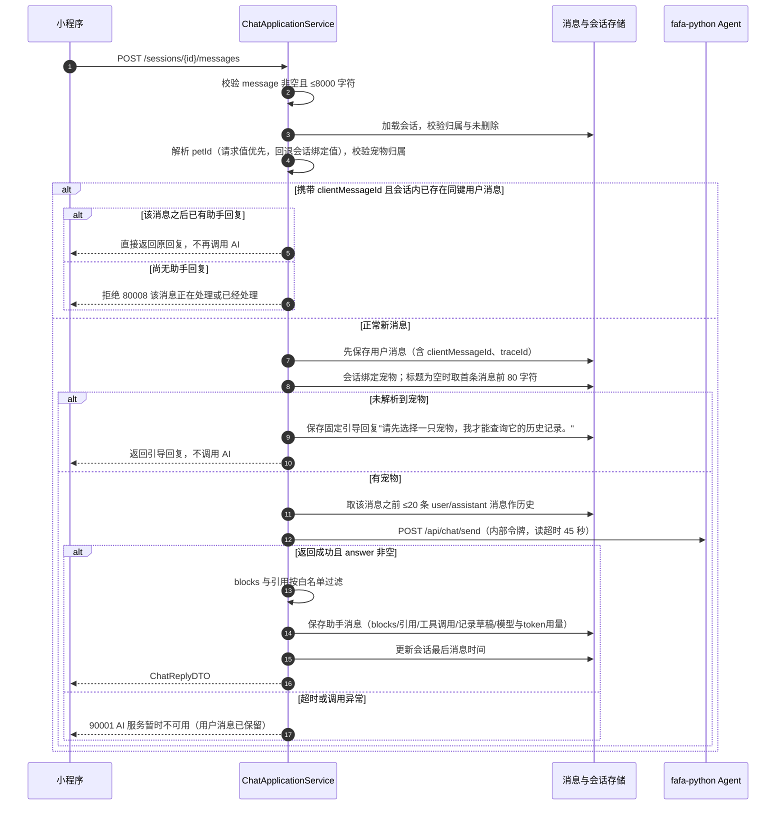
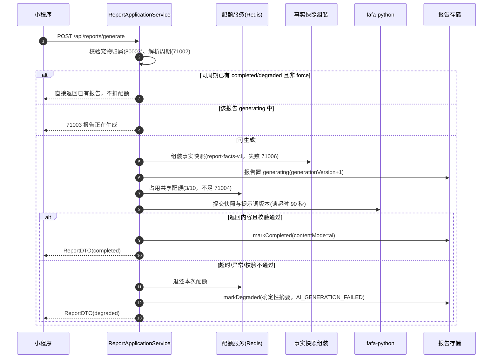
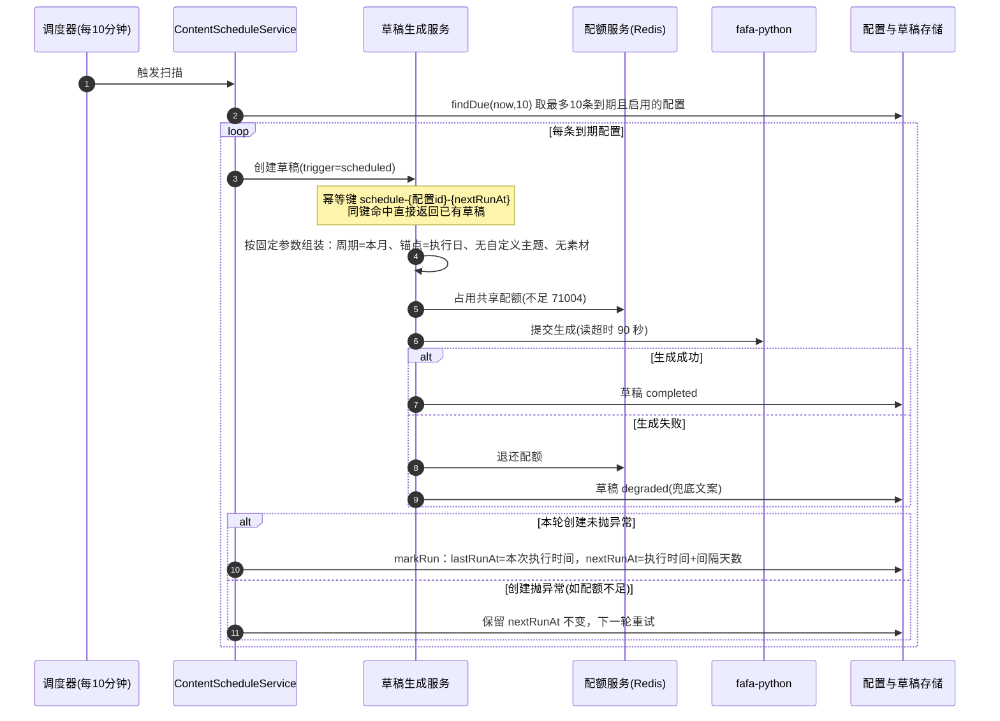

# 09 AI助手与内容报告

- 文档日期：2026-10-07
- 对应 Controller：`ChatController`（/api/chat）、`ReportController`（/api/reports）、`ContentDraftController`（/api/content-drafts）、`ContentScheduleController`（/api/content-schedules）、`InternalAiQueryController`（/internal/ai，服务间）、`CallbackController`（/api/callback，服务间）

## 1 模块定位

本模块回答两类需求：用户想"问一只宠物"，以及用户想"把一只宠物的故事讲给别人听"。

- AI 聊天：用户用自然语言提问，AI 读取该宠物的体重、状态、事件、喂食、医疗、开支等只读数据后回答，并能顺手生成一条记录草稿（如"昨天吐了一次"）供用户一键确认落库。
- 周期报告：按周/月/季/年把宠物的客观数据汇总成一份可回看的报告。
- 内容草稿：基于同期数据生成分享笔记或小红书文案草稿，可编辑、可按周期定时自动生成。

职责边界：Java 负责会话权限、消息持久化、响应白名单过滤与配额；Python 负责 Agent 编排与大模型调用；Python 回读业务数据只能走 Java 暴露的 `/internal/ai/**` 只读接口，且每个请求都显式携带 userId 并重新校验宠物归属。

## 2 AI 聊天

### 2.1 接口清单

| 方法与路径 | 用途 |
| --- | --- |
| POST /api/chat/sessions | 创建 AI 会话 |
| GET /api/chat/sessions | 查询会话列表 |
| GET /api/chat/sessions/{sessionId}/messages | 查询会话消息（游标分页） |
| POST /api/chat/sessions/{sessionId}/messages | 发送消息并获取 AI 回复 |
| DELETE /api/chat/sessions/{sessionId} | 删除会话 |
| GET /api/chat/recommendations | 查询推荐问题（见第 3 节） |

会话对象（ChatSessionDTO）：sessionId、petId（通用会话为空）、title、status（active/deleted）、lastMessageAt、createdAt。

消息对象（ChatMessageDTO）：messageId、sessionId、role（user/assistant）、content、blocks、citations、recordDraft、assistantStatus（当前固定 answered）、createdAt。

### 2.2 创建与管理会话

交互逻辑：AI 助手页 → 点击"新建对话"（可选先选中一只宠物）→ 系统创建会话并返回会话卡片 → 会话列表按时间排列，可按宠物过滤、可删除。

业务规则：

- 创建会话时可不带宠物，得到一个通用会话；带 petId 时校验宠物归属，非本人宠物直接拒绝。
- 删除会话为软删除，状态置 deleted；已删除会话不能再发消息。
- 会话列表 page 从 1 起，size 默认 20、上限 50。

### 2.3 发送消息

请求体（POST /api/chat/sessions/{sessionId}/messages）：

| 字段 | 必填 | 规则 |
| --- | --- | --- |
| message | 是 | 不能为空，去首尾空格后 ≤8000 字符（fafa.chat.max-message-length，默认 8000） |
| petId | 否 | 正整数；指定时校验归属；不传时使用会话已绑定的宠物 |
| clientMessageId | 否 | ≤64 字符；客户端生成的幂等标识 |

处理时序（无宠物与有宠物两条分支）：

关键规则：

- 消息持久化时序是"先落用户消息，再等模型、再落助手消息"，发送过程不持有数据库事务，避免模型推理期间占用连接。因此调用失败时用户消息已经在，但不会有对应助手消息。
- 幂等：同一会话内 clientMessageId 命中历史用户消息时视为重复提交。已有回复则原样返回（响应中 suggestedQuestions 为空）；无回复（如上次 AI 超时）则返回 80008，此时用户应换一个新 clientMessageId 或不携带幂等键重发。
- 宠物绑定：请求带 petId 会话即被绑定到该宠物；会话标题取第一条用户消息的前 80 字符。
- 历史窗口：传给 Agent 的上下文只含 user/assistant 两种角色、当前消息之前最多 20 条（fafa.chat.history-message-limit）。
- 聊天不消耗报告内容配额，当前也没有独立的聊天次数限制。
- 超时与工具约束（fafa.chat 配置）：Agent 整体读超时 45 秒由 Java HTTP 客户端强制执行；工具单次超时 8 秒、最多 5 次工具调用为平台约定值，Java 侧无消费点，执行位置在 Agent 侧 [待确认]。

响应 ChatReplyDTO 字段：sessionId、userMessageId、assistantMessageId、petId、content（回复文本）、blocks（结构化块）、citations（引用）、suggestedQuestions（建议的后续问题）、recordDraft（记录草稿）、traceId（链路追踪 ID，异常反馈时可用于对账）。

### 2.4 助手消息的 blocks 与引用

AI 的回复除纯文本外，可携带结构化块（blocks）。Python 返回什么 Java 不直接信任：每个块必须是 JSON 对象，且 type 命中白名单才会被保存与展示，未列出的类型一律丢弃（不报错）。没有 type 但带 sourceType 或 source_type 字段的节点按引用处理，同样放行到 citations。

blocks 渲染类型：

| type | 展示形态 |
| --- | --- |
| stat | 单项数据卡片，突出一个指标值 |
| chart | 图表，展示趋势或对比 |
| media | 素材卡片，展示宠物照片或视频 |
| link | 链接条，点击跳转到对应功能页 |
| notice | 提示条，展示说明或注意事项 |

块内字段结构由 Agent 侧契约定义，Java 仅按 type 过滤不解读字段 [待确认] 各 type 的字段级渲染细节。

### 2.5 记录草稿（recordDraft）

当用户在聊天里陈述了可记录的事实（如喂食、体重、状态），Agent 可返回 recordDraft。平台约定置信度阈值 0.80（fafa.chat.record-draft-confidence-threshold）：达到阈值的草稿才建议向用户提示"可一键落记录"。阈值配置项定义于 Java 配置类，Java 侧只保存并透传 recordDraft，不做置信度校验，判定发生在 Agent 侧 [待确认] 阈值判定的具体执行位置与提示文案。

### 2.6 历史消息与游标分页

GET /api/chat/sessions/{sessionId}/messages：

| 参数 | 规则 |
| --- | --- |
| beforeId | 可选；游标，只返回 ID 小于该值的消息；不传表示从最新一条开始 |
| limit | 可选；默认 50，上限 50 |

返回按消息 ID 升序（旧到新）。上滑加载更早消息时，把上一页最早一条的 messageId 作为 beforeId 传入。消息只允许会话归属人查看，非本人会话统一按"会话不存在"处理，不暴露存在性。

## 3 猜你想问

### 3.1 接口与参数

GET /api/chat/recommendations：

| 参数 | 规则 |
| --- | --- |
| petId | 可选；指定时校验宠物归属（非本人宠物拒绝）；不传时取用户的第一只宠物 |
| limit | 可选；默认 6，夹取到 1..6 |

返回 RecommendationDTO：petId 与 items 列表；用户没有任何宠物时返回空列表。**推荐问题是确定性生成的**：服务只查询本地已有数据（体重、每日状态、事件）决定候选是否出现，全程不调用大模型，不消耗任何配额。

### 3.2 候选问题与出现条件

候选按固定顺序生成，按条件过滤后取前 limit 条：

| 顺序 | 键 | 问题文案 | 分类 category | 出现条件 |
| --- | --- | --- | --- | --- |
| 1 | weight-trend | {宠物名}最近体重怎么样？ | trend | 恒出现 |
| 2 | weight-history | {宠物名}最近一个月体重有变化吗？ | trend | 近 30 天存在体重记录 |
| 3 | refused-food | {宠物名}这个月有几天拒食？ | record | 本月 1 日至今天存在每日状态记录 |
| 4 | recent-events | {宠物名}最近发生了什么？ | memory | 近 30 天存在事件记录 |
| 5 | feeding-history | {宠物名}最近吃了多少？ | record | 恒出现 |
| 6 | media-memory | 帮我找{宠物名}最近的照片和视频 | memory | 恒出现 |

交互逻辑：AI 助手页进入会话或选中宠物 → 页面请求推荐问题 → 点击某条问题即以其为内容发送消息，走第 2.3 节的发送链路。数据少的新宠物只会看到 3 条恒出现的问题；记录越全，候选越接近 6 条。

## 4 周期报告

### 4.1 接口清单

| 方法与路径 | 用途 |
| --- | --- |
| POST /api/reports/generate | 生成周期报告 |
| GET /api/reports | 查询报告列表（petId 必填；page 从 1 起，size 默认 20、上限 50） |
| GET /api/reports/{id} | 查询报告详情 |
| POST /api/reports/{id}/regenerate | 重新生成（等价于 force=true、来源标记 regenerate） |
| DELETE /api/reports/{id} | 删除报告（软删除） |

生成请求体：petId（必填）、periodType（week/month/quarter/year，默认 month）、anchorDate（锚点日期，不传由服务端按今天推断）、force（默认 false）。

### 4.2 周期解析与生成规则

| periodType | 统计区间 |
| --- | --- |
| week | 锚点日期所在的自然周（周一至周日） |
| month | 锚点日期所在自然月 |
| quarter | 锚点日期所在季度（连续 3 个自然月） |
| year | 锚点日期所在自然年 |

生成处理规则（触发条件 → 处理 → 输出）：

1. 校验宠物归属，非本人宠物返回 80003。
2. 解析周期：统计开始日期不得晚于今天，区间跨度不得超过 3660 天（fafa.report.max-range-days），否则返回 71002。
3. 同周期已有报告且状态为 completed 或 degraded、且未强制重生成：直接返回已有报告，不重复生成、不扣配额。
4. 同周期报告正在生成中：返回 71003。
5. 组装事实快照（见 4.3），组装失败返回 71006。
6. 报告置为 generating：新建报告 generationVersion 从 1 起；已有报告重新生成时 generationVersion 加 1。
7. 占用生成配额（见 4.4），调用 Python 生成（读超时 90 秒）。
8. 返回内容通过校验则报告 completed；超时、异常或校验不通过则退还配额并降级为确定性摘要（见 4.7）。

交互逻辑：报告页选择宠物与周期类型 → 点击"生成报告" → 生成期间同周期重复点击只会拿到已有结果或 71003 → 完成后进入报告详情。列表按生成时间倒序展示，详情含事实快照与报告正文。

### 4.3 事实快照

生成前服务把该宠物该周期的客观数据固化为一份快照（snapshotVersion 固定 report-facts-v1），AI 只能基于快照写作，不能联网或猜测：

| 快照字段 | 内容 |
| --- | --- |
| schemaVersion | 快照结构版本，固定 report-facts-v1 |
| pet | 宠物基础信息 |
| period | 周期类型与起止日期 |
| dailyStatuses | 周期内每日状态记录 |
| weights | 周期内体重记录 |
| feeding | 周期内喂食记录 |
| events | 周期内事件记录 |
| reminders | 周期内提醒历史 |
| medicalVisits | 周期内就诊记录 |
| medications | 周期内用药计划与记录 |
| healthAlerts | 周期内健康预警 |
| expenses | 周期内开支记录 |
| media | 周期内素材，最多 12 条（fafa.report.max-media-count） |

报告的 dataStatus 取值 complete 或 partial。当前判定方式是检查快照中是否包含 dailyStatuses 字段，而组装器总是输出该字段，因此实际几乎恒为 complete [待确认] partial 的实际产生条件。

### 4.4 生成配额

报告生成与内容草稿生成共用同一个按自然月计的配额池（Redis 键 fafa:quota:report-content:{userId}:{yyyy-MM}）：普通用户每月 3 次、会员每月 10 次。占用失败返回 71004；AI 调用失败或内容校验不通过时本次占用会退还，不会白扣次数。配额细则见文档《12 会员与配额》。

### 4.5 AI 内容校验

Python 返回的报告内容必须通过 ReportContentValidator，任一不满足即视为失败：

| 校验项 | 规则 |
| --- | --- |
| title | 非空，≤100 字符 |
| summary | 非空，≤2000 字符 |
| highlights | ≤8 条 |
| careSuggestions | ≤8 条 |
| timeline | ≤20 条 |
| mediaSuggestions | ≤12 条 |
| sourceKeys | ≤64 个；每个必须命中前缀白名单 |

sourceKey 前缀白名单（引用必须指向快照内的事实）：media:、dailyStatuses:、weights:、feeding:、events:、reminders:、medicalVisits:、medications:、expenses:、healthAlerts:。

医疗违禁词：内容中出现"诊断为、确诊、处方、服用剂量、治疗方案"任一词即校验失败。校验失败不直接报错给用户，而是走降级（见 4.7）。

### 4.6 生成链路时序

### 4.7 报告状态与降级展示

| status | 含义 | contentMode |
| --- | --- | --- |
| generating | 生成中 | - |
| completed | AI 生成成功 | ai |
| degraded | AI 失败后的确定性兜底 | deterministic |
| failed | 状态枚举保留；当前 Java 同步生成流程不产生该状态 [待确认] 产生场景 | - |

降级时写入的确定性摘要由代码拼装，不依赖 AI：标题为"{宠物名}的{week/month/quarter/year}报告"；摘要是"本周期已记录每日状态 N 天、喂食 N 次、事件 N 条。"；亮点为"已纳入事实快照的数据均可在报告详情中回看"；养护建议为"继续保持规律记录，便于下个周期形成可比较趋势"；时间线、素材建议与引用为空；lastErrorCode 记为 AI_GENERATION_FAILED，lastErrorMessage 为"AI 暂不可用，已生成事实摘要"。

用户侧表现：报告仍可正常打开，数据（快照）完整可回看，页面上以 contentMode 与提示文案说明这是兜底摘要而非 AI 成稿；用户可点击"重新生成"再次尝试。

### 4.8 重新生成与删除

- 重新生成（POST /{id}/regenerate）：读取原报告的宠物、周期类型与起始日期，以 force=true、来源 regenerate 走一遍 4.2 的生成流程；generationVersion 加 1，旧内容被新内容覆盖。即使原报告是 completed 也允许重生成。
- 删除（DELETE /{id}）：软删除，列表与详情不再可见。

## 5 内容草稿与定时发布

### 5.1 接口清单

| 方法与路径 | 用途 |
| --- | --- |
| POST /api/content-drafts | 生成内容草稿 |
| GET /api/content-drafts | 草稿列表（petId 必填；page 从 1 起，size 默认 20、上限 50） |
| GET /api/content-drafts/{id} | 草稿详情 |
| PUT /api/content-drafts/{id} | 用户编辑保存草稿 |
| POST /api/content-drafts/{id}/regenerate | 重新生成草稿 |
| DELETE /api/content-drafts/{id} | 删除草稿（软删除） |
| GET /api/content-schedules | 查询定时配置（petId 可选过滤） |
| PUT /api/content-schedules | 保存定时配置（存在即更新） |
| POST /api/content-schedules/{id}/enable | 启用配置 |
| POST /api/content-schedules/{id}/disable | 停用配置 |
| DELETE /api/content-schedules/{id} | 删除配置（软删除） |

生成请求体：petId、contentType（share_note 分享笔记 / xiaohongshu 小红书，默认 share_note，其他值返回 71008）、topicType（默认 monthly_summary；代码未限定候选清单 [待确认] 前端可选主题）、customTopic（自定义主题文案）、periodType（默认 month，解析规则同 4.2）、anchorDate、selectedMediaIds（选中的素材）、idempotencyKey。

### 5.2 生成草稿

处理规则：

1. 校验宠物归属（80003）与内容类型（71008）。
2. 素材处理：ID 去重，最多 12 个（与报告共用 max-media-count），逐个校验存在且属于当前宠物，否则 71009。
3. **幂等键防重复生成**：idempotencyKey 为空时自动生成 manual-{UUID}；非空且同用户已存在同键草稿时直接返回已有草稿，不重复生成、不扣配额。
4. 解析统计周期（同 4.2 规则），组装事实快照（与报告共用同一组装器）。
5. 创建草稿（初始 generating），占用共享配额（3/10，与报告同一池），调用 Python 生成（读超时 90 秒）。
6. 返回内容通过校验（title 非空 ≤100 字符、body 非空 ≤5000 字符、hashtags ≤20 个、mediaOrder ≤12 个、无医疗违禁词）则 completed；否则退还配额并降级为兜底文案。

交互逻辑：内容页选择宠物与内容类型（分享笔记/小红书）→ 选择主题或填写自定义主题 → 可勾选配图素材 → 点击生成 → 生成完成进入草稿编辑页，可修改文案、调整配图顺序、重新生成或删除。

### 5.3 草稿编辑与兜底文案

用户编辑保存（PUT /{id}）对提交的整个 draftJson 校验：非空且 ≤12000 字符，不含医疗违禁词（诊断为、确诊、处方、服用剂量、治疗方案）；若其中 mediaOrder 数组携带素材 ID，逐个校验归属，否则 71009 或 80003。

AI 生成失败时的兜底草稿（contentMode=deterministic）：标题"{宠物名}的成长记录"；正文"记录一下{宠物名}最近的生活点滴，留住每一个值得回看的瞬间。"；标签 #宠物日常、#成长记录；配图沿用用户所选素材；lastErrorCode=AI_GENERATION_FAILED，lastErrorMessage="AI 暂不可用，已生成可编辑草稿"。用户可直接在编辑页修改后使用。

重新生成（POST /{id}/regenerate）：沿用草稿原有的类型、主题、周期与素材，generationVersion 加 1 后重新走 5.2 的生成流程。

### 5.4 定时发布配置

用户可以为某只宠物的某类内容设置周期自动生成（trigger=scheduled）：

- 唯一性：同一"用户 + 宠物 + 内容类型"只有一条配置，重复保存即为更新（upsert），不会出现重复配置。
- 间隔：intervalDays 仅允许 7、15、30 天，其他值返回 71011。
- 下次执行时间：不传时默认为保存时刻加间隔天数；topicType 不传默认 monthly_summary。
- 启停：enable/disable 控制是否参与调度；删除为软删除。

定时生成链路：

调度频率由 fafa.report.schedule-scan-cron 控制，默认"0 */10 * * * *"即每 10 分钟一轮，每轮最多处理 10 条到期配置。幂等键包含 nextRunAt，保证"同一配置的同一轮到期"只生成一份草稿；即使上一轮在推进 nextRunAt 前中断，下一轮也不会重复生成。定时生成失败的配置会保留 next_run_at 在下一轮自动重试。

### 5.5 定时与手工生成的区分

草稿的 generationTrigger 标记来源：manual（用户点击生成）、regenerate（重新生成）、scheduled（定时生成）。列表与详情将该字段返回给前端，可用于展示"自动生成"标识。

## 6 服务间通道

本节内容用户不可见，仅说明边界。Java 与 Python 之间存在两条内部通道，均不走用户登录态，由 X-Internal-Token 内部令牌校验，令牌不符返回 401（SaToken 登录校验对 /internal/** 与 /api/callback/** 放行，改由内部令牌拦截器把关）。

### 6.1 /internal/ai 只读数据接口

Python Agent 回读业务数据只能走 /internal/ai 下 17 个只读端点：

| 路径（前缀 /internal/ai） | 数据 |
| --- | --- |
| GET /pets/{petId}/profile | 宠物档案 |
| GET /pets/{petId}/daily-status | 每日状态 |
| GET /pets/{petId}/weight | 体重记录 |
| GET /pets/{petId}/feeding | 喂食记录 |
| GET /pets/{petId}/events | 事件记录 |
| GET /pets/{petId}/reminders/history | 提醒历史 |
| POST /media/search | 素材搜索 |
| GET /media/{mediaId} | 素材详情 |
| GET /pets/{petId}/medical-visits | 就诊记录 |
| GET /pets/{petId}/medication-plans | 用药计划 |
| GET /pets/{petId}/expenses | 开支记录 |
| GET /pets/{petId}/expense-statistics | 开支统计 |
| GET /pets/{petId}/medication-records | 用药记录 |
| GET /pets/{petId}/health-alerts | 健康预警 |
| GET /pets/{petId}/foods | 食物 |
| GET /pets/{petId}/feeding-plans | 喂食计划 |
| GET /pets/{petId}/reports | 历史报告内容（上限 12 条） |

共同安全规则：每个请求显式携带 userId，服务端据此重新校验 userId 对 petId 或 mediaId 的归属，非本人数据一律返回 80003；日期区间参数限制在 1..366 天。即使用户侧请求参数被篡改，Python 拿到的数据也只可能是该用户自己的。

### 6.2 回调通道

/api/callback 下两个端点：素材分析回调（photo-analysis）与宠物向量化回调（pet-vectorization）。幂等与终态保护：

- 素材分析回调：已处于终态的素材直接跳过，不重复更新。
- 宠物向量化回调：完成与失败均为一次终态，重复通知时领域方法返回 false 被忽略。

## 7 边界与免责声明

### 7.1 异常边界与用户所见

| 场景 | 系统行为 | 用户所见 |
| --- | --- | --- |
| 聊天 Agent 超时（45 秒）或调用异常 | 用户消息已持久化，无助手消息 | 返回 90001"AI 服务暂时不可用"；重发需换新 clientMessageId 或不携带幂等键，否则收到 80008 |
| 报告 AI 超时、异常或内容校验失败 | 退还本次配额，写入确定性事实摘要 | 报告可正常查看（contentMode=deterministic），提示"AI 暂不可用，已生成事实摘要"，可重新生成 |
| 草稿 AI 超时、异常或内容校验失败 | 退还本次配额，写入兜底草稿 | 草稿可查看可编辑，提示"AI 暂不可用，已生成可编辑草稿" |
| 配额耗尽（本月 3/10 次用完） | 不发起 AI 生成 | 返回 71004，次月自动恢复 |
| AI 返回未约定内容 | 未知 blocks 类型丢弃、非白名单引用过滤、越界长度与违禁词校验失败转降级 | 页面只出现约定内的元素，不出现医疗结论表述 |
| 会话未绑定宠物时提问 | 不调用 AI | 固定引导"请先选择一只宠物，我才能查询它的历史记录。" |
| 定时生成失败（如配额不足） | 配置的 nextRunAt 保留 | 无感知，下一轮自动重试 |

### 7.2 免责声明模式

AI 输出定位为参考内容：聊天回复、报告与草稿均不构成医疗诊断或治疗建议。代码层的落点有两处：报告与草稿的内容校验直接拦截"诊断为、确诊、处方、服用剂量、治疗方案"等医疗结论表述；医疗摘要返回结构中预留 disclaimer 免责声明字段。面向用户展示的统一免责声明文案与摆放位置由前端与 Agent 侧约定 [待确认]。
