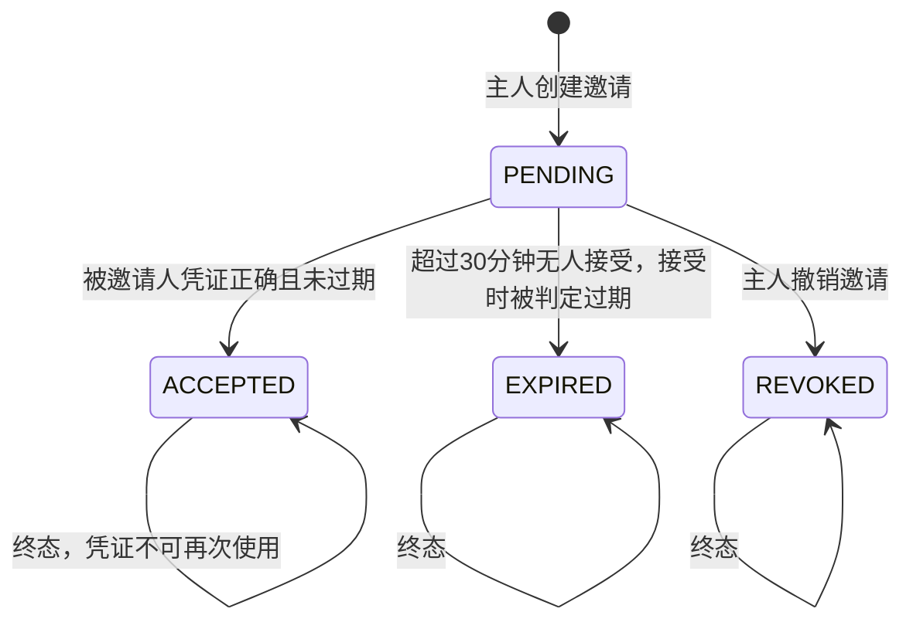
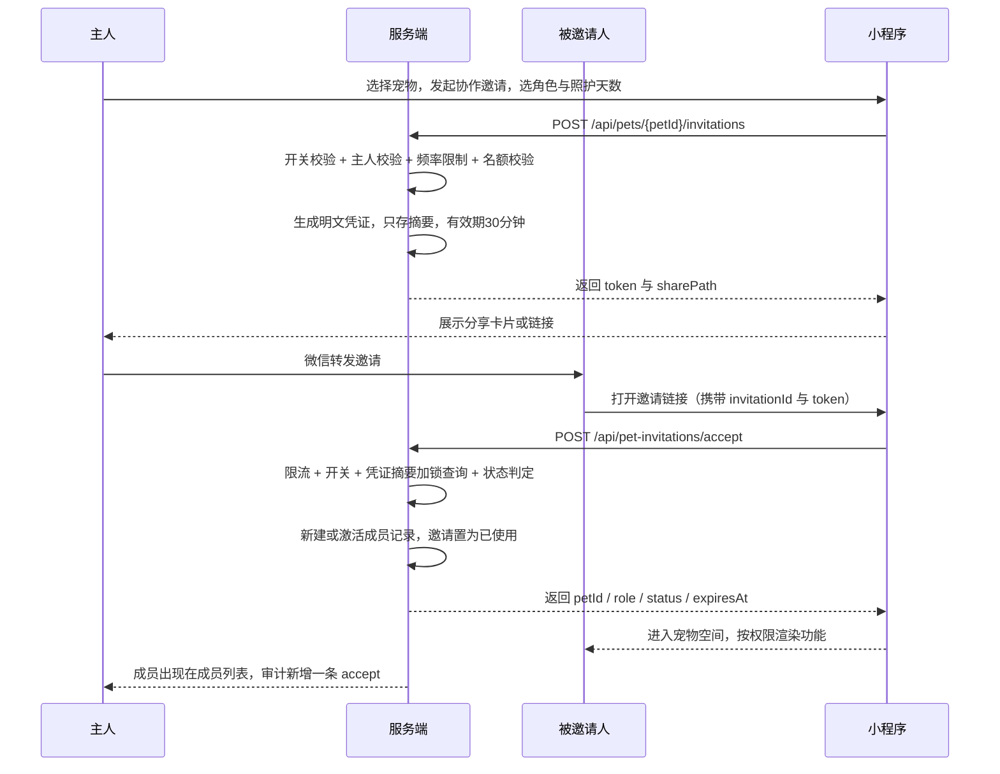

# 家庭协作与权限

文档日期：2026-10-07

对应 Controller：`PetCollaborationController`（`/api/pets`）、`PetInvitationController`（`/api/pet-invitations`）、`AccessAuditController`（`/api/pets/{petId}/audit-logs`）、`EmergencyCardController`（`/api/pets/{petId}`）

本文规则全部提取自上述接口对应的应用服务、领域模型与安全组件源码。协作功能受配置开关控制，开关关闭时非主人无法进入任何协同流程，主人仍可正常查看自己的宠物。

---

## 1 功能定位

主人（宠物档案的创建者）可以把一只宠物开放给家庭其他成员或临时照护者：

- 生成一条一次性邀请，通过分享路径发给对方
- 对方在自己小程序里接受邀请，成为成员（长期）或临时照护者（有到期时间）
- 主人查看成员列表、撤销某个成员、撤销未使用的邀请
- 成员按角色获得不同的读写范围，看不到成员管理和审计入口
- 任何人访问不到该宠物时，系统记下拒绝记录，只有主人能查阅这份日志
- 主人维护急救卡（血型、过敏史、慢性病、紧急联系人、首选医院），成员和临时照护者只读

角色由宠物归属关系派生，共三种：`owner`（主人）、`member`（成员）、`caregiver`（临时照护者）。

---

## 2 协作功能开关

| 配置项 | 值 | 效果 |
| --- | --- | --- |
| `fafa.collaboration.enabled` | 生产默认 `false`，开发/测试 `true` | 关闭时所有协同入口不可用 |

| 场景 | 开关关闭时的表现 |
| --- | --- |
| 主人查询自己的宠物、创建邀请、管理成员 | 正常，主人身份不依赖开关 |
| 非主人调用任何协作相关校验 | 返回 72001"宠物空间协同功能未开放" |
| 创建邀请 / 接受邀请 / 撤销成员 / 撤销邀请 | 先校验开关，直接 72001 |
| `GET /api/pets/{id}` 详情（非主人） | 授权判定为"协同功能未开放"并写入审计 |

开关是运行时读取，切换即时生效，不改变已存在的成员数据。开关重新打开后，原本已接受的成员恢复可用 [待确认] 是否存在重新开启时的成员状态修复。

---

## 3 角色模型

| 维度 | owner 主人 | member 成员 | caregiver 临时照护者 |
| --- | --- | --- | --- |
| 来源 | 宠物档案的所属用户，自动获得 | 接受 `member` 邀请 | 接受 `caregiver` 邀请 |
| 是否占成员名额 | 否（不入成员表） | 是 | 是 |
| 有效期 | 无 | 无到期时间，强制为空 | 必须有未来到期时间，最长 30 天 |
| 权限范围 | 全部 17 项权限 | 10 项 | 6 项 |
| 编辑档案/照片 | 可以 | 不可以 | 不可以 |
| 管理成员与邀请 | 可以 | 不可以 | 不可以 |
| 查看访问审计 | 可以 | 不可以 | 不可以 |
| 急救卡 | 读 + 写 | 只读 | 只读 |
| 医疗记录（就医/用药） | 读 + 写 | 只读 | 不可见 |
| 支出、喂食、报告 | 读 + 写 | 只读（报告只读，不生成） | 不可见 |

硬性约束（领域层校验，无法绕过）：

- `member` 不允许设置到期时间，设置即报"长期成员不能设置到期时间"
- `caregiver` 必须有未来到期时间，缺失或过期即报"临时照护必须设置未来到期时间"
- 主人不能成为自己宠物的成员，接受自己的邀请报"主人不能接受自己的协同邀请"
- 到期后成员自动转为 `expired` 状态，下次访问被拒并返回 72010"临时照护权限已过期"

### 3.1 CAREGIVER 有效期上限

`fafa.collaboration.caregiver-max-days=30`。创建邀请时传入的 `expiresInDays` 必须在 1 到 30 之间，超范围返回参数错误并附"临时照护有效天数超出配置范围"。到期时间为"接受邀请的时刻 + N 天"，不是"创建邀请的时刻 + N 天"。

---

## 4 邀请流程

| 接口 | 方法 | 用途 | 调用方 |
| --- | --- | --- | --- |
| `/api/pets/{petId}/invitations` | POST | 创建一次性邀请 | 主人 |
| `/api/pets/{petId}/invitations/{invitationId}` | DELETE | 撤销未使用的邀请 | 主人 |
| `/api/pet-invitations/accept` | POST | 接受邀请 | 被邀请用户 |

### 4.1 创建邀请

请求体：

| 字段 | 类型 | 必填 | 规则 |
| --- | --- | --- | --- |
| role | 文本 | 是 | `member` / `caregiver`，非法值返回参数错误 |
| expiresInDays | 整数 | caregiver 必填 | `@Min(1)`；caregiver 取值 1–30；member 必须不传或忽略（传了也不生效，成员到期时间强制为空） |

响应字段：`invitationId`、`petId`、`role`、`token`（明文凭证，仅此一次返回）、`expiresAt`（邀请失效时刻）、`memberExpiresAt`（成员到期时刻）、`sharePath`。

`sharePath` 由服务端拼好，形如 `/pages/invitation/accept?invitationId=1&token=<明文凭证>`，小程序直接用它生成分享链接或扫码内容，不要自行拼接。

处理规则（顺序执行，任一步失败即终止且不留副作用）：

1. 校验协作开关已开启
2. 校验当前用户是该宠物主人，否则 72004
3. 频率限制：`invite` 动作按用户维度每小时 20 次，超出返回 72008
4. 解析角色、计算成员到期时间（校验 1–30 天区间）
5. 名额校验：当前有效成员数（到期时间未超过此刻）已达上限时返回 72002
6. 生成 32 字节安全随机凭证，Base64 URL 安全无填充编码；数据库只存 SHA-256 摘要，明文只在响应里出现
7. 邀请有效期 = 当前时间 + 30 分钟（`invitation-expire-minutes=30`）
8. 写入审计（operation=`invite`，resourceType=`pet_invitation`，result=`success`）

### 4.2 邀请状态机

一次性由三重条件共同保证：`maxUses=1`、`usedCount` 累加、状态置为 `ACCEPTED`。可接受的条件是"状态为 PENDING 且使用次数未达上限且有效期未到"。

| 接受时状态 | 返回 |
| --- | --- |
| 凭证摘要查不到记录 | 72007 邀请凭证无效 |
| 状态为 `ACCEPTED` | 72006 邀请已被使用 |
| 状态为 `EXPIRED` 或 `REVOKED` | 72005 邀请不存在或已失效 |
| PENDING 但已过 30 分钟 | 先把状态落库为 `EXPIRED`，再返回 72005 |
| 接受人是宠物主人本人 | 72005 |
| 接受人已是该宠物的有效成员 | 72006 |
| 宠物已被删除或查不到 | 72005 |

### 4.3 接受邀请

请求体：`invitationId`（长整型，必填）、`token`（文本，必填，创建时返回的明文凭证）。

处理规则：

1. 先做频率限制：`accept` 动作按用户维度每小时 30 次，超出 72008（限流在开关校验之前，被限流的请求不产生任何业务判定）
2. 校验协作开关
3. 对明文凭证做 SHA-256，与邀请 ID 一起加行锁查询记录
4. 判定可接受性（见上表）
5. 若该用户在此宠物下已有成员记录（曾是成员后被撤销或过期），走"重新激活"：更新授权人、加入时间、到期时间，清除撤销时间，状态回到 `active`；否则新建成员记录
6. 邀请记为已使用，写入审计（operation=`accept`）

响应字段：`petId`、`role`、`status`、`expiresAt`。小程序据此直接跳转到宠物空间，无需二次查询。

凭证不匹配的查询是"邀请 ID + 摘要"联合条件，因此伪造凭证与猜别人的邀请 ID 都落到 72007，不泄露邀请是否存在。

### 4.4 撤销邀请

`DELETE /api/pets/{petId}/invitations/{invitationId}`，仅主人。

- 邀请不属于该宠物或不存在：72005
- 状态为 `PENDING`：置为 `REVOKED`，写入审计（operation=`revoke`）
- 状态已是 `ACCEPTED` / `EXPIRED`：静默无变化，接口仍返回成功（幂等，不报错）

撤销邀请不影响已经通过该邀请加入的成员。

### 4.5 多人协作时序

---

## 5 成员管理

| 接口 | 用途 | 权限 |
| --- | --- | --- |
| `GET /api/pets/{petId}/members` | 成员列表 | 仅主人 |
| `DELETE /api/pets/{petId}/members/{memberId}` | 撤销成员 | 仅主人 |
| `GET /api/pets/{petId}/access` | 查询当前用户在该宠物下的角色、状态、到期时间与权限集合 | 任何人可查自己 |

成员列表响应：`memberId`、`userId`、`nickname`、`role`、`status`、`joinedAt`、`expiresAt`。主人身份不出现在成员列表中，需要单独展示。

规则：

- 查询列表前会批量把已到期但仍是 `active` 的临时照护者落库为 `expired`，因此主人打开成员页看到的一定是最新状态
- 撤销只对 `active` 成员生效；成员不存在或不属于该宠物返回 72003；成员已是 `revoked` / `expired` 同样返回 72003 并附"当前成员不可撤销"
- 撤销后写入审计（operation=`revoke`，resourceType=`pet_member`），成员记录保留以便审计日志中的历史条目仍可解释
- 被撤销的成员再次拿到新邀请时走"激活"路径，恢复为 `active`，加入时间更新为本次接受时间
- 成员上限按主人会员状态区分：普通用户 0 人（无法邀请任何人），VIP 用户 5 人；统计口径为"该宠物下当前有效的成员数"，已撤销/已过期的成员不占名额
- 非主人查询成员列表返回 72004"无权管理成员"

`access` 接口是小程序做界面裁剪的唯一依据，返回权限编码集合与服务端当前时间（`serverTime`），供前端判断临时照护剩余天数使用，避免依赖本机时间。被拒时集合为空，`status` 为 `missing` / `unavailable` / `expired` / `revoked`，`role` 为实际角色或 `none`。

---

## 6 权限码与角色矩阵

服务端定义 17 个稳定权限码，页面只消费 `access` 返回的集合，不在前端硬编码角色判断。

| 权限码 | 业务含义 | owner | member | caregiver |
| --- | --- | :---: | :---: | :---: |
| READ_PROFILE | 读取宠物档案与详情 | 有 | 有 | 有 |
| READ_RECORD | 读取日常记录 | 有 | 有 | 有 |
| CREATE_RECORD | 新增日常记录 | 有 | 有 | 有 |
| EDIT_OWN_RECORD | 编辑本人创建的记录 | 有 | 有 | 有 |
| COMPLETE_REMINDER | 完成提醒待办 | 有 | 有 | 有 |
| READ_MEDICAL | 读取就医与用药记录 | 有 | 有 | 无 |
| MANAGE_MEDICAL | 管理就医与用药记录 | 有 | 无 | 无 |
| READ_EXPENSE | 读取支出 | 有 | 有 | 无 |
| MANAGE_EXPENSE | 管理支出 | 有 | 无 | 无 |
| READ_FOOD | 读取喂食与饮食 | 有 | 有 | 无 |
| MANAGE_FOOD | 管理喂食与饮食 | 有 | 无 | 无 |
| READ_REPORT | 读取健康报告 | 有 | 有 | 无 |
| GENERATE_REPORT | 生成健康报告 | 有 | 无 | 无 |
| MANAGE_MEMBER | 管理成员与邀请 | 有 | 无 | 无 |
| READ_AUDIT | 查看访问审计 | 有 | 无 | 无 |
| READ_EMERGENCY | 读取急救卡 | 有 | 有 | 有 |
| EDIT_EMERGENCY | 编辑急救卡 | 有 | 无 | 无 |

矩阵要点：

- `member` 比 `caregiver` 多出的 4 项全部与医疗健康、费用、饮食、报告相关，其中医疗类是 `READ_MEDICAL`
- `caregiver` 拥有的唯一医疗相关权限是 `READ_EMERGENCY`，即应急场景只能看急救卡，看不到就医史和用药史
- 三类角色都有 `EDIT_OWN_RECORD`，意味着成员之间只能改自己写的内容
- 所有 `MANAGE_*`、`GENERATE_REPORT`、`READ_AUDIT`、`EDIT_EMERGENCY` 均为主人独占
- 主人的权限集合由代码直接给出全部枚举值，不做逐项配置

接入状态：目前实际调用权限校验的业务点是 `READ_PROFILE`（宠物详情）、`READ_RECORD` / `CREATE_RECORD` / `EDIT_OWN_RECORD` / `COMPLETE_REMINDER`（记录与提醒）、`READ_MEDICAL`（就医、用药、健康预警）、`READ_EXPENSE`（支出）、`READ_FOOD`（喂食）、`READ_EMERGENCY`（急救卡）。`MANAGE_*`、`GENERATE_REPORT`、`EDIT_EMERGENCY` 在权限定义与矩阵中存在，但业务侧尚无对应调用点；成员管理、审计、急救卡写入实际使用严格的主人校验（等价于 `MANAGE_MEMBER` / `READ_AUDIT` / `EDIT_EMERGENCY` 的语义）[待确认] 是否统一改为权限码驱动。

宠物档案与照片类写操作（更新资料、替换照片、重新向量化、排序、删除）走的是"归属人直接校验"，非主人一律返回"无权操作此宠物"，不查权限集合。

---

## 7 频率限制

| 动作 | 维度 | 上限 | 触发结果 |
| --- | --- | --- | --- |
| invite（创建邀请） | 按主人用户 ID | 每小时 20 次 | 72008"邀请操作频率超限" |
| accept（接受邀请） | 按接受人用户 ID | 每小时 30 次 | 72008 |

实现口径：

- 固定窗口计数：键为"动作 + 用户"，第一次计数时设置 1 小时过期，窗口内累计达到上限即拒绝，窗口结束后自动清零
- 上限配置为 0 或负数时一律拒绝
- 用户标识为空时拒绝
- 计数组件异常时拒绝（fail-closed），即组件不可用期间无法创建和接受邀请
- 一次业务请求只计一次；请求失败若已进入计数则同样计数 [待确认] 是否需要在业务失败时返还额度

---

## 8 访问审计

| 接口 | `GET /api/pets/{petId}/audit-logs?page=1&size=20` |
| --- | --- |
| 可见范围 | 仅该宠物主人，非主人返回 72014 或 72004 |
| 分页规则 | 页码最小 1，`size` 默认 20、上限 50，超出自动收敛 |
| 保留时长 | 配置为 730 天（`audit-retention-days=730`），代码中未见清理任务 [待确认] 过期日志的清理机制 |

记录字段：`userId`（被访问宠物归属人）、`operatorId`（执行者）、`operation`、`resourceType`、`resourceId`、`result`、`reason`、`createdAt`。服务端不返回凭证、请求头或任何完整敏感文本。

写入时机：

| 事件 | operation | result | reason |
| --- | --- | --- | --- |
| 非主人访问被拒（无成员记录） | read / pet_access | denied | 成员不存在 |
| 非主人访问被拒（开关关闭） | read / pet_access | denied | 协同功能未开放 |
| 成员已撤销或状态不可用 | read / pet_access | denied | 成员关系不可用 |
| 临时照护到期后访问 | read / pet_access | denied | 临时照护权限已过期 |
| 创建邀请 | invite / pet_invitation | success | 无 |
| 接受邀请 | accept / pet_invitation | success | 无 |
| 撤销邀请 | revoke / pet_invitation | success | 无 |
| 撤销成员 | revoke / pet_member | success | 无 |

被拒访问会同时记录到归属人视角，主人能看到"某用户在某时刻尝试访问我的宠物但被拒"。审计写入失败不影响主流程，仅记录服务端日志（授权判定结果仍然生效）。

---

## 9 急救卡

| 接口 | 用途 | 权限 |
| --- | --- | --- |
| `GET /api/pets/{petId}/emergency-profile` | 读取原始资料与版本号，供编辑页回填 | `READ_EMERGENCY` |
| `PUT /api/pets/{petId}/emergency-profile` | 保存资料 | 严格主人校验 |
| `GET /api/pets/{petId}/emergency-card` | 读取拼装好的卡片 | `READ_EMERGENCY` |

### 9.1 字段与校验

| 字段 | 上限 | 格式规则 |
| --- | --- | --- |
| bloodType 血型 | 1000 | 自由文本 |
| allergies 过敏史 | 1000 | 自由文本 |
| chronicConditions 慢性病或长期病史 | 1000 | 自由文本 |
| emergencyContactName 联系人姓名 | 64 | 自由文本 |
| emergencyContactPhone 联系人电话 | 32 | 非空时必须匹配 `[-0-9+() ]{6,32}`，即只允许数字、连字符、加号、括号、空格，长度 6–32 |
| primaryHospitalName 医院名称 | 200 | 自由文本 |
| primaryHospitalPhone 医院电话 | 32 | 同联系人电话规则 |
| primaryHospitalAddress 医院地址 | 500 | 自由文本 |
| notes 备注 | 1000 | 自由文本 |
| version 版本号 | 整数 | 必填，首次保存传 0，更新时传上次查询返回的值 |

所有文本入库前 trim，纯空白按未填写处理（返回 null）。字段全部可选，允许只填联系人。资料不从 AI 或病历原文自动推断，只保存用户确认的内容。

### 9.2 保存规则与并发冲突

处理规则：

1. 严格校验当前用户是宠物主人，非主人返回 72004
2. 以行锁方式读取该宠物的资料记录（悲观锁），与乐观锁版本号配合
3. 记录不存在时：传入 `version != 0` 直接判定 72012；传 0 才允许新建空资料，随后套用本次提交的字段
4. 记录已存在时：版本号与库中版本不一致抛"应急资料版本冲突"，转换为 72012
5. 字段校验失败（超长或电话格式）转换为 72013"应急资料字段无效"并附具体原因，如"医院名称长度不能超过200""联系人电话格式无效"
6. 保存成功，版本号 +1，更新人与更新时间写入本次操作者

并发含义：两个人（或同一人开两个页面）先后编辑，后提交者版本落后，收到 72012 而不是覆盖前者。小程序需在收到 72012 时重新拉取资料、提示用户当前内容已被他人更新，由用户决定合并后重试。

首次保存与更新走同一个接口，区别只在 `version` 传 0 还是传当前版本号。

### 9.3 卡片响应

卡片是"宠物档案数据 + 用户确认的应急资料"的组装结果，不是一份新数据。

| 分组 | 内容 | 来源 |
| --- | --- | --- |
| pet | 宠物 ID、名称、类型、品种、性别、出生日期、当前体重 | 宠物档案，实时 |
| profile | 血型、过敏史、慢性病、备注 | 用户确认的应急资料 |
| emergencyContact | 联系人姓名、电话 | 用户确认的应急资料 |
| primaryHospital | 医院名称、电话、地址 | 用户确认的应急资料 |
| sourceStatus | `not_filled` / `user_confirmed` | 资料是否存在 |
| updatedAt | 资料最后更新时间 | 资料是否存在 |

资料完全未填写时：`profile` 内四个字段均为空，`emergencyContact` 与 `primaryHospital` 整组为空，`sourceStatus=not_filled`，`updatedAt` 为空；`getProfile` 返回同样的空资料结构且 `version=0`，供编辑页直接初始化。

`sourceStatus` 用于页面上区分"这是主人确认过的信息"和"待补充"，急救卡展示时应明确标注未填写，不能空白显示。

---

## 10 交互逻辑

### 10.1 主人邀请成员

| 用户动作 | 系统响应 | 页面变化 |
| --- | --- | --- |
| 在宠物空间点"邀请协作" | 查询成员列表与当前名额余量 | 展示角色选择（成员 / 临时照护）与照护天数选择（1–30） |
| 普通用户（非会员）进入邀请页 | 名额上限 0，创建邀请直接返回 72002 | 显示升级引导，分享按钮不可用 |
| 选择临时照护但未填天数 | 参数错误"临时照护有效天数超出配置范围" | 停留在表单，提示必填天数 |
| 提交成功 | 返回凭证与 `sharePath`，有效期 30 分钟 | 生成分享卡片，页面显示"30 分钟内有效，仅可使用一次" |
| 一小时内多次创建（第 21 次） | 72008 | 提示稍后再试，按钮临时禁用 |
| 分享后反悔 | 撤销邀请成功 | 邀请状态变已撤销，已加入的成员不受影响 |
| 打开成员列表 | 到期成员自动标记过期 | 列表显示角色、昵称、加入时间、到期时间、状态 |
| 撤销某成员 | 成功，写审计 | 该成员移出列表，状态为已撤销 |
| 查看访问记录 | 仅主人可见 | 分页展示谁在何时试图访问、结果与原因 |

### 10.2 被邀请人接受

| 用户动作 | 系统响应 | 页面变化 |
| --- | --- | --- |
| 打开分享链接 | 小程序解析 `invitationId` 与 `token` | 展示宠物名、角色、有效期与确认按钮 |
| 未登录 | 先走登录流程 | 登录后回到邀请确认页 [待确认] 登录后是否回跳原邀请页 |
| 点确认 | 校验通过则建立成员关系 | 跳转该宠物的空间首页，按角色渲染可用功能 |
| 链接超过 30 分钟 | 72005 | 提示邀请已失效，引导联系主人重新邀请 |
| 链接被他人用过 | 72006 | 提示邀请已被使用 |
| 凭证被改动 | 72007 | 提示链接无效 |
| 自己就是主人 | 72005 | 提示无需接受自己的邀请 |
| 已是有效成员 | 72006 | 提示已是该宠物成员，直接进入空间 |
| 一小时内接受第 31 次 | 72008 | 提示操作过于频繁 |
| 临时照护到期后再次进入 | 72010，同时成员状态落库为过期 | 空间内提示权限已过期，功能不可用，需主人重新邀请 |

### 10.3 急救卡

| 用户动作 | 系统响应 | 页面变化 |
| --- | --- | --- |
| 主人进入编辑页 | 返回当前资料与版本号 | 表单回填，版本号随表单一起暂存 |
| 首次填写并保存 | `version=0`，创建成功，版本变 1 | 卡片状态从"未填写"转为"已确认" |
| 电话格式错误 | 72013 并附原因 | 定位到电话输入框报错，其余内容保留 |
| 超字数 | 72013 并指明字段与上限 | 对应文本域提示超长 |
| 两端同时编辑，后提交者 | 72012 | 提示内容已被更新，重新拉取后让用户确认 |
| 成员或照护者打开急救卡 | 只读渲染卡片 | 无编辑入口 |
| 成员或照护者调用保存接口 | 72004 | 前端本不应出现该入口 |

---

## 11 错误码清单

| 码 | 含义 | 常见触发 |
| --- | --- | --- |
| 72001 | 宠物空间协同功能未开放 | 开关关闭时非主人访问、创建或接受邀请 |
| 72002 | 成员数量已达上限 | 普通用户邀请、VIP 超 5 人 |
| 72003 | 成员不存在 | 撤销不存在、不属于该宠物或已不可撤销的成员 |
| 72004 | 无权管理成员 | 非主人访问成员列表、管理邀请、保存急救卡 |
| 72005 | 邀请不存在或已失效 | 凭证过期、已撤销、主人自邀、宠物缺失 |
| 72006 | 邀请已被使用 | 重复接受、已是有效成员 |
| 72007 | 邀请凭证无效 | 凭证不匹配或链接被篡改 |
| 72008 | 邀请操作频率超限 | 创建超 20/小时或接受超 30/小时 |
| 72009 | 成员权限不足 | 角色无对应权限码时调用受限接口 |
| 72010 | 临时照护权限已过期 | 到期后访问 |
| 72011 | 应急资料不存在 | 定义存在，当前读取接口以空资料返回而非报错 |
| 72012 | 应急资料版本冲突 | 版本号不一致或首次保存未传 0 |
| 72013 | 应急资料字段无效 | 超长或电话格式不合法 |
| 72014 | 审计查询无权限 | 非主人查询审计 |
| 72015 | 共享提醒推送失败 | 定义存在，用于共享提醒推送场景 |

参数错误统一使用参数无效码并附具体原因（角色非法、照护天数超范围、标签或宠物字段问题）。

---

## 12 待确认清单

1. 协作开关从关闭切回开启时，历史成员与邀请状态是否需要修复或通知
2. 审计日志 730 天保留期没有清理任务实现，需确认由谁清理
3. 急救卡"编辑"与"读取"分别用严格主人校验和权限码校验，是否统一为权限码驱动
4. `MANAGE_*` / `GENERATE_REPORT` / `EDIT_EMERGENCY` 尚无业务调用点，需确认接入计划
5. 限流在业务失败时是否返还额度；计数组件不可用期间全部拒绝是否需要降级提示
6. 成员上限普通用户为 0（等同不可用），需要确认这是灰度策略还是产品决策，以及前端引导文案
7. 未登录用户打开邀请链接后的回跳路径
