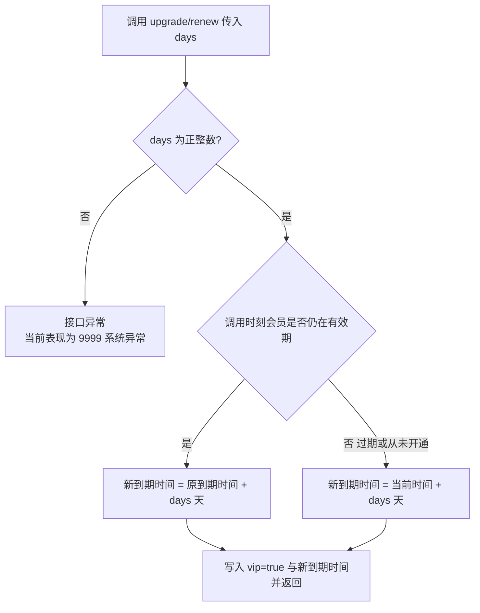
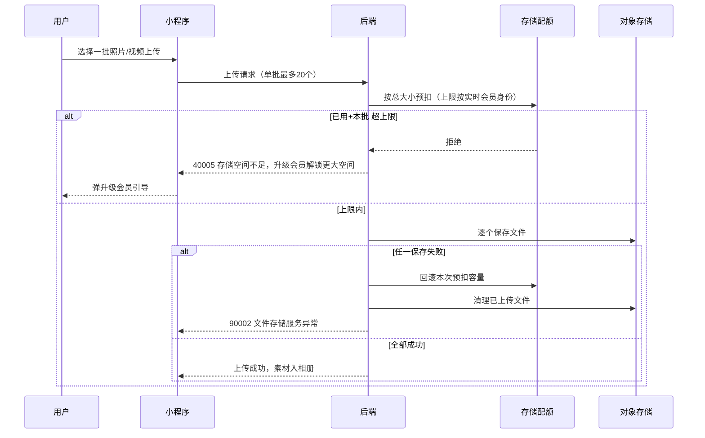
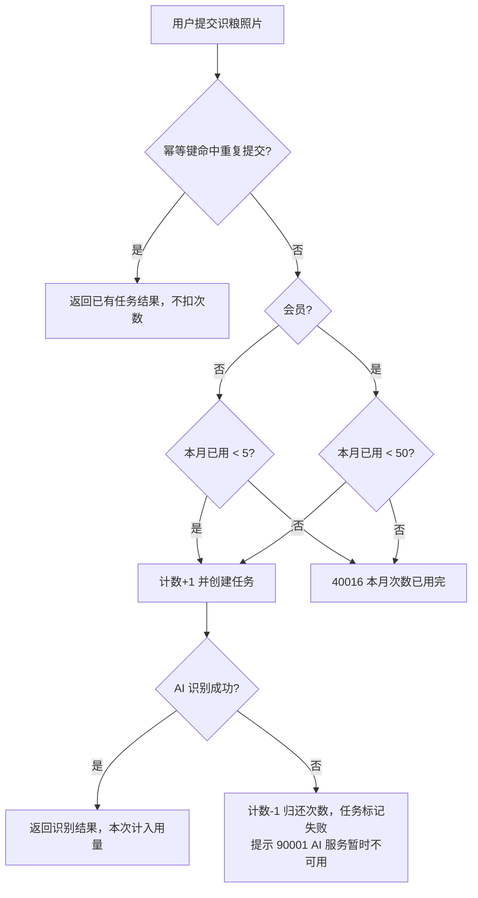

# 会员与配额

> 文档日期：2026-10-07
> 对应后端模块：UserController（会员接口）、QuotaController

## 一、模块定位

会员与配额模块决定"免费用户和会员各自能用到什么程度"。它包含三部分：

- 会员身份：开通、续费、到期判定，身份字段挂在用户资料上
- 配额规则：存储空间、AI 语义检索、食品包装识别、报告与内容生成四类权益的免费/会员差异
- 用量守护：每次消耗额度的操作都有"先扣后用、失败退还"的防超发与不冤枉扣减机制

「我的」页的用量进度条、各 AI 功能入口的"本月剩余次数"、配额不足时的升级引导，数据全部来自本模块。

## 二、用户与场景

| 场景 | 用户动作 | 系统行为 |
| --- | --- | --- |
| 空间用满 | 上传照片/视频被拒 | 提示「存储空间不足，升级会员解锁更大空间」，引导到会员中心 |
| 月额度用完 | AI 检索/识粮/报告达到上限 | 提示本月已用完，升级会员可解锁更高或不限额度 |
| 开通会员 | 在会员中心选月/季/年档开通 | 立即生效，权益上限即时提升 |
| 会员续费 | 到期前再次购买 | 新天数叠加在原到期时间之后，不浪费剩余天数 |
| 会员过期 | 到期后继续使用 | 无提醒任务，下次读取时按免费身份处理 |
| 查看用量 | 打开「我的」页 | 展示存储/检索/识粮/报告的已用与上限 |

## 三、会员开通与续费

### 3.1 天数参数与档位约定

后端接口接收一个 `days`（正整数天数）参数，本身不限档位。产品层面的档位由前端传入约定值：月卡 **32 天**、季卡 95 天、年卡 366 天（源自功能规划文档的定价折算口径）[待确认] 最终定价与档位天数。

### 3.2 业务逻辑

两个写入口，规则一致：

- `POST /user/vip/upgrade?days=N`：开通或延长会员。当前已是有效会员时自动转为续费（叠加）；非会员或已过期时从**此刻**起算 N 天
- `POST /user/vip/renew?days=N`：续费。有效会员在原到期时间上追加 N 天；**已过期的会员或从未开通过的用户调用此接口也会直接激活会员**，从现在起算 N 天

起算规则的核心是"未过期不浪费"：只要调用时会员仍在有效期内，新买的天数一律加在原到期时间之后；只有已过期（或从未开通）才从当前时间起算。

输出结果：返回更新后的完整用户资料（含 vip 标记与新的 vipExpireTime），前端据此刷新会员状态。

异常分支：

- days 传 0 或负数：后端内部抛参数异常，但当前未被翻译成友好提示，客户端收到 9999「系统异常」[待确认] 应改为 1001 类提示；前端务必只传正整数
- 未登录调用：返回 1002

### 3.3 交互逻辑

| 用户动作 | 系统响应 | 页面变化 |
| --- | --- | --- |
| 会员中心选择档位并「开通」 | 前端带对应 days 调用升级接口 | 成功后立即显示会员标识与到期时间 |
| 会员有效期内再次购买 | 走升级或续费接口，到期时间顺延 | 到期时间 = 原到期时间 + 新天数 |
| 过期后购买 | 从现在起算新天数 | 会员标识恢复，到期时间更新 |

### 3.4 VIP 判定流程

### 3.5 会员过期为惰性判定

系统没有定时任务批量把过期会员降级。会员是否有效，在**每次读取和每次扣额度时即时判定**：判定条件为"会员标记为真 且 到期时间晚于当前时刻"，二者任一不满足即按免费用户处理。因此到期那一刻起，用量上限、AI 权益、身份展示自动回落到免费档，无需用户操作。

实现细节备注：资料查询与会员查询接口在过期判定后会尝试回写降级标记，但该回写条件在代码中恒不成立，过期标记实际不会持久化——由于所有读取都即时重算，用户可见行为不受影响 [待确认] 是否需要修复该回写逻辑。

会员状态查询 `GET /user/vip` 返回三个字段：isVip（当前标记）、isVipValid（即时判定是否有效）、vipExpireTime（到期时间）。前端应以 **isVipValid** 为准展示会员状态。

### 3.6 支付未接入（重要边界）

开通/续费接口**没有任何支付校验**：调用即生效，不校验订单、不接微信虚拟支付。当前仅供开发与演示使用 [待确认] 支付方案（小程序虚拟支付接入属平台合规强约束）。上线收费前必须补齐"支付成功回调后才写入会员"的链路，否则存在被直接刷会员的风险。

## 四、免费用户与会员权益差异

配置值三套环境一致，均取自后端配置：

| 权益项 | 免费用户 | 会员 | 后端是否实际强制执行 |
| --- | --- | --- | --- |
| 宠物数量上限 | 2 只 | 999 只（配置值，语义为不限量） | 否。配置已定义但代码中未找到任何消费点，当前创建宠物不受数量限制 [待确认] 接线计划 |
| 素材存储空间 | 2 GiB（2147483648 字节） | 20 GiB（21474836480 字节） | 是，上传前原子扣减 |
| AI 语义检索（照片搜图） | 每月 10 次 | 不限 | 是，会员直接放行不计数 |
| 食品包装识别（识粮） | 每月 5 次 | 每月 50 次 | 是，按自然月计数 |
| 报告 + 内容生成 | 共享池每月 3 次 | 共享池每月 10 次 | 是，两类功能共用同一计数器 |

两处展示与执行不一致，需在上线前对齐 [待确认]：

1. 配额查询接口对会员的识粮上限返回 -1（前端应渲染"不限"），但实际扣减按每月 50 次执行——会员用到第 51 次会被拒，与展示矛盾
2. 宠物数量上限只存在于配置，未接线（见上表）

## 五、配额扣减与回滚机制

### 5.1 存储配额（累计型，随会员身份变上限）

业务逻辑（触发→规则→输出）：

1. 触发：用户上传一批照片/视频（单批最多 20 个；单照片 ≤10MB，单视频 ≤50MB）
2. 预扣：以本批**总大小**尝试占用存储配额，上限按扣减时刻的会员身份实时取值（免费 2 GiB / 会员 20 GiB）；"已用 + 本批 > 上限"则整批拒绝，返回 40005，一个文件也不会上传
3. 落盘：预扣成功后逐个存入对象存储；任一分片失败则**回滚本次预扣的全部容量**并清理已传文件，返回 90002
4. 释放：用户删除素材时，对应容量归还配额
5. 并发安全：同一用户并发上传时扣减为原子操作，不会出现两批同时通过导致超限

边界：会员过期降级后，已用空间**不会被删除或隐藏**，但上限立即回落到 2 GiB；若已用量超过免费上限，后续任何新上传都会被 40005 拒绝，直到用户删素材把已用降到上限之下。

### 5.2 月度计数型配额（AI 检索 / 识粮 / 报告池）

四项月度规则共用一套计数机制，按**自然月**统计：

- 计数以"用户 + 月份"维度累计，每月 1 日零点自动从 0 重新计，无需人工重置
- 每次 AI 任务提交前**先计数占位**：达到上限则退回计数并给出对应错误提示，任务不创建
- 任务执行失败（AI 服务异常等）时**归还本次占用的次数**，用户不为失败的 AI 调用买单
- 识粮提交若命中幂等键（重复提交同一请求），直接返回已有任务结果，**不重复扣次数**

分项规则：

| 功能 | 计数时机 | 会员规则 | 失败退还 | 超限提示 |
| --- | --- | --- | --- | --- |
| AI 语义检索 | 提交检索问题时 | 不计数、不限次 | AI 网关异常退还 | 40006 本月 AI 语义检索次数已用完，升级会员解锁不限次 |
| 食品包装识别 | 创建识别任务时 | 计数，上限每月 50 次 | 识别失败退还并标记任务失败 | 40016 本月食品包装识别次数已用完 |
| 报告 + 内容生成 | 生成报告/草稿时 | 计数，共享池上限每月 10 次 | AI 生成失败退还次数，报告改走确定性摘要兜底 | 71004 本月报告与内容生成次数已用完 |

细节规则：

- 检索输入为空时走普通确定性检索，不调 AI、**不占检索额度**
- 报告/内容在 AI 失败退还后以降级模式（degraded 标记）产出，内容质量降低但功能不中断；是否算一次有效使用以"未扣次数"为准 [待确认] 降级产物是否也该计一次
- 识粮与报告池的退还不会把计数压成负数（并发退还安全）

## 六、配额查询接口

`GET /api/quota`（需登录），一次返回「我的」页用量面板所需的全部数据：

| 字段 | 类型 | 含义 |
| --- | --- | --- |
| storageUsed | 长整数 | 存储已用字节数 |
| storageLimit | 长整数 | 存储上限字节数（按实时会员身份 2 GiB / 20 GiB） |
| aiSearchUsed | 长整数 | 本月 AI 语义检索已用次数（会员固定为 0） |
| aiSearchLimit | 长整数 | 本月检索上限；会员返回 -1 表示不限 |
| foodRecognitionUsed | 长整数 | 本月食品包装识别已用次数 |
| foodRecognitionLimit | 长整数 | 本月识粮上限；会员返回 -1（与实际 50 次上限不一致，见第四章） |
| reportContentUsed | 长整数 | 本月报告+内容生成共享池已用次数 |
| reportContentLimit | 长整数 | 共享池上限（免费 3 / 会员 10） |
| isVip | 布尔 | 当前是否有效会员（即时判定结果） |

前端渲染约定：limit 为 **-1 时展示"不限"**而非进度条；存储按 `used/limit` 画百分比；月额度按 `used/limit` 画"剩余 X 次"。会员识粮的展示矛盾对齐前，建议会员档对识粮展示"每月 50 次"而非"不限" [待确认]。

## 七、规则与边界汇总

| 边界情形 | 系统行为 |
| --- | --- |
| 未登录访问会员/配额接口 | 返回 1002「未登录或登录已过期」 |
| 登录态有效但用户记录缺失 | 返回 1003「用户不存在」 |
| days 传 0 或负数 | 无友好提示，落到 9999「系统异常」，前端必须只传正档位天数 [待确认] 后端补校验 |
| 未过期时重复 upgrade | 按续费叠加到期时间，不会重置也不报错 |
| 过期会员调用 renew | 直接激活，从当前时间起算 |
| 支付环节 | 完全未接入，调用接口即可成为会员，见 3.6 |
| 上传批次超存储上限 | 整批拒绝 40005，无任何文件落盘 |
| 对象存储中途失败 | 预扣容量回滚 + 清理已传文件 |
| AI 服务异常 | 月度次数归还用户，报 90001 |
| 会员过期瞬间 | 上限即时回落；超额已用存储不删除，新上传被拒直到删到限内 |
| 跨自然月 | 三项月度计数自动清零重算 |
| 并发扣减 | 存储原子条件更新、月度计数原子递增，均不超发 |
| 创建第 3 只免费宠物 | 后端当前不拦截（上限未接线），与配置的 2 只矛盾 [待确认] |

## 八、错误码索引

| 错误码 | 提示文案 | 出现场景 |
| --- | --- | --- |
| 1002 | 未登录或登录已过期 | 未带令牌访问会员/配额接口 |
| 1003 | 用户不存在 | 登录态有效但用户缺失 |
| 40005 | 存储空间不足，升级会员解锁更大空间 | 上传批次超出存储上限 |
| 40006 | 本月 AI 语义检索次数已用完，升级会员解锁不限次 | 免费用户检索超 10 次/月 |
| 40016 | 本月食品包装识别次数已用完 | 识粮超 5 次/月（会员 50 次/月） |
| 71004 | 本月报告与内容生成次数已用完 | 共享池超 3 次/月（会员 10 次/月） |
| 90001 | AI 服务暂时不可用，请稍后重试 | AI 网关异常，次数已退还 |
| 90002 | 文件存储服务异常 | 对象存储失败，容量已回滚 |
| 9999 | 系统异常 | 含 days 非正数等未兜底的边界 |

## 九、API 索引

| 方法 | 路径 | 功能 | 需登录 |
| --- | --- | --- | --- |
| GET | /user/vip | 查询会员状态与到期时间 | 是 |
| POST | /user/vip/upgrade?days=N | 开通或延长会员（有效则叠加，否则新起算） | 是 |
| POST | /user/vip/renew?days=N | 续费会员（过期/非会员调用也会激活） | 是 |
| GET | /api/quota | 查询存储与三项月度配额用量及上限 | 是 |

路径前缀说明：会员接口在 `/user` 下，配额接口在 `/api/quota`，两组前缀不一致，为后端现状 [待确认] 是否统一。
