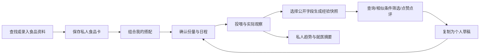
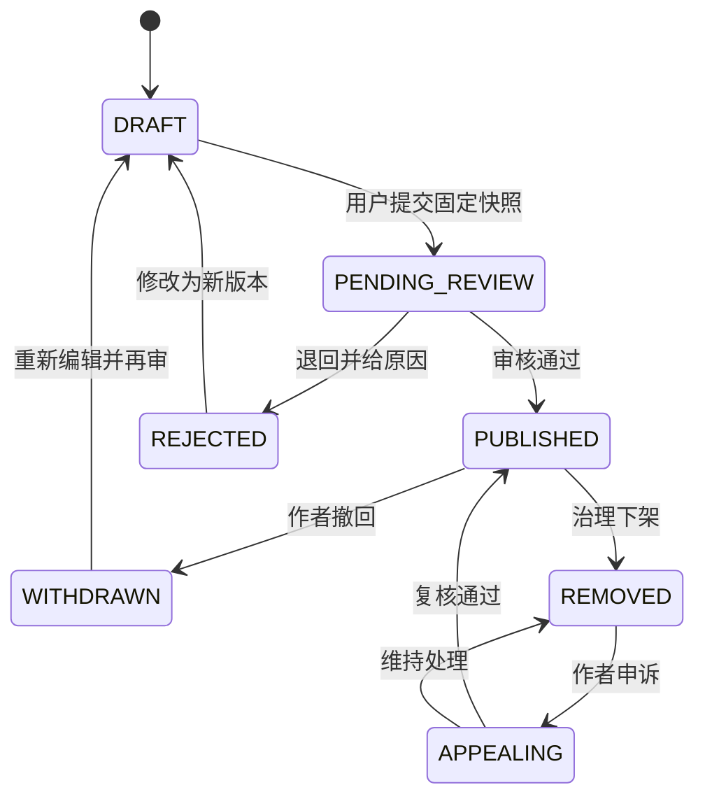

# 伴宠 PawLife · APP 页面与交互设计规格 v2.1

> 日期：2026-10-25｜面向：中国大陆猫狗宠主与家庭照护者｜实现方向：Flutter + Java 模块化单体。  
> 输入基线：[PRD v2.0](宠物APP_产品原型设计_PRD_v2.0.md)。本稿是可交给 Codex + Pencil/pen.dev MCP 的**设计规格与产品决策**，不是已经实现、验证的界面或后端。  
> 配套：[接口与数据契约](宠物APP_接口与数据契约_v2.1.md) · [Pencil 执行手册](宠物APP_Pencil执行手册_v2.1.md)。  
> 本地项目目前只有需求文档；下面的 API、枚举、阈值与页面编号均为拟定契约，没有假定现成接口已经存在。

## 0. 先回答：食品卡、搭配分享与相似宠物推荐值得做吗？

### 0.1 结论与产品定位

值得做，而且比泛宠物内容流更贴近原 PRD 的长期价值：**让宠主找到可参考的饮食经验，保存自己的搭配，在实际喂养中持续校正。** 价值不来自“别人喜欢的粮我也买”，而来自看清“哪只宠物、在什么阶段、吃了哪个版本的食品、如何搭配、观察了多久、还有哪些影响因素”。

这是一项待验证的产品判断，不是已经证明的市场需求。建议把食品库、私人搭配、计划与记录列为第一阶段；结构化分享、查询、点赞与点评列为第二阶段的受控试用；有足够有效观察后再开放个性化排序。以下将完整目标体验都设计出来，阶段开关不等于省略设计。

### 0.2 用户获得的实际价值

| 用户问题 | 对应能力 | 判断有用的行为 |
|---|---|---|
| 我家的猫狗现在吃什么、谁喂过了？ | 私人食品卡、当前计划、家庭同步 | 能找到本餐状态并快速记录 |
| 我能混搭干粮、湿粮和零食吗？ | 搭配编辑、标签检查、能量合计 | 看见每项份量、缺失信息和补充食品占比 |
| 年龄和体型相近的宠物吃得怎样？ | 相似条件筛选、观察周期、分项点评 | 找到有背景信息的经验并查看依据 |
| 这套搭配能直接给我的宠物用吗？ | 个体资料核对、适用检查、份量重新确认 | 保存个人草稿，核对后才启用计划 |
| 换粮后我观察到了什么？ | 换粮日历与排便、食欲、体重关联 | 形成可追溯观察，避免把相关性当因果 |
| 我分享以后，家庭隐私会不会公开？ | 发布快照、字段白名单、独立公共身份 | 发布预览明确展示陌生人能看到什么 |

### 0.3 四项必须分开的判断

| 判断 | 回答的问题 | 可以展示 | 不应展示 |
|---|---|---|---|
| 食品资料可信程度 | 这份标签信息从哪里来？ | 包装标签、核对时间、来源版本 | “平台认证好粮”“WSAVA 认证品牌” |
| 宠物条件相似 | 参考宠物与我家有哪些共同条件？ | 同物种、生命阶段相近、体重接近、品种相同 | “同品种所以一定适合” |
| 使用体验 | 主人观察到什么？ | 愿意吃、剩食情况、排便观察、使用天数 | “治好了肠胃”“90% 有效率” |
| 基础适用检查 | 已知资料有没有明显冲突？ | 标签阶段可参考、资料不足、需专业确认、已知冲突 | 单一“健康契合度 98 分”或疗效概率 |

主界面统一用“**参考匹配**”“**基础适用检查**”，不展示百分比契合度。用户口中的“契合度”落实为有解释的多维状态。品种是可选相似条件，生命周期、营养用途、体重/体况与个体限制更重要。AAHA 说明营养建议应结合个体和食品营养特征，而非仅按品种；老年营销标签也不是统一营养标准。[AAHA 年龄与品种饮食](https://www.aaha.org/resources/2021-aaha-nutrition-and-weight-management-guidelines/age-specific-and-breed-specific-diets/)

### 0.4 产品闭环与风险

- **冷启动**：先维护少量可追溯食品资料；没有使用反馈就显示“暂无观察”。官方示例明确标“示例”，不伪造用户、点赞和喂养天数。
- **幸存者偏差**：评价收集“仍在使用/已停用/暂停”，停用原因与负面观察同样可查。没有回访不视作满意。
- **刷评与广告**：点赞与资料核对、参考排序分离；标注赠品/合作/自购/未披露；用户自报不是购买凭证。
- **记录真实性**：“关联 14 天记录”只证明应用内存在相关记录，不证明记录真实、全天完整或食物造成效果。跨家庭聚合先按宠物去重，再展示家庭数。
- **健康风险**：处方/治疗用途、疾病、成长/繁育期、已知过敏或自制饮食不自动生成营养处方；可以记历史、收藏经验、保存自己的草稿。
- **隐私与治理**：公开内容是经审核的独立快照。删除私人素材不应让公开副本无期限存续；引用依赖、撤回与删除传播必须可追踪。

### 0.5 与 PRD v2.0 的明确变更

| v2.0 基线 | v2.1 决策 | 影响 |
|---|---|---|
| 今日/照护/回忆/AI/我的 | 今日/照护/发现/回忆/我的 | AI 进入首页、详情与全局助理入口；保留全部 AI 能力 |
| 食品卡和喂食计划 | 新增独立“搭配”层 | 分享组合不等于分享家庭计划和执行人 |
| 社区后期泛图文流 | 第二阶段试点“食品与饮食经验” | 单列结构化列表优先；首发不做陌生人私信/直播/交易 |
| 食品表兼顾公共与私有 | 公共食品版本 + 私人卡 + 包装批次 | 用户改标签不能污染全站，价格不进入公共资料 |
| 能量工具六步 | 核对资料→看结果/调整→保存草稿，最多三屏 | 保留解释和风险核验，不压缩成黑箱按钮 |
| 喂食可按计划一键完成 | 明确“已投喂”和“已观察摄入” | 未观察剩食时不能假定吃完 |
| 相似品种内容设想 | 相似条件、体验、适用检查分层 | 不用种族/品种标签推断疾病或处方 |
| 首发私密记录优先 | 继续保留 | 不分享也能完整使用记录与家庭协作 |

原案第 7–25、27–35 节的账号、宠物、家庭、医疗、任务、回忆、账本、自定义、AI、报告、隐私功能均在后文有对应页面。设备接入、同城服务、交易、直播只保留未来扩展方向，不绘制伪可用入口。

### 0.6 科学与设计依据

| 已核对的依据 | 对本方案的约束 | 适用边界 |
|---|---|---|
| WSAVA 强调饮食史、体况/肌肉评估与个体营养评估 | 食品和年龄不足以推出完整营养结论 | 指南不是产品品牌认证；图谱另需确认使用许可 |
| FDA 解释完整均衡声明、生命阶段以及保证分析值口径 | 保存营养用途、标签原文、数值比较符、as-fed/干物质口径 | 美国标签解释仅作参考，不能替代中国商品标签要求 |
| Apple HIG 的导航、Sheet 和无障碍指导 | 固定顶层导航，单层 Sheet，清晰取消/完成、足够触控面积 | 本稿具体色值和间距是品牌设计决策，不冒充苹果强制规范 |
| 中国跟帖评论和算法推荐规则 | 设计举报、申诉、非个性化排序和审核状态 | 点赞也不是免治理功能；是否备案需结合实际服务评估 |

来源：[WSAVA 营养指南](https://wsava.org/global-guidelines/global-nutrition-guidelines/)；[FDA 完整均衡说明](https://www.fda.gov/animal-veterinary/animal-health-literacy/complete-and-balanced-pet-food)；[Apple Tab bars](https://developer.apple.com/design/human-interface-guidelines/tab-bars)、[Sheets](https://developer.apple.com/design/human-interface-guidelines/sheets)、[Accessibility](https://developer.apple.com/design/human-interface-guidelines/accessibility)；[跟帖评论规定](https://www.cac.gov.cn/2022-11/16/c_1670253725725039.htm)、[算法推荐规定](https://www.cac.gov.cn/2022-01/04/c_1642894606364259.htm)。研究日期为 2026-10-25；后文权重、样本门槛、字数限制均是待验证的产品参数。

## 1. 领域对象与推荐规则

### 1.1 用户语言与数据实体

| 对象 | 用户理解 | 数据边界与引用 |
|---|---|---|
| 公共食品资料 FoodProduct/Version | 这款食品的标签档案 | 品牌、系列、口味、销售地区、配方版本；规格可有多个 SKU |
| 我的食品卡 FoodCard | 我家正在用/收藏的食品 | 引用公共版本或私人手填版本；私有备注不公开 |
| 包装批次 FoodLot | 手里的这一袋/罐 | 条码、净重、批号、开封/到期、购买价、剩余量 |
| 我的搭配 MixtureVersion | 一天的食品组合 | 多项食品版本与份量；可私密保存、复用和分享 |
| 喂食计划 PlanVersion | 哪只宠物、几点、由谁喂 | 从搭配生成，含时区/周期/生效区间；始终属于家庭 |
| 喂食记录 FeedingEvent | 实际投喂及观察情况 | 引用当时食品和计划版本；投喂量与摄入量分离 |
| 使用观察 ObservationEpisode | 一段使用周期的反馈 | 宠物背景快照、日期、单品/混喂、关联记录、干扰因素 |
| 公开经验 PublicationVersion | 可搜索的分享卡 | 选定搭配/食品、宠物匿名背景、体验、公开图片的快照 |
| 点评 Review | 针对单品或搭配的结构化使用体验 | 一个作者+宠物+目标版本+使用周期一份主点评；追评属于同周期 |
| 评论 Comment / 点赞 Reaction | 交流/表达喜欢 | 不直接作为营养依据；收藏私有，复制数量不等于实际使用人数 |

食品资料与用户经验可分别被搜索；食品资料页不设“好粮星级”，其下的经验与点评可以点赞。用户可分享自己录入的食品卡，但公共检索前需核对/审核；公共产品聚合中保留贡献者署名，包装事实与个人观点分区。

### 1.2 参考匹配怎样实现

**候选过滤先于排序**：只检索审核通过且可见的公开快照；按物种隔离；过滤屏蔽作者、下架食品、撤回版本。年龄/体型等按公开授权字段匹配，不从别人的私有宠物档案取数。医疗信息不默认作为社交画像。

**基础适用检查状态**（对象是“当前宠物 × 食品/搭配版本”）：

| 状态 | 用户文案 | 主按钮 | 后端判断与处理 |
|---|---|---|---|
| `REFERENCE_ONLY` | 基础资料可参考，仍需确认份量 | 保存为我的草稿 | 已知物种/阶段用途匹配，未发现已知冲突；不代表全面安全 |
| `NEED_INFO` | 缺少适用阶段/能量等资料 | 补充资料 / 仅收藏 | 返回缺失字段；不补零、不把未知当通过 |
| `PROFESSIONAL_REVIEW` | 这项饮食安排需专业确认 | 保存资料清单 | 疾病、处方/治疗、自制、生食或特殊生理阶段等；不自动算替代方案 |
| `CONFLICT` | 与已知条件冲突：含已标记回避原料 | 查看冲突 | 禁用自动套用；保留私人历史记录能力和纠错入口 |

已知原料冲突可阻断自动导入；“未发现”不等于“无过敏原”，尤其是标签不完整或存在交叉接触可能时。健康情况“不清楚”不能作为“健康已确认”。硬过滤不足时不靠相似排序补救。

**相似条件排序 v1（内部规则，非临床模型）**：同物种候选内，对已公开可比较的生命阶段、体型/近期体重区间、绝育、品种、活动概况计算加权相似；初始权重分别 35/30/15/10/10，需实验校准。年龄估计使用区间重叠，不强制精确生日；犬体型使用明确记录或可靠字典，不能仅由当前幼犬体重推成成年体型。字段缺失不按相同处理，同时返回 `matched_dimensions`、`missing_dimensions`、`coverage`。可比较覆盖低于初始门槛 0.6 时只显示“部分条件相近”，不展示总分或强排序标签。

结果卡显示具体理由，如“同为成年猫 · 体重区间接近”“品种不同”“对方未填写绝育信息”。筛选“相同品种”是用户明确约束；零结果时由用户点击“放宽品种”，服务端不得悄悄放宽。相似评分与基础适用检查分别返回。

**食品/搭配相似搜索**：先按物种与用途/阶段过滤，再按食品类型、已核对主要原料标签、能量密度和干/湿形式检索。“配方资料相近”不代表营养等效；不凭配料顺序反推百分比。没有各项能量的组合不能按热量比例计算搭配相似。早期 SQL 条件过滤足够；数据量和质量提升后可加文本向量召回，结构化过滤与权限校验始终保留。

### 1.3 点评、统计与推荐不能混用

点评维度：愿意吃（愿意/一般/不愿意/未观察）、剩食（吃完/有剩/不清楚）、排便观察（无明显变化/偏软/偏硬/其他/未观察）、操作便利度（方便/一般/不方便），可选预算与颗粒体验。不要把主观分项相加为营养分数。

每份反馈展示使用期、首次/追评、混喂情况、样本来源、商业关系。排便变化不自动归因食品。家中多个成员对同一宠物同一周期只能更新一份统计观察，讨论仍可多条。相同宠物多个周期在“当前经验”统计只取最新有效周期，历史可展开；显示观察人数、独立宠物数、独立家庭数及统计截止时间。

初始产品门槛：同一目标版本/筛选队列至少 10 只独立宠物、来自至少 5 个家庭才显示比例分布，否则写“目前有 3 份观察，样本较少”。这是防误读的发布门槛，不是统计显著性保证。用户跳过一项时，该项分母减少，必须明确“愿意吃 8/10；另 2 份未观察”。点赞数不作分母；赠品/广告内容不参与默认参考排序，可在单独标签下查阅。

### 1.4 复制搭配的边界

复制只产生私人草稿，锁定来源版本；保留署名与来源链接，不自动复制对方宠物名、家庭成员、闹钟、私密价格或药物。先展示原作者份量仅供背景，用户为自己的宠物重新确认。原作者改版或撤回不自动改变正在执行的个人计划；撤回后不再提供公开原文，个人已获授权保存的结构化草稿按告知规则保留，违法/危险内容可另行下架并提示。

混合不同全价食品也不能仅凭热量相加宣称整体营养完整。零食/补充类的能量占比提示需与适用专业规则绑定；无可靠目标或能量缺失时只显示“暂不能判断”。自制配方不凭粗蛋白/脂肪几项推断均衡。

## 2. 信息架构与“三步”约束

### 2.1 五个稳定的主入口

| Tab | 首屏目的 | 二级内容 | 常驻快捷入口 |
|---|---|---|---|
| 今日 | 确认谁喂过、下一件事 | 全家总览、任务、通知、快捷记录 | 喂食、饮水、排便、AI 助理 |
| 照护 | 管自己的饮食与健康 | 分段：饮食/健康/全部记录 | 食品库、我的搭配、计划、医疗、账本 |
| 发现 | 查食品，参考其他宠物经验 | 食品/搭配/观察；相似条件筛选 | 搜索、我的发布、个性化开关 |
| 回忆 | 浏览照片、日记和成长 | 时间轴/相册；搜索/故事 | 添加素材、写日记 |
| 我的 | 管账号、家庭与权限 | 宠物、成员、收藏、设置、导出 | 公开主页与私人账号分开 |

饮食是照护默认分段；应用记忆用户上次分段。今日的饮食摘要可一步直达。发现尚未开放 UGC 的阶段显示真实维护的食品资料与明确标记的知识卡；不放假的热门分享，不让 Tab 空白。AI 是全局可见的工具入口（首页右上、照护/记录/食品详情底部文字入口），进入 AI 全屏对话后仍可返回来源页；不悬浮遮挡表单或主按钮。

### 2.2 三步的计数规则

“最多三步”指从**文中注明的任务起点**到完成的必经业务页面/阶段与主推进动作不超过三次。确认页和必经选择弹层计入；页内输入、勾选、搜索不伪称一次点击完成，但也不拆成连环向导。系统邮箱验证跳转、相册授权等外部系统动作单独标示，不能承诺整个注册或多食品复杂录入只点三次。

每屏一个主要目标；最多一个 Sheet；食品搜索、份量、营养字段用同页区块切换，不能在 Sheet 上叠第二层 Sheet。高频任务从今日提供直接入口，避免“Tab→分类→菜单→表单→确认”的深链。

| 流程 | 起点 | 第 1 步 | 第 2 步 | 第 3 步 |
|---|---|---|---|---|
| 首次注册建档 | 欢迎页 | 账号信息及协议 | 验证码核验 | 宠物昵称+猫狗/接受邀请 |
| 无计划记录喂食 | 今日 | 打开喂食表单 | 同屏选食品/份量并保存 | 无；原地成功反馈 |
| 按计划投喂 | 今日任务卡 | 点“已投喂” | 无；结果回显 | 无 |
| 添加食品卡 | 食品库 | 搜索/扫描/拍照选择 | 核对并保存 | 无；详情成功态 |
| 编辑搭配 | 我的搭配 | 同屏编辑食品与份量 | 保存 | 无 |
| 启用喂食计划 | 搭配详情 | 核对个人份量与日程 | 预览变更并启用 | 无 |
| 能量工具 | 照护饮食 | 核对宠物资料 | 查看估算并选择用途 | 保存为草稿 |
| 发布经验 | 食品/搭配详情 | 编写使用背景与经验 | 公开字段预览并提交 | 无；审核中原地反馈 |
| 参考别人的搭配 | 经验详情 | 核对对象与资料 | 改自己的份量、时间 | 预览并启用/保存草稿 |
| 写点评 | 经验/食品详情 | 同屏填写观察 | 预览并提交 | 无 |
| 就医 OCR | 医疗首页 | 选择/拍摄材料 | 同屏核对字段与提醒选项 | 保存 |
| 邀请照护者 | 家庭页面 | 选择范围和有效期 | 生成邀请并分享 | 无；系统分享面板另标 |
| 上传照片 | 回忆首页 | 系统选择素材 | 预览归属并上传 | 无 |
| BCS 家庭观察 | 健康页 | 看与摸指导 | 选择分数/不确定性 | 保存 |
| 导出摘要 | 报告或档案 | 选范围 | 预览 | 生成/分享 |
| 注销/危险删除 | 对应设置页 | 影响说明 | 验证身份 | 确认申请 |

### 2.3 导航及返回

详情 push；短选择使用半屏 Sheet；长表单全屏 Sheet；正文/图片预览全屏 viewer。顶级页切换保留滚动位置，各 Tab 各自返回栈。深链先校验登录与对象权限，再进入目标；返回至少可回所属 Tab。切宠物保留当前模块，但清空旧宠物个性化结果并重取；编辑中的宠物 ID 固定，切换前提示“保留草稿后切换/继续编辑”。

## 3. iOS 视觉、组件与全局交互合同

### 3.1 视觉令牌（设计提案）

| 类别 | 浅色 | 深色/规则 |
|---|---|---|
| 页面背景 | `#F6F7F4` | `#111613` |
| 一级表面 | `#FFFFFF` | `#1D2520` |
| 二级表面 | `#EDF2EE` | `#28332C` |
| 主文字 | `#17251E` | `#F1F5F2` |
| 次文字 | `#57665D` | `#B8C5BC` |
| 品牌强调 | `#23694D`，白字主按钮 | `#8BD6AF`，深色按钮文字 |
| 关注 | `#885600`，浅琥珀底 | `#F2C46D`，深底 |
| 危险 | `#B42332` | `#FFADB5` |
| 分隔线 | `#DDE4DE` | `#3A473F`，不承担唯一信息 |
| 间距 | 4/8/12/16/20/24/32pt | 页面左右 20，组间 24，组内 12/16 |
| 圆角 | 列表组 16，内容卡 20，按钮 14 | 标签胶囊；照片视实际比例 |
| 字体 | 系统中文字体；大标题 34/41，页标题 22/28，正文 17/24，次要 15/21，注释 13/18 | 动态字号；核心数值 28/34；Tab 11–12，禁止拿注释字号承载重要风险 |

使用 iOS 大标题、Inset Grouped 列表、清晰导航栏、轻量材质底栏与底部 Sheet；磨砂仅用于导航/覆盖层，不能铺满信息卡。默认主按钮每屏一个，文字明确“保存食品卡”“启用计划”“提交审核”。“下一步”仅用于尚不能明确最终动作的向导。

默认手机设计宽 393pt，高 852pt 的可视参考；另外验证 375pt 小屏与大字号。画布完整内容稿可高于设备高度，必须同时给首屏视口和滚动说明，不能将所有信息缩小塞入一屏。状态栏/底部安全区按实际设备适配，不把设计示意高度写死进 Flutter。

### 3.2 组件目录

| 编号 | 组件及默认内容 | 交互、尺寸与变体 |
|---|---|---|
| C01 | AppShell：状态栏/导航/内容/Tab | Tab 图标+标签；五项均匀；选中填充图标+底色；不只变颜色 |
| C02 | PetSwitcher：头像32、姓名、下拉、家庭 | 触控区≥44pt；展开列宠物、全家、归档入口；每行物种/头像防误选 |
| C03 | SectionHeader：标题、可选说明、查看全部 | 整个尾部按钮可点；不把标题整行误作按钮 |
| C04 | FoodRow：封面56、名称2行、用途、能量、来源 | 末端选框/箭头二选一；下架/缺能量/待核对变体 |
| C05 | MixtureCard：标题、3项食品缩略图、热量状态、用途 | 只用一层容器；点正文详情，收藏独立44pt命中区 |
| C06 | TaskRow：时间、行动、宠物、份量、执行人、状态 | 已投喂主动作；行体进详情；待确认/完成/离线/冲突 |
| C07 | MatchPanel：状态、两条理由、一条未知项 | 点“查看依据”展开；无总百分比、无健康分数仪表盘 |
| C08 | ExperienceRow：标题、宠物条件、观察期、来源、点赞 | 单列；配图可选；数字附标签；广告/样本不足显式变体 |
| C09 | ObservationBadge：应用内记录/自述/未观察 | 点开解释证据限制；“记录关联”不是“疗效已验证” |
| C10 | QuantityField：数值+单位+换算说明 | 数字键盘、单位同页切换；无每份克重不能转g |
| C11 | MetricTile/Chart：值、单位、日期、数据覆盖 | 不足样本显示文字；图表下可展开数据表 |
| C12 | SourceRow：来源、核对者类型、核对日、版本 | 可打开原标签；用户确认与平台校对两种标签 |
| C13 | StickyAction：合计/状态、主按钮、可选次按钮 | 下方留安全区；键盘弹起保持表单可见；不遮最后一行 |
| C14 | AsyncJob：排队/处理中/完成/失败 | 真进度才百分比，否则阶段文案；可离开，结果进通知 |
| C15 | Empty/InlineError/AccessDenied | 标题+一句原因+一个恢复动作；不全部用“暂无数据” |
| C16 | FormRow/ChoiceChips/Disclosure | 必填提示、错误文本紧邻字段；多选与单选形态明确 |
| C17 | ReviewDistribution | 各维度独立人数/分母、统计时间、未观察数 | 不合成星级；小样本只列个案 |
| C18 | PublicationStatus | 草稿/审核中/已公开/退回/已撤回/已下架 | 退回含原因及修改；下架提供申诉 |

### 3.3 所有页面继承的状态规则 S

下文每页写“继承 S”即要求按其控件呈现以下适用状态，不能省略成一句笼统说明。只读页无提交态，编辑页无数据列表空态；适用性在页面清单标注。

| 状态 | 视觉与行为 |
|---|---|
| `loading` | 首次按实际布局骨架；250ms内完成可不闪骨架；禁止把骨架数值当0 |
| `refreshing` | 保留上次数据，显示刷新与更新时间；旧数据不可冒充实时家庭状态 |
| `empty` | 具体对象文案，如“还没有食品卡”，按钮“添加第一张” |
| `error` | 局部失败只影响对应区块；“暂时加载不了，重试”；保留筛选/输入 |
| `offline` | 顶部“离线，显示最近同步的数据”；低风险记录可存待同步草稿；启用计划/公开发布/给药完成需联网核验 |
| `forbidden` | “当前账号无法访问”；清除受限数据和缩略图，返回可访问页；不能只禁按钮仍展示资料 |
| `submitting` | 主按钮禁连点并有状态文字；同一幂等键；超时先查操作状态再重试 |
| `conflict` | 显示服务端最新版本/已完成人；不静默覆盖；保留用户草稿并允许对照重填 |
| `deleted` | “内容已撤回/资源不可用”；清除操作按钮；列表刷新同步移除 |
| `partial` | 已知部分值+缺失条数；合计为null时显示“未完整”，不显示0 |
| `long-text` | 标题最多2行，详情可展开原文；按钮不被挤出；极大字号改纵向排布 |
| `readonly` | 明确“你有查看权限”；仍能读来源；不显示可误触的保存按钮 |

离线投喂记录显示“本机已记录，家庭尚未同步”，不冒充任务已同步完成；恢复联网发生重复任务冲突时显示已有记录并让用户核对。软件只能减少重复记录和沟通遗漏，无法保证两人在同步前不会实际重复投喂。

### 3.4 输入、反馈、取消与可访问性

- 所有单位独立字段；允许小数按业务精度，禁止负数、NaN、科学计数法及含混的“袋”无规格换算。金额用最小货币单位；营养计算用十进制定点。
- 必填错误原位展示，提交滚至首个错误并聚焦。保存失败保留全部输入；成功回到来源页并显示新记录，不额外占一个“成功页面”。
- 取消无改动直接关闭；有改动显示“保存草稿/放弃/继续编辑”。页面草稿自动保存时提示“草稿已保存”；草稿不是正式记录。
- 默认支持系统返回和可见返回按钮。Sheet 拖拽关闭与取消同义；修改未保存时同一确认规则。危险操作始终提供取消，不默认选中删除。
- 热区以≥44×44pt为本产品基线；颜色+文字/图标双编码；正文目标对比度≥4.5:1，非文字关键状态≥3:1，逐项实测。
- VoiceOver 顺序遵循视觉阅读顺序；图标有动词标签，当前宠物与单位一起读；图表提供表格和结论。支持减少动态效果/提高对比度/降低透明度。
- 点赞可乐观反馈，失败回滚并给重试；健康记录、计划生效、公开发布以服务端成功为准。轻提示约3秒且提供可见结果，不依赖短暂Toast承载唯一风险信息。
- 所有时间显示发生时间与家庭时区；补录显示“补录于…”。跨时区计划保留家庭墙钟时间并显示下一次执行，不简单加24小时。

## 4. 统一页面描述约定

页面 ID 是设计、原型热点、路由和验收共同索引。API 名称在配套文档中定义。每页包含入口/布局/操作/数据状态；字段复用本稿字段字典时不另造版本。

版本标签：**A** 私人照护闭环；**B** 受控社区与参考检索；**C** 增强能力。下面所有页面都属于目标设计范围；A/B/C 只控制上线批次。系统控件、页面内分段及同页只读/编辑模式不另计独立产品页面。

| 模块 | 页面/流程单元数 | 编号范围 |
|---|---|---|
| 账号、宠物、家庭 | 15 | AUTH-01至05、PET-01至05、FAM-01至05 |
| 今日、任务与照护入口 | 8 | TODAY-01至04、CARE-01至04 |
| 食品、搭配、计划与记录 | 17 | FOOD-01至06、MIX-01至03、PLAN-01至05、FEED-01至03 |
| 发现与结构化社区 | 10 | DISC-01至10 |
| 身体与日常观察 | 9 | HEALTH-01、BODY-01至03、DAILY-01至05 |
| 医疗与紧急联系 | 7 | MEDICAL-01至07 |
| 回忆、媒体与日记 | 7 | MEMORY-01至02、MEDIA-01至03、NOTE-01至02 |
| 账本与自定义 | 3 | BILL-01至02、CUSTOM-01 |
| AI与报告 | 5 | AI-01至03、REPORT-01至02 |
| 我的与设置 | 7 | MY-01至07 |
| 合计 | **88** | 流程内每一步与状态变体需要额外画布帧，不等于只画88帧 |

## 5. 账号、宠物与家庭

### AUTH-01 欢迎与首次介绍〔A〕

- **入口/布局**：首次启动后进入 3 屏横向滑动介绍：第 1 屏展示 FaFa 品牌与温暖欢迎语；第 2 屏介绍喂食、饮水和健康提醒；第 3 屏介绍家庭共享照护。每屏右上提供“跳过”，底部显示三段白色圆角分页线；前两屏“继续”，第三屏“开始使用”。不放“开始记录”或“接受照护邀请”按钮卡。协议同意放在登录/注册流程，不在介绍页阻断。
- **操作**：支持左右滑动、点分页线切换；“跳过”在任意屏进入 AUTH-02；“继续”按 1→2→3 前进；第三屏“开始使用”→AUTH-02。第三屏保留“先看看食品资料”游客入口→DISC-01；点赞/收藏/发布时再登录并恢复原意图。邀请链接携带 token 进入登录上下文，登录后继续 FAM-03；邀请码在登录流程输入。
- **接口/状态**：`BOOTSTRAP`返回服务可用性、功能开关、协议版本；无网络仍可读已缓存协议。协议页面使用同一只读正文容器，有标题/版本/返回，无法加载时不得默认视为同意。继承S。

### AUTH-02 登录与注册〔A〕

- **布局**：顶部“登录伴宠”，分段“登录/注册”；邮箱、密码；注册再显示确认密码；密码显隐、密码管理器支持；下方未预勾的协议同意行；主按钮“登录”或“发送验证邮件”；尾部“忘记密码”。邀请上下文显示“登录后可查看邀请范围”。
- **校验/操作**：邮箱去首尾空格，账号标准化由后端统一；密码8–128字符（拟定参数），支持粘贴，不截断、不存明文。注册两次一致；协议版本随提交。成功登录恢复已有家庭或去AUTH-05；注册去AUTH-03。
- **接口/状态**：`AUTH`。凭据错误统一“邮箱或密码不正确”；限流展示服务端重试时间；未验证账号转验证码；禁用账号给申诉入口。切换分段保留邮箱，不把密码复制到日志。继承S。

### AUTH-03 邮箱验证〔A〕

- **布局**：标题“验证邮箱”、遮罩邮箱、6位验证码、重新发送倒计时、修改邮箱链接，主按钮“验证并继续”。验证码格式和有效期采用后端配置，自动填充可用时启用。
- **操作**：验证成功→AUTH-05或FAM-03；修改邮箱返回上一页；验证码过期可重发；离开不创建宠物或加入家庭。邮箱App跳转是外部动作，不能以“三次点击注册”宣传。
- **接口/状态**：`AUTH`返回challengeId、expiresAt、resendAt。错误码区别过期/无效/次数限制；恢复会话用challenge状态，不缓存验证码。继承S。

### AUTH-04 找回密码〔A〕

- **布局/流程**：同一全屏向导两屏：①邮箱+验证码发送/验证；②新密码+确认+“重设密码”。顶部进度“1/2”，输入规则同AUTH-02。
- **反馈**：发送结果避免暴露邮箱是否注册；完成后提示需要重新登录，并撤销其他会话。返回验证页保留邮箱，清空密码。
- **接口/状态**：`AUTH`，重置凭据一次性、短有效期；提交超时查询结果，不反复更改。继承S。

### AUTH-05 首次建档/选择路径〔A〕

- **布局**：“先认识你的伙伴”；单页顶部“创建宠物/加入家庭”分段。创建仅昵称（1–20字符）、猫/狗必填，头像/生日/品种折叠可选；加入模式为邀请码输入与同页邀请预览。
- **操作**：创建按钮一次保存默认家庭和宠物→TODAY-01；加入预览展示范围后点接受→TODAY-01；已有家庭无需建宠。用户可暂不建档浏览资料。
- **接口/状态**：`ONBOARD`原子提交，幂等键防两次建家庭；未知品种允许保存。邀请过期不逼用户创建宠物，提供“返回浏览”。继承S。

### PET-01 宠物管理与切换〔A〕

- **布局**：当前家庭标题；活跃宠物列表（头像56、昵称、猫/狗、年龄及是否估计、最近体重及日期）；尾部添加；已归档折叠区。排序用显式“编辑排序”而非仅隐藏长按。
- **操作**：行体→PET-03；编辑排序保存数组；添加→PET-02；切换Sheet复用同数据但只选择，不混入删除。全家概况不能作为个体喂食记录目标。
- **接口/状态**：`PETS`返回权限、活跃/归档状态、最近指标。没有宠物显示创建/接受邀请；配额若实验启用仅在创建时说明，不把共享宠物算进自建额度。继承S。

### PET-02 宠物建档/编辑〔A〕

- **布局**：上方头像/封面裁切预览；基础组昵称、物种；推荐组性别/绝育/年龄模式；详细组品种、到家日、签名、照护说明。上传一张原图，分别预览头像1:1和横幅，不要求三次上传。生物识别样本在高级区选填。
- **字段**：生日选择“确切日期/估计区间/不知道”；未来生日拒绝；品种搜索字典含未知/混血；未知不保存成某一纯种。体重由新增指标入口记录，不能覆盖历史；物种改动已有计划时需展示影响。
- **操作/接口**：`PETS/DICTIONARIES/UPLOAD`；保存前revision校验。删除入口只在详情更多菜单，避免与保存相邻。取消遵循草稿规则；物种变化不自动转换历史单位，需重新检查计划。继承S。

### PET-03 宠物详情〔A〕

- **布局**：封面160高、昵称、年龄/体重及日期；“今日照护”摘要；饮食/健康/回忆3个入口；最近3张照片；里程碑；档案分组。右上编辑/更多，公共分享不直接分享本页。
- **操作**：饮食→CARE-01饮食，健康→HEALTH-01，照片→MEDIA-02；“饮食基础资料”→PET-04；更多含归档、导出、权限内的删除。私人病史默认折叠且按ACL返回。
- **接口/状态**：`PET_DETAIL`聚合资料、摘要与permissions；照片失败不阻塞档案。归档显示“已暂停日程”，按钮变为恢复/查看历史。继承S。

### PET-04 饮食基础资料〔A〕

- **布局**：“为参考匹配补充资料”；一屏三组：①生命阶段、生日/估计年龄、物种、犬体型信息；②近期体重（值/日期/来源）、绝育、活动概况、BCS来源；③需要回避的原料、兽医饮食要求、当前健康情况（无已知问题/有/不清楚）。
- **操作**：只为浏览相似条件时允许跳过；需能量估算则明确所缺字段。医疗原文只私密存储；提供“允许用哪些条件做参考匹配”的独立开关，默认不公开。保存后只重新计算参考结果，不自动改计划。
- **接口/状态**：`NUTRITION_PROFILE`带profileRevision和字段来源/未知值。体重过旧使用可配置提示（示例30天）而非诊断阈值；健康未知进入NEED_INFO/PROFESSIONAL_REVIEW，不能显示全绿。继承S。

### PET-05 归档、恢复与删除〔A〕

- **布局**：操作标题、受影响宠物、任务/记录/媒体/公开内容数量、权限变化说明；归档主按钮“归档并暂停未来提醒”；删除是独立3步危险流程：影响→身份验证→申请。
- **逻辑**：归档不删除历史；恢复时选择“仅恢复档案/同时恢复未来日程”，不补发归档期间提醒。删除显示实际撤销截止时间、保留义务说明和清理进度；默认拟定30天撤销期，最终以政策配置为准。
- **接口/状态**：`PET_LIFECYCLE/DELETION`返回job、deadline、affectedPublications。拥有公开经验时默认一并撤回含该宠物资料的快照，提供明确影响清单；服务端不得静默保留可识别副本。继承S。

### FAM-01 家庭与成员〔A〕

- **布局**：家庭切换/名称；宠物头像组；成员列表（昵称、角色、宠物范围、有效期）；邀请中列表；底部“邀请照护者”“照护交接”。
- **操作**：成员→FAM-04；邀请→FAM-02；编辑家庭名同页；退出家庭需显示失去访问范围，Owner须先完成所有权转移或关闭家庭。切家庭清空旧家庭缓存及实时订阅。
- **接口/状态**：`HOUSEHOLDS/MEMBERS`。权限不足者仍看被授权成员信息，不显示联系方式；最后Owner不能直接退出。继承S。

### FAM-02 邀请设置〔A〕

- **布局**：单页选角色预设、宠物多选、有效期、任务/医疗/相册/费用权限；高级权限展开。默认临时照护不含医疗附件、私人日记、公开发布、删除。
- **操作**：创建邀请码→同页结果区域展示到期时间与系统分享；复制/分享不擅自选接收人；撤销邀请码立即失效。发布家庭宠物经验是单独权限，默认仅Owner，Admin也不自动获得。
- **接口/状态**：`INVITES`高熵token、一次性/限次策略；公开预览不泄露具体病历或联系方式。网络失败保持选择；撤销后系统分享的旧链接也失效。继承S。

### FAM-03 接受邀请〔A〕

- **布局**：邀请者公共名、家庭名、授权宠物、可做/不可做、有效期；主按钮“接受邀请”、次按钮“暂不加入”。未登录在AUTH流程完成后回本页。
- **操作/接口**：`INVITES`预览与接受分开；接受时再次校验范围版本。邀请已使用由同一接收者打开直接“进入家庭”，他人显示不可用；范围变更重新展示，不沿用旧预览。继承S。

### FAM-04 成员权限与所有权〔A〕

- **布局**：成员信息；按宠物分组授权；资源×查看/新增/编辑/删除简化勾选；有效期；底部保存；更多“撤销访问”。权限依赖就地说明，例如允许上传不等于允许删他人照片。
- **操作**：修改→影响预览→保存；撤销后访问即时停止、缓存清理、签名续期拒绝。所有权转移采用独立同页模式：选符合条件成员→双方身份与接收确认→完成；双方动作不可假装一人三点击完成。
- **接口/状态**：`MEMBERS/OWNERSHIP`。不可扩大超过操作者自身授权；保存冲突展示最新权限。共享宠物退出时个人公开资料的后续管理按归属处理，不能接管他人账号。继承S。

### FAM-05 照护交接卡〔A〕

- **布局/流程**：①选择宠物、时间窗口和字段（饮食计划、医嘱原文、禁忌、任务、联系信息）；②预览卡片；③创建限时只读链接/导出。敏感字段逐项明确授权，不默认全选。
- **呈现**：顶部交接日期/更新时间；当前计划与已完成餐次；原医嘱；需要做的下一件事；电话入口用系统拨号确认。打印版显示导出时间而非实时状态。
- **接口/状态**：`HANDOFF/SHARES`；链接身份/有效期校验，撤销可阻止后续服务器访问，已下载文件无法远程抹除，预览处简短说明。继承S。

## 6. 今日、任务与记录基础

### TODAY-01 今日首页〔A〕

- **自上而下**：状态栏；左宠物切换、右通知/AI；大标题“今天”；紧凑宠物横幅（不超过120高）；今日任务摘要“完成2项 · 待处理1项”；首个喂食任务；快捷记录四项（喂食/饮水/排便/更多）；饮食摘要；身体趋势；最近3张回忆。底部Tab固定。正常字体393宽首屏必须看见首个任务主按钮与至少一排快捷记录。
- **真实文案示例**：“团子 · 2岁 · 4.2kg，10月22日测量”“08:00 早餐 · 干粮25g · 已由小林投喂”“20:00 晚餐 · 待处理”。今日能量分列“计划250kcal / 已投喂100kcal / 摄入尚未完整观察”。
- **操作**：已投喂按钮有轻触反馈，服务端确认后行变完成；行体→TODAY-03；更多记录→CARE-04；饮食摘要→CARE-01；AI携当前宠物与只读上下文。全家模式按宠物分组，不把多宠热量相加为单宠值。
- **接口/状态**：`TODAY`聚合返回section级状态和同步时间；任务更新通过推送后重取/前台短轮询兜底。没有任务显示“还没有安排”，没有记录显示“今天尚无记录”，两者不混用。继承S。

### TODAY-02 任务与日历〔A〕

- **布局**：标题日程；日期横条/日历切换；待办/完成/全部分段；宠物/成员/类型筛选；按时间列表；右上添加。未处理逾期显示“待确认”，不写“你漏喂了”。
- **操作**：完成调用统一任务完成；稍后同一Sheet选30分钟/1小时/自定义，保留原到期时间；跳过填可选原因，取消未来周期需进入规则编辑；可在页内新增提醒：名称、宠物、类型、发生时间/周期、执行人、提前提醒/静默时间，一屏保存。
- **接口/状态**：`TASKS/TASK_RULES`。每日/周/月/固定间隔/指定日，日历时区可见；31号月规则明确“无该日跳过/月底”，默认需选定后才保存。通知关闭不改变任务存在。继承S。

### TODAY-03 任务详情与执行〔A〕

- **布局**：任务名、宠物、应执行时间、当前状态；食品/剂量/步骤明细；负责人；说明；执行日志；底部主动作。喂食为“按计划记录投喂”；药物为“核对后记录”；日常护理为“已完成”。
- **操作**：喂食份量调整进入FEED-01同一任务上下文；跳过/延后在本页展开；撤销完成仅表示撤销记录，要明确“不代表撤回实际喂食/给药”，修正事件后再决定任务状态。
- **接口/状态**：`TASK_DETAIL/TASK_COMPLETE`。并发已完成显示执行人/时间与“查看记录”，不创建第二条；用户确实额外喂了应显式新建“计划外记录”，绝不通过重试绕过唯一约束。继承S。

### TODAY-04 通知中心〔A/B〕

- **布局**：照护/互动/系统分段；未读标识、时间、宠物/内容摘要；右上全部已读。照护信息优先，社区点赞合并为“3人赞了你的观察”。
- **操作**：通知深链到目标，读取后标记；目标已撤回用S.deleted；互动可静音，提醒设置跳MY-03。系统推送点开必须重新鉴权，不直接展示payload中的医疗原文。
- **接口/状态**：`NOTIFICATIONS`游标列表、批量已读；同一提醒delivery去重；推送被系统关闭时给非阻塞设置入口。继承S。

### CARE-01 照护首页〔A〕

- **布局**：宠物选择、大标题“照护”、分段饮食/健康/全部记录。饮食分段：当前计划简卡→计划/投喂/摄入摘要→食品库/搭配/换粮观察入口→近7日记录→AI解释；健康分段嵌HEALTH-01内容；全部记录嵌CARE-02列表。
- **操作**：食品库→FOOD-01，搭配→MIX-01，计划→PLAN-01；“找参考搭配”切DISC-01并携用户主动允许的条件；不携带病历原文。右上+始终为新增记录选择，不能因分段变化变成含混发布按钮。
- **接口/状态**：`CARE_OVERVIEW`按分段懒加载；饮食能量部分缺失时提示“2项中1项可计算”；某模块失败不遮全页。继承S。

### CARE-02 全部记录与筛选〔A〕

- **布局**：日期范围、类型/来源/成员筛选；时间轴组标题“10月25日”；每行时间、类型、主要数值、宠物、记录人、来源；有附件显示数量。无记录日期保持空白而非补0。
- **操作**：行→CARE-03；顶部搜索仅搜授权记录；筛选Sheet一屏选择并应用，返回保留条件。删除不放滑动唯一入口；更多菜单显式可达。底部+→CARE-04。
- **接口/状态**：`EVENTS`游标、发生时间排序、补录标识；过期游标提示刷新，避免重复行；筛选无结果展示清除条件。继承S。

### CARE-03 记录详情与修正〔A〕

- **布局**：类型/发生时间/宠物；结构化字段；食品或医疗引用卡；附件；备注；记录人、来源、创建/修改时间；更多编辑/删除/查看变更。
- **操作**：编辑复用相应记录表单；删除弹影响确认（统计、任务关联、观察报告），返回列表后同步刷新；已公开经验不会静默改写，提示是否更新/撤回相关公开版本。备注修改不会重开完成任务。
- **接口/状态**：`EVENT_DETAIL/EVENTS`，revision乐观锁；无权限的关联附件显示受限说明，不输出签名URL。继承S。

### CARE-04 快捷记录选择〔A〕

- **布局**：半屏Sheet，顶部当前宠物；常用四项；下方两列图标+名称：喂食、饮水、排便/排尿、体重、护理、活动、症状、疫苗、驱虫、用药、就医、费用、日记、自定义；搜索与编辑常用。
- **操作**：选类型替换当前Sheet内容为对应表单或转全屏，不能再叠Sheet；全家上下文先在同一屏选个体。喂食允许无食品精确资料的快速记录，标“食品未识别”，不能生成假热量。
- **接口/状态**：`DICTIONARIES/QUICK_ACTIONS`；缓存默认类型可离线显示；被权限限制的动作显示原因或不出现。继承S。

## 7. 食品资料、私人食品卡与对比

### 7.1 食品字段字典 F（FOOD-03/04 共用）

| 区域 | 字段/控件 | 必填、默认与校验 |
|---|---|---|
| 识别 | 名称1–80、品牌可选、猫/狗、地区、口味、食品形态 | 名称/物种必填；品牌未知不推断；同名不同地区/配方不合并 |
| 用途 | 全价/补充/零食/治疗用途/自制/未知；适用阶段原文 | 不以“湿粮”判断用途；未知显式保存；生命周期以标签为来源 |
| 版本 | 包装照片、标签拍摄日、配方版本说明、条码 | 条码定位SKU，不能唯一代表配方；无条码可手填 |
| 能量 | 数值、kcal/kg或kcal/100g或kcal/份、每份克重、来源 | 可缺失；数值>0；每份无克重仅能按份算，不能算g或跨单位比较 |
| 分析值 | 粗蛋白/脂肪/纤维/水分/灰分及可选其他营养 | 百分比项0–100%、比较符≥/≤/=/约、as-fed/干物质/未知、来源；其他营养单位按字典定义，mg/kg等不套百分比量程；缺项null |
| 原料 | 标签原文、已核对原料标签 | OCR不得擅自把“禽类”改成鸡；原料标签不等于完整过敏原清单 |
| 规格 | 净重/单位、每包装份数、批号 | 净重>0；规格与配方版本分离 |
| 私人 | 价格、渠道、开封/到期、剩余量、备注 | 公开预览默认剔除；过期提醒不宣称食品已经变质 |
| 来源 | 录入人类型、用户核对/平台核对、核对日期 | 用户不能自选平台认证标记；审核状态由后端给出 |

### FOOD-01 我的食品库〔A〕

- **布局**：标题“食品库”，搜索、添加；分段在用/收藏/停用；物种/类型筛选；FoodRow列表；可选“需要核对”条。页脚说明“私人备注仅家庭授权成员可见”。
- **操作**：行→FOOD-03；添加→FOOD-02；收藏公共食品生成/引用私人卡；停用不删历史引用；多选只用于停用/恢复，不批量改营养字段。长按只是更多菜单的替代入口。
- **接口/状态**：`FOOD_CARDS`。空态“把常用食品放在这里，下次喂食直接选”；卡引用版本下架显示限制原因，历史仍可按授权查看。继承S。

### FOOD-02 搜索、扫描与选择食品〔A〕

- **布局**：搜索框“品牌、食品名或条码”；页内切换搜索/扫码/拍标签；输入结果同屏显示名称、地区、口味、规格、核对状态；底部“没找到，手动添加”。从搭配编辑进入时有多选模式和“已选2项，加入”。
- **逻辑**：输入停顿约300ms搜索并取消过期响应；扫码匹配多个版本需选择，不能直接选第一个；拍标签后进入FOOD-04核对。相机拒绝可选相册或手填，不反复要权限。
- **接口/状态**：`FOOD_SEARCH/BARCODE/OCR_JOB`。无结果提供手填；超时保留词；公共目录不可用仍可创建私人卡。搭配选择器作为编辑页内替换区域，有返回按钮，不产生多层模态。继承S。

### FOOD-03 食品详情〔A/B〕

- **布局**：封面与品牌名称/地区/版本；用途和生命阶段；突出能量与口径；来源行；当前宠物的基础适用检查；分段“标签资料/使用观察/我的使用”。标签资料分组展示原料原文、保证分析值、包装图；使用观察为结构化点评；我的使用含私人批次与记录。
- **底部**：主按钮“加入我的搭配”；次按钮“记录投喂”；顶部收藏、更多（对比/纠错/停用私人卡/贡献资料）。访客主按钮先登录再恢复。
- **操作**：点能量展示来源与换算；营养值必须保留≥/≤；点“资料有误”生成更正提案，不能直接改公共版本。公开体验/点评入口→DISC-04/05。我的食品卡页可编辑私人覆盖版本，版本标“仅我家使用”。
- **接口/状态**：`FOOD_DETAIL/MATCH/REVIEWS`分区返回。数据缺失写“未提供”；平台核对只指标签核对。下架时禁新增推荐/自动导入，仍允许有权限者记录过去实际使用。继承S。

### FOOD-04 新增、OCR核对与更正〔A/B〕

- **布局**：全屏编辑，上方原包装照片缩略条，可放大对照；下方依次身份/用途/能量/营养/原料；关键低置信字段有“待核对”文字；私人批次折叠。页脚“保存到我的食品库”，可选“同时提交公共资料贡献”默认关闭。
- **操作**：OCR数据仅草稿；逐个确认能量数值、分母和每份重量，不采用一键假确认全部。未知可明确选“暂不填写”。核心身份填好即可保存私人卡；公共贡献须有来源、版本和审核材料，提交后显示审核中。
- **校验**：错单位即时提示，如“4200 kcal/100g数值可能填错，请核对包装”；异常值需复核而非擅自改为420。缺水分不允许干物质换算；分析值上下界不能冒充实测值。
- **接口/状态**：`FOOD_CARDS/FOOD_PROPOSALS/OCR_JOB`。OCR失败手填；公共候选疑似重复提示关联已有，但不强合并；私有保存成功和公共审核成功是两件事。继承S。

### FOOD-05 食品对比〔A/B〕

- **布局**：最多3款的横向比较，第一列字段固定；小屏两款，第三款可横滑且有提示。顶部版本/用途/阶段，随后能量、分析值、来源、可选私人单位成本；突出“仅比较标签信息”。
- **操作**：添加/移除同页；as-fed/干物质切换附说明；蛋白等以上下界保证值计算的干物质值只能标“按标签估算”，不能推导精确排名或宣称高者更好。水分缺失/100%/口径不明时该单元格“不可换算”。
- **接口/状态**：`FOOD_COMPARE`返回normalizedValue、comparator、basis、conversionStatus。价格不存在显示未填；混币种禁止直接排序，不自行汇率换算。治疗用途不参与“最佳选择”评奖。继承S。

### FOOD-06 包装与库存〔C〕

- **布局**：食品名称/版本；当前包装列表（批号、净重、开封/到期、估计剩余）；消耗记录；购买入口为私人记账，不是电商。
- **操作**：添加包装、校正剩余量、停用提醒同页表单；喂食只扣所选择批次，不因计划自动扣库存。记录撤销需逆向调整并留痕；共享碗或多包装无法归属时记“未归属消耗”。
- **接口/状态**：`FOOD_LOTS`；剩余按记录估算，展示更新日和手动校正；低库存只根据用户设阈值提醒，不自动下单。继承S。

## 8. 我的搭配、喂食计划与实际记录

### MIX-01 我的搭配列表〔A〕

- **布局**：私密说明；当前宠物筛选；全部/在用/草稿/收藏来源；组合卡（名称、食品数、热量完整性、最近修改、被哪个计划使用）；右上新建。
- **操作**：卡→MIX-03；新建→MIX-02；来源收藏和个人草稿分开标签；复制自己的搭配生成新草稿，引用版本不变；删除使用中的搭配只能归档，历史快照保留。
- **接口/状态**：`MIXTURES`含draft/active/archived与关联计划数；无搭配引导“选择两种常用食品，也可以只放一种”。继承S。

### MIX-02 搭配编辑器〔A〕

- **布局**：名称（1–40）、目标宠物、用途“日常/过渡/仅记录”；食品条目逐行封面+食品版本+用途+数量/单位+能量；“添加食品”在本页展开搜索选择区；下方合计已知能量/缺失数、主食与补充类热量分布、基础适用检查；高级备注折叠。
- **操作**：每行支持删除、换食品和单位；换版本后重新计算并标注变化；同食品同版本重复加入时合并需用户确认。粘贴对方搭配时先显示来源份量，默认要求确认个人份量，不能沿用对方体重比例自动放大。
- **保存**：支持保存不完整草稿；作为可启用搭配时必须确认全部份量和能量状态，缺能量允许人工计划但不显示营养达标。主按钮“保存搭配”，不同时暗中创建任务；随后MIX-03提供启用入口。
- **接口/状态**：`MIXTURE_DRAFT/DIET_CALCULATE`返回每行有效性、knownKcal、totalKcal、missingItems、checks。前端可即时预估但以服务端同一计算版本为准；引用食品改版不静默更新。继承S。

### MIX-03 搭配详情〔A/B〕

- **布局**：名称、私密/来自公开经验标记、版本/日期；食品清单与每天原始份量；能量口径；检查结果；适用记录背景；当前关联计划；观察与修改历史。底部主按钮“为我的宠物安排计划”，次按钮“分享经验”。
- **操作**：编辑创建新版本；启用→PLAN-02；分享→DISC-04；“复制为新搭配”保留来源；如果属于别人公开经验，主按钮改“保存为我的草稿”，先走个体核对。
- **接口/状态**：`MIXTURE_DETAIL/MATCH`；源食品失效提示，旧版本可阅读；已公开标签不意味着家庭计划已公开。继承S。

### PLAN-01 当前喂食计划〔A〕

- **布局**：宠物、计划名称/版本/生效区间；今天餐次列表（时间、食品份量、已投喂状态）；每日计划热量与未知项；执行人/提醒；“计划历史”折叠；主按钮编辑，次入口停用。
- **操作**：点餐→TODAY-03；新建/编辑→PLAN-02；暂停只取消未来待执行实例、不改历史；恢复选择生效日不补发。一个宠物同一时间只能有一个“主喂食计划”，临时额外喂食通过记录而非第二套覆盖计划。
- **接口/状态**：`PLANS`区分active/scheduled/paused/history。没有计划仍有“直接记录投喂”。多人仅记录权限时可看餐次但不能改计划。继承S。

### PLAN-02 份量与日程编辑〔A〕

- **布局**：同屏上段“我的宠物与份量”，展开PET-04必要字段/食品条目；中段餐次（早/晚默认空白或复用本人上次，不灌入他人时间）、时间与每餐分配；下段开始日、每日/指定星期、结束日、执行人、提醒。提醒开关默认继承家庭偏好，首次在启用时申请通知。
- **逻辑**：每餐条目之和须与每日总量一致，提供“按餐次均分”后允许调整；舍入余量落最后一餐并可见。工作日/周末通过本页模式分组，生效日期不能把昨天已发生任务重写。缺能量只能标“按份量安排，热量未完整”。
- **操作/接口**：`PLAN_DRAFT/DIET_CALCULATE`；下一步→PLAN-03；特殊饮食可按用户已获得的医嘱手动记计划，但自动估算/自动套用受限制，来源与确认者可追溯。取消保留草稿；离线不启用。继承S。

### PLAN-03 生效预览与版本变更〔A〕

- **布局**：新旧对照（总份量、餐次、提醒、执行人、生效时间）；“今天已完成的餐次保持原记录”；未来被替换任务数量；需要处理的冲突；底部“确认启用”。同时展示检查结果与用户手动方案标记。
- **逻辑**：默认从下一完整日开始；用户选今天时，后端preview返回可替换的未来实例，对已完成/正在确认实例不回写。新的计划revision和previewToken一致才可激活；旧计划保留不可变历史。
- **接口/状态**：`PLAN_PREVIEW/PLAN_ACTIVATE`；并发变更409时重新预览。确认成功原地“已安排，明日08:00开始”并回PLAN-01；任务生成状态可为处理中，不把202说成已完成。继承S。

### PLAN-04 能量估算工具〔A〕

- **三屏**：①同屏核对体重/日期/生命阶段/绝育/活动/健康限制；②显示RER、估算前提、采用的系数来源与版本、可调整的人工目标和食品换算；③确认“只保存估算/生成计划草稿”。不自动激活计划。
- **显示**：`RER = 70 × 体重kg^0.75`；MER系数由有来源的规则给出，输入不适用时不输出具体建议克数。健康成年、合适体况的参考起点也须随实际观察复核。用户填写兽医给定目标时标“用户录入目标”，不是算法认证。
- **边界/接口**：`ENERGY_ESTIMATE`输出eligibility、assumptions、missingFields、sourceRef、kcalEstimate、validAt。病患、成长繁育、体况异常/不清楚等转专业核对提示，可保存资料；不能套用成年绝育系数。参考依据：[AAHA 喂食计划](https://www.aaha.org/resources/2021-aaha-nutrition-and-weight-management-guidelines/feeding-plans-for-healthy-appropriate-weight-cats-and-dogs/)。继承S。

### PLAN-05 换粮观察日历〔A/B〕

- **布局**：开始/结束日、原搭配/目标搭配；用户确认的分阶段日程；下方日期轴与食欲、排便、体重观察；按钮“记录今天的观察”“暂停转换”。
- **操作**：创建→同屏设每阶段日期和份量→预览确认，最多三步；可从兽医说明手填，不向所有宠物统一强制7天方案。缺任一能量时不显示精确按热量替换比例；按克数比例必须明确“不是等热量”。
- **接口/状态**：`TRANSITIONS`统一由主计划产生每餐任务，不能额外生成一套重复任务；出现异常让用户记录、查看联系兽医入口，系统不自动加速/切换/开药。观察页说明同时用药、零食等可能影响结果。继承S。

### FEED-01 记录投喂〔A〕

- **布局**：全屏或大Sheet；宠物固定顶栏；时间默认现在、支持补录；按本餐计划/上次本人记录/手填切换；食品条目、投喂量与单位；“是否观察实际吃了多少”默认未观察，选已观察才显示剩余/吃完比例；照护人默认当前账号，备注折叠。
- **关键含义**：主按钮“保存投喂记录”；默认不假定吃完。单食品可记剩余g或比例，不能两者矛盾；多食品混碗无法分别测剩余时记录“混合剩余，构成未知”，不按原比例虚算各食品摄入。多宠共碗先记共享投喂事件，不能给每只都计全量摄入。
- **接口/状态**：`FEEDING_CREATE`含taskInstanceId可空、foodVersionId、offered、consumed/observationMethod、happenedAt。无计划直接可用；无食品身份可存文字与份量，热量unknown。任务关联重复返回已完成记录。继承S。

### FEED-02 补充摄入与使用观察〔A/B〕

- **布局**：引用本餐/日期和投喂量；按食品可观察剩余；食欲/排便主观选项；“还有其他零食/混喂/用药/生活变化”可选；备注与照片；底部“保存观察”。
- **逻辑**：未知不是0；剩余≤投喂，同一事件多次修正保留revision；量杯/估计与称重区别标识。食欲/排便可关联已有事件，避免同一次排便重复建立事件。私密观察保存后可选择整理公开经验，不自动弹发布强引导。
- **接口/状态**：`FEEDING_OBSERVATION/OBSERVATION_EPISODES`；家庭角色可写入范围由后端判定；公开统计只使用已授权快照。继承S。

### FEED-03 饮食趋势〔A〕

- **布局**：7/30/自定义日期；计划、已投喂、已观察摄入三种指标切换；按天柱图；覆盖天数、能量完整性；食品占比；体重/换粮日期独立同步时间轴；明细表。
- **逻辑**：有记录的0和没有记录严格区分；未观察摄入日期用缺口，不连成0曲线。有效天数分母清楚；数据不完整时只显示已知合计不做全天达标判断。计划变更按当日版本绘制，不用当前计划回填历史。
- **接口/状态**：`FEEDING_STATS`服务端计算，同一数据供APP/报告/AI；图例文字可读。允许导出饮食观察报告→REPORT-01。继承S。

## 9. 发现、分享、点评与参考匹配

### DISC-01 发现首页〔A目录/B社区〕

- **首屏顺序**：大标题“发现”；搜索框“找食品、搭配或使用观察”；食品/搭配/观察分段；“参考团子的条件”开关与两条条件摘要；排序“最新/资料较完整/条件相近”（后者需要启用个性化）；筛选按钮；单列结果。右上“我的发布”入口。
- **卡片层次**：标题→2–3个食品缩略图/单张观察图→“成年猫 · 3–5kg · 已观察21天”→两行经验摘要→来源与样本徽标→作者/时间/点赞/收藏。相似理由最多两项，详细理由进DISC-06。配图可选，纯文字经验不降为残缺卡。
- **操作**：卡→DISC-03或FOOD-03；点赞区域独立，轻触切换；收藏是个人动作，不自动把整套加入喂食计划。关闭个性化即时切为非个性化最新排序，明确筛选条件仍可由用户主动输入。
- **接口/状态**：`DISCOVERY`返回items、cursor、rankingMode、appliedFilters、relaxedFilters（只有获用户同意才非空）。无相似样本显示“还没有足够相近的观察”，可查看同物种全部；不显示“匹配99%”。继承S。

### DISC-02 搜索结果与筛选〔B〕

- **布局**：搜索词与取消；食品/搭配/点评结果类型；已选条件标签；结果数（未知总量时只显示“已加载20条”）；排序；结果列表。筛选在一个大Sheet：物种、生命阶段、估计年龄区间、体重/体型、品种（含混血/未知）、绝育、食品形式/用途、观察时长、是否关联记录、商业关系。
- **交互**：用户填写年龄以月/年输入，内部转换区间；同品种是可清除条件，不是默认硬门槛；带明确区间的条件不能被语义搜索悄悄忽略。Sheet底部重置/应用，同页显示预计结果可选，加载失败仍可应用。
- **模式**：“相似宠物”比较公开背景；“相似食品”比较标签；“相似搭配”比较食品形式与已知能量结构，顶部模式说明会变化。搜索“适合肾病猫的粮”只导向专业核对信息与明确标签资料，不自动排出治疗榜单。
- **接口/状态**：`PUBLIC_SEARCH`回传解释与缺失字段；分页绑定queryHash与snapshotAt，切宠物/条件废弃旧请求。没结果提供一项一项放宽按钮，不跨物种填满页面。继承S。

### DISC-03 公开经验详情〔B〕

- **从上到下**：作者公共头像/昵称、商业关系、更多；标题与可选图片；“个人喂养观察”标签；使用期间宠物背景（匿名名/物种/年龄区间/体型，显示“记录时”）；搭配/食品版本清单；实际使用期与单品/混喂；分项体验；记录覆盖；混杂因素；对当前宠物的参考匹配；评论预览；底部收藏/点赞与“保存为我的草稿”。
- **重点文案**：“来源宠物当时每天使用…，不是给团子的建议份量”；“关联14天投喂记录，全天摄入完整性未确认”；“期间还调整了零食，无法只归因于该食品”。不在首屏放大点赞总数压过背景。
- **操作**：食品条目→FOOD-03；匹配→DISC-06；作者→DISC-07；点评→DISC-05；评论→DISC-08；更多含举报/屏蔽/复制链接。作者看自己的内容增加编辑、撤回；编辑生成待审新版本，不直接改公开旧版。
- **套用**：主按钮启动①同页核对我的宠物与限制→②个人份量与时间编辑→③PLAN-03确认。CONFLICT仅可收藏/纠错；PROFESSIONAL_REVIEW保存资料清单，不给自动用量。保存草稿并不产生任务。
- **接口/状态**：`PUBLICATION_DETAIL/MATCH/REACTIONS`；未登录可看可公开字段，但公开资料不返回私人ID可枚举路径。撤回/下架清理正文与媒体令牌，显示原因类别及原作者可用的申诉入口。继承S。

### DISC-04 分享食品卡/搭配经验〔B〕

- **第1屏编写**：选择来源（已有食品/搭配/观察周期，来源详情进入时预填）、标题1–60、使用宠物、使用日期与是否仍在用、原始份量、体验正文20–2000、可选图片最多9张；商业关系必须选择自购/获赠/合作/其他；混喂/同时用药等背景可选“有/无/不清楚”。使用宠物年龄取观察时间，不取今天。
- **第2屏公开预览**：模拟陌生人视角；可公开字段开关（物种/阶段默认选，年龄区间/体型/品种可选，昵称与照片单独选）；不显示精确生日、芯片、家庭名、成员、联系方式、精确地址、原始病历、私人价格与EXIF；所有将发布图片提供遮挡/替换入口。说明来源、引用保留与可撤回。
- **提交**：主按钮“提交审核”，返回草稿列表的审核中态，不显示“已发布”。需有发布权限与满足当前账号验证策略；未满足时保存草稿并显示具体待办，不能暗中改成公开。个人记录证明授权不等于家庭所有者许可，二者分别校验。
- **接口/状态**：`PUBLICATION_DRAFT/PUBLICATION_SUBMIT`，审核的是固定快照版本。来源在预览后变化须重新预览；拒绝原因指向具体字段；媒体处理未完成阻止提交但不丢文本。继承S。

### DISC-05 写点评与追评〔B〕

- **布局**：目标食品/搭配与版本固定头；宠物（可用匿名背景，不要求公开名字）；使用起止、仍在使用/停用、停用原因；愿意吃、剩食、排便观察、操作便利四组单选，默认“未观察”；文字体验、可选证据范围；商业关系。可选预算只填写独立的每日区间与币种，默认不公开，不直接读取私人账本或订单。不得默认5星。
- **流程**：同屏填写→公开预览并提交，最多两业务屏。已有同宠物同目标同周期反馈则“更新观察/添加追评”；不同家庭成员不能新增一份重复统计反馈。关联记录可选，拒绝授权仍可自述点评并标来源。
- **呈现**：追评按日期追加，更新主统计时保留旧版本；异常体验可以写，不因负面评价本身退回。个体出现症状时给联系兽医入口，不能诱导用户继续使用来凑观察期。
- **接口/状态**：`REVIEWS/REVIEW_SUBMIT`返回duplicateEpisodeId、moderationStatus、publicSnapshot。日期不能未来且结束不早于开始；明确“仅自述”不劣化为假用户。继承S。

### DISC-06 为什么推荐/基础适用检查〔B〕

- **布局**：标题“这份经验为什么出现在这里”；上部三行：基础适用检查、相似条件、资料完整性；中部“相近”“不同”“尚不清楚”列表；底部排序方式、规则更新日与“修改我的条件”“关闭个性化”。
- **内容示例**：“相近：同为成年猫，体重区间3–5kg”；“不同：对方为长毛混血”；“未知：对方未记录活动概况；该食品能量待核对”；“这不是营养效果预测”。不出现内部算法权重和代码字段作为普通用户流程文案。
- **操作**：补资料在同一Sheet表单编辑后刷新结果；关闭后返回最新排序；问题反馈可选理由“不相似/资料有误/不想看”。用户对药物/病史的否认不能通过按钮直接解除服务端明确冲突。
- **接口/状态**：`MATCH/PREFERENCES`返回ruleVersion、profileRevision、candidateVersion、generatedAt；资料更新时旧结果失效；算法不可用显示“匹配暂不可用，仍可查看原始资料”。继承S。

### DISC-07 公开作者与宠物背景页〔B〕

- **布局**：公共头像/昵称/自填简介；公开宠物背景卡；已公开经验/点评分段；各内容显示观察时年龄，不给精确家庭位置；更多屏蔽/举报。专业身份只有通过审核且在有效范围内才显示对应认证，用户昵称不能伪装标记。
- **操作**：点击背景只打开授权公开字段；“与我的宠物比较”→DISC-06；默认没有私信或电话号码入口。本人在MY-01维护公共资料，与账号邮箱/家庭角色分离。
- **接口/状态**：`PUBLIC_PROFILE`仅公共投影；作者删宠物/撤权限后同步撤回相关内容并刷新。小样本背景不组合展示稀有健康标签与地区以降低再识别风险。继承S。

### DISC-08 评论与回复〔B〕

- **布局**：标题“讨论”；作者置顶说明可选；最新评论/互动较多；评论含公共头像、正文、时间、回复/点赞/更多；回复最多一层，第三层以“回复某某”落在同一线程；底部输入“分享你的观察或提问”。
- **操作**：正文1–500字符，图片首版不开放；发送显示本人可见的审核中，不计公开数量；通过后其他人可见；失败保留草稿。删除自己评论需确认；删除根评论后按审核策略展示“原评论已删除”，合法回复不无故丢失。
- **接口/状态**：`COMMENTS`游标及rootId；屏蔽作者内容不回流；评论区关闭说明原因；限制频率使用retryAfter。无法通过评论让AI开药；医疗求助优先提示适当线下行动。继承S。

### DISC-09 举报、屏蔽与申诉〔B〕

- **布局**：统一流程页，以report/appeal模式切换。举报：原因单选（广告未披露/危险建议/不实资料/侵权隐私/辱骂/其他）、补充说明、可选证据；申诉：处理结论、规则说明、申诉文字、证据。底部提交，成功回显工单号与查看进度。
- **操作**：举报→选原因并提交，两步；屏蔽可在更多菜单点选后一次确认，立刻从当前列表移除，设置内可恢复；申诉不自动恢复被下架内容。
- **接口/状态**：`REPORTS/BLOCKS/APPEALS`，用户只能看自己的处理进度；不暴露举报者身份。重复举报返回已有工单，网络失败重试不创建多份。继承S。

### DISC-10 我的公开内容与审核〔B〕

- **布局**：我的经验/我的点评/食品贡献分段；状态筛选草稿/审核中/已公开/需修改/已撤回/已下架；每项标题、版本、时间、状态和下一动作。公共资料贡献与个人观点审核分别标识。
- **操作**：草稿继续编辑；审核中允许撤回申请；退回显示字段原因；已公开编辑生成新审核版本，旧版继续公开直到新版本通过，若涉及隐私/安全则先撤回旧版；撤回后计数不再用于公共统计。
- **接口/状态**：`MY_PUBLICATIONS/MODERATION_STATUS`；审核状态变化进TODAY-04；内容删改导致统计重算，前端显示统计更新时间。审核无承诺固定分钟数；超时显示“处理中，可稍后查看”。继承S。

### 9.1 内容运营侧最低能力〔B上线依赖〕

以下为独立管理后台，不挤入消费端APP，但缺任何一项不得把审核设计成自动成功：待审队列与材料对照、食品重复/配方版本合并提案、危险医疗/虚假身份/商业关系审核、举报与申诉工单、批量下架与原因通知、操作审计、回滚记录、统计作废与索引失效重试。具体后台视觉另立项目，消费端状态与接口在本稿完整定义。

## 10. 健康、身体指标与日常观察

### HEALTH-01 健康总览〔A〕

- **布局**：宠物/数据更新时间；下次医疗待办；体重/BCS/MCS三项各有日期；疫苗/驱虫/用药/就医四入口；过敏与饮食要求；近30天观察与数据覆盖；紧急联系入口。
- **操作**：指标→BODY页面，医疗→MEDICAL页面；提醒点击→TODAY-03；AI只总结已授权记录。不得给总健康分数，不因无记录标“健康良好”。
- **接口/状态**：`HEALTH_OVERVIEW`；某指标缺失独立“尚未记录”，病历权限不足整个区块隐藏并说明可申请的权限类型，不泄露诊断。继承S。

### BODY-01 体重趋势与记录〔A〕

- **布局**：最新值+日期+测量来源；7/30/90天图；文字变化和样本数；历史列表；固定“记录体重”。新增在本页大Sheet：kg数值、测量时间、秤/估计、可选备注。
- **逻辑**：>0、最多2位小数；量程异常二次核对而非截断。少于3次或记录过稀时不做趋势判定（产品初始规则）；跨较大时间间隔不直线补测值。自报目标体重不当作兽医目标。
- **接口/状态**：`METRICS`；保存返回新metric与revision，关联饮食资料仅更新最新值指针。删记录触发统计刷新。继承S。

### BODY-02 BCS 体况观察〔A〕

- **布局/三步**：①犬猫专属、来源合法的“看与轻触”指导，明确不能只看照片；②1–9选分/无法判断及确定程度，选择测评者（本人/兽医记录）；③预览保存。无授权图谱时用文字指导与外部原始资料链接，不编造标准图。
- **展示**：分数必须显示“5/9”，5分制导入另标原量表且不自动线性换算；历史与体重共时间轴分开纵轴。家庭观察不显示“诊断正常”。
- **接口/状态**：`METRICS/ASSESSMENT_GUIDES`，保存scale、guideVersion、assessor、confidence、time。无法判断可保存未知观察，不强填中间值。继承S。

### BODY-03 MCS 肌肉状况〔A〕

- **布局**：说明“与体脂不同”；部位观察指导；正常/轻度流失/中度/严重/无法判断；测评者、时间、可选原始兽医记录；历史。
- **操作**：指导与选择同页，预览保存两步；不让图片识别自动落结论；与BCS并列而非互相换算。用户不确定时可导出给兽医的问题。
- **接口/状态**：`METRICS/ASSESSMENT_GUIDES`；本页语气保持观察性；来源附件有独立ACL。继承S。

### DAILY-01 饮水/换水记录〔A〕

- **布局**：测量饮水/观察喝水/换水三分段，选择后字段变化；测量填ml与方法；观察选少/中/多/没看到；换水填器具和可选加入量；统一时间/备注/保存。
- **逻辑**：加入300ml不等于喝了300ml；多宠共用饮水器标共享，不平均分给个体；湿粮含水估算独立展示。默认不把“适中”转换数值。
- **接口/状态**：`EVENTS`，waterMode和quality必存；不同模式分组统计。继承S。

### DAILY-02 排便/排尿记录〔A〕

- **布局**：排便/排尿切换；发生时间；状态正常/偏软/偏硬/其他/未观察（排尿使用次数/是否观察困难等专用字段）；可选次数、照片、描述；主按钮保存。
- **操作**：图谱若使用须注明物种与来源许可；同一次事件照片附着，不按每张照片增加次数。明确报告便血、无法排尿等时展示联系兽医行动，不等待AI聊天结果；提示不自动诊断。
- **接口/状态**：`EVENTS`；统计只按有效观察归组，“铲砂一次”与“宠物排尿一次”不同类型；不知道归属宠物时保存共享观察不纳入个体次数。继承S。

### DAILY-03 活动与遛宠〔A〕

- **布局**：开始计时/补录二选一；计时状态显示开始时刻和已用时、暂停/结束；补录填时长/强度/发生时间；可选地点文字、照护人、照片。
- **操作**：开始→结束并核对→保存，最多3步；中断保留本地计时草稿；不自动从手机运动推断宠物运动。GPS属C扩展，A阶段无地图权限申请或假路线。
- **接口/状态**：`ACTIVITY_SESSION/EVENTS`；时长用起止与暂停区间计算，不能只依赖前台计时器；忘记结束时让用户校正。继承S。

### DAILY-04 症状与行为观察〔A〕

- **布局**：症状多选+自由描述；时间、持续时间/频次、主观严重程度、食欲/精神/排泄伴随变化；照片视频；是否已联系兽医；保存/整理就医摘要。
- **逻辑**：用户自己输入的“怀疑”与兽医诊断分字段；高风险明确描述给MEDICAL-07入口，仍可保存记录；未知持续时长可空。AI提取仅草稿。
- **接口/状态**：`EVENTS/SYMPTOM_GUIDANCE`规则版本可追溯；提示服务失败不影响联系人可见和原始记录。继承S。

### DAILY-05 日常护理〔A〕

- **布局**：洗澡/梳毛/刷牙/剪甲/洗耳等字典，时间默认现在、执行人、备注、可选下次提醒；首页常用项目可一键复用。
- **操作**：保存事件与明确勾选的提醒一次提交；上次字段复用不复制旧日期。可只记录、不设周期；周期不由品牌广告默认决定。
- **接口/状态**：`EVENTS/TASK_RULES`事务或明确部分成功处理；类别字典版本不可在旧记录上更名改义。继承S。

## 11. 医疗、预防、医嘱与急需联系

### MEDICAL-01 疫苗/驱虫档案〔A〕

- **布局**：疫苗/驱虫分段；未来已确认提醒；历史记录；添加。新增同页分组：宠物、项目名称/内外驱类型、日期、医院/医嘱来源、产品批次、按实际执行的剂量及单位、附件、可选下次日期。
- **操作**：填写→核对并保存，提醒由显式勾选创建；未填下次日期不按年龄擅自安排。驱虫剂量记录来自用户/兽医既定说明，不由体重自动生成。
- **接口/状态**：`PREVENTIVE_EVENTS`；“已安排”与“已接种/已驱虫”分开，未到未来日期只能存任务不能伪造已执行事件。重复日期同项目提示核对，允许真实不同剂次。继承S。

### MEDICAL-02 用药计划与原医嘱〔A〕

- **布局**：当前用药列表；原医嘱引用；药名、规格、每次剂量/单位、途径、频率、起止日期、执行人；预览下一次任务；每个字段来源。OCR导入沿用MEDICAL-05核对。
- **操作**：新增/编辑同页→变更预览→确认保存；药量与单位逐项人工确认。停用只暂停未来任务，不覆盖已给药记录；改变剂量生成新版本。无医嘱可记录发生事实，不让AI补出合理剂量。
- **接口/状态**：`MEDICATION_PLANS`；剂量结构如mg、ml、片不可缺；规格和药名相同也不能默认合并。继承S。

### MEDICAL-03 给药执行确认〔A〕

- **布局**：宠物大头像/姓名；本次药名、规格、剂量、途径、计划时间；最近一次执行人和时间；“我已核对宠物及本次医嘱”确认项；主按钮“记录已按医嘱给药”。
- **流程**：任务入口→同屏核对→提交，两步；既不自动执行给药，也不宣称软件能防止现实中的重复给药。联网核验发现已完成时显示已有记录，不提供“再确认一次”诱导。
- **接口/状态**：`MEDICATION_COMPLETE`唯一任务实例；弱网超时展示“结果待核实”，查operationId，禁止重复自动创建；离线只保存观察草稿，不能显示完成或重新给药建议。继承S。

### MEDICAL-04 就医记录与病历盒〔A〕

- **布局**：日期/医院搜索与筛选；就诊摘要卡含日期、主诉、兽医诊断有无、附件数、复诊日期；主按钮添加就医；独立“未归类文件”入口。
- **操作**：详情→MEDICAL-06；添加→MEDICAL-05；附件筛选按处方/化验/影像/其他，不自动把影像判读为诊断。临时照护者只看到其授权部分。
- **接口/状态**：`VISITS/MEDICAL_FILES`；部分附件处理失败显示具体文件，原件仍可按权限看。继承S。

### MEDICAL-05 就医填写/OCR核对〔A/C OCR增强〕

- **三步**：①上传或拍摄资料，可跳过直接手填；②同屏原图对照与字段核对（日期/医院/主诉/诊断原文/处置/医嘱/检验项/费用/复诊提醒选项）；③保存就医记录及勾选的后续安排。
- **校验**：诊断有“兽医记录/主人描述”来源，未确诊留空；检验项目保存原名称、数值、单位、原参考区间、医院、时间。OCR低置信突出但高置信也不自动成为已确认医疗事实。费用保存账本时避免重复关联。
- **接口/状态**：`OCR_JOB/VISITS`；原图不可读可重拍，失败可手填；复诊日期含糊不能创建提醒。保存事件、账本、提醒需事务或服务端返回分项失败补偿，不能只Toast“全部成功”。继承S。

### MEDICAL-06 就诊详情与附件〔A〕

- **布局**：就诊摘要→兽医原文→医嘱→附件网格→结构化检验项目→后续提醒→费用（有权限才显示）→变更日志。附件放大复用MEDIA-02安全文件viewer。
- **操作**：编辑→MEDICAL-05；生成就医前摘要→REPORT-01；分享→MY-04范围预览。跨医院检验不默认连成趋势，只有可比较单位、项目及适当解释才并列。
- **接口/状态**：`VISIT_DETAIL/MEDIA_ACCESS`；附件签名过期重新鉴权取；删附件留引用失效说明，不保留可下载旧URL。继承S。

### MEDICAL-07 紧急联系与资料卡〔A〕

- **布局**：顶部“需要及时处理时，请联系兽医”；用户保存的医院/联系人电话、地址文本、营业信息来源与更新时间；已授权过敏/禁忌、当前医嘱；按钮“拨打电话”“查看就医摘要”。
- **操作**：拨号系统确认；新增联系人同页填写；没有联系人可打开系统地图搜索（清楚离开APP，定位单独授权），不虚构营业中或急诊能力。AI失败不影响该页。
- **接口/状态**：`EMERGENCY_CARD`；可选本机加密应急缓存仅限明确授权字段，缓存有有效期和撤权处理；不以旧缓存宣称医嘱最新。继承S。

## 12. 回忆、相册与日记

### MEMORY-01 回忆首页与时间轴〔A〕

- **布局**：大标题“回忆”、宠物/全家筛选、搜索/添加；时间轴/相册分段。时间轴默认生活视图，切换健康视图；年份/月快速定位；日期、照片、日记摘要、生日/到家里程碑。健康视图展示事件引用卡而非复制一套记录。
- **操作**：照片→MEDIA-02，日记→NOTE-01只读模式；添加→上传/写日记两项Sheet后替换为编辑内容。标记里程碑在事件详情操作，不能推断宠物情绪为事实；点击健康引用重新校验ACL。
- **接口/状态**：`MEMORY_TIMELINE`游标包含展示时间，未分类照片也可展示；时间改动只改displayAt，不改原拍摄时间。空态给“添加第一张照片”。继承S。

### MEMORY-02 相册与相簿管理〔A〕

- **布局**：全部/相簿/收藏/故事；日期分组照片网格，默认3列，视频显示时长；相簿列表显示封面/名称/数量；存储用量置于底部，不抢主内容。
- **操作**：长按多选并提供显式选择按钮；批量移动/加标签/收藏/删除按权限可用；新增相簿在同页输入名称1–30、说明0–200；删除相簿默认只解散归类、不删原件，若选同时删除素材必须另说明影响；默认“全部媒体”是聚合视图，不可删除。
- **接口/状态**：`ALBUMS/MEDIA_LIST/STORAGE`；只有一只宠物也不自动把所有照片判给它；没有三视图仍可上传。继承S。

### MEDIA-01 批量上传与处理队列〔A〕

- **流程/布局**：①系统照片/文件选择；②预览网格，同页统一选择宠物（可留未分类）、相簿、时间；③点击上传。使用系统受限照片选择器，不扫描全相册。一次最多50个文件是初始配置，类型/大小/视频长度以服务端能力给出。
- **状态**：每个文件独立排队/上传中/处理缩略图/已就绪/失败/取消；上传进度有真实字节依据；AI标签在上传成功之后处理，不阻塞素材可见。可全部重试失败项，也可单个重试/移除；断点续传可用则说明，否则保留本地待传队列。
- **接口/状态**：`UPLOAD/MEDIA_COMMIT/JOBS`，额度先预检、完成时复核；超额给清理/升级选项，既有素材仍能看；删除孤儿上传由服务端清理。媒体权限被撤销时取消未完成提交并清本地敏感缩略图。继承S。

### MEDIA-02 媒体/文件查看与归属〔A〕

- **布局**：全屏图像/视频/PDF viewer，顶部返回/更多，底部拍摄日期、关联宠物、收藏/信息；信息Sheet显示标题、标签、拍摄/上传/展示时间、来源和权限。视频不自动有声播放。
- **操作**：编辑标签、移动相簿、下载、删除按权限；AI标签单独标“建议”，用户确认或纠正；多宠同框允许多标签，识别失败留未分类。分享先生成范围预览，不直接把私有签名URL复制到公开平台。
- **接口/状态**：`MEDIA_DETAIL/MEDIA_ACCESS/MEDIA_UPDATE`；文件不支持预览时显示文件名/大小/类型和下载，不执行任意HTML；图片失效可重取签名，403清理内容。继承S。

### MEDIA-03 精准与智能搜索〔A精准/C语义〕

- **布局**：搜索框、精准/智能分段；宠物/日期/类型/相簿/标签筛选；结果网格；智能结果可显示“匹配：草地、奔跑”，并标可能有误。
- **操作**：语义输入“团子去年冬天在草地上奔跑”后把解析出的明确过滤条件以可编辑标签显示；相似图仅是检索，不证明宠物身份。结果反馈“不相关”不删除素材；清空搜索恢复原相册位置。
- **接口/状态**：`MEDIA_SEARCH`服务端先按家庭/ACL过滤，向量服务失败回退关键词并提示；未经授权的素材连数量和缩略图也不返回。继承S。

### NOTE-01 日记阅读与编辑〔A〕

- **布局**：只读时标题/日期/宠物/正文/引用卡/媒体，编辑按钮可见；编辑时默认一行日记，展开完整编辑器（标题、正文、列表、引用、加粗、附件），底部“添加照片/引用记录/AI润色”。格式菜单在选中文字时出现，不常驻桌面式工具栏。
- **操作**：自动保存草稿，明确保存正式日记；输入可产生待办建议，但只在用户勾选且日期明确后保存提醒。AI修改提供原文对照，不能杜撰经历；回退草稿保留原文。编辑器采用结构化文档JSON为唯一主存储，Markdown仅导入/导出格式。
- **接口/状态**：`JOURNALS/AI_DRAFT`，链接和富文本受控渲染；附件失效显示说明；公开分享走独立预览，不把私人日记默认放入发现。继承S。

### NOTE-02 成长故事与纪念模式〔C〕

- **布局/流程**：①选已授权照片与里程碑；②预览固定故事模板/可编辑文案；③保存私密故事或明确分享。模板提供到家纪念、月度回忆、年度回忆，不假称“最快乐的照片”是识别事实。
- **纪念模式**：从PET-03更多显式进入；说明停止未来任务/通知、保留回忆；确认后不自动公开离世信息；用户可更改纪念日期和封面。纪念故事分享同样清理位置与他人信息。
- **接口/状态**：`STORIES/PET_LIFECYCLE`；AI生成失败仍可手工编辑模板，素材权限变化需重新预览。继承S。

## 13. 账本与自定义记录

### BILL-01 养育账本〔A〕

- **布局**：月份选择、家庭/宠物范围；本月金额与币种；类别条形图；近6月趋势；流水（分类、金额、日期、记录人、关联对象）；添加按钮。费用权限独立于喂食权限。
- **操作**：流水→BILL-02编辑；图表点击筛选类别；多币种按币种分开统计，不把元/美元加成一个数；公共家庭费用单独一类，宠物分摊只展示用户选择的口径。
- **接口/状态**：`EXPENSES/EXPENSE_STATS`，金额最小单位整数；删除关联费用不删除就诊或食品。无记录“本月还没有记账”，不是开销0的事实证明。继承S。

### BILL-02 记账、预算与订阅〔A记账/C预算〕

- **布局**：金额/币种、分类、日期必填；宠物/家庭分摊、商家、数量、关联食品/就医、票据、备注可选；预算模式同页显示月份、金额、提醒阈值；订阅模式填周期与下次日期。
- **操作**：食品购买可关联包装批次，不自动公开价格；来自就医则锁定visitId防双记账；分摊比例合计100%，不填则公共家庭费用。预算超额只提示，不限制照护记录。
- **接口/状态**：`EXPENSES/BUDGETS`；保存与上传票据可分别完成但明确附件状态；费用数字不由OCR无确认落库。继承S。

### CUSTOM-01 自定义记录模板〔C〕

- **布局**：模板列表与新增；编辑同页名称、图标、字段列表（单选/多选/数值+单位/时间/文本/布尔/照片）、必填/默认值、是否复用上次、可选提醒；预览示例表单。
- **流程**：定义→预览→保存，最多3屏。模板变更产生schemaVersion，历史按原版本解释；停用隐藏新建入口但保留历史。明确不支持用户脚本、SQL、任意公式；药物模板不能绕过医疗确认规则。
- **接口/状态**：`CUSTOM_SCHEMAS`返回允许组件及数量上限（初始10字段）；默认值不复制旧发生日期；数据来源标custom。继承S。

## 14. AI 助理与报告

### AI-01 AI 对话〔A基础/C增强〕

- **入口/布局**：今日右上、照护底部、食品/记录详情“问问助理”；顶部固定会话宠物/家庭与来源页；历史入口；空态“查记录/解释标签/帮我记/生成摘要”；消息流；底部输入、附件、发送/停止。
- **四类消息**：简短文本；数据卡（值/日期/单位/来源）；图表（文本结论+覆盖）；行动草稿（待确认）。来源chips点开记录或知识来源，出处失败说明，不伪造引用。食品推荐回应复用MATCH的已计算结果，LLM不能凭语感改安全状态。
- **操作**：发送后依次显示查找资料/生成回答，不暴露内部函数名；停止后保留已生成文本，未确认操作不写库。切宠物开启新会话上下文，旧会话标原宠物，不能改标题后把旧回答冒充另一宠物。
- **接口/状态**：`AI_CHAT`SSE，断线恢复按eventId去重；失败仍能开原始记录；模型拒答/找不到数据给手动入口。消息不自动发给他人或公开社区。继承S。

### AI-02 行动草稿核对〔A〕

- **布局**：准备创建的记录类型、宠物、发生时间、字段、来源句/图片；缺失/低置信字段突出；“确认保存”“修改”“取消”。多个行动分卡，默认只确认当前卡，不把记录、提醒、公开发布捆绑。
- **流程**：看草稿→同页修改→确认保存；确认请求来自用户会话，服务端签发短效token绑定draftHash；模型输出`confirmed=true`无效。若草稿引用的计划/权限已变化，要求重新核对。
- **接口/状态**：`AI_DRAFT/AI_COMMIT`；重复确认返回同一事件；过期草稿可重新生成；药物等高风险字段沿医疗人工核对规则。继承S。

### AI-03 历史、来源与数据使用〔A〕

- **布局**：会话按日期/宠物列表；详情可搜索消息；来源模式显示来源名称、发布时间/记录时间、引用片段、访问范围；设置模式显示允许AI使用的资源和第三方处理说明。
- **操作**：删除会话不删除已确认正式事件，影响清单说明；撤销AI资源授权阻止后续检索，相关缓存清理；数据导出走MY-04。历史消息中的受限附件/引用实时鉴权，撤权后不能继续展开原文。
- **接口/状态**：`AI_HISTORY/AI_CONSENT`；离线不发模型；额度耗尽提供原始记录与手填，不阻断照护。继承S。

### REPORT-01 报告中心与生成〔A基础/C增强〕

- **布局**：报告类型四项（月度照护/就医摘要/饮食观察/年度回忆）；已生成列表含覆盖期、快照时间、版本、状态；生成Sheet选宠物、日期、模块、附件范围、照片选择，费用/私人日记默认不加入医疗摘要。
- **流程**：选范围→预览数据范围→生成，3步；返回202后显示排队/汇总/生成说明/渲染等真实阶段，可离开后从通知回看。周期自动生成仅在明确订阅后启用，默认私密。
- **接口/状态**：`REPORT_JOBS`，失败可重试同数据快照，不重复扣额度；某模块不足时报告写不足，不用AI补全数值。继承S。

### REPORT-02 报告阅读、导出与分享〔A〕

- **布局**：宠物、日期范围、生成时间/数据快照；摘要；饮食三口径；体重/体况；任务完成；医疗时间轴；可选费用/照片；变化提示；来源和缺失；底部导出PDF/长图与分享。
- **操作**：点图表数据展开来源，源事件修改提示“报告基于旧快照，可重新生成”；分享选范围/有效期→预览→生成。PDF/图片下载后不可远程撤回，在分享页说明一次；服务器链接可撤销。
- **接口/状态**：`REPORT_DETAIL/EXPORT_JOBS/SHARES`，受控模板版本、可访问附件；报告权限撤销时正文与缓存受控，不只隐藏导出按钮。继承S。

## 15. 我的、收藏、通知、隐私与支持

### MY-01 我的首页与公共身份〔A/B〕

- **布局**：私人账号昵称/头像（邮箱遮罩）；家庭/宠物入口；我的收藏、我的公开内容、账号安全、通知、隐私数据、帮助；C阶段会员用量。公共身份独立行“别人看到的我”。
- **操作**：公共名1–24、简介0–120、头像在同页编辑并预览；真实身份验证状态只显示必要结果，不公开证件/邮箱。我的发布→DISC-10，收藏→MY-02；私人头像用于公共头像需明确选择。
- **接口/状态**：`ME/PUBLIC_PROFILE`；模块不可用按featureFlags处理，不画不可点击死入口。继承S。

### MY-02 收藏与保存来源〔A/B〕

- **布局**：食品/搭配/经验/知识分段；最近收藏优先，搜索与选择；条目包含原作者与版本；已复制为个人草稿标记。
- **操作**：取消收藏不删个人搭配；已撤回内容显示不可用占位，可清理；多选删除收藏仅取消关系。收藏默认私密，不显示“某用户收藏了你”或公开收藏列表。
- **接口/状态**：`FAVORITES`统一按目标type/id/version；已撤回不回传原正文；私人草稿在MIX-01单独管理。继承S。

### MY-03 通知与日程设置〔A/B〕

- **布局**：系统权限状态；照护提醒/家庭完成通知/社区互动/报告完成开关；静默时段、家庭时区、合并频率；“测试通知”入口。营销默认关闭且与关键提醒分开。
- **操作**：拒绝系统通知仍保留站内任务；更改家庭时区预览下一次执行时间后确认，不批量重复生成任务；测试通知只测试投递，不完成真实任务。
- **接口/状态**：`NOTIFICATION_PREFS`；推送令牌更新撤销旧令牌，后台失败解释“可能无法收到系统提醒，站内日程可查看”；不承诺系统永不漏通知。继承S。

### MY-04 隐私、导出与分享管理〔A/B〕

- **布局**：数据使用/AI授权/个性化推荐开关；公开信息范围；活跃分享链接列表（对象、字段、到期、撤销）；导出任务；删除/注销入口。屏蔽列表同页可展开管理。
- **操作**：关闭个性化停止基于画像排序，保留用户显式筛选；导出选家庭/宠物/资源范围→预览→生成；撤销分享即刻阻止后续访问；清理缓存不会误删服务器数据。到期链接打开给“分享已失效”，不暴露标题中的敏感信息。
- **接口/状态**：`PRIVACY_PREFS/EXPORT_JOBS/SHARES/BLOCKS`；权限撤回传播至索引/报告/公开快照并可显示任务进度。具体保留期由产品政策配置，不能写“已永久删除”却只软删。继承S。

### MY-05 账号安全、设备与注销〔A〕

- **布局**：已验证邮箱、密码修改、登录设备（名称/最近活动/大致信息）、退出；危险区注销。邮箱更改要验证新旧身份要求，展示流程状态；设备撤销有当前设备区分。
- **注销三步**：影响清单（家庭所有权、公开内容、数据导出、撤销期）→身份核验→确认申请；Owner先处理家庭归属，不能无提示删除其他家庭成员有权保留的共有记录。取消申请只在截止前可用。
- **接口/状态**：`ACCOUNT_SECURITY/SESSIONS/DELETION`；离线不能注销；提交结果需operationId确认。注销数据保留例外明确列出范围/原因/期限，由最终政策定义。继承S。

### MY-06 会员与用量〔C〕

- **布局**：当前权益、存储/AI用量、重置周期、方案差异、价格/币种/订阅周期、自动续订说明、恢复购买/管理订阅；基础照护记录、基础就医资料导出和注销明确可用。
- **操作**：购买走平台官方支付/订阅流程；未完成不能授予权益；恢复购买重新校验receipt；到期只按公布策略限制新增容量/高级能力，不扣留已有健康资料。当前无商业配置时不画价格或假优惠。
- **接口/状态**：`ENTITLEMENTS/BILLING`；购买中/取消/待处理/恢复失败/退款后状态有独立文案，不能因客户端支付回调即认为最终到账。继承S。

### MY-07 帮助、反馈与规则说明〔A/B〕

- **布局**：搜索帮助；常见问题（记录与计划区别、能量单位、公开与家庭区别）；反馈入口；我的工单；社区规范、隐私/协议版本、数据来源、应用版本。问题详情用原生可访问正文页。
- **操作**：反馈类型、描述1–1000、可选附件与联系邮箱；日志诊断包另行选择并告知剔除Token/病历原文；提交后工单进度。投诉/申诉到DISC-09，不要求用户找到客服私聊才能撤回内容。
- **接口/状态**：`SUPPORT/LEGAL_DOCS`；服务中断时可读缓存帮助，离线反馈存草稿。继承S。

## 16. 跨页面权限、生命周期与异常闭环

### 16.1 权限默认值（必须由后端返回并复核）

| 能力 | Owner | Admin | Caregiver | Viewer/Temp | 普通公开用户 |
|---|---|---|---|---|---|
| 查看基础宠物资料 | 是 | 是 | 指定宠物 | 按范围/期限 | 仅发布快照 |
| 新增日常记录 | 是 | 是 | 按类型 | Viewer否，Temp按任务 | 否 |
| 修改/删除他人记录 | 是且有审计 | 显式授权 | 否 | 否 | 否 |
| 编辑搭配/启用计划 | 是 | 显式授权 | 默认否 | 否 | 仅自己的草稿 |
| 看病历原件/费用/私人日记 | 是 | 分资源授权 | 分资源授权 | 分资源授权 | 否 |
| 发布家庭宠物相关经验 | 是 | 单独授予publish | 默认否 | 否 | 仅有权发布的资料 |
| 删除原始媒体 | 是 | 可单独授权 | 默认否 | 否 | 否 |
| 点赞/评论/收藏 | 满足社区账号策略 | 同左 | 同左 | 同左 | 登录且满足策略 |
| 归档/删宠物/转移所有权 | 是 | 否 | 否 | 否 | 否 |

`actorId`来自登录会话，用户可填“实际执行人”但不能冒充该账号完成了认证操作；审计同时保存recordedBy与performedBy。权限有资源范围、宠物范围和时间窗口，不用一个role字符串包办。各聚合响应附capabilities用于界面，但后端不信任客户端隐藏/显示。

### 16.2 必须设计的组合异常

| 场景 | 页面上看到什么 | 恢复动作/后台责任 |
|---|---|---|
| 食品能量缺失 | MIX-02“已知160kcal，另1项无法计算”，总量未完整 | 可保存份量草稿，补资料后重新核对 |
| kcal/份无每份g | FOOD-04每份重量待填 | 可按份记录，禁止转g和每100g比较 |
| 两位照护者同时完成一餐 | 一人成功；另一人看到执行人和时间 | 同task唯一事件；额外真实投喂独立补录 |
| 离线完成状态未知 | TODAY-03“结果待核实” | 根据operationId查询，不能直接再执行 |
| 原食品改配方 | 食品页“有新版本”，旧计划仍标旧版本 | 选新版本→重新计算→确认新计划 |
| 计划预览后他人修改 | PLAN-03“计划已更新，请重新预览” | 409保留草稿，不覆盖最新版本 |
| 当前宠物切换 | 公开经验仍同一内容，匹配面板重新加载 | 请求绑定petId/profileRevision，丢弃旧响应 |
| 撤回公开经验 | 收藏/外链显示已撤回 | 索引和聚合失效；读接口实时检查状态 |
| 私人证据删除 | 作者看到关联证据失效；公开徽标撤销/重审 | 删除依赖追踪；不能继续显示关联记录证明 |
| 未观察摄入 | 首页摄入未知，投喂已知 | 两口径分离，报表同规则 |
| 共享碗/无法归属 | “共同投喂，个体摄入未知” | 不均分、不复制完整热量给每只 |
| 样本不足/不满足匿名门槛 | 无百分比分布，显示个案数量或隐私保护 | 不构造空白雷达图、不扩大到异物种 |
| AI/OCR故障 | 保留原图、原文与手动表单 | 可单独重试，不创建正式记录 |
| 上传一半失败 | 已成功项正常、失败项重试 | 单项幂等，已上传项不重复占额度 |
| 权限失效 | 正文/缓存清除，“访问权限已变化” | 重新鉴权签名、SSE/轮询连接也终止 |
| 分享链接有效但内容已撤回 | “内容已不可用” | 状态校验优先于链接到期，不能继续回源 |

### 16.3 公开生命周期

修改发布内容是在同一publication下创建新version；旧公开版与新待审版可以并存，但同一时刻只有一个activePublicVersion。由REJECTED直接改状态为PUBLISHED是禁止的；作者自行删除不能绕过既有举报审计的受限留存政策。审核队列失败是processing，不是默认公开。

## 17. 验收用例：设计稿与后端共同使用

| 编号 | 操作情境 | 必须看见/发生 |
|---|---|---|
| UX-01 | 未填品种/生日/头像创建宠物 | 成功进入今日，未知字段自然呈现 |
| UX-02 | 游客查食品后收藏 | 登录后回原食品；收藏结果明确，不自动公开任何资料 |
| UX-03 | 新用户没有计划直接喂食 | 两业务阶段内保存，不被迫先建食品和计划 |
| UX-04 | 点本餐已投喂 | 投喂完成；摄入仍未知；记录人和时间可见 |
| UX-05 | 相同幂等键重发投喂请求 | 返回同一eventId，不出现重复餐次 |
| UX-06 | 两账号同时完成同task | 只有一次完成；冲突用户看见已有记录 |
| UX-07 | 多食品能量部分缺失 | knownKcal有值、totalKcal=null、缺失数明确 |
| UX-08 | kcal/kg转kcal/100g | 4000→400；原始来源和单位仍保留 |
| UX-09 | kcal/份缺每份重量 | 不产生g换算；按份可记录 |
| UX-10 | 保证分析值为≥蛋白/≤水分 | 详情和对比保留比较符与估算警示，不显示精确营养优劣榜 |
| UX-11 | 猫档案查看狗粮组合 | 冲突，不可自动套用；不以点赞量覆盖 |
| UX-12 | 当前健康资料未知 | 不显示“已确认健康/完全适合” |
| UX-13 | 未知品种/混血 | 可以检索同物种/阶段，不降为无法使用APP |
| UX-14 | 同品种无结果 | 明确零结果；只有用户点击才放宽品种 |
| UX-15 | 原作者幼年使用，现在成年 | 经验展示观察时背景，不拿今天年龄计算旧观察 |
| UX-16 | 同家庭三成员写同宠物同周期点评 | 只形成一份聚合观察，支持追评，不能刷三份样本 |
| UX-17 | 9只宠物/4家庭样本 | 不展示百分比分布，写样本较少 |
| UX-18 | 点赞100但无使用反馈 | 只显示喜欢数，不生成参考可信等级 |
| UX-19 | 公开预览含原始病历/精确位置 | 字段白名单剔除；图片须清理或替换；阻断不合规提交 |
| UX-20 | 公开素材处理失败 | 文本草稿保留，发布未完成，不生成假公开链接 |
| UX-21 | 修改已公开食品标签 | 新版本核对/审核，历史计划保留旧快照 |
| UX-22 | 复制别人组合 | 来源署名保留；个人份量需核对；未启用前无任务 |
| UX-23 | 作者撤回经验 | 搜索、详情、分享、收藏同步不可读；私有副本遵守已告知规则 |
| UX-24 | 删掉证据原记录 | 证据徽标更新，不能继续显示记录关联天数 |
| UX-25 | 关闭个性化 | rankingMode变最新/非个性化，不继续隐式画像排序 |
| UX-26 | 启用计划时遇旧版本冲突 | 重新预览，已完成餐次不改、未来不重复 |
| UX-27 | 跨时区/夏令时 | 下一次执行按家庭墙钟规则，时间可见且无重复instance |
| UX-28 | 混合剩余/共享碗 | 个体和单食品摄入未知，不等比例虚算 |
| UX-29 | 临时照护到期后点旧图片链接 | 读取被拒绝，页面清理；不能重新签发下载链接 |
| UX-30 | 给药提交超时 | 显示待核实并查询结果，不提示再次给药 |
| UX-31 | 未填下次疫苗/驱虫日期 | 不擅自创建周期；历史事件正常保存 |
| UX-32 | OCR误识单位且用户未确认 | 不入正式医疗字段，可手工修正 |
| UX-33 | 无三视图上传照片 | 正常成功，归属可留未分类 |
| UX-34 | 大字号、375宽、长中文食品名 | 无主按钮遮挡/截断重要值；阅读顺序可理解 |
| UX-35 | 深色/降低透明度 | 文本和状态可辨认，材质不影响对比度 |
| UX-36 | AI工具输出已确认true | 服务端不执行正式写入；必须用户确认凭据 |
| UX-37 | 报告源数据被修改 | 显示快照时间/可重新生成，不默默改既有导出 |
| UX-38 | 导出涉及未授权费用/病历 | 服务端拒绝超范围，客户端不通过删按钮假授权 |
| UX-39 | 删除相簿 | 默认保留素材；删除素材需独立影响确认 |
| UX-40 | 归档恢复宠物 | 仅未来安排恢复，不补发停用期提醒 |
| UX-41 | 重复上传/网络重试 | 已成功文件不重复占用额度或生成重复asset |
| UX-42 | 发布权限仅普通Admin | 不默认能公开家庭宠物；保持草稿并显示权限原因 |
| UX-43 | 饮水定性观察 | 不混入ml总量；换水量不算饮水量 |
| UX-44 | 多币种/共享费用 | 按币种与归属口径展示，不伪造统一总价 |
| UX-45 | 举报/评论退回 | 有结果状态、原因和对应恢复/申诉入口 |
| UX-46 | 新食品引用不存在/已下架 | 编辑页指出具体行，不整体清空用户输入 |
| UX-47 | 页面返回/Sheet关闭 | 已修改字段有保存草稿选项，未保存不假成功 |
| UX-48 | 接口某区块失败 | 其他模块正常可操作，局部重试不重提已成功操作 |

## 18. 上线拆分、验证与取舍

| 阶段 | 交付边界 | 进入下一阶段的条件 |
|---|---|---|
| A 私人价值 | 账号/宠物/家庭、今日任务、食品与搭配、人工计划、实际记录、基础健康/回忆/账本、AI受控草稿、基础导出 | 幂等/并发/ACL/删除测试过关；真实用户能持续记录并理解投喂≠摄入 |
| B 受控共享 | 独立公开资料、分享预览、结构化点评、搜索、点赞收藏、相似条件、审核举报申诉、非个性化选项 | 内容运营能力到位；有足量真实背景完整的经验；用户理解“相似≠适用” |
| C 增强 | 库存、智能媒体检索、成长故事、预算、自定义模板、深度AI报告、透明会员 | A/B留存与价值证据成立，成本可测，能力经过单独评估 |

**验证问题**：目标用户是否真的愿意填使用周期和混喂背景？没有百分比“契合度”时是否仍能理解价值？分享预览是否能正确预测公开内容？用户能否辨别投喂/摄入、食品用途/形态、收藏/启用计划？每类招募单宠猫、单宠狗、多宠和共同照护者做任务测试；不要只问“喜欢这个功能吗”。

**核心指标**：保留v2.0的每周活跃照护家庭；新增“有背景的经验查看→保存个人草稿→确认计划→发生实际记录”的漏斗。复制转化不是营养效果；点赞不是北极星。追踪食品字段核对率、缺能量比例、观察有效覆盖、重复任务冲突率、错误归属率、发布撤回率、举报处置时长和负面反馈可见性。

**事件字典建议**：`food_card_saved`、`mixture_saved`、`plan_previewed`、`plan_activated`、`feeding_offered_recorded`、`consumption_observed`、`publication_previewed`、`publication_submitted`、`publication_published`、`match_explanation_opened`、`personalization_disabled`、`reference_copied`、`review_followed_up`。埋点不上传病历原文、原料过敏备注、邮箱、签名URL等敏感内容；分析按同意策略与聚合口径实现。

## 19. 交付与阅读顺序

1. 产品/UI先读本稿0–3节，确认统一术语和设计系统，再按任务阅读88个页面。
2. 后端/Flutter对照[接口与数据契约](宠物APP_接口与数据契约_v2.1.md)，确认字段、错误码、状态和版本语义；这些是提议接口，实施前形成OpenAPI/JSON Schema。
3. Codex + Pencil按[执行手册](宠物APP_Pencil执行手册_v2.1.md)读取页面清单和示例数据，先完成核心饮食闭环，再覆盖全部页面与状态。
4. 设计完成必须逐条验证第17节；画布里有页面不代表真实API、支付、推送、审核或AI已实现。

本稿将v2.0的概念原型细化为可执行的设计合同；剩余需要真实验证的是产品假设、营养规则评审、真实食品标签、社区运营资质及实施后的可用性，不将这些未验证事项伪装成已上线能力。

